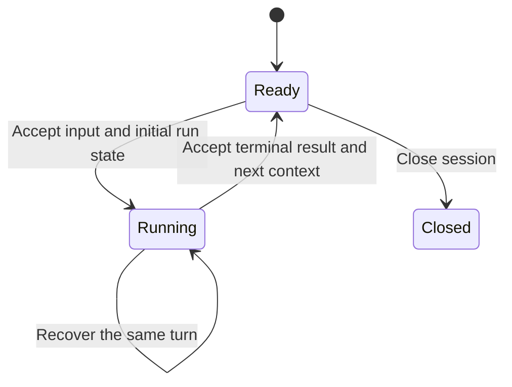

# Multi-turn execution and RunStateSnapshots

Status: **Requirements ready for implementation; no runtime edits authorized here**.
D143 closes the public stop decision; D142 closes the Hook set. Repository APIs were checked on
2026-11-16. Compaction, assistant-phase, and prompt-caching documentation was checked on 2026-11-09.
The owner decides which designs and interfaces become **Locked**. The owner selected one run for
the complete conversation as the main direction on 2026-11-09. The registers below distinguish
approved behavior and APIs from historical drafts. This update records requirements only.
The proposed additions do not exist in Gent yet; current API excerpts are labelled separately.

**Status rules.** Use these labels throughout review:

| Label | Meaning |
| --- | --- |
| Verified fact | Observed current code behavior, test result, or cited provider rule |
| Requested requirement | A goal or constraint stated by the owner |
| Owner direction | An explicit owner preference, with its stated condition for review |
| Draft | An assistant proposal that the owner has not approved |
| Locked | A choice explicitly approved by the owner, with the approval recorded here |
| Open | A design question that needs a choice before implementation |

An implementation recommendation, code example, or required check in a draft section is part of
that proposal. It is not approval to implement that interface. Discussion, silence, and a request
to save this file do not lock a decision. Only the owner can move a decision to **Locked**.

**Requested requirements.** Load serialized accepted state and apply only later batches. Support
new user replies after an agent answer across all Gent providers. Use clear, maintainable library
interfaces. Follow the repository's ownership, recovery, stats, and verification rules. Keep this
record in `req-multi-turn.md`, and separate draft interfaces from owner-approved decisions.
Compare all proposed APIs with current APIs and explain their tradeoffs before approval.

**Owner direction D05, 2026-11-09.** Use one agent run for the complete conversation. Keep the
original prompt, prior loop history, tool calls, available reasoning records, and compacted
summaries within that run. The owner asked us to pursue this unless evidence shows that it is
extremely difficult. Large histories make serialized state and bounded tail replay a central
requirement. This direction does not require one live process or one unbounded model request.
The earlier session-with-one-run-per-turn recommendation is superseded. Its API sketches remain
below as review history, not as the current recommendation.

**Locked API decisions, 2026-11-09.** The owner approved AssistantMessageKind and all three shown
constants (D21/I16), then approved UserMessageRetentionStrategy.Retain with pointers to its input
and result structs (I17). The exact declarations are marked Locked below. Field placement for the
assistant kind and the input/result struct layouts remain open. Approval does not authorize code.

**Approval record, 2026-11-09.** The four response annotations approve these separate scopes:

| Selection | Owner approval | Locked scope |
| --- | --- | --- |
| AssistantMessageKind declaration | “Okay then let's lock this in” | Type and three constants |
| Boundary truncation default | “Let's lock this decision in” | Default retention behavior |
| Retain interface | “lock this in with updates” | Pointer input/result signature |
| Retention requirements and timing | “Agreed, lock this in” | Required data and shared trigger |

The third approval also states “prefer pointer to structs in general for all interfaces.” D25
records that interface convention. No adjacent NewTurn, RunStateSnapshot, result, or lifetime API is
approved by these selections.

**Original approval D30, 2026-11-11; capture method superseded by D40.** The owner approved the
single-state proposal with “Okay agreed, please lock this in to the draft.” Use one public RunState
struct for recoverable execution data, RunStateSnapshot capture, serialization, and decoding.
RunView contains the full accepted events and history for inspection and export. RunState retains
the working context and any earlier evidence still required for recovery. These roles are locked.

**Reaffirmed role distinction, 2026-11-13.** A RunStateSnapshot is a captured RunState, or its
encoded form in storage. RunView is the full history/archive view. These definitions are already
Locked; calling the unimplemented design "proposed" does not reopen them. Only the remaining field
layouts, encoding details, and unapproved APIs are Draft. Do not introduce another public
RunStateSnapshot wrapper.

RunStateSnapshot capture produces a stable RunState at a complete accepted batch boundary. Persist
its encoded form, decode it back into RunState, apply later batches, then restore execution. Run
identity and the accepted cursor belong to RunState. The serialization format handles versioning and
integrity. The public SavedRunState and RunSnapshot wrapper proposals are superseded.

The following capture signature was originally approved. D40 removes this public method:

```go
func (ctx *ExecutionContext) Snapshot() (*RunState, error)
```

The earlier wrappers separated storage metadata from runtime data. A stable captured value can
use the same RunState type, which removes the extra public representations and their conversions.
Exact RunState fields and the encoded format remain Draft. D78 locks private typed groups and
ownership; D79 locks the typed encoder. D46 approves the shown decode/replay methods and used result
surface. The single-state roles and stable capture requirement stay Locked.
D40 defines capture through Recorder.Save and replaces public ExecutionContext.Snapshot.

**Latest execution direction, 2026-11-10.** NewTurn starts the agent immediately after saving the
new input. Match fresh execution's task input, typed return, recorder, event, and subscription
contracts. A separate public admission call is not part of the normal flow. The owner described
the normal use case as restoring saved run state, submitting another task, and executing it with
the same facilities as a fresh task. The earlier admission-only recommendation is superseded.
D35 locks the execution signatures; D67 removes Start and uses NewTurn for every user task.
This direction does not authorize implementation.

**Locked public restoration API D31, 2026-11-12.** The owner approved the recommendation to expose
Runner.Restore as the public restore API and keep the shared restoration mechanism internal:
“Yes, please lock this recommendation in.” The proposed public lower-level RestoreExecutionContext
entry point is superseded. Its current code remains relevant as the baseline, not the target API.
Runner.Resume can use the same internal preparation before continuing the accepted turn.

This locks the public entry point and the internal restoration boundary. D39 later locks the
parameters and the used result fields. Package layout must let Runner use
the internal mechanism; merely making the current gent function unexported cannot cross the package
boundary. The package arrangement is an implementation decision that still needs review.

**Locked extension scope D32, 2026-11-12.** The owner stated: “Gent doesn't support replacing the
executor - this is out of scope.” Gent supports application-defined agent loops through Loop[T]
and executes them with the standard Runner[T]. Supporting a custom loop does not require a custom
executor or a public low-level restore function. Do not add executor replacement as an extension
contract for this work. Current references to custom executors must not expand the agreed scope.

These original approvals did not settle a replacement for RestoreBindings. D37 and D39 now approve
shared Runner configuration and restoration without a RestoreBindings argument. Current Gent still
uses that type. These approvals do not authorize implementation.

**Locked configuration lifetime D33, 2026-11-12.** The owner approved: "Runner configuration is
fixed while executions use it." Configure a Runner before use. Do not change its configuration
while an execution uses it. This locks the lifetime rule, not the proposed Config fields or package.
It does not require later processes to restore the same configuration. D34 describes that separate
requirement. Service objects can manage their own connections or caches under their own contracts.

**Locked evolution requirement D34, 2026-11-12.** The owner approved recovery and continuation
with updated agent code and configuration wherever saved state remains usable. Do not require
applications to keep a registry of Runner versions for saved runs. Preserve accepted evidence and
counters; allow changes to tools, limits, and steering messages. Require migration or an explicit
result only when saved data or provider state cannot be used. This principle is also recorded in
AGENTS.md. The later "Yes, agreed" approves the distinction between accepted facts and policies for
future work, including the limits, guidance, catalog, provider, and data cases below. Exact checks,
migration APIs and policy transition events remain Draft. Reopening a limit-ended turn remains Open.

This replaces the earlier recommendation that saved effective settings must always govern future
execution. Saved settings describe prior execution; they do not require identical future settings.
D33 still applies: create a newly configured Runner when settings change, then restore with it.

**Approval record D35-D45, 2026-11-12.** The owner approved the following scopes in the later
response annotations. A lock approves the design; it does not authorize implementation here.

| Selection | Decision | Approved scope |
| --- | --- | --- |
| Start, Continue, NewTurn; fresh results | D35 | Exact signatures and ordinary typed results |
| ctx and execCtx names | D36 | Repository-wide naming for the two context types |
| Shared Config; setup literal | D37 | gent.Config, accessor, constructor, shown shared fields |
| Loop-specific supervisor settings | D38 | Keep algorithm configuration on the Loop |
| Context preparation; restore and resume/next turn | D39 | Preparation APIs and caller flows |
| Lazy RunStateSnapshot capture and transfer | D40 | Recorder callback; no public capture method |
| LoopData with CheckpointState | D41 | Require the existing persistence contract |
| Capture at controlled boundaries | D42 | Capture custom and built-in state together |
| Run-scoped versus turn-scoped fields | D43 | Preserve run fields; reset declared turn fields |
| Simple Quick Start examples | D44 | Overhaul teaching style around focused snippets |
| Concurrent reuse if simple and reliable | D45 | Conditional direction, not a blanket guarantee |

**Locked execution API D35, revised by D67.** The original approval covered Start, Continue, and
NewTurn. D67 removes Start and makes NewTurn handle the first task and later tasks. NewTurn takes
ExecutionContext and Task pointers and returns (T, *ExecutionResult, error). Continue takes only
ExecutionContext and returns the same tuple. The approved caller checks the result before using T.
The existing TerminationSuccess result check remains the example's success check; new result fields
remain under review except ExecutionResult.Status and its cannot-start contract, locked by D68/D69.

**Locked naming D36.** Use ctx for context.Context and execCtx for gent.ExecutionContext as the
default names for parameters, receivers, locals, and examples. Use role-specific names when a scope
has multiple contexts. Do not introduce a public worker abstraction to explain a
context parameter. Keep worker lease where it names actual execution ownership. The rename is
implementation work.

**Locked configuration API D37.** Place common configuration in gent.Config. Expose the read-only
reference through ExecutionContext.Config() *Config. Keep Loop.Next's signature unchanged. Construct
the Runner with NewRunner(loop, *gent.Config). The approved setup fields are ToolChain, Recorder,
Observers, Codecs, CompactionTrigger, CompactionStrategy, and SteeringMessages. Defaults remain
Draft, along with optionality and fields not shown in the setup. No RestoreBindings is required.
D55 later replaces the separate Observers field with Runner-configured Subscribers and Hooks.
Their exact field and method declarations remain under review.

**Later configuration approval D114.** F06 now defines the Locked complete Config shape and
defaults. Nil and empty Limits both select no local rules; DefaultLimits() is an explicit preset.
The original D37 approval above remains the record of its earlier, narrower scope.

**Locked configuration boundary D38.** Keep loop-specific configuration on the configured Loop.
For example, a custom supervisor loop owns its supervisor model, prompts, retry policy, and checks.
Shared configuration must not absorb these settings merely to reduce constructor arguments. If a
setting's ownership is unclear, report it to the owner before moving it. The current review found
ReAct model/call settings, output, format, repetition handling, and response-length handling on the
Loop, outside the shared Config. Keep that separation. Shared SteeringMessages contains
common tool, recovery, and media guidance; it does not contain the ReAct repetition/length messages.

**Locked preparation and caller flows D39.** The owner approved NewExecutionContext(ctx, name), its
(*ExecutionContext, error) return, and caller cleanup through Release. The owner also approved
Restore(ctx, *RunState) with (*RestoreResult, error), the RestoreReady status check, and the Status,
Context, and Reason fields used by the caller. Other restore statuses remain Draft; D78 locks the
ownership rules. Restore prepares resources without executing. Continue resumes an interrupted turn,
or NewTurn submits a new task on idle state under D133. A completed turn is not permanent
conversation closure. loadRunState remains an application helper, not a Gent API. D55 moves
subscription registration into Runner configuration. D61 places recovery orchestration inside
Continue before Loop.Next. Restore still only reconstructs state and prepares resources.

**Locked save-time capture D40.** The owner approved Recorder.Save with the RunStateSnapshot
callback and the four capture/publication rules below. The owner also directed that same-process
state transfer must use a Recorder. Remove the public ExecutionContext.Snapshot proposal. D30's
single RunState, RunView, and stable-capture roles remain Locked. Capture only through the callback
while Save is active. It returns the prepared state through the supplied batch, including required
recovery data. Publish that state only with or after acceptance of its batch. Retain a stable
captured value for asynchronous serialization; never retain the callback itself.

**Lazy capture explicitly reaffirmed, 2026-11-13.** The owner approved avoiding full
RunStateSnapshot work at savepoints where the recorder does not request it. Keep the
RunStateSnapshot callback lazy. Prepare the consistent batch and source state first, but create the
stable full RunStateSnapshot only when the callback is invoked. Required batch/custom-state capture
still occurs even when no RunStateSnapshot is requested. This clarifies the Locked D40 behavior;
RunStateSnapshot frequency and the capture implementation stay open.

**Capture clarification, 2026-11-13.** Fix the batch and its source state before Save. Create the
full RunStateSnapshot lazily in the callback. Use the fixed state, including the batch's custom-data
payload and resume position, without reading later mutable execution fields. The callback's cursor
must equal the end of the supplied batch. This keeps both representations in sync without requiring
a full RunStateSnapshot allocation or encoding on every save. Eager full RunStateSnapshot creation
is not a new requirement and does not replace the approved callback.

**RunStateSnapshot cost clarification, 2026-11-13.** RunStateSnapshot cost depends on the retained
state size and representation. Each savepoint already needs consistent batch data, including custom
LoopData and the resume position. The lazy callback avoids the additional full RunStateSnapshot work
when storage does not request one; it does not remove the required custom-state capture from the
batch.

Creating a stable RunState value can require copying retained data. Reusing immutable values can
reduce that cost under an explicit ownership contract. Encoding the whole state and writing its
bytes add CPU, allocation, and storage work. Large custom data, retained messages, or media can make
this significant. It need not require another database roundtrip when the application stores the
batch and optional RunStateSnapshot together. Exact cost and defaults remain unmeasured for the new
design.

Keep capture proportional to retained execution state; do not replay all batches or copy the full
RunView archive to create each RunStateSnapshot. The current Export method copies Activity, the
batch index, History, Runtime, and Checkpoint. Its cost is not a measurement of the proposed compact
RunState. The older full-view measurements below concern replay/decode, not RunStateSnapshot
creation latency. During implementation, measure capture, encoding, bytes written, allocations, and
save delay separately. RunStateSnapshot frequency remains application policy; no frequency or
capture implementation is locked by this cost discussion. D78 later locks state groups and
ownership; the exact RunState layout and capture implementation details still need interface review.

A nonpersistent execution can still run without a Recorder; it has no supported state-transfer path.
A Recorder used only for same-process transfer can retain accepted batches/state in memory. This
does not provide crash durability. Durable recovery still requires persistent storage. This storage
distinction belongs in Recorder documentation. Keep the persistent-save acceptance contract.
The same-process flow is Recorder capture, Restore with a fresh Go context, then NewTurn. Capture
the terminal save, or retain enough later batches to reach it, before starting the next turn.

**Locked custom state D41-D43.** Require LoopData to implement CheckpointState, as shown below.
BasicLoopData must implement the default contract. Capture custom state at the same controlled
boundary as built-in state. Preserve run-scoped fields on NewTurn. Reset only declared turn-scoped
fields. D47 later approves GetTask removal. Mutation APIs and the turn-field declaration/reset API
remain Draft. D76 requires backward-compatible custom-data evolution through LoopData documentation.

**Locked Quick Start direction D44.** The owner requested a complete Quick Start overhaul using
the short-example style from this review. Teach the interface through small, focused snippets that
show setup, input, calls, and results. A lesson does not need to be a complete working Go file. Keep
application infrastructure outside the main explanation. Show required error handling and resource
cleanup where they explain the interface. Name and describe any application helper; do not present
an invented helper as a library API. Complete programs can remain optional reference material.

The implementation should cover shared setup, NewTurn, live subscriptions, save/capture, load plus
tail replay, Restore/Continue, and Restore/NewTurn as separate short examples. Validate snippets
with small test wrappers where needed; do not make readers study those wrappers. This locks the
rewrite direction. It does not authorize rewriting the current guide during this design review.

**Owner direction D45: conditional concurrent reuse.** Keep the Runner free of per-run progress.
Pursue concurrent use with distinct contexts if it is simple and reliable. Do not add a complex
worker pool, implicit current context, or broad execution lock to make arbitrary custom dependencies
safe. Shared loops and services still need their own concurrency contracts. If reliable concurrent
reuse needs substantial extra machinery, report that tradeoff before making it a required feature.

**Locked loading flow D46, 2026-11-12.** The owner approved the RunStateSnapshot-plus-tail loading
example with "Yes agreed, lock this in" and selected it for the Quick Start rewrite. Select one
accepted head, load a RunStateSnapshot at or before it, decode RunState, check identity and cursor,
and apply only later complete batches through that head. Check the final cursor before Restore.
Without a RunStateSnapshot, replay the whole accepted log into an empty state. Read large tails in
pages when needed.

The approval includes the shown data API: CodecRegistry.UnmarshalRunState, RunState.RunId,
RunState.LastAppliedEventSequenceNumber under D66, and RunState.Apply, with the signatures below.
It includes the used result fields and RunStateReady, ApplyApplied, and ApplyDuplicate identifiers.
Other load/replay statuses and the encoded format remain Draft. D78 locks ownership; D79 locks the
marshal API and Gent's encoding/validation responsibility.
fetchAcceptedHead, fetchRunStateSnapshot, and fetchBatches remain application helpers, not Gent
interfaces. Keep expected missing-data and replay outcomes explicit in a complete application
loader. The Quick Start should use these short loading examples; the implementation rewrite remains
planned.

**Locked task ownership D47, 2026-11-12.** The owner accepted removal of GetTask from LoopData.
NewTurn supplies the task; ExecutionContext owns it and supplies reads through Task(). This updates
D41's declaration to remove GetTask. D84 adds the required TurnResetter embedding alongside
CheckpointState. BasicLoopData supplies default state support and reset behavior; it does not need
a second task source to satisfy the interface.

**Locked terminal custom state D48, 2026-11-13.** The owner approved restoration of LoopData from
terminal state so NewTurn can continue with the application's custom progress. Restore must create
and restore the custom data even when the saved run has an accepted terminal outcome. Do not replace
saved custom data with empty default data. Preserve run-scoped fields; NewTurn resets only declared
turn-scoped fields under D43. Restore must not rerun the loop, tools, or accepted output processing.
The custom-data factory is Locked by D83. D76 replaces the custom migration-interface proposal with
backward-compatible evolution guidance. Current terminal restoration skips extension restoration;
implementation must remove that restriction for this new lifecycle.
D62 reaffirms that LoopData is the Loop's saved state and must continue across completed turns.

**Locked interface design rule D49, 2026-11-13.** The owner requested simple, intuitive, elegant
interfaces that are quick to understand. AGENTS.md now contains the owner's three complexity rules:
minimize the interface surface without losing correct semantics, provide one way to achieve the
same goal, and expose customization through one interface with good defaults. This locks the design
rule. It does not approve the event consolidation proposal or remove previously approved APIs.

**Original integration approval D50, revised by D55/D58.** The owner approved three integration
points: Recorder.Save for persistence and RunStateSnapshots, one execution subscription for
responsive UI, and configured read-only observers for metrics, logs, and troubleshooting. Replace
the separate live event and chunk subscription paths with one interface. Keep the approved
Recorder.Save RunStateSnapshot callback. Exact subscription names, signatures, projections, filters,
and observer error handling remain Draft. The examples below illustrate the direction without
locking those details. D55/D58 now replace the separate UI subscription and observer interfaces with
one Subscriber.

**Owner terminology D51, 2026-11-13.** Separate event subscribers from Hooks. Event subscribers
consume facts without changing model/tool requests or loop decisions. Hooks explicitly customize
those requests or decisions before their effective values are frozen and saved. Use Hooks naming
for that capability; do not retain a mixed mutable/observational Config.Events abstraction. The
two Hook callback fields are Locked by D82; the remaining stages and configuration fields stay
Draft. Recorder is a required persistence boundary:
it does not edit execution inputs, but its failure must stop dependent work. This timing contract
must not be lost by treating it as an optional, asynchronous event subscriber.

**Locked recovery guarantee D52, reaffirmed 2026-11-13.** Every accepted savepoint must leave the
accumulated saved run recoverable for continuation under the supported execution contract. A save
must not be merely a diagnostic log that Restore cannot use. This applies to the complete accepted
prefix or a valid RunState plus its later batches, not to one delta batch in isolation. Terminal
state must restore its outcome and custom data for the applicable NewTurn lifecycle. Continuation
can retry an incomplete model call or use explicit tool-recovery results; it does not require saving
a provider stream or Go stack. The exact enforcement design remains Draft. Current gaps are listed
in the save audit below. This requirement does not approve fresh LoopData capture at arbitrary code
positions, nor require a standalone full RunStateSnapshot in every batch.

**Locked state equivalence D53, reaffirmed 2026-11-13.** The owner requires this save contract: Gent
calls Recorder.Save and blocks dependent loop work until acceptance. Each accepted save represents
one complete logical execution state, including custom LoopData and framework continuation state.
Replaying all accepted batches and loading a RunStateSnapshot plus its accepted tail must
reconstruct that same state. This holds without requesting a RunStateSnapshot. Capture and
enforcement mechanisms remain Draft. Current progress saves do not satisfy this stronger rule for
arbitrary custom-data mutations. D72 preserves this data-equivalence rule while removing mandatory
custom control steps.

**Locked savepoints D54, 2026-11-13.** The owner approved initial execution or NewTurn, before and
after iteration, after compaction, before and after each managed tool call, and terminal finish.
Each savepoint includes the state listed in the table below. Treat terminal finish as one category.
This replaces the current schedule of additional progress/model saves in the implementation plan.
Safe coalescing remains an implementation design question. D57 accepts unsaved model work; D72
defines the custom-loop restart contract. D61 adds the approved After Recovery savepoint to this
list.

**Locked integration surface D55, 2026-11-13.** Use Recorder, Subscriber, and Hooks, all configured
on the Runner. Recorder provides blocking persistence and optional RunStateSnapshot capture. One
Subscriber interface serves UI, metrics, logs, and troubleshooting. Hooks explicitly change requests
or execution behavior. Gent supplies frozen typed event payloads and owns decoding; subscribers do
not need a CodecRegistry argument. This supersedes the separate Config.Observers and context-level
subscription registration in D37/D39/D50. It does not change Recorder.Save. Exact Subscriber/Hook
types, method signatures, registration fields, and failure policies were left Draft by this
approval. D80 now locks Subscriber.OnEvent and its delivery policy; D82 locks the shown Hook
callback fields.

**Original resume-position requirement D56, revised by D72.** The earlier approval required custom
control state that prevented repeated mutations when Next was entered again. D72 removes that
requirement: custom loops do not need a step enum or automatic continuation within Go code. Gent
restores accepted framework state and custom data, then enters Loop.Next from its beginning after
required managed recovery. Custom authors own restart safety in their own code. Gent retains its
internal recovery bookkeeping; the reference loop's saved frame and tool plan remain valid.

**Locked model-work tradeoff D57, 2026-11-13.** Accept repetition of unsaved model work to reduce
storage roundtrips. Do not add a model-response savepoint by default. Preserve accepted counters
and enforce limits against observed usage during execution; save frequency must not control limit
checks. Replay must not count saved usage again. Document that interruption can leave provider token
charges absent from Gent's recovered counters, including usage reported after the last savepoint.
Retries can add further charges. Counters and token limits cannot guarantee an exact billing total
or a hard provider-spend cap across interruptions when usage was never observed or accepted.

**Locked Subscriber timing D58, 2026-11-13.** Use one Subscriber interface with Live and Accepted
delivery settings. Live includes provisional updates. Accepted delivers events after their save
succeeds. Keep the distinction explicit, and withhold accepted final output until its save succeeds.
Historical replay is distinct from future-event delivery. This approves timing semantics and the
shared interface, not an enum declaration, payload layout, filter defaults, or failure policy.

**Locked savepoint terminology D59, 2026-11-13.** Use savepoint for a durable execution boundary
throughout repository documentation in the implementation phase. Use SaveBatch for persisted changes
and RunStateSnapshot for a captured serializable RunState. Do not describe progress saves as a
second recovery contract. Historical/current-code names in this design remain evidence. Specific
public type and method renames still need interface review; do not silently rename locked
declarations.

**Locked custom-loop documentation D60, 2026-11-13.** Document the managed operations required for
recoverable custom loops in their Go API comments. Tool execution must use the managed plan and
execution path, currently PrepareCalls and ExecuteNext. Direct Tool.Call or other external calls
bypass that guarantee; this is an accepted risk that documentation must state. Add a Quick Start
lesson for custom loops during implementation. Use small examples for LoopData serialization and
restart behavior, managed model/tools, history, savepoints, and Restore/Continue/NewTurn. Explain
that Gent calls Recorder.Save. Show a crash between a tool effect and its saved result and the
resulting recovery report. The guide must explain which code users supply and which work Gent
performs.

**Locked recovery orchestration D61, 2026-11-13; custom-loop scope revised by D72.** The owner
approved Gent-owned recovery followed by the Loop's normal result-processing path. Restore only
reconstructs state and prepares resources. Continue performs required recovery preparation before
Loop.Next, reuses accepted results, checks unfinished managed calls, and prepares the recovery
results/messages and matching continuation state. Accept that state at the After Recovery savepoint
through the existing Recorder.Save before entering the Loop. No second persistence hook or public
Recover alias is needed. D72 requires no custom step interface; custom data remains serializable.

After Recovery is now an approved savepoint. Its save failure blocks Loop.Next and model calls.
Unresolved is valid accepted evidence; the savepoint means preparation is complete, not that all
external outcomes are known. Avoid an extra write when nothing changed, and combine it with the
final recovered-tool save when both describe the same complete prepared state.

An interruption after acceptance must restore those recovered messages, evidence, plan state,
accounting, custom data, and framework continuation state from batches or a RunStateSnapshot plus
tail. Continue then enters Loop.Next without repeating the accepted recovery checks, rebuilding
replies, or issuing another After Recovery save for the same state. An accepted Unresolved report
also skips that check. Use durable completion state to decide, rather than the new process/attempt
identity. Later accepted work can introduce a new unfinished operation that needs recovery.
Completion is not a permanent per-run flag. Savepoint layout, internal APIs, and the representation
of completion remain Draft. The orchestration, placement, reuse, and save contract are Locked.

**Locked LoopData state guarantee D62, 2026-11-13.** LoopData is the Agent Loop's per-run mutable
state. Each accepted savepoint must contain enough data to restore all of that logical state through
its required CheckpointState contract, including application-defined fields. RunStateSnapshot
capture is optional acceleration and must not be the only copy of custom state. Capture the matching
framework continuation state with the data. Preserve any application-defined control fields as
ordinary custom data; D72 does not require such fields. Apply this guarantee to active, interrupted,
recovered, and terminal states.

Restore must reconstruct the correct custom data and all saved values even when the prior turn
finished. A new process can allocate a new Go instance; it must restore the saved logical values.
NewTurn continues with that restored instance. It must not replace it with BasicLoopData, rerun
initial-task data initialization, or clear custom fields merely because the previous turn ended.
Restore itself performs no turn reset. Under D43, only an explicitly declared turn-scoped reset may
change specified custom fields during NewTurn; all other custom values remain. The new task and
framework lifecycle changes do not authorize discarding the loop's existing state.

The saved state is authoritative evidence. Missing custom bindings or incompatible data must produce
an explicit load/restore outcome, never silent fallback to empty state. D34 still permits declared
migration and evolved runtime configuration; a migration must preserve or explicitly transform the
custom state. Clients, Go contexts, and pointers are runtime resources, not saved logical values.
Custom serializers must include all mutable loop state; embedding BasicLoopData does not discover
new application fields. D83/D84 lock the factory and turn-reset declarations. D76 settles the
custom-data evolution guidance and removes the proposed LoopData migration interface from scope.

**Locked comprehensive savepoint verification D63, 2026-11-13.** The owner requires extensive
implementation tests for the promise that accepted savepoints restore correctly and support the
applicable Continue or NewTurn path. Cover every approved savepoint, both replay routes, custom
LoopData, terminal restoration, many turns, and repeated interruptions. Include the interruption
after After Recovery acceptance and before Loop.Next. The coverage matrix below is required
implementation work, not an optional follow-up or authorization to write implementation code now.
These approvals also lock D52/D53 as behavioral requirements; their implementation remains pending.

**Locked terminology D64, 2026-11-14.** The owner approved RunStateSnapshot as the term for a
captured serializable RunState or its encoded storage form, in code, discussion, and documentation.
This names the captured value; it does not add a public RunStateSnapshot type. D30 still uses one
public RunState. D40 still permits capture only through Recorder.Save, with no public context
capture method. The callback parameter is now captureRunStateSnapshot. Application examples use
fetchRunStateSnapshot, WantRunStateSnapshot, and wantRunStateSnapshot where those names apply.

The owner also approved the required related renames. Update implementation identifiers, comments,
tests, and documentation when implementation is authorized. This design review updates this file
and AGENTS.md only. Preserve exact current-code and historical API names when citing evidence, such
as the removed ExecutionContext.Snapshot proposal, HistorySnapshot, and trace.Snapshot. Third-party
source checkouts and full RunView captures are different concepts. This terminology change does not
alter their types or relabel old performance measurements as measurements of RunStateSnapshot.

**Locked user recovery invariant D65, 2026-11-14.** The owner approved adding the recovery promise
to the Gent design principles in AGENTS.md. When an application correctly stores complete SaveBatch
values through Recorder.Save and follows the documented LoopData and managed-execution contracts,
Gent must restore the same logical agent state at each accepted savepoint. The application can then
Continue an unfinished turn or use NewTurn for new input on idle restored state. Full replay and a
RunStateSnapshot plus its accepted tail must produce the same state, including custom data and the
matching framework continuation state. This is an implementation and test invariant, extending the
recorded D52/D53/D62/D63 rules.

The guarantee concerns saved logical state and the applicable continuation path. It does not mean
identical future model output, a serialized Go stack, or rollback of external effects. Unfinished
external operations use the managed recovery contract. Accepted results and completed recovery
preparation must be reused. D34 still permits supported data migration and changed future policies.
D72 clarifies that arbitrary custom Next code restarts from its entry point on restored data. The
custom author owns the correctness of repeated local code and any new actions it requests.

**Locked sequence naming D66, 2026-11-16.** The owner approved the proposed naming family and
required its consistent use throughout the repository. This updates the cursor name approved under
D46. Accepted event positions form one consecutive sequence per RunId. The first event is 1; an
empty accepted cursor is 0. BatchId remains a digest, not a batch
ordinal. Live positions are provisional until saved and can be reused after an interrupted attempt.

| Current-code name or earlier approved name | Locked replacement |
| --- | --- |
| RecordedEvent.EventNumber | RecordedEvent.EventSequenceNumber |
| BaseEvent.EventNumber | BaseEvent.EventSequenceNumber |
| Checkpoint.EventNumber | Checkpoint.EventSequenceNumber |
| SaveBatch.PreviousEventNumber | SaveBatch.PreviousEventSequenceNumber |
| RunView.LastAppliedEventNumber | RunView.LastAppliedEventSequenceNumber |
| RunState.LastAppliedEventNumber() | RunState.LastAppliedEventSequenceNumber() |

Apply this family to all code, field and method names, wire names, trace cursors, tests, examples,
documentation, in-code documentation, and Quick Start source and generated material. Do not leave
different names for the same concept across those surfaces. Update generators and templates so
regeneration preserves the approved names. Include a repository-wide search and generated-output
check in implementation verification. Do not add compatibility aliases for the development API.

The longer names state the ordering contract; EventNumber alone can mean a label. Active target
declarations and caller examples below use the approved names. Keep old spellings only in clearly
labelled current-code excerpts, historical proposals, or rename comparisons. This approval locks
the rename work; this design turn does not perform the runtime or wire-format refactor. D76 still
excludes a custom LoopData migration interface.

**Locked execution simplification D67, revised by D133.** The owner approved removing Start and
using NewTurn for the first and later tasks. Keep its approved parameters and synchronous return
of (T, *ExecutionResult, error). NewExecutionContext prepares a fresh context; Restore prepares
saved state. Both use NewTurn for explicit new input and save admission before dependent execution.

D133 also permits NewTurn on an idle unfinished turn. Prepare required recovery, then accept the
previous task's closure and new-task admission/reset together. Keep RunId and history; allocate a
new TurnId and reset only approved turn fields. No final answer from the prior task is required.
An active attempt still returns Busy. Continue resumes the same accepted task without a new prompt
or reset. This revises D35/D47's task-entry name and the old completed-turn-only restriction.
Do not add a public close-before-NewTurn step, queue, or separate admission method.

**Locked execution status D68, revised by D111/D133.** Use the named string type ExecutionStatus
with ExecutionFinished = "finished", ExecutionPaused = "paused", ExecutionBusy = "busy", and
ExecutionNoActiveTurn = "no_active_turn". Finished means an accepted completed-turn result; Paused
means a saved unfinished turn. Busy prevents overlapping execution on one context. NoActiveTurn
applies to Continue when there is no unfinished task. D133 removes the former unfinished-turn
rejection from NewTurn. AlreadyStarted remains removed with Start.

D71/D74 require GetLastTurnResult alongside NoActiveTurn. The current declaration is in D111 below,
with D133's admission update applied. Other public fields follow their separate approvals.

**Locked cannot-start contract D69, revised by D133.** Busy and NoActiveTurn return zero T and nil
error. They do not accept input, overwrite saved output, or release another call's resources. Their
call result does not replace accepted execution state. Unexpected operation failures still use
error. A NewTurn that closes an unfinished turn is an accepted transition under D133, not a
cannot-start result. Cancellation, storage, limits, and handled tool/output contracts stay separate.

**Locked enum convention D70, 2026-11-16.** The owner requires each enum to have its own named
string type, with its allowed values declared as typed const values. Each constant must have a Go
documentation comment immediately above it that explains its meaning. Start the comment with the
constant name and state when it applies. This rule is added to the Gent design principles in
AGENTS.md. The ExecutionStatus declaration below follows it. D75 requires a repository-wide review
and conversion as the final implementation step. This design review does not perform that refactor.

**Locked conditional approval D71, 2026-11-16.** The owner approved NoActiveTurn for Continue on a
completed turn only if Gent also provides GetLastTurnResult. The getter returns the last completed
turn's result and returns nil when no such result is available. The owner accepts retaining that
result in RunState. Treat the getter and the changed Continue behavior as one feature; do not remove
terminal result replay without its replacement read path.

This approval originally covered the getter name, purpose, absence, and retained-state requirement.
D74 now locks the receiver, typed return tuple, and the accepted-result behavior shown below. A nil
ExecutionResult pointer means no last result; T can independently be a valid nil value. The exact
stored layout remains Draft. These approvals do not authorize runtime implementation.

**Locked custom-loop restart scope D72, 2026-11-16.** The owner accepted this contract: Gent
restores accepted framework state and custom LoopData. Continue completes the required managed
recovery, then enters Loop.Next from its beginning. Custom loop authors are responsible for making
their own code safe to restart. Gent does not require a step enum or provide automatic continuation
within arbitrary custom Go code. This supersedes D56's mandatory custom resume-position requirement
and the earlier recommendation to introduce required custom steps or a workflow abstraction.

The owner explicitly accepts duplicated work during continuation and different model responses when
a model call repeats. The reference loop's existing recovery architecture is sufficient for this
direction; no additional public step mechanism is required. Gent retains internal framework and
reference-loop bookkeeping, including accepted history, counters, operation identities, saved tool
plans, and accepted recovery preparation. Reuse accepted results for the same managed operation; do
not treat permission to repeat computation as permission to replay a completed tool effect. Unsaved
model work can repeat under D57. Accepted model/tool evidence still remains saved evidence.

Full batch replay and RunStateSnapshot-plus-tail replay must restore the same accepted state under
D53/D62/D65. That guarantee does not promise identical subsequent custom control flow or model
output. New calls with new identities are new operations, even if their business purpose matches an
earlier call. Custom authors can use ordinary state checks, repeat-safe operations, or optional
saved steps when needed. The reference loop owns its internal recovery behavior without requiring
applications to implement those steps. After Recovery preparation and reuse under D61 remain Locked.

This scope applies to continuation after restoration; Restore itself still only reconstructs state
and prepares resources. It does not execute custom work or call a model. Existing gaps against the
new savepoint/multi-turn design and D63's implementation tests remain separate work. Approval of
this simpler contract does not certify that every proposed API or savepoint is already implemented.

**Locked callback retry caveat D73, 2026-11-16.** The owner accepted that custom Output.Process,
validators, and hooks can repeat after interruption and requested this caveat in the reference
loop's code documentation. An external write inside Output.Process can complete before the terminal
output is durably accepted. A resumed attempt can call Process again and repeat that write. Managed
tool recovery does not automatically cover external effects inside such callbacks. Keep them safe to
repeat or use a managed tool for an action that needs its recovery contract. Once terminal output is
durably accepted, restore reuses it without calling Output.Process again.

This caveat is documented in [agents/react/doc.go](agents/react/doc.go). It changes documentation,
not callback signatures or runtime behavior. Ordinary built-in answer parsing and validation do not
require a new application step interface. D73 does not weaken the accepted-output publication
barrier or authorize automatic repetition of accepted managed tool actions.

**Locked last-turn getter D74, 2026-11-16.** The owner approved the proposed GetLastTurnResult
design with "Okay, please lock this in." Use Runner[T].GetLastTurnResult(*ExecutionContext) with (T,
*ExecutionResult, error). Lock the exact declaration and return table shown below. No completed
result returns zero T, nil result, and nil error. A completed success returns its saved typed value
and result. A completed non-success returns zero T and its saved result, with nil getter error.
Unexpected read/decode failures use error. An old turn's failure remains part of its saved result.

Retain the last accepted completed result in RunState and reconstruct it through SaveBatch replay
with or without a RunStateSnapshot. Replace it only with an accepted completed-turn result. A normal
next-turn start, interruption, or compaction preserves it. Under D133, closing an unfinished turn to
admit new input replaces it with that turn's canceled result in the same acceptance. Include
unsuccessful completed outcomes rather than returning an older success. Keep one last result in
working state and older results in the archive. Retain associated turn identity; its field name
remains Draft.

The getter performs no model/tool calls, output processing, execution events, or saves. It must work
after Continue returns and must not hide invalid data or unsupported codecs as absence. The getter
signature, typed-value behavior, nil semantics, and these retained-result rules are Locked. Private
field layouts and exact codec checks are implementation details. D111/D133/D143 settle the
lifecycle: Stop and limits pause; NewTurn can close/replace an unfinished task.

**Locked final enum review D75, 2026-11-16.** The owner requires a final implementation step to
review all Gent-owned code in the repository and apply D70 to every enum. This includes existing
code, not only declarations added by this feature. Review public and internal packages, tests and
test helpers, examples, auxiliary modules and tooling, and generated code sources. Update generators
and templates when needed so regeneration preserves the rule. Review documentation code examples as
well. The required step appears after the historical implementation outline below and applies to the
final approved implementation plan. Complete it before final verification. This approval adds
required implementation work; it does not request the repository refactor in this design turn.

**Locked LoopData evolution documentation D76, 2026-11-16.** The owner approved documenting
backward-compatible evolution for custom LoopData implementations at the LoopData interface in
[agent.go](agent.go), and explicitly requested that this approval be recorded in this requirements
document. This is required implementation documentation; this review does not edit the Go source.

The documentation must guide custom loop authors to evolve saved data through compatible additions.
Preserve existing saved field identities, types, units, and meanings. Add a new field for a changed
representation or meaning, and deprecate the old field while retaining the data and reader behavior
that older saved runs still need. New fields must support older saves through valid defaults or
existing saved information. Distinguish absent data from an explicit zero value when that difference
matters. Do not silently reset accepted progress when a new field is absent.

If an author uses saved steps or enum values, preserve their identities and meanings, and add new
values for new behavior. This guidance does not require a step enum; D72's custom-loop restart scope
remains unchanged. Keep saved type identities and compatibility versions stable for compatible
additions. Document the chosen codec's naming rules; current reflective encoding uses Go field
names, so a JSON tag alone does not preserve a renamed field.

Do not add the proposed CheckpointStateMigrator interface or its migration result types for
LoopData. Ordinary custom-state restoration remains responsible for reading compatible older data.
Preserve explicit invalid/unsupported outcomes when data cannot be used; never substitute empty
state. The reason is to keep the extension surface small and guide authors toward compatible
saved-data changes without another conversion protocol to implement and maintain.

This requirement concerns custom LoopData's persisted contract, including its serializers and the
code that uses restored values. It does not require public Gent Go APIs to remain backward
compatible during development, settle framework-format or provider compatibility, or promise that
older code can read newer saves. The implementation must document this guidance directly on LoopData
rather than leave it only in this design record. D83/D84 later lock the factory and turn-reset APIs.

**Locked in-code recovery invariant D77, 2026-11-16.** The owner requested the replay equivalence
rule in the relevant Go documentation so later implementation work preserves it. The canonical rule
is documented on Recorder in [run.go](run.go), with a reference from ApplyBatch in
[run_replay.go](run_replay.go). Keep it on the RunState capture/replay APIs when those are
implemented:

```text
full batch replay == RunStateSnapshot + accepted tail == accepted logical state
```

Both paths end at the same accepted event sequence position. Include all custom data, required
history, counters, accepted results, managed operation identities, and framework continuation and
recovery evidence. A RunStateSnapshot remains optional; complete batches alone must restore that
state. D72 still governs custom Next restart behavior. The guarantee does not serialize the Go stack
or promise identical later model output. The Go comment is a design constraint for the refactor,
not a claim that the proposed APIs or all savepoint guarantees are implemented already.

**Locked RunState representation and ownership D78, 2026-11-16.** The owner approved private typed
fields for the retained state groups and the ownership table below. These groups include identity
and cursor, turn/outcome/framework continuation, active context and required history, statistics and
identity allocation, plans and recovery evidence, and versioned custom data. Retain the last
accepted completed result under D74. Custom saved steps are optional under D72. Full history remains
RunView.

Decode returns caller-owned state. Applied transfers retained batch values into that state;
duplicate or rejected Apply leaves both inputs unchanged. Ready Restore transfers ownership to
ExecutionContext; other results or errors leave the input with the caller. Encoding borrows a stable
state. Recorder capture returns an independent stable RunStateSnapshot. Do not encode concurrently
with mutation or ownership transfer. Do not add another full restore copy only for defensive safety.
The exact private field names, internal layout, and encoded representation remain Draft.

**Locked typed encoding and framework responsibility D79, 2026-11-16.** The owner approved
CodecRegistry.MarshalRunState(*RunState) ([]byte, error), paired with the already approved
UnmarshalRunState. Gent owns the encoded format, version and integrity handling, consistent state
capture, decoding, validation, and replay. Reuse the existing registry and codecs. No extra public
saved-state wrapper or separate RunStateSnapshot codec is required.

The application implements Recorder.Save and stores complete batches and optional RunStateSnapshot
bytes through Gent's encoding APIs. It does not design the framework format, walk runtime objects
to assemble a saved state, or implement its own replay validator. The application still selects its
storage and capture frequency, stores bytes with the required acceptance/ordering contract, and
loads the selected accepted tail. The approved Recorder callback remains lazy. Custom LoopData
authors still supply their required saved-field contract and custom codecs where needed; Gent cannot
infer arbitrary application state. D76 supplies the compatible-evolution guidance without migration
interfaces. Exact bytes, remaining expected result statuses, and format-version policy stay Draft.

**Locked Subscriber interface and delivery D80, 2026-11-16.** The owner approved
Subscriber.OnEvent(ctx context.Context, event *RecordedEvent) error and Runner-based registration.
Use Accepted delivery by default and Live delivery when selected. Gent supplies frozen concrete
payloads and owns decoding. Delivery is ordered and bounded. A failed consumer stops receiving and
reports its failure; its failure does not reject already accepted execution. The exact registration
fields, payload field layout, delivery enum, bounds, and stop-reporting interface remain Draft.

The owner conditions the design on support for a working streaming agentic chat server. D81 adds a
required application that demonstrates this with public interfaces. Resolve any remaining delivery,
replay, lifecycle, or stop-reporting gap before declaring that integration complete. Do not require
the UI to decode private Gent data or modify framework internals to receive events.

**Locked follow-up examples project D81, 2026-11-16.** After the multi-turn refactor is complete,
create a repository example directory with runnable examples that use the local .env configuration.
Exclude that directory and its application dependencies/assets from Gent release payloads. It must
include a streaming agentic chat UI that shows available reasoning, tool execution, and other Gent
progress, and proves that the public interfaces support that application. Use an in-memory key-value
store of encoded bytes with no disk or database persistence. The separate requirements section below
defines the user-requested scope and draft implementation/verification details. Do not build the
example application during this design review.

**Locked typed Hooks D82, 2026-11-16.** The owner approved the shown BeforeModelCall and
BeforeToolCall typed callbacks and their behavior. Hooks run synchronously before effective input
is frozen. Failure blocks the dependent action under that operation's existing failure contract.
They cannot change accepted facts. Expected tool/output conditions retain their typed result
contracts. D73 still documents callback repetition after interruption. These two fields are approved
members of Hooks, not a complete final list of mutation stages. Other stages, configuration field
details, and exact failure mappings remain Draft.

**Later Hook approval D142.** The initial Hook set is now complete with these two fields. D103
settles Hook errors, and D114 settles Config.Hooks. Keep the original D82 approval scope above as
history; do not treat it as an open request for more callbacks.

**Locked LoopData factory D83, 2026-11-16.** The owner approved Config.NewLoopData func() LoopData.
It allocates an empty data instance independently of a Task and performs no model/tool calls or
external setup. The first NewTurn supplies its Task through ExecutionContext. Restore allocates an
instance and restores its saved fields, including terminal data. Later NewTurn calls keep that
restored instance. A fresh run defaults to BasicLoopData when no factory is configured. A missing
compatible custom factory on restore must produce an explicit incompatibility, not empty fallback.

**Locked required turn reset D84, 2026-11-16.** The owner approved TurnResetter.ResetTurn() on the
condition that LoopData embeds TurnResetter. Adopt that condition. ResetTurn is required for
LoopData, not discovered as an optional interface. The approved target declaration is:

```go
// TurnResetter resets only custom fields that the LoopData author assigns to one turn.
type TurnResetter interface {
    ResetTurn()
}

// LoopData retains per-run state and declares its persistence and turn-reset contracts.
type LoopData interface {
    CheckpointState
    TurnResetter
}
```

Keep this interface limited to LoopData. Do not apply it to tools, models, subscribers, hooks, or
general checkpoint components. BasicLoopData provides the default reset; it has no application
fields to clear. A custom type must implement its own reset when it adds turn-scoped fields; an
embedded implementation cannot discover those fields. Reset changes only declared turn-scoped
custom data. It performs no external work, returns no error, and preserves run-scoped data.

NewTurn owns the turn transition and accepts the new task and reset state before dependent work.
Restore and Continue do not reset the restored data. The first-turn factory path remains D67/D83;
do not reset restored state merely to construct an execution context. Save retry must reuse the
prepared transition instead of repeatedly resetting data or admitting the task twice. Framework
turn state and limits remain separate from this custom-field method. D72 does not require a custom
Step field. These approvals change the design; runtime interfaces are not implemented in this turn.

**Locked effective system instructions D85, 2026-11-16.** The owner approved the complete
instruction-lifetime contract with "Yes, agreed, let's lock this in." Gent maintains one current
system instruction prefix outside the compactable conversation selection. Use these rules:

| Operation | Effective system instruction behavior |
| --- | --- |
| First NewTurn | Establish the initial instructions |
| Later NewTurn without replacement | Inherit the accepted instructions |
| Later NewTurn with replacement | Replace the complete effective instruction prefix |
| Continue or restore | Use the accepted saved instructions |
| Compaction | Preserve the effective instructions unchanged |
| Historical reads | Retain evidence of earlier instruction versions |

Accept the instruction replacement and the new user task together through the normal save boundary,
before dependent execution uses them. Full batch replay and a RunStateSnapshot plus its accepted
tail must recover the same effective instructions. Changing application code alone must not change
the instructions of a recovered run; the application explicitly supplies the replacement.

The earlier instructions remain historical evidence, but are no longer the active instruction
prefix. NewTurn preserves the accepted compacted context. It appends the new user task without
reinstating original messages that a previous compaction removed from the active selection.
The scope uses prefix replacement. Instructions inserted into the middle of conversation history
are deferred; this approval does not add that feature or live user steering.

This locks behavior, not Task field names, types, the representation of an omitted replacement,
or an explicit clear operation. R06's Task layout and nil-versus-empty convention remain Draft.
The instruction part of D07/I08 is now governed by D85; older conversation-wrapper proposals remain
Draft. No new public state type, submission method, or permanent conversation-close operation is
approved by this decision.

**Locked instruction-change cost documentation D86, 2026-11-16.** The owner accepts that replacement
can invalidate cached context after the changed prefix. Whether and how often to replace the prefix
is the application's decision. Gent must explain the consequence clearly in Go documentation on
the instruction input and NewTurn when implemented. Explain that a changed prefix can require the
provider to process earlier context again, increasing input cost and latency. Keep the explanation
short, concrete, and provider-dependent; do not imply a fixed extra charge or guaranteed cache hit.
This is a documentation requirement, not a new confirmation step or a restriction on replacement.

**Locked instruction responsibilities D87, 2026-11-16.** The owner approved the division with
"Accepted, please lock this in." Gent owns which instructions are current, when a replacement is
accepted, and how it is saved and restored. The adapter owns the provider representation
and whether retained native context remains usable with that representation.

This responsibility does not approve a new adapter method or the R08 result layout. The exact
incompatibility result and any provider-state conversion/reset policy remain Draft. Do not infer
permission to silently discard accepted native evidence or to substitute an appended instruction
for the approved replacement semantics. D10/D11 and R08 remain the review points for those choices.

**Later failure decision D103.** A failed model request uses error and leaves the accepted turn
recoverable. This supersedes the earlier expected incompatibility-result proposal. Native context
conversion/reset policy and internal validation placement remain under review.

**Locked instruction constraints D88, 2026-11-16.** The owner accepted the remaining constraints
with "Yes of course." Replacement removes the old authoritative prefix; it does not erase earlier
references or assumptions in conversation history. Summaries must distinguish prior decisions from
current instructions. Gent guarantees delivery of the accepted instructions in the applicable
provider representation, not model obedience. Requirements that need deterministic enforcement
remain the responsibility of tool checks, output validation, or execution policy.

Instructions remain part of context-budget accounting even though compaction does not remove or
shorten them. An oversized instruction prefix needs an explicit failure outcome. The budget unit,
specific result/status, and any accounting API remain Draft; this approval does not add a new
ExecutionStatus value or select a numeric allowance.

**Locked Task declaration and instruction input D89, 2026-11-16.** The owner approved the R06
declaration and its nil-versus-empty convention with "Okay, lock this in." This resolves the
remaining Task field-layout and clear-operation choices left open by D85:

```go
type Task struct {
    Instructions []*ModelMessage
    Messages     []*ModelMessage
}
```

Nil Instructions inherits the accepted instruction prefix. A non-nil Instructions slice replaces
the complete prefix, including a non-nil empty slice to clear it. Messages supplies the new ordered
conversation input to append. NewTask(parts...) continues to create one user message and leaves
Instructions nil. The normal request uses the effective prefix and selected conversation; it does
not prepend the entire Task again. D85 still governs atomic acceptance and historical evidence.

Gent must preserve nil versus non-nil empty Instructions through task capture, encoding, decoding,
and replay. Otherwise an explicit clear could become inheritance. Document this distinction at
the Task field. Exact wire encoding and message validation outcomes remain Draft. This approval
does not lock AssistantKind field placement or add inline system-instruction changes.

**Locked retention budget unit D90, 2026-11-16.** The owner selected bytes with "Let's use the
metric we know best, the bytes." Use a configurable combined byte allowance for retained user
messages. The default retention policy must not require a provider tokenizer or a remote token
counting call. This supersedes token-based allowance proposals under I13/I17 and R07.

The unit decision applies to user-message retention. It does not change provider usage statistics,
billing, model context limits, or the configured compaction trigger. A byte allowance does not
guarantee that a complete model request fits its token context window. D22's replaceable boundary
truncation and D24's compaction-only schedule remain Locked. The exact default, counting rules for
content parts, configuration owner, and result field layout remain Draft.

**Locked Subscriber lifecycle and registration D91, 2026-11-16.** The owner approved moving OnStop
onto Subscriber with "Okay we can lock this in." Extend D80's approved OnEvent method with the
required OnStop method. Use OnStop rather than OnKicked because delivery can end normally or stop
because of overflow, timeout, or a callback failure. The approved declarations are:

```go
// Subscriber receives read-only events and the end of delivery for its subscription.
type Subscriber interface {
    // OnEvent handles one read-only execution event.
    OnEvent(ctx context.Context, event *RecordedEvent) error

    // OnStop handles the end of delivery for this subscription.
    OnStop(ctx context.Context, result *SubscriberStop)
}

// SubscriberRegistration selects a subscriber and its delivery settings.
type SubscriberRegistration struct {
    Subscriber Subscriber
    Delivery   SubscriberDelivery
    Buffer     *DeliveryConfig
}
```

There is no separate OnStop callback field on SubscriberRegistration and no optional stop-handler
interface. A subscriber that needs no stop action still implements OnStop. The subscriber owns its
event handling and stop handling; registration supplies delivery settings.

Gent calls OnStop once after event delivery for that subscription ends. It is a notification, not
a request for permission to stop delivery. Wait for an active OnEvent call to return before calling
OnStop. Callbacks must honor cancellation and return; Gent cannot forcibly terminate blocked Go
code. A delivery failure affects that subscription, not every execution that shares the Subscriber
instance. The stop result identifies the run and attempt. D80's isolation from agent execution and
its ordered, bounded delivery contract remain in effect.

This completes the method and registration-shape choices in review item #2 / R02. It does not
approve the remaining exact SubscriberStop fields, stop-reason constants, SubscriberDelivery
constants, RecordedEvent payload layout, or DeliveryConfig bounds and defaults. Those data and
configuration declarations remain Draft. The earlier optional registration callback and one-method
Subscriber sketches are superseded by D91. No runtime implementation is authorized by this lock.

**Locked retention default D92, 2026-11-16.** The owner approved 32 KiB with "Ok let's lock this
in as the default." The standard compaction strategy uses 32 * 1024 bytes across retained user
messages unless the application configures another allowance. This is a combined allowance, not
32 KiB per message. It does not limit the whole request or promise a fixed provider token count.

**Locked text measurement and boundary cuts D93, 2026-11-16.** The owner approved counting UTF-8
content bytes and cutting only between complete UTF-8 characters. Measure text content, not its
JSON encoding or message envelope. Keep newer eligible messages first, then shorten the boundary
message to the remaining allowance. Preserve complete UTF-8 code points; the result can use fewer
bytes than the allowance. Return the selected messages in chronological order. Originals stay
unchanged in history.

The approved example uses eligible message sizes [12 KiB, 12 KiB, 16 KiB], oldest first. With a
32 KiB allowance, the retained projection is [4 KiB, 12 KiB, 16 KiB], subject to a valid text cut.
D102 later selects oldest-first removal and whole-media omission. Exact marker text and media
accounting remain Draft. D24 still restricts this retention policy to compaction boundaries.

**Locked retention configuration owner D94, 2026-11-16.** The owner approved configuring retention
on the standard compaction strategy, then supplying that strategy through the Runner's gent.Config.
Use the existing CompactionStrategy configuration slot. The standard strategy owns the allowance
and selected UserMessageRetentionStrategy. A custom compactor can use its own policy, subject to
required-input, history, instruction, and provider-continuation contracts.

Do not add another mandatory retention pass in the Runner or default Loop. CompactionTrigger
continues to decide when compaction runs. This resolves the configuration-owner choice under D14,
I13, and R07. The exact configuration struct and fluent method declaration shown below remain
Draft; this approval locks ownership and setup flow, not an unreviewed method name.

**Locked standard-compactor setup D95, 2026-11-16.** The owner approved the shown setup with
"Ok approved, lock this in." Construct the standard strategy with
compaction.NewSummarization(summaryModel, textFormat), then pass it to executor.NewRunner through
gent.Config.CompactionStrategy alongside CompactionTrigger and Recorder. The constructor uses the
Locked 32 KiB retention default without a separate retention option. This locks the shown caller
flow and constructor use; the existing NewRunner pointer-configuration contract remains unchanged.

**Locked retention option API D96, 2026-11-16.** The owner approved the shown override with
"Approved, lock this in." Use the following fluent option and shown configuration field:

```go
// Approved method on compaction.SummarizationStrategy.
func (s *SummarizationStrategy) WithUserMessageRetention(
    config *gent.UserMessageRetentionConfig,
) *SummarizationStrategy

// Approved field on gent.UserMessageRetentionConfig.
MaxBytes int
```

The option accepts a pointer and returns the configured strategy. The approved example sets
MaxBytes to 64 * 1024 before supplying the strategy to NewRunner. The type name and shown field
are Locked. Additional fields not used in the approved snippet, zero/negative handling, and exact
validation results still need review. The replaceable strategy contract remains approved under
D22/D25; this lock does not silently finalize every R07 input/result declaration.

**Later content approval D113, 2026-11-17.** The D97/D99/D100 descriptions below retain their
original wording. D113 changes Gent's candidate type to final_answer_candidate and reserves
final_answer for accepted output. It also unifies the stream Content field. D99's validation/save
ordering and frozen preview evidence remain required. Native phases keep their original values.

**Locked shared assistant content type D97, 2026-11-16.** The owner approved AssistantContentType
and the meanings of its values. Use one open named string type across metadata and corresponding
logical assistant content. This supersedes D21's separate AssistantMessageKind declaration; do not
retain parallel enums for the same content classification.

| Value | Meaning |
| --- | --- |
| Empty string | No classification is known |
| commentary | Progress or commentary |
| reasoning | Provider-supplied reasoning content or its visible summary |
| intermediary | Intermediate assistant content without a more specific type |
| final_answer | An answer candidate, independent of Gent's acceptance |
| Additional strings | Preserve additional provider labels |

The approved type is `type AssistantContentType string`. final_answer does not authorize accepted
publication. When that type is known during generation, it can appear on MetaContent while Gent
still waits for validation and the terminal save before publishing Content. Rejected candidates
can retain that classification. NewTurn preserves a previous answer's classification.

The owner separately challenged whether the type is always known while streaming. This approval
does not require early classification for every provider. Never guess meaning from text. Detailed
unknown-preview handling, later classification, exported constant identifiers, and integration
field placement remain Draft. R06 records provider evidence and the proposed handling below.

**Owner archive requirement D98, 2026-11-16.** The owner requires complete historical inspection
for troubleshooting when the application correctly stores SaveBatch values. Reaffirm D30: RunView
must reconstruct all accepted Gent events and original history from the first batch through the
last accepted savepoint. Keep readable assistant content and metadata as well as native
continuation; an archive containing only opaque provider items is not sufficient for inspection.

The record must preserve the accepted evidence needed to inspect prompts and instruction changes,
effective Gent model requests and returned responses, tools, output-validation decisions, results,
and compaction/context-selection changes. Compaction changes the active selection, not archived
originals. Historical replay reads saved evidence; it must not call the model, execute tools, or
rerun output processing to rebuild the record. Exact archive reader and UI projection APIs remain
Draft. No raw HTTP capture API or second persistence interface is introduced by this requirement.

This guarantee ends at the last accepted savepoint, consistent with D54/D57. Unsaved live output
after it can be lost on interruption. Data the provider never exposes cannot be reconstructed as
readable reasoning. Applications must retain the accepted batch archive; a compact RunStateSnapshot
plus its tail restores execution but cannot replace older archive data for a full RunView.

**Design guidance placement, 2026-11-16.** The owner required D98's archive guarantee in the Design
section of AGENTS.md. It is now recorded under User archive guarantee in gent_design_principles,
beside the execution recovery guarantee. Full batch replay reconstructs the full accepted archive;
a compact RunStateSnapshot plus its tail alone does not. A complete archive projection can also
serve historical reads; this distinction does not require rebuilding the archive for each UI read.

**Locked publication and preview clarification D99, 2026-11-16.** The owner confirmed "aligned"
for both the accepted-output sequence and preservation of earlier preview labels. Stream provisional
MetaContent, obtain the complete candidate, validate it, accept the terminal save, then publish
complete accepted Content. Recognition of final_answer alone does not publish accepted output.
Output processing can change delivery content. A rejected candidate has no accepted Content event.

When later evidence identifies a complete answer, its classification can be final_answer while
earlier frozen previews remain intermediary. Preserve both at the next approved savepoint; do not
rewrite original stream events. A provider response completing still does not add a savepoint.
This locks the clarified behavior, not additional event fields or a new stream protocol.

**Locked provider continuation verification D100, 2026-11-16.** The owner accepts retaining
final_answer on rejected candidates subject to tests that prove rejection followed by continuation
works for each provider. Require per-provider NewTurn tests as a separate path. Extend D63 with
these requirements for every supported provider adapter and applicable endpoint family:

- Reject an answer, send the saved candidate and correction context, and obtain another response.
  Include repeated rejections before acceptance so history contains multiple answer candidates.
- Complete a turn, call NewTurn, and obtain a response using the retained earlier conversation.
- Repeat the applicable paths after restoration. An unfinished rejected-answer turn uses Continue;
  a completed turn uses NewTurn. Cover full batch replay and RunStateSnapshot plus accepted tail.
- Check complete native request construction, order, roles, item grouping, and required continuation
  data. Preserve known phases, signatures, tool identities, and unknown native fields where needed.
- Verify no rejected candidate is published as accepted Content, accepted output waits for its save,
  and RunView retains each candidate, validation decision, correction, and accepted answer.

AssistantContentType is a Gent classification, not a universal provider wire field. Each adapter
must translate the retained context into a valid request; do not forward final_answer identically
to endpoints that use a different representation. Tests must prove the next call works, not merely
that a portable enum survived encoding. Do not silently change native phases or discard evidence
to make a test pass. An unsupported result does not establish support for the normal same-provider
rejection or NewTurn path; fix the mapping or report the limitation.

Use fixture tests for exact requests and saved-state behavior, plus configured live provider tests
before claiming remote compatibility. A controlled validator can force rejection without depending
on a model producing invalid output by chance. Missing credentials, unavailable endpoints, and
unverified models must be reported; skipped live checks are not proof of compatibility. This adds
implementation and release verification requirements, not permission to implement or run paid
provider calls during this design discussion. Native-context changes after instruction replacement
or compaction still require the separate R08 compatibility review.

**Locked logical content classification D101, 2026-11-16.** The owner agreed to classify each
logical assistant content item with AssistantContentType and reuse message identities to connect
previews, complete candidates, and validation. A mixed response must retain the separate meanings
of its reasoning, commentary, and answer items. Do not put one classification on an entire mixed
ContentChoice. Apply this rule across streamed content, complete responses, saved history, and
request translation where those items are represented. Preserve required native grouping; this
does not require each native item to become a separate role-based message. Exact field names,
containing structs, constant identifiers, and codec layout remain Draft.

**Locked oldest-first retention D102, 2026-11-16.** The owner requires older content to be removed
first. Among eligible user messages, omit older messages before newer ones. Within the boundary
message, remove older parts first; a partial text cut removes its beginning and keeps its newest
suffix. This supersedes the earlier draft recommendation to keep the beginning of boundary text.
Keep returned messages and surviving parts in their original chronological order. D93's UTF-8
boundary rule and D24's compaction-only schedule remain unchanged. Do not modify archive originals.

Media retention is all or nothing: retain a complete media part or omit it. Do not slice media bytes
or keep an incomplete media reference. Text can be shortened at a complete UTF-8 code point. This
locks removal granularity, not media byte accounting or permission to drop protected required input.

Provide a default truncation marker in plain language and let the application configure it through
the standard retention configuration. The retained projection starts with a marker when earlier
content was removed, followed by the surviving newer content. This is a conceptual display shape;
it does not lock an extra message, role, or identity. Exact marker wording and configuration fields
remain Draft. Recommended wording is "[Earlier user content was omitted during compaction.]".
Counting the marker within MaxBytes remains the recommendation. Review media accounting, marker
overflow, zero/negative limits, and exact retention result fields before finalizing that layout.

**Locked error pattern D103, 2026-11-16: Propagate, Fix, Restore, Continue.** The owner approved
the error and retry proposal, then required it to be a named design pattern. Errors caused by
execution code must reach the application with enough detail to diagnose the failure. The
application can log the error, fix its code or configuration, restore accepted state, and call
Continue. A code error ends the current attempt; it does not accept a completed turn.

This rule covers unexpected errors propagated from execution Hooks, Loop.Next, output processing,
and managed request construction or validation. An invalid request or unusable native context
caused by the selected code/configuration uses non-nil error, including the incompatibility case
discussed in R08. Gent must not turn these failures into an expected Invalid/Incompatible call
result, ordinary model steering, or an automatic retry of the unchanged failing operation.

| Concern | Locked behavior |
| --- | --- |
| NewTurn / Continue return | Zero T, nil ExecutionResult, non-nil error |
| Failed operation | Stop; do not send a request rejected by local validation |
| Attempt resources | Cancel and release owned workers through normal cleanup |
| Accepted unfinished turn | Keep it unfinished and available to restored Continue |
| Accepted SaveBatch values | Preserve their evidence, state, counters, and order |
| Failed provisional work | Do not accept it merely to save a completed error result |
| Terminal save | Do not make one solely because this code error occurred |
| Last completed result | Preserve it under D74; do not replace it with the failed attempt |
| Retry | Fix the cause, restore the latest accepted state, then Continue |

The normal return tuple and D68's four ExecutionStatus values remain unchanged. There is no
ExecutionFinished result for this exceptional return. GetLastTurnResult still reads only the last
accepted completed turn. If NewTurn already accepted the task, retry with Continue rather than
submitting that task again. This is same-task recovery; D133 also permits explicit new input through
NewTurn on restored idle state, closing the previous task. If setup failed before any initial turn
was accepted, use the ordinary NewTurn path after correcting setup.

Restore through either full batch replay or RunStateSnapshot plus the accepted tail. Both paths
must recover the same accepted state under D53/D65. Do not resume from the failed worker's partly
changed memory or accept broken provisional LoopData to report the error. If an accepted savepoint
contains an unfinished managed tool operation, use the normal recovery contract for that operation.
This preserves retryability; it does not make unchanged bad code succeed, undo external effects,
or reopen an already completed turn.

**Locked diagnostic responsibility under D103.** Gent must surface as much relevant detail as is
available in the returned error so the application can identify the failing code and correct it:

- Preserve the original cause when adding context. Use Go error wrapping so errors.Is/errors.As
  still work; do not flatten the cause into an unrelated generic message.
- Identify the failing stage and operation, such as BeforeModelCall, BeforeToolCall, Loop.Next,
  Output.Process, or native request construction. Add component/callback names when available.
- Include the available run, turn, context, iteration, and logical operation identities needed to
  locate the failure. Include provider/model or tool identity when it explains that operation.
- Explain the failed requirement and the relevant actual/required values or request location,
  when known. Do not return only "model call failed" when the lower layer has useful details.
- Retain available source or stack detail supplied by the original error. Do not invent a code
  location or assume that an ordinary Go error contains a stack trace.
- Preserve the main error if cleanup or diagnostic recording also fails; do not replace or
  silently discard either failure. Return enough context to distinguish their operations.

Raw troubleshooting detail belongs in the application error/private diagnostics, not model
steering or public chat content. The application owns logging. Diagnostic reporting must not
accept broken provisional execution state or add a savepoint outside the approved schedule.
Exact message formatting, internal helpers, and any general panic policy remain implementation
choices; this approval does not require a public error hierarchy or a panic-recovery API.

**Scope boundaries.** Expected lifecycle and load/replay conditions retain their typed results.
Normal output rejection remains a typed decision with steering. Tool.Call/Tool.Recover errors
already handled by the managed tool contract remain operation failures with safe steering and
private diagnostics; this rule does not turn every tool return error into a run failure. A Hook
callback error is distinct from a handled Tool.Call error and must propagate when it prevents the
dependent operation. Subscriber failures keep their isolated delivery contract. Cancellation,
limits, and storage failures retain their separate contracts. D72/D73's rules for repeated custom
work and callback side effects remain in force.

**Effect on earlier proposals.** D103 supersedes R08's expected model-request rejection results
and its proposed ExecutionResult mapping. Do not add TerminationModelRequestRejected or
ExecutionResult.ModelRequestCheck for these errors. ModelRequestCheck and ModelCallStartResult
are not required public APIs for this feature. A separate public Model.ValidateRequest method is
also unnecessary merely to report these errors; existing request construction can return them.
Keep checks on the effective request after Hooks. Preserve usable native evidence; do not silently
discard or rewrite it to avoid an error. Explicit native conversion/reset policy remains Draft.

**Current-code gap, verified 2026-11-16.** Current Runner handles an ordinary Loop.Next error by
setting TerminationError and calling finish, which commits PhaseTerminal. Returning an error from
an adapter alone therefore does not implement D103. Change the Runner failure path during the
refactor so these errors leave the accepted turn unfinished. Current adapters already check the
effective request during native construction after Hooks; the managed path also checks protected
output controls. Sources: executor/executor.go, agents/react/agent.go, model_call.go,
model_output.go, and models/responses.go. These are source findings, not implemented changes.

**Required verification and documentation.** Extend D63's implementation checks to cover:

- A failed Hook blocks its model/tool action and returns the original cause with operation context.
- Invalid or incompatible request construction fails before the rejected model request is sent.
- A custom Loop.Next error after an accepted savepoint leaves the turn unfinished, returns no
  ExecutionResult, and preserves the previous completed result and accepted custom/framework state.
- After the cause is fixed, full replay and RunStateSnapshot plus tail both permit Continue to
  finish the same accepted turn without submitting its task twice or repeating accepted managed
  work for the same operation. Repeated failures must not create terminal error results.
- Root error inspection and contextual diagnostics survive propagation and cleanup. Separate tool,
  Subscriber, cancellation, limit, and storage contracts retain their established behavior.

Teach this named pattern in the relevant Runner, Loop, and Hook Go documentation and in the Quick
Start during implementation. Show the error return, application logging/fix, restore, and Continue
flow. This approval updates requirements only; it does not authorize implementation in this turn.

**Owner output visibility requirement D104, 2026-11-16.** The owner rejected a UI that shows only
accepted output while later model calls use an undisplayed original response. The troubleshooting
UI must show both the original model response and the accepted output, with clear labels and their
shared source identity. This extends D98's archive visibility and the D81 example UI requirement.
Show the readable response and available metadata; retain native continuation evidence for request
inspection. Opaque provider data must not be presented as readable reasoning that Gent never saw.

When a selected response remains usable, later model calls retain its original native response and
required continuation. Do not replace it with processed delivery content merely to match the chat
display. Normal compaction and active-context selection still apply; this does not permanently pin
every response. Preserve both original and accepted forms in the archive even when active context
changes. The recorded effective request shows what each model call actually received.

Use linked UI views such as Model response and Accepted output. These are two views of one output
processing operation, not two assistant messages to append to model history. The existing evidence
already preserves both forms; use D101 identities to relate them. Exact UI layout, field names,
and handling of identical forms remain Draft. Include a transformed-output example in D81 and
verify both live display and archive replay, with the next request retaining usable native content.
Native conversion/reset policy remains Draft under D103; this requirement does not authorize
silently discarding provider data when it cannot be used.

**Locked turn identity D105, 2026-11-16.** The owner approved keeping the TurnId proposal and
avoiding additional status fields or enums without a demonstrated need. Add this field to the
existing ExecutionResult:

```go
// Locked D105 additional ExecutionResult field.
TurnId string
```

TurnId identifies the user task to which the result belongs. Keep that identity through Continue,
restoration, and repeated attempts. A new accepted turn receives a different identity within the
same RunId. Retain the identity with the accepted last-turn result under D74. Related events and
diagnostics use that same turn identity so an application can group activity across attempts;
exact event-field placement and the identity-generation format remain Draft.

For example, if T1 completed and T2 is unfinished, GetLastTurnResult returns T1's result with T1's
TurnId. Continuing T2 keeps T2's identity. The getter must not label T1's saved answer as T2's
answer. Verify identity preservation through full replay and RunStateSnapshot plus accepted tail,
including reads of the previous completed result while a later turn remains unfinished.

Do not add ExecutionResult.TurnStatus or the proposed Unfinished/Completed public enum now. The
earlier R05 declaration is superseded; older session TurnStatus sketches remain historical only.
Keep the required saved lifecycle state internally. ExecutionStatus and TerminationReason keep
their approved roles. Under D103, a propagated code error returns nil ExecutionResult, so an
additional result status would not describe that error path. Any later public status addition
needs a concrete caller need that existing contracts cannot express, followed by owner review.

This decision locks TurnId and its identity meaning. D111, D121-D124, D133, and D143 supply the
complete current lifecycle, result, and Stop contracts. These requirements do not implement them.

**Locked shared retention data D106, 2026-11-16.** The owner approved the data representation in
side-chat annotation 1 after asking whether it represents retained user messages. It does: use one
entry type for both retention input and output, including complete and shortened projections.

**Later decision D110.** The original declaration below included Required. D110 removes that
field and all special protection for user prompts. Use D110's current entry and result declarations.
The input fields and source/projection meanings approved here remain in effect.

```go
type UserMessageRetentionEntry struct {
    EntryId      EntryId
    MessageIndex int
    Message      *ModelMessage
    Required     bool
    Truncated    bool
}

type UserMessageRetentionInput struct {
    Messages              []*UserMessageRetentionEntry
    MaxBytes              int
    Marker                string
    EarlierContentOmitted bool
}
```

EntryId and MessageIndex identify the immutable source message. Message contains its current
retained projection; later retention must not reload omitted text merely because the archive still
has it. Messages use chronological order. Required marks content that cannot be shortened or
removed. Truncated remains true when a previous compaction shortened that message.
EarlierContentOmitted preserves the fact that earlier content was removed across repeated
compactions. Marker is the effective configured notice, not a second configuration owner.

The result uses the same entry type and retains the proposed success-data fields Messages,
RetainedBytes, and EarlierContentOmitted. RetainedBytes includes the notice when present. Input is
borrowed and read-only. Reuse unchanged values; construct a new projection when shortening content
so the archived original remains unchanged. The failure fields Status and Limit, their enum, and
RetentionLimit remain under the failure review below because annotation 6 challenges that contract.
This approval does not lock the disputed runner failure extension or choose protection timing.

**Locked media byte accounting D107, 2026-11-16.** The owner approved counting the locally retained
content representation with "Yes approved, lock this in" in side-chat annotation 3:

| Content | Byte charge |
| --- | --- |
| Text | UTF-8 content bytes under D93 |
| Embedded binary | Raw payload length |
| Remote URL or file reference | UTF-8 bytes of the retained reference |
| Structured DataContent | Bytes of Gent's stable compact JSON representation |
| Cache-control wrapper | Charge its underlying content once |

Keep non-text parts whole. Do not slice binary content, structured values, or references. Do not
fetch remote content or make a provider token-counting call to compute this allowance. A URL is
charged for its stored reference, not the media it can resolve to. This is not a model-window,
decoded-media, transport-encoding, or process-memory limit. The complete effective model request
still has its own provider constraints. For example, optional embedded content larger than the
allowance can be omitted; required content must not be silently removed. Its failure outcome is
covered by the open review below. Verify the same accounting after both restoration paths.

**Locked configurable retention notice D108, 2026-11-16.** The owner accepted the notice proposal
in side-chat annotation 4, with configurability as the stated concern. D109 supplies that setting.
Use this default wording:

```text
[Earlier user content was omitted during compaction.]
```

Provide one notice when content has been omitted, including omission in earlier compactions. Count
its UTF-8 bytes inside MaxBytes. Preserve its framework origin in saved compaction evidence and
exclude it from future human-message selection so repeated compaction does not accumulate notices.
Prefix the first retained user projection with the notice. If no user content remains, use one
generated context note. Neither case adds a new user task or changes the archived original.

Do not shorten the marker itself. The configured allowance must accommodate the complete marker;
otherwise report invalid configuration before making the summary call. When required content plus
a necessary marker cannot fit, the failure review below governs the result; this marker approval
does not independently approve a CannotFit status. RequiredBytes, if retained in a reviewed result
or diagnostic, must account for the necessary marker. No replacement message or notice role beyond
these placement and provenance requirements is introduced by this decision.

**Locked retention configuration D109, 2026-11-16.** The owner approved the configuration proposal
in side-chat annotation 5. Keep the D96 option and use this complete configuration declaration:

```go
type UserMessageRetentionConfig struct {
    MaxBytes         int
    TruncationMarker string
    Strategy         UserMessageRetentionStrategy
}
```

| Configuration | Meaning |
| --- | --- |
| No retention option | Use the locked defaults |
| MaxBytes == 0 | Use the combined 32 KiB default |
| MaxBytes > 0 | Use the explicit allowance |
| MaxBytes < 0 | Invalid configuration |
| Empty TruncationMarker | Use the default notice |
| Non-empty TruncationMarker | Use this complete replacement notice |
| Nil Strategy | Use the default boundary-truncation strategy |

Do not add a separate disable flag or interpret a negative allowance as unlimited. The standard
compactor resolves the configuration and supplies effective values to retention. There is no
second retention configuration on Runner or Loop. Keep configuration fixed during execution under
D33. The approved fluent option still returns the strategy, not an error. Validate before dependent
compaction work and propagate invalid-configuration errors through D103. Do not add a validation
API solely to change that return contract. These defaults do not select protection timing.

**Locked best-effort user retention D110, 2026-11-16.** The owner rejected special protection for
user prompts and described retention as a best-effort way to keep recent instructions explicit
beside the compacted summary. Follow the configured compaction and retention policies. A user
message can be shortened or omitted at a compaction boundary even before the first main-model call
or before the turn finishes. Do not delay configured compaction until a response or final answer
arrives. Do not add user-input consumption tracking or a permanent first-prompt exception.

The current shared entry and result declarations are:

```go
type UserMessageRetentionEntry struct {
    EntryId      EntryId
    MessageIndex int
    Message      *ModelMessage
    Truncated    bool
}

type UserMessageRetentionResult struct {
    Messages              []*UserMessageRetentionEntry
    RetainedBytes         int
    EarlierContentOmitted bool
}
```

Keep D106's UserMessageRetentionInput and the locked Retain pointer signature. Remove Required
from the entry type. Retention may return fewer messages or no user messages. A large text message
can be shortened under D102; a media or structured-data part can be omitted as a whole under D107.
The configurable notice still follows D108/D109. No user message has to survive merely because it
is the newest task or has not received an answer. Originals remain unchanged in archived history.

**Failure simplification under D110.** The protected-input overflow case no longer exists, so
there is no remaining choice between a typed CannotFit result and an error for that case. Remove
the proposed UserMessageRetentionStatus, UserMessagesCannotFit, RetentionLimit, and RequiredBytes
fields/types for this feature. Do not add CompactionResult, a retention termination reason, or
ExecutionResult limit fields solely to represent that removed case. This revises D26's required
human-input and expected budget-exceeded requirements, and removes D106's original Required field.
Ordered source identities, retained projections, byte accounting, and ownership rules still apply.

This does not make all compaction failures successful. Invalid configuration, a failed strategy,
an invalid proposed update, or an unusable effective model request still returns an error through
D103. A request that exceeds the model's context window after compaction is a code/configuration
failure, not a new retention status. Preserve accepted state and use Propagate, Fix, Restore,
Continue. An implementation that exceeds the configured allowance has violated the policy; do not
turn that defect into a normal CannotFit result. Keep the existing storage and run-limit contracts.

**Scope of removed protection.** This decision concerns user-authored prompts. It does not remove
the effective system-instruction contract, required tool/recovery evidence, provider protocol
constraints, or the existing output-correction groups. Do not delete CompactionInput.Required or
managed recovery safeguards merely because user retention no longer has a Required field. Do not
add an unconditional trimming pass to NewTurn; D24 still applies retention only during compaction.

**RunView transparency under D110.** The owner makes troubleshooting the framework's responsibility.
For accepted compaction, retained SaveBatch evidence and RunView must let the application inspect:

- The original user messages and their source identities.
- The actual summary-model request, its covered source context, and its response/summary.
- The effective retention settings and the resulting retained or omitted source messages.
- Shortened projections, generated notices, and the active-context selection change.
- The effective next main-model request, including the messages actually sent.

Use the existing D98 archive guarantee; do not require full archive replay merely to restore the
compact execution state. Invalid or unsaved attempts keep D103's error/private diagnostic path.
Transparency does not authorize accepting broken state or adding a new savepoint for failed work.

The summary carries earlier context and the retained copies provide extra exact text. This is the
design intent, not a promise that a generated summary preserves every instruction or that the model
will remember it. Do not claim a source was summarized unless the actual summary input supports
that claim. Keep summary-input construction separate from retained-copy selection; the draft
standard-compactor ordering summarizes covered active input before applying the retained-copy
update. Detailed summary coverage and prompt design remain in the separate compaction review.

Extend D63's implementation verification to cover a configured compaction before the first main
response, trimming a user message larger than the allowance, whole omission of oversized media,
and a valid result with no retained user messages. Verify that the archive still exposes the full
originals, actual summary call, selection change, and next request. Both execution-restoration
paths must produce the same accepted retained projection without user-consumption bookkeeping.
These are requirements only; no runtime implementation is authorized by this decision.

**Locked single execution status and resumable limits D111, revised by D133.** D111 approved
ExecutionPaused and resumable limit stops with one ExecutionResult.Status. D133 removes the former
NewTurn rejection for an unfinished turn. Use the four values below. Continue still resumes a
paused task without a new prompt; an explicit NewTurn can instead close it and accept new input.
Do not add TurnStatus, another lifecycle enum, or a separate lifecycle field.

```go
type ExecutionStatus string

const (
    // ExecutionFinished means a completed-turn result was accepted.
    ExecutionFinished ExecutionStatus = "finished"

    // ExecutionPaused means execution stopped with the saved turn still unfinished.
    ExecutionPaused ExecutionStatus = "paused"

    // ExecutionBusy means another call owns execution of this context.
    ExecutionBusy ExecutionStatus = "busy"

    // ExecutionNoActiveTurn means Continue has no unfinished turn to execute.
    ExecutionNoActiveTurn ExecutionStatus = "no_active_turn"
)
```

Status tells the caller what it can do next. The existing TerminationReason explains why execution
stopped. Paused does not mean that a worker or Go stack remains alive; another process can restore
the saved unfinished turn and continue it. Keep D69's cannot-start behavior and D105's TurnId.

| Status | Meaning | Normal next action |
| --- | --- | --- |
| ExecutionFinished | A completed-turn result was accepted | NewTurn or read the saved result |
| ExecutionPaused | Execution stopped with the turn unfinished | Continue or NewTurn |
| ExecutionBusy | Another execution call owns the context | Wait for that call |
| ExecutionNoActiveTurn | No unfinished turn exists | NewTurn or GetLastTurnResult |

D143 also uses Paused for a saved user Stop. For an accepted limit stop, NewTurn or Continue
returns zero T, a non-nil ExecutionResult with
Status = ExecutionPaused and TerminationReason = TerminationLimitExceeded, and nil error. Keep the
same TurnId. The ExceededLimit field carries the limit details; this approval does not finalize
F01's separate proposed LimitExceeded struct or the remaining ExecutionResult field layout.
A paused call publishes no accepted answer merely because it returned a result.

The saved-state behavior is part of this approval, not only the enum declaration:

- Accept a recoverable stop savepoint with the turn still unfinished. Do not accept a completed
  turn merely because an execution limit was reached.
- Preserve its task, history, custom LoopData, counters, and managed-operation/recovery evidence.
  Full replay and RunStateSnapshot plus accepted tail must restore the same unfinished state.
- Preserve the previous completed result. GetLastTurnResult must not return the paused turn as a
  completed turn or replace an earlier accepted answer with the limit-stop result.
- Restore with updated limits and call Continue using the same TurnId and original accepted task.
  No follow-up prompt, repeated task admission, or NewTurn is required to continue that task.
  D133 separately permits NewTurn on idle state when the caller explicitly supplies a new task.
- Recheck saved usage against the updated limits before dependent work. Continue must not reset
  counters or grant a new allowance. Limits that still prevent work must not be bypassed.
- Return ExecutionPaused only after the stop save succeeds. Failed or uncertain persistence keeps
  its storage-error contract; reconcile accepted storage before resuming or writing again.

D103 is unchanged. Unexpected code/configuration failures return zero T, nil ExecutionResult, and
non-nil error. They do not create an accepted paused result or a terminal error result. The
application fixes the cause, restores accepted state, and calls Continue for the same task. D69's
Busy and NoActiveTurn return zero T and nil error without changing accepted state. D133 also permits
an explicit new task after restoration; it does not permit executing the failed provisional handle.

This revises D68's original four-value declaration and any earlier meaning of Finished as merely
"the execution method returned." It supersedes F01/F02/R05's proposals that a reached limit
completes the turn, makes Continue return NoActiveTurn, or requires another prompt. A limit stop
now leaves an unfinished turn; reopening a completed turn is not the mechanism. D105's rejection
of an additional TurnStatus remains in effect. Earlier conflicting declarations, comments, and
examples below are historical for these points, not implementation instructions.

D117, D121-D124, and D143 settle statistics, reuse/release, result fields, and Stop. Internal
phase names and encoding must implement the approved resumable boundary without changing managed
recovery or accepted-output guarantees. Implementation is not authorized by this document edit.

Extend D63's future verification to cover a limit stop, restart, and Continue after increasing the
limit through both replay paths. Verify stable TurnId/task and counters, no replacement of the last
completed result, no new accepted prompt, no accepted answer on pause, no bypass with unchanged
limits, and no successful Paused result after a failed or uncertain stop save.

**Locked replay result contracts D112, 2026-11-17.** In this side conversation, the owner approved
"3. Replay: complete the expected-result contracts" and asked to lock it in after reviewing the
diagnostic field and a simple batch-replay example. This approval covers the constructor, typed
result declarations, and expected-result rules below. It does not authorize runtime implementation.

- Add NewRunState(runId string) *RunState as an empty replay target at accepted cursor zero.
  Apply the initial accepted batch before Restore. Keep the approved D46/D79 codec and replay APIs.
- Use RunStateLoadStatus with RunStateReady, RunStateInvalid, and RunStateIncompatible. Use
  RestoreStatus with RestoreReady, RestoreInvalid, and RestoreIncompatible.
- Use ApplyStateStatus with ApplyApplied, ApplyDuplicate, ApplyCursorConflict,
  ApplyReceiptRequired, ApplyInvalid, and ApplyIncompatible. F03 contains their exact string values
  and the required Go comments. Do not add a redundant Unsupported or RunClosed result here.
- Lock RunStateLoadResult, RestoreResult, and ApplyStateResult as declared in F03, including the
  structured expected/received predecessor sequence numbers for cursor conflicts.
- Use Detail string for human-readable diagnostic text in all three result structs. This is the
  clarified rename of the earlier Reason string field. Status is the typed condition that selects
  caller behavior; structured fields supply machine-readable values. Callers must not parse Detail.
  This does not add a second reason enum or rename unrelated reason fields.
- Return nil error for expected results. Unexpected operation/custom-codec failures retain their
  wrapped errors and return no result. State/Context is present only for its Ready result.
- A known exact retry returns ApplyDuplicate. A wholly older batch without a retained receipt
  returns ApplyReceiptRequired; the application must prove its exact accepted identity in storage.
  A cursor gap or an overlapping batch that extends beyond the cursor is ApplyCursorConflict.
- Preserve D78's ownership and no-partial-application rules. A rejected batch does not change the
  replay target. Do not copy the full archive or retain every receipt in compact execution state.

The same Apply loop works for full replay from NewRunState and tail replay from a decoded
RunStateSnapshot. Use complete accepted batches in sequence, stop on a non-success result or error,
and verify the chosen accepted head before Restore under D46. The example's logging is diagnostic;
it does not make Detail a control-flow contract.

D112 supersedes the earlier Reason field name and Draft status labels for these replay declarations.
Exact private state/codec layout and receipt-retention mechanics remain implementation choices
under the existing guarantees. Empty-ID behavior was not part of D112's interface approval;
D126 now locks construction without a panic and validation at replay/load/restore. F09's RunView
API and the other closure proposals were not approved by D112. Preserve D111 unchanged.

**Locked unified content and accepted-answer types D113, 2026-11-17.** In this side conversation,
the owner agreed to one content field, requested distinct final_answer_candidate and final_answer
values, and approved the reviewed contract with "Yes please lock this in." This approval changes
D97's meaning of final_answer and supersedes F05's separate Content and MetaContent stream fields.

Use one logical AssistantContent representation with the shared AssistantContentType. Provider
previews and accepted output use one StreamChunk.Content field. Replace the separate MetaContent
struct and StreamChunk.MetaContent field in the target API. Field presence alone no longer
establishes accepted output. Keep per-item classification under D101; do not put one content type
on an entire mixed model response.

The following type and two constant declarations are Locked. D97's other value meanings remain
unchanged: commentary, reasoning, intermediary, unspecified content, and additional labels.
This does not approve every other constant identifier or container declaration in F05.

```go
type AssistantContentType string

const (
    // AssistantContentFinalAnswerCandidate identifies proposed answer content.
    // It does not establish acceptance.
    AssistantContentFinalAnswerCandidate AssistantContentType = "final_answer_candidate"

    // AssistantContentFinalAnswer identifies complete output accepted and saved by Gent.
    AssistantContentFinalAnswer AssistantContentType = "final_answer"
)
```

| Stage | Gent content type | Publication rule |
| --- | --- | --- |
| Type not yet known | intermediary or unspecified | Keep the observed preview |
| Answer candidate identified | final_answer_candidate | Provider progress or complete candidate |
| Validation rejects it | final_answer_candidate | No accepted-answer publication |
| Validation succeeds; save pending | final_answer_candidate | Wait for the accepted save |
| Terminal save succeeds | final_answer | Publish the complete accepted output |

Keep the existing event distinction, with D141's approved name. A model_stream_chunk event carries
provider progress. An accepted_answer event carries the complete answer accepted and saved by Gent.
Both use the unified Content payload. The event kind defines whether a consumer appends a delta or
handles complete accepted output; it is not another assistant-content enum. Append-only rendering
of both forms would duplicate the answer.

Conceptual payload example; this does not fix the remaining Go container fields:

```text
model_stream_chunk:
  Content:
    - Type: final_answer_candidate
      MessageId: candidate-1
      Content: "The answer."

accepted_answer:
  Content:
    - Type: final_answer
      MessageId: accepted-1
      Content: "The answer."
  SourceMessageIds: [candidate-1]
```

The second event is published only after validation and a successful terminal save. Its content can
differ from the candidate because output processing can change the delivered answer. This preserves
D99's publication barrier and D104's requirement to retain both the original and accepted forms.

The following rules are Locked with the unified representation:

- Translate native provider phases into Gent classifications. A native final_answer phase maps to
  Gent's final_answer_candidate, not to accepted final_answer. Keep the original native phase and
  required continuation evidence unchanged. Do not send final_answer_candidate directly as a
  provider wire phase; each adapter translates retained context for its endpoint.
- Only Gent's managed acceptance path can publish final_answer as accepted output. Check the event
  kind and content classification at that boundary. An adapter-supplied label cannot claim
  acceptance. Recognition of a complete candidate or successful validation is not enough.
- Saving a candidate event as history does not promote it to final_answer. Accepted subscribers
  can receive saved reasoning, commentary, and rejected candidates. Accepted storage and accepted
  answer publication remain separate facts.
- Do not rewrite earlier candidate or preview events after validation or saving. A rejected
  candidate keeps final_answer_candidate. A successful candidate also stays unchanged in the
  original evidence; publish a separate complete final_answer linked through SourceMessageIds.
  If the type becomes known late, keep earlier intermediary or unspecified previews unchanged.
- Retain the original model response for later requests, including NewTurn, and use its usable
  native continuation under D104. Do not append the original candidate and the processed accepted
  publication as two assistant answers. The archive and UI can show both with their relationship.
- Keep rejection, interruption, and storage state in their existing events/results. Do not add
  rejected_final_answer, saved_candidate, or another assistant-content enum for those conditions.

The deliberate tradeoff is that AssistantContentType includes content purpose and one acceptance
distinction. The two answer values make display and handling clearer. The managed event contract
keeps that convenience from letting provider labels bypass validation or saving. If a public API
still delivers bare StreamChunk values without RecordedEvent, it must preserve an equivalent
explicit event distinction; this approval does not add or retain a second subscription API.

**Approval scope.** The shared logical item, unified Content field, two answer constants, native
translation, and publication rules above are Locked. Exact AssistantContent/StreamChunk field
layouts, the complete ContentChoice declaration, helper signatures, and additional event fields
remain Draft unless approved elsewhere. The rest of F01-F10 is not approved by this selection.

D113 supersedes earlier uses of Gent final_answer for candidates and the proposed separate
MetaContent delivery field, including the conflicting D97/D99/D100, F05, and R06 examples below.
Keep historical current-code and third-party names accurate. Apply the approved terminology to
implementation, codecs, tests, in-code documentation, guides, and Quick Start material together.
No runtime code or broader implementation work is authorized by this lock.

Extend D63/D100 verification to cover early and late candidate classification, rejected candidates,
validation followed by a failed or uncertain save, accepted complete publication, and changed
processed output with source identities. Verify provider labels cannot publish accepted output,
both replay paths preserve the original and accepted forms, and NewTurn does not duplicate native
assistant content. Keep each provider's required phases and continuation data during those checks.

**Locked shared configuration and explicit limit presets D114, 2026-11-17.** The owner approved
F06 in full with one change: omitted and empty Limits must both mean no local execution-limit
rules. The owner also required the clearer compaction wording "Enabled when both members exist."
The complete Config and RecordingConfig declarations, defaults, and recording contract in F06
are now Locked with those changes.

- Nil Limits and a non-nil empty Limits slice have the same behavior. Do not install a default
  rule set automatically. A non-empty slice is the complete local rule set, not an addition to
  hidden defaults.
- Reuse the existing DefaultLimits() []Limit helper as the explicit way to select the standard
  preset. Advertise it in the Quick Start and configuration documentation. Do not add a competing
  builder. A caller can change the returned slice before use; assigning a new one-rule slice
  replaces the whole local preset. No implicit merge, fallback, or retained default rule remains.
- Compaction is enabled when both CompactionTrigger and CompactionStrategy exist. Both absent
  disables it; only one present is invalid configuration. When enabled, the configured trigger
  decides when to compact. Presence alone does not require compaction on every NewTurn.
- Lock the remaining F06 defaults, including 65,536 pending events, 64 MiB of encoded pending
  events, and a 30-second Save timeout. These recording bounds remain enabled when Limits is
  nil or empty; execution-limit rules and recording-resource allowances have different purposes.
- Recording bounds are hard allowances, not save triggers. Exceeding one ends the attempt with
  D103's recording/configuration error path. Report the required and configured counts or bytes,
  and retain accepted state. Do not number or publish that rejected event, split it to fit, or
  silently omit evidence to continue. Do not add an extra savepoint. Managed external-effect
  recovery and ambiguous-save handling remain required.
- Keep configuration fixed while executions use it. Resolve defaults without changing the
  caller's Config. To continue an existing run with changed settings, configure a new Runner and
  restore accepted state under D33/D34. Do not change configuration used by an active attempt.

**Scope.** This locks the shared shape and field defaults in F06, with the child field removed
under D116. F02's additional Limit/Stats fields and scope APIs remain Draft unless
approved separately. D111's accepted resumable execution-limit stop is unchanged; a recording-bound
failure does not become an accepted ExecutionPaused result.

D114 supersedes the earlier F06/R09 nil-limits default, the draft Config.DefaultLimits and
Config.CheckpointPolicy fields, and statements that the shared Config shape, omitted-value defaults,
or pending-event bound remain undecided. The approved fields are Limits and Recording. Keep older
current-code examples accurate as historical evidence. The current F06 section shows the approved
limits examples; approval does not authorize runtime implementation.

Extend D63's future verification with nil, empty, explicit-preset, and one-rule Limits cases. Verify
that replacement retains no hidden default rules and helper calls provide independent slices for
caller setup. Cover all compaction member combinations, recording defaults and invalid values,
event/byte overflow with no extra save or lost accepted evidence, and Save timeout with uncertain
acceptance. Verify recovery with increased recording allowances through both replay paths.

**Locked subagent scope and root recovery contract D116, 2026-11-17.** Remove the current child
execution feature and its exclusive dependencies in this refactor. Defer the replacement until
Gent gives every subagent the root loop's recovery guarantees and ease of use. A custom AgentLoop
must be able to create and run subagent Runners through Gent. The application uses the same root
save/load and Continue/NewTurn process as for a single loop; Gent restores and coordinates all
saved subagent work. The Design section of AGENTS.md records this framework requirement.

F07 defines the removal scope, the foundation to retain, and the future acceptance tests. D116
removes the Children field from D114's Config and replaces the old child binding and execution
proposals. Their names, signatures, and configuration rules are no longer implementation choices
for this refactor. Keep ordinary root configuration validation under D103. This decision changes
requirements only; runtime implementation is not authorized by this document edit.

**Approval reconciliation D117-D120, 2026-11-17.** The owner supplied nine response annotations.
Four approve additional scopes; five refer to decisions already recorded by other sessions. The
mapping below applies each approval only to its selected response item. No implementation is
authorized. Preserve D111-D114 and D116 rather than lock their superseded alternatives again.

| Annotation | Reviewed response item | Current decision |
| --- | --- | --- |
| 1 | Statistics and turn measurements | Locked D117 below |
| 2 | Turn lifecycle; no TurnStatus | Confirmed D105/D111; resumable limit stops |
| 3 | Replay result contracts | Confirmed D112; Detail is diagnostic text |
| 4 | Archive replay alignment | Locked D118 below |
| 5 | Scope and implementation choices | Locked D119 below |
| 6 | Custom-state and compaction pointers | Locked D120 below |
| 7 | Assistant content representation | Confirmed D113; one Content field and two answer types |
| 8 | Shared configuration | Confirmed D114 with D116; explicit limits, no Children |
| 9 | Child execution removal | Confirmed D116; replacement subagents deferred |

D111 keeps one ExecutionStatus with ExecutionPaused for an accepted unfinished limit stop. Continue
uses the same task and TurnId after restoration with usable limits. Do not add TurnStatus or make
limits complete the turn. D112 fixes the replay statuses and Detail fields; no duplicate replay
approval is needed. D113 uses final_answer_candidate for proposed answers and final_answer only
for complete output accepted and saved by Gent, through one Content field. Preserve native phases
and the publication barrier; the original candidate remains separate archive evidence.

D114 leaves nil and empty Limits without execution-limit rules; DefaultLimits() is explicit.
Recording bounds remain enabled. D116 removes child contexts, their state/APIs, Config.Children,
and hierarchy-only counters and Self/IsSelf helpers. No approval in this message restores that
feature or approves the old child-binding design. Future subagents must satisfy D116's complete
root save/load, continuation, archive, and ease-of-use contract.

**Locked statistics and limit measurement D117, 2026-11-17.** The owner approved response item 2,
"Statistics: keep cumulative counters and add turn measurements," with "Let's lock this in."
Lock F02's declarations and measurement rules, subject to D111's resumable limit behavior and
D116's removal of child-specific counters. This completes the scope left open by D114 for Limit
and ExecutionStats; it does not install default rules when Config.Limits is omitted.

```go
type LimitScope string

const (
    // LimitTurn measures counters in the current turn across all continued attempts.
    LimitTurn LimitScope = "turn"

    // LimitRun measures cumulative counters across all turns of the run.
    LimitRun LimitScope = "run"
)

type Limit struct {
    Type     LimitType
    Key      StatKey
    MaxValue float64
    Scope    LimitScope
}

func (stats *ExecutionStats) GetCounter(key StatKey) int64
func (stats *ExecutionStats) GetTurnCounter(key StatKey) int64
func (stats *ExecutionStats) GetGauge(key StatKey) float64
```

An empty Scope selects LimitTurn. GetCounter retains cumulative reads. GetTurnCounter reads usage
since the accepted turn baseline. While execution is active, reads include current provisional
updates under the normal live-statistics contract. Saves capture accepted counters and baselines;
Restore and Continue preserve those accepted values rather than resetting an allowance. D57's
caveat about unsaved provider usage remains in effect.

All gauges, including custom gauges, have a turn lifetime. Reset their readings on NewTurn and
rebuild context-size gauges from retained state. Keep persistent application values in LoopData or
cumulative counters. Scope changes counter measurement only; gauge limits inspect the current
reading and do not create a historical gauge total. Keep the current threshold operators: exact
iteration rules use >= at the completed-iteration boundary; other counter/gauge rules use >.
Recheck saved usage before dependent work after restoration or changed settings.

Keep execution/event iteration identities cumulative. Read the current turn's iteration count
through GetTurnCounter(SCIterations), without Self(). For a cumulative baseline of 120 followed by
seven calls, the getters return 127 and seven. Continue preserves that allowance across attempts.
A reached execution limit returns ExecutionPaused only after its recoverable stop save succeeds;
it preserves the unfinished task and prior completed result under D111. A run allowance does not
reset on NewTurn. D114's recording-bound failure remains a separate D103 error path.

No persisted deadline API is added in this feature. Go context deadlines control runtime lifetime;
restoring with a fresh deadline does not reset accepted counter usage. This approval does not lock
F01's remaining cancellation/resource/result fields or reverse the removal of child propagation.
Extend D63's future checks with turn/run scopes, gauge resets, exact/prefix rules, and restoration
of both counters and their baselines through both replay paths. Keep D111's paused-limit tests.

**Locked archive replay API D118, 2026-11-17.** The owner approved response item 9,
"Archive replay: align its API with execution-state replay," with "Accepted. Let's lock this in."
Use the following declarations for full accepted-history replay:

```go
func NewRunView(runId string) *RunView
func (view *RunView) Apply(
    batch *SaveBatch, codecs *CodecRegistry,
) (*ApplyStateResult, error)
```

Replace the value-returning ApplyBatch entry point with RunView.Apply; do not keep both public
ways to apply a batch to that view. The constructor initializes Gent's format metadata. Use D112's
ApplyStateResult, including Detail for explanatory text and typed Status for caller decisions.
Keep D78's ownership and no-partial-application rules for retained batch values.

RunView and RunState share validation/transition rules with different retained projections.
RunView retains the complete accepted archive and receipt index. RunState retains the evidence
needed to continue execution and bounded recent receipts. Application storage pages complete
encoded batches; Gent decodes and applies them without running models, tools, or output processing.
No additional archive-store, pager, or decoder interface is required for this feature. Full archive
construction intentionally uses memory proportional to the retained archive; normal execution
restoration does not construct that view.

This locks the archive declarations, replay alignment, and the shared-transition direction in
F09. It does not approve unselected F01 lifecycle rules or all surrounding application transport
policies. D126 settles empty-ID handling: no constructor panic; typed validation at first use.
Verify full accepted history, duplicate/gap handling, typed content, and unchanged inputs on
rejection under D63/D98.

**Locked feature scope D119, 2026-11-17.** The owner approved response item 10,
"Scope: close the remaining choices explicitly," with "Yes accepted. Please lock this in."
Lock the following limits and responsibility boundaries for this refactor:

- Do not add automatic provider-state conversion or a native-reset API. Preserve usable native
  context. Otherwise return the detailed D103 error. Normal supported same-provider continuation
  and NewTurn still require D100 verification; this is not permission to accept broken mappings.
- Put system-prefix instructions in Task.Instructions. Reject system instructions inserted into
  Task.Messages; inline replacement remains deferred. Task.Messages must contain at least one
  user message. Keep D89's nil inheritance and non-nil empty clear behavior.
- Do not add a public saved-state migration API, custom executor, session wrapper, or separate
  admission call. D76's compatible custom-data evolution rules remain required.
- Use only the approved Runner execution family. Remove redundant Execute/Start/Resume execution
  entry points in the target API; NewTurn submits first/later tasks, Restore prepares, Continue
  resumes an unfinished task, and GetLastTurnResult reads accepted completion.
- Leave private state fields, package arrangement, encoding details, and indexes to implementation
  under the locked recovery, archive, ownership, compatibility, and performance guarantees.
- Keep the chat example as the follow-up project under D81. Its frontend transport and release
  packaging do not add core execution interfaces in this refactor.

This is approval of the selected scope item, not blanket approval of F01-F10. Remaining Subscriber
payload/stop details, cancellation/resource policies, and exact content containers keep their own
status. D116's child removal and future subagent contract remain in force. The other omissions in
older drafts do not become new public interfaces through silence. Apply the approved scope to
code, tests, in-code documentation, guides, and Quick Start when implementation is authorized.

**Locked custom-state and compaction signatures D120, 2026-11-17.** The owner approved response
item 8, "Custom state and compaction: finish the pointer signatures," with "Accepted. Please lock
this in." Use these declarations, retaining the existing required LoopData embeddings:

```go
type CheckpointState interface {
    CheckpointType() string
    CheckpointVersion() int
    SaveCheckpointState() (*EncodedValue, error)
    RestoreCheckpointState(state *EncodedValue) error
}

type TurnResetter interface {
    ResetTurn()
}

type LoopData interface {
    CheckpointState
    TurnResetter
}

type CompactionStrategy interface {
    Compact(execCtx *ExecutionContext, input *CompactionInput) (*HistoryUpdate, error)
}
```

Keep the component type/version methods; they do not identify a Runner version. Capture stable
custom state at approved boundaries. RestoreCheckpointState borrows its input and restores the
fresh factory instance. Call ResetTurn during NewTurn, including the first task. Restore and
Continue never call ResetTurn. Accept task admission and the reset data together; a failed admission
must not overwrite accepted saved data. Preserve D42/D53 and the pure factory under D83.

Use the existing compaction trigger at the normal before-iteration point, including the first
iteration of a turn. This is a trigger check, not unconditional trimming at NewTurn. On compaction,
provide attributed covered input to the summarizer before shortening the retained user copies.
Preserve source roles and covered user text, the effective system prefix, and required tool/output
correction groups. The summary reads the covered active context, not the full archive each time.
Accept the summary, retained projections/notice, trigger state, and selection together at the
approved compaction savepoint.

Keep the current summary prompt initially. The broader prompt/budget redesign in req-compaction.md
remains deferred; this approval settles only the stated integration requirements. D110 supplies
best-effort retention without user protection. Do not add CompactionResult, protected-user states,
or migration interfaces. Compaction/request/configuration failures follow D103. This approval
changes interface requirements, not runtime behavior in this documentation turn.

**Approval verification, 2026-11-17.** Checked the four new decisions against D111-D114/D116 and
current statistics, checkpoint, compaction, and archive signatures. All changed lines meet the
100-character limit. Markdown fences, reviewed tables, decision IDs, and new enum comments pass.
The 19 Go blocks in the approval and closure reviews parse with gofmt; this is a syntax check, not
verification of the unimplemented APIs. Reversing the recorded edits restores the prior document
exactly. The six other checked repository files are unchanged, and git diff --check passes. No
runtime implementation, Go suite, or provider call was performed.

**Side-review approvals D121-D125, 2026-11-17.** The owner approved items 2-5 of the cancellation
and execution-lifetime review. Its item 6 originally requested an explanation of SavedError reuse;
D134 now locks that reuse. Item 7 clarifies late Stop behavior. D133 later locks NewTurn on idle
unfinished state. D143 now settles Stop as the single public pause control. No runtime
implementation is authorized by these requirement updates.

**Locked reusable execution context D121.** Keep ExecutionContext reusable after accepted turn
completion while its owner context is alive. This includes success, refusal, and accepted
cancellation. Allocate fresh attempt identities, cancellation scopes, and delivery workers for
each admitted execution attempt. Do not release the conversation handle merely because an answer
was accepted. Join attempt-owned producers, streams, and workers before the execution call returns.
Keep configured tool/model/recorder services and conversation state across turns; turn completion
does not destroy those services. Their own ownership and concurrency contracts still apply.

An accepted Stop or limit pause can reuse the context. Continue rechecks configured limits
and accepted usage. A fresh attempt does not grant another allowance. Changed Runner configuration
still requires a new Runner and restoration under D33/D34. Unexpected execution errors, worker
interruption, and failed or uncertain saves require accepted-state restoration before execution;
do not reuse provisional mutable state. Reconcile uncertain storage first. A released handle
cannot execute again. Apply the existing cannot-start checks before allocating an attempt.

During managed work, execCtx.Context() supplies the current attempt's Go context. Do not cache it
across turns. An old canceled Go context stays canceled. Preserve accepted RunId/TurnId/counters
under their existing contracts; NewTurn resets only its approved turn-scoped state. This locks
resource separation and reuse. D143 defines Stop without adding another public stop method.

**Locked final runtime cleanup D122.** Keep the existing signature:

```go
func (execCtx *ExecutionContext) Release()
```

Release is idempotent final cleanup. Prevent new execution on the handle, interrupt active work,
and wait for owned workers to finish. Release itself performs no terminal save and does not turn
an unfinished task into a canceled task. Accepted results remain available for read-only inspection
while the handle remains referenced. Runner cleans up each attempt without releasing the reusable
conversation handle after each accepted answer. The application normally defers Release.

Release can block while cooperative callbacks finish. Call it from the owner, not synchronously
from a Hook, tool, or Subscriber callback whose completion it must wait for. A callback can request
a pause through Stop without waiting on its own completion. D143 removes public Interrupt;
Release retains internal interruption. Disposal does not decide task completion.

**Locked execution-result declaration D123, extended by D143.** Use this flat result and
termination-reason set. D143 adds the user Stop reason; TerminationCanceled still means completed
task closure. Status, TurnId, and the result fields retain their approved meanings:

```go
type ExecutionResult struct {
    Status            ExecutionStatus
    TurnId            string
    TerminationReason TerminationReason
    Output            []ContentPart
    Refusal           *ModelRefusal
    ExceededLimit     *LimitExceeded
    CancellationCause *SavedError
}

type TerminationReason string

const (
    // TerminationSuccess means the turn completed with accepted output.
    TerminationSuccess TerminationReason = "success"

    // TerminationRefused means the turn completed with a provider refusal.
    TerminationRefused TerminationReason = "refused"

    // TerminationCanceled means the unfinished turn was closed, such as by NewTurn.
    TerminationCanceled TerminationReason = "canceled"

    // TerminationStopped means Stop paused the turn without completing it.
    TerminationStopped TerminationReason = "stopped"

    // TerminationLimitExceeded means a limit paused the unfinished turn.
    TerminationLimitExceeded TerminationReason = "limit_exceeded"
)
```

Output contains accepted delivery content for success; typed T remains the processed application
value. Refusal supplies refusal details, ExceededLimit supplies paused-limit details, and
CancellationCause supplies cancellation diagnostics. Cannot-start results have no termination or
output details. Results and their reachable values are read-only.

Remove ExecutionResult.Error, TerminationError, and TerminationCompactionFailed from the target
result contract. Unexpected execution failures use the returned error under D103. Rename
TerminationContextCanceled to TerminationCanceled; parent-context interruption does not itself
create that completed outcome. An accepted completed cancellation has nil returned error.

D143 keeps completed cancellation separate from a user pause. Stop returns Paused/Stopped after
its recoverable save; NewTurn can close a replaced unfinished task as Finished/Canceled under
D133. Neither outcome requires a public CancelTurn method. D134 keeps SaveError conversion and
normal replay for CancellationCause when a completed canceled result contains diagnostics.

**Locked actual limit measurement D124.** Use the existing limit-event terminology:

```go
type LimitExceeded struct {
    Limit        *Limit
    MatchedKey   StatKey
    CurrentValue float64
}
```

Limit records the effective rule at the stop. MatchedKey identifies the actual counter/gauge,
including the specific key selected by a prefix rule. CurrentValue records the measured quantity
under that rule's turn/run scope. Save stable details with the pause; later configuration changes
must not change the explanation of an earlier stop. These names replace F01's older Key/Value
proposal and match the current LimitExceededEvent terminology. The float64 value matches existing
limit measurement; use the integer counter APIs for exact accounting. D117's threshold and scope
rules remain unchanged.

**D125 superseded by D143.** The conditional CancelTurn naming decision is withdrawn. Use Stop
for a resumable pause. Do not expose CancelTurn, CancelRun, or a second public Interrupt operation
in the target API. Task replacement already uses NewTurn under D133.

**SavedError explanation — reuse now Locked D134.** SavedError is an existing
Gent type, not another cancellation mechanism already approved elsewhere. It stores Message,
Codes, and nested Causes. Current uses include SavedOutcome.Error in checkpoint.go,
CompactionRecord.Error in history.go, ordinary error encoding in history_codec.go, and frozen
stream errors in stream_hub.go. Current terminal error storage is baseline evidence; D103 removes
terminal outcomes for unexpected code failures in the target design.

D134 approves calling SaveError when Gent creates the accepted result's CancellationCause, then
using normal framework encoding and replay. It adds no second serializer and does not require the
application to encode causes itself. Stop has no caller-supplied cancellation cause under D143.
Status/TerminationReason select control flow; the saved cause supplies diagnostics without automatic
model-prompt or chat-content publication.

For example, current Gent can preserve the text and cancellation classification of a wrapped
context.Canceled error through CodecRegistry.Encode/Decode. Known codes and nested causes survive;
an arbitrary private Go error type does not reappear merely because its message was saved. A custom
codec can preserve supported custom fields when explicitly used. D123's field type is not a promise
to recreate arbitrary concrete error types in CancellationCause.

**Late Stop and accepted results — D143.** A saved completion remains unchanged if Stop arrives
after it. Do not relabel accepted success as stopped or canceled, rewrite a SaveBatch, or carry a
stop flag into the next attempt. The method selects current active work when it is called; remote
applications must discard stale turn-targeted commands through their serialized run controls.
D143 defines the same rule for a terminal save already in progress.

**Stop and new input — Locked D143/D133.** Stop pauses the unfinished task. Continue resumes it;
NewTurn can replace it with explicit new input. These operations share the existing recovery and
save mechanisms. Do not add a separate permanent-cancellation or public worker-interruption API.

D133 now permits NewTurn on an idle unfinished context. Prepare required managed recovery and
preserve prior task/effect evidence, then accept old-turn closure and new-task admission/reset
together. Keep the same RunId and allocate a new TurnId. Use the normal synchronous result for the
new execution. Keep Busy while another attempt owns execution and restore unusable handles first.
Continue remains available for the same paused task without a new prompt or allowance reset.
The older completed-turn restriction and its extra rejection status are removed.

Future steering appends accepted user input to the existing task at a safe model-call boundary.
Keep its TurnId, turn allowance, custom turn data, and pending managed work. Do not call ResetTurn
or create a second execution worker. Preserve in-flight request evidence; the next eligible request
uses the accepted input. Steering cannot bypass an execution limit. A new task and steering can
share internal input-admission code, but their identity/reset/return semantics must remain explicit.
Do not silently turn NewTurn into steering based only on whether execution happens to be active.
D28 still defers implementation of live steering; the owner has asked about the design, not yet
approved its implementation or a queue/receipt API.

**Review scope after D121-D125, updated by D133/D134/D143.** Context reuse, Release, result and
limit details, flexible NewTurn, saved diagnostics, and Stop are settled. Live steering remains
deferred. The former CancelTurn/Interrupt choice is superseded; do not reopen it as a prerequisite.

**Locked replay-constructor identity validation D126, 2026-11-17.** The owner approved the
empty-ID proposal with "Okay please lock this in then." NewRunState and NewRunView accept an empty
run ID without a panic. Keep their approved signatures; validate identity when the target is used.
This closes the constructor question left open by D112/D118 and the D120 readiness audit.

These public constructors create empty replay targets. NewRunState supports batch-only execution
state replay; NewRunView supports archive replay. Fresh execution uses NewExecutionContext and
NewTurn. Loading a RunStateSnapshot restores its saved identity through UnmarshalRunState; it does
not need a new replay target or a separately supplied identity for Restore.

- NewRunState("") and NewRunView("") return empty targets without panicking for that input. Creating
  such a target does not accept execution state or start work.
- RunState.Apply and RunView.Apply require a non-empty target RunId and a non-empty batch RunId.
  Validate both independently; two empty IDs must not pass merely because they match. Non-empty
  IDs must match. These identity failures return ApplyInvalid with nil error under D112.
- Detail must explain whether the target ID is empty, the batch ID is empty, or the IDs differ.
  Include the available expected and received identities where useful. Callers branch on Status,
  not the wording. No exact diagnostic string is fixed by this approval.
- Reject the whole batch without changing the target, its cursor, or the supplied batch. No partial
  application or ownership transfer occurs on rejection. Preserve D78's existing contract.
- Direct Restore of a RunState with an empty ID returns RestoreInvalid, nil Context, and nil error.
  Decoding an otherwise readable saved RunState with an empty ID returns RunStateInvalid with nil
  State and nil error; it must not return RunStateReady. Give detailed diagnostic text in both
  results. Unexpected codec/operation failures keep D112's separate error contract.
- Do not generate an ID, infer it from the first batch, or replace a target's ID to make replay fit.
  The application corrects its input and creates a new target with the intended run ID. Recovery
  preserves the saved run identity.

The tradeoff is that the caller's mistake is reported at first use rather than construction. An
empty replay target has no accepted work, so the existing explicit validation results handle this
without a new constructor, result type, or panic policy. This approval supersedes the earlier
empty-ID panic recommendation. It does not change required-pointer contracts or authorize runtime
implementation.

Extend D63's future checks for both replay targets: empty target ID, empty batch ID, both empty,
non-empty mismatch, and matching valid IDs. Check detailed results, unchanged rejected inputs and
cursors, and no automatic identity assignment. Cover direct Restore and decoded saved state with
an empty ID. Document the same rules on the constructors, replay/load APIs, and Quick Start.

**Subscriber approvals D127-D132, 2026-11-17.** The owner approved all six items in the Subscriber
side review. The approval also requires clear consumer documentation for Live/Accepted delivery,
event deduplication, and read-only event access. These decisions complete the Subscriber part of
F04. Keep D80/D91's method and registration signatures. The separate proposal to make two Hooks
the complete initial Hook set is not part of this approval. No runtime implementation is authorized.

| Annotation | Approved item | Decision |
| --- | --- | --- |
| 1 | Delivery modes and consumer documentation | D127 |
| 2 | Queue fields, defaults, and accounting | D128 |
| 3 | Callback timeout, final drain, and shutdown | D129 |
| 4 | Stop reason, cursors, errors, and deduplication | D130 |
| 5 | Event envelope and mandatory read-only access | D131 |
| 6 | Ordering, concurrency, and UI reconciliation | D132 |

**Locked delivery modes D127.** Use these declarations:

```go
type SubscriberDelivery string

const (
    // SubscriberAccepted delivers events after their complete SaveBatch is accepted.
    SubscriberAccepted SubscriberDelivery = "accepted"

    // SubscriberLive delivers provisional events, subject to the output save barrier.
    SubscriberLive SubscriberDelivery = "live"
)
```

An empty mode selects SubscriberAccepted. Other unknown values are invalid configuration.
Accepted delivery includes all saved evidence, including reasoning, tool activity, and rejected
answer candidates; it does not mean accepted answers only. Delivery can arrive in bursts at
savepoints. Live delivers provisional progress before persistence. Gent must still withhold
accepted final output until its save succeeds under D113. Neither mode replaces historical replay.

Gent must document what each consumer must prepare. Accepted consumers handle batch bursts,
replay, and duplicate delivery. Live consumers also handle previews that disappear after recovery,
attempt changes, and replacement with accepted state. Both honor callback cancellation, treat
values as read-only, and use the identity fields in D130/D132. Put these requirements in the API
comments, the delivery/history guide, and focused Quick Start examples when implementing the API.

**Locked queue limits D128.** Keep this declaration and the current defaults:

```go
type DeliveryConfig struct {
    MaxEvents int
    MaxBytes  int
    Timeout   time.Duration
}
```

The defaults are 4,096 events, 8 MiB, and 30 seconds. A nil registration Buffer or a zero field
selects its default. Negative fields are invalid. Bounds apply separately to each registration
in each execution attempt. Queued events and the event inside an active OnEvent count toward both
allowances. Bytes measure encoded event size, not total Go heap use. Gent can calculate that size
once and reuse it across delivery accounting; no consumer-side encoding is required.

An event that cannot fit stops that subscription, including one event larger than MaxBytes. Do not
split it or silently drop it and continue delivery. Producers do not wait for a slow callback to
free capacity. Do not offer unbounded queues. Count and byte bounds cover different resource risks;
applications can raise them for larger events. These settings do not change D114's separately
Locked RecordingConfig or its persistence failure contract.

**Locked callback timeout and shutdown D129.** Use Timeout for the following three allowances:

| Stage | Allowance and behavior |
| --- | --- |
| Each OnEvent | One Timeout, starting when Gent invokes the callback |
| Normal final drain | One total Timeout after enqueueing ends |
| OnStop | A fresh Timeout context after event delivery has ended |

An OnEvent timeout covers the whole callback, including any network write inside it. Queue waiting
does not consume that individual callback timer. During the final drain, use the earlier of the
callback deadline and the drain deadline. Stop with SubscriberTimeout if the queue cannot drain in
time. A finite queue with only per-event timeouts could still delay shutdown for too long; the
total drain allowance prevents that delay without adding separate timeout fields.

On normal attempt completion, stop enqueueing, drain within that total allowance, then call OnStop
once. On overflow, callback timeout, or callback error, cancel that subscription and discard its
undelivered queue. Owner interruption or release also cancels delivery and discards the queue.
Wait for an active OnEvent to return before OnStop, and wait for OnStop to return. Both callbacks
must honor their contexts. A timer cannot forcibly terminate arbitrary Go code. Do not abandon a
goroutine and claim cleanup completed. No unconditional wall-clock bound is promised for a
callback that violates this contract.

A delivery failure does not undo accepted saves or change the agent's accepted result. Saved
missed events remain available for replay. Reuse one Timeout for these stages; no separate
CallbackTimeout, DrainTimeout, or StopTimeout field is added. Apply D121/D122's attempt cleanup and
Release contracts. This approval does not select or rename a public execution stop method.

**Locked stop notification and deduplication D130.** Use these declarations:

```go
type SubscriberStopReason string

const (
    // SubscriberClosed means the attempt ended or its owner ended delivery.
    SubscriberClosed SubscriberStopReason = "closed"

    // SubscriberOverflow means an event exceeded the queue's count or byte allowance.
    SubscriberOverflow SubscriberStopReason = "overflow"

    // SubscriberTimeout means callback delivery or the final queue drain timed out.
    SubscriberTimeout SubscriberStopReason = "timeout"

    // SubscriberFailed means an unexpected OnEvent error stopped delivery.
    SubscriberFailed SubscriberStopReason = "failed"
)

type SubscriberStop struct {
    RunId                           string
    AttemptId                       string
    Reason                          SubscriberStopReason
    LastDeliveredEventSequenceNumber uint64
    LastAcceptedEventSequenceNumber  uint64
    Error                           error
}
```

RunId and AttemptId identify the execution whose subscription stopped.
LastDeliveredEventSequenceNumber advances only when OnEvent returns nil.
LastAcceptedEventSequenceNumber reports Gent's accepted run position at stop. It is not a consumer
delivery cursor. Neither field proves that a browser received or displayed an event; application
acknowledgment is a separate contract.

Reason controls caller behavior. SubscriberClosed does not say whether the agent succeeded,
paused, or failed. Error carries an unexpected callback failure, not an expected timeout/overflow
encoded as an error. If an unexpected callback failure occurs during another active stop condition,
preserve that error without replacing the primary reason. A callback returning the cancellation
caused by Gent is not a separate unexpected failure. This supersedes F04's restriction that Error
can be present only with SubscriberFailed. SubscriberStop is a runtime notification, not another
saved agent event. Keep OnStop's already approved void return; do not add a second stop channel.

Gent MUST document that consumers deduplicate events. Use these exact RecordedEvent fields:

| Delivery | Deduplication key |
| --- | --- |
| Live preview | RunId + AttemptId + EventSequenceNumber |
| Accepted event | RunId + EventSequenceNumber |

An OnEvent callback can send an event and then fail before returning nil. Its successful-delivery
cursor does not advance, so replay can deliver the event again. Gent does not promise exactly-once
external delivery. A replacement attempt can reuse unsaved sequence positions, so a Live consumer
must not treat EventSequenceNumber alone as identity. Cross-mode reconciliation must recognize
that a later Accepted event can confirm an earlier Live preview; confirmation is not another item
to append blindly.

For example, LastDeliveredEventSequenceNumber = 140 and LastAcceptedEventSequenceNumber = 150 means
that Gent accepted through 150, while this subscriber completed callbacks only through 140. An
Accepted consumer can fetch the saved events after 140. It must not treat 150 as proof of delivery.
Document this example, a callback-failure duplicate, and an interrupted Live attempt in the guide
and Quick Start. Put the keys and cursor meanings in Go documentation on Subscriber.OnEvent,
SubscriberStop, and RecordedEvent. D132 governs reconnect and preview reconciliation.

**Locked read-only event envelope D131.** Use the following public declaration. Its Go documentation
must preserve the mandatory read-only contract shown here:

```go
// RecordedEvent carries ordered execution evidence with a concrete, frozen payload.
// Consumers MUST NOT modify this envelope or any value reachable through its fields.
// Read fields only, including nested payload pointers, slices, maps, and byte buffers.
// Deduplicate Live previews by RunId, AttemptId, and EventSequenceNumber.
// Deduplicate Accepted events by RunId and EventSequenceNumber.
type RecordedEvent struct {
    EventSequenceNumber uint64
    RunId               string
    TurnId              string
    Ts                  time.Time
    Type                string
    EventName           string
    ContextId           string
    Iteration           int
    AttemptId           string
    ModelCallId         string
    ToolCallId          string
    Payload             any
}
```

EventSequenceNumber defines order; Ts is for display and diagnostics. Run/turn/attempt identities
associate activity with execution. ModelCallId and ToolCallId link related operations. ContextId
and Iteration identify where activity occurred. Type identifies the record kind and remains open
to application event kinds; EventName preserves the specific built-in or application event name.
This does not restore D116's removed parent/depth fields or child execution feature.

Payload holds a frozen concrete pointer, such as *StreamChunk, *BeforeToolCallEvent, or
*HistoryChange. Structural markers can have nil payloads. Remove the parallel Change field and
replace the public encoded Payload with the decoded value. CodecRegistry owns wire encoding and
restores concrete values on decode. Gent validates known kind/payload combinations before
publication. Subscribers do not need a codec argument or knowledge of the private wire format.

Consumers borrow all these values read-only, including when they retain references. Do not clone
the whole payload for each subscriber. Go does not enforce this ownership rule, so documentation
must state it directly. A consumer that needs a mutable representation must create independent
values for that feature; this does not permit mutation of the shared event. Apply the same warning
to Subscriber.OnEvent, envelope field documentation, guides, and examples. Hooks remain the
separate approved way to change effective execution input at their supported stages.

**Locked ordering and UI reconciliation D132.** Use one serial delivery worker per registration
per attempt. Its callbacks do not overlap. Different registrations and different runs can execute
concurrently, including registrations that share a Subscriber instance. Gent must not hold
execution locks while calling user callbacks. Failure stops only that registration in that
attempt. Preserve D91's once-only OnStop and ordering relative to an active OnEvent.

A UI can use the existing registration shape to receive both modes:

```go
Subscribers: []*gent.SubscriberRegistration{
    {
        Subscriber: liveUI,
        Delivery:   gent.SubscriberLive,
    },
    {
        Subscriber: savedUI,
        Delivery:   gent.SubscriberAccepted,
    },
}
```

This is a Config literal fragment. liveUI and savedUI are application handlers forwarding to one
application hub, not new Gent helpers. Separate handlers identify the delivery mode without
adding it to each saved event. The two registrations have separate bounded queues. Browser
connection management belongs to the application; no combined delivery mode or new subscription
method is added.

Subscriptions deliver future events. On reconnect, load saved history to a fixed accepted head,
buffer new delivery during that load, then reconcile by the D130 identities. Accepted history is
the durable basis; an unsaved Live preview must not become a trusted replay cursor. A UI uses
existing source-message identities to relate candidate previews to complete accepted output.
Do not append a candidate preview and its accepted publication as two answers. Keep D113's
candidate/accepted distinction and original-versus-processed content evidence.

**Subscriber documentation and verification requirements.** Implementation must update API comments,
delivery/history documentation, and focused Quick Start examples together. Include both modes,
read-only payload access, cooperative cancellation, queue sizing, duplicate detection by the exact
fields, failed-callback duplicates, stop cursors, saved-history reconnect, and shared-instance
concurrency. D81's later chat example must demonstrate this public contract.

Extend D63 verification with count/byte overflow including the active callback, one oversized
event, nil/zero/negative configuration, callback deadline coverage, and a total final-drain deadline
that does not reset per event. Use controlled synchronization to prove serial callbacks, concurrent
independent registrations/runs, active-callback completion before OnStop, and worker cleanup.
Cover failed-callback duplicates, reused unsaved sequence positions, both deduplication keys,
accepted-state preservation after a delivery failure, and immutable typed payload replay. Preserve
unexpected shutdown errors without replacing the primary stop reason. These are implementation
checks, not claims that the unimplemented interfaces have already passed runtime tests.

**Review scope after D127-D132.** The Subscriber data, delivery, envelope, and UI requirements are
now Locked. Older F04/R02 declarations and readiness lists are historical where they differ.
D135-D141 separately settle content containers, D142 completes the Hook set, and D143 settles
Stop. D126 closes the constructor edge case. None of those choices remains a Subscriber blocker.

**Locked flexible NewTurn admission D133, 2026-11-17.** The owner approved NewTurn on an idle
unfinished turn and requested removal or revision of the superseded restrictions. Users can stop
execution and submit a new task without first completing the previous task. Keep the existing
NewTurn signature and synchronous typed result. Reuse managed recovery and the normal NewTurn save
boundary; do not add a queue, session wrapper, or separate public close/admission operation.

NewTurn accepts a task on a fresh context, after a completed turn, or on an idle unfinished turn.
It keeps the conversation's RunId and retained history/context, allocates a new TurnId, and applies
the approved turn-scoped reset. An active attempt still returns ExecutionBusy before any task
replacement or reset. Do not run two attempts on one context or silently interpret NewTurn as
steering. Stop the active attempt and wait for its cleanup before calling NewTurn. Restore accepted
state first if interruption, failure, release, or an uncertain save made that handle unusable.
D121 still permits direct reuse after a clean accepted completion or limit pause.

For an idle unfinished turn, perform the following transition:

1. Validate the new task and setup before accepting it. Prepare required managed recovery for the
   previous turn, reusing accepted results and any saved After Recovery preparation under D61.
   Preserve pending-operation evidence and required native request groups. Do not execute queued
   business actions merely to finish the abandoned task or require another model answer from it.
2. Prepare the previous turn's canceled completion and the new task, identity, counter baselines,
   and reset LoopData. Keep prior facts in accepted history. Resetting custom data must not erase
   the evidence needed to inspect the previous task or its managed operations.
3. Accept previous-turn closure and new-turn admission/reset together in the normal NewTurn
   SaveBatch. The reset state is part of that saved transition, not an unsaved mutation after it.
   Preserve the initial save barrier before new model/tool work. Required recovery can have its
   existing separate After Recovery boundary; it does not itself close the old turn or admit input.
4. Execute the new task through the normal tools, Hooks, Subscribers, output, and limit paths.

Use the existing Finished/TerminationCanceled outcome for the replaced unfinished turn; do not
add another closure status or reason enum. Its explicit closure becomes the last completed result
under D74. The NewTurn call returns the new turn's result, not that previous canceled result. If
there was already a completed turn, starting the next task preserves that result as before.
No final-answer content is fabricated for a canceled task, and previous answers remain unchanged.

A failure before admission does not partially close the old task or accept part of the new task.
Reconcile a failed or uncertain save against complete stored batches. If storage accepted the
transition, restore that new task and Continue; do not submit it again. If it did not, the prior
accepted task remains available. Both replay paths must reproduce the same task identities,
custom data, history, counters, old-turn closure, and last completed result. External effects are
not undone; use the existing managed recovery evidence contract.

Continue remains the choice to resume the same accepted task, with the same TurnId and allowance.
NewTurn expresses a new task and therefore starts the approved turn accounting. Run counters and
run-scoped limits do not reset. A reached run limit can still pause the newly accepted turn before
new model/tool work. D111's same-task Continue path after a limit stop remains required.

Remove ExecutionNeedsContinue and its needs_continue value from the target API, tests, wire values,
and teaching examples. The remaining ExecutionStatus values are Finished, Paused, Busy, and
NoActiveTurn. Do not retain an unused enum value or invent a new rejection case to justify it.
D67/D68/D69/D111 and their interface/caller-flow examples are revised accordingly. D103's recovery
of the same task still uses Continue; this approval also permits explicit new input after restoring
usable accepted state. It does not make a failed mutable handle safe to execute directly.

Extend D63 verification with NewTurn on fresh, completed, paused, and restored unfinished contexts;
Busy without mutation or resource release; recovery reuse; and failure before/at/after the combined
save. Verify no half-transition after save failure or lost acknowledgment. Check both replay paths,
turn-reset versus run-counter preservation, no duplicate accepted task after recovery, the canceled
previous result through GetLastTurnResult, and no model/output processing to invent an old answer.
Keep the public flow small. If implementation reveals a concrete obstacle to this composition,
report the evidence rather than silently weaken the recovery guarantee or restore the old
restriction.

**Locked cancellation SavedError reuse D134, 2026-11-17.** The owner approved the explained reuse
of the existing SavedError type for ExecutionResult.CancellationCause. Gent converts an accepted
cancellation cause through SaveError and saves it with the result using normal encoding and replay.
The application continues to store complete SaveBatch values and optional RunStateSnapshots; it
needs no separate cause serializer or cancellation-storage API.

Keep message text, supported codes, and nested causes. Do not promise reconstruction of arbitrary
private Go error types from a message. Status and TerminationReason select control flow; the saved
cause supplies diagnostics. Do not automatically insert it into model prompts or answer content.
Unexpected execution errors still follow D103 and do not become accepted canceled outcomes. The
public Stop method has no cause argument under D143. This saved diagnostic field does not
require another public cancellation method or a second serialization path.

**Future steering clarification after D133 — implementation remains deferred.** The owner's
observation is correct: reusable execution contexts and ordered saved input provide useful shared
mechanisms for future Steer. Steering still needs its own input ordering, acceptance, and
concurrency rules. It keeps the current TurnId, turn counters, custom turn data, and pending work;
it does not call ResetTurn. Save the added input before the next eligible model request uses it, and
do not rewrite an in-flight request. It must not bypass a reached limit or start a second worker.
This is a simpler extension point, not a claim that live steering is already implemented or fully
designed. D28 continues to defer its implementation and no Steer signature is locked by this
observation.

**D133/D134 document verification, 2026-11-17.** The recorded edits reproduce this document from
its pre-review version. D126-D132 from the other sessions remain unchanged. Both ExecutionStatus
declarations use the same four current values and parse with gofmt; no obsolete constant declaration
remains. Check changed-line lengths, Markdown fences, decision IDs, and repository whitespace. These
are document checks, not runtime verification of the proposed APIs. No Go suite or runtime code
change is part of this approval update.

**Current review scope after D133/D134/D143.** Flexible NewTurn admission, saved cancellation
causes, and Stop are settled. Earlier readiness lists are superseded. This requirements update
contains no runtime implementation and does not add live steering.

**Side-review content approvals D135-D141, 2026-11-17.** The owner approved all six proposals in
this side conversation. The owner then approved the event rename and changed the preferred name
from accepted_output to accepted_answer; D141 records that final choice. These approvals change
requirements only and do not authorize runtime implementation.

| Annotation | Reviewed proposal | Decision |
| --- | --- | --- |
| 1 | AssistantContent as a classified group | Locked D135 |
| 2 | One ordered ContentChoice response | Locked D136 |
| 3 | Derived candidate and tool views | Locked D137 |
| 4 | Accepted-answer event name, including the follow-up correction | Locked D141 |
| 5 | Shared stream content; metadata outside the payload | Locked D138 |
| 6 | Constant names and unknown classifications | Locked D139 |
| 7 | One filter helper and read-only content | Locked D140 |

**Locked assistant-content group D135.** Use this exact declaration and pointer receiver:

```go
type AssistantContent struct {
    Type      AssistantContentType
    MessageId string
    Content   []ContentPart
}

func (*AssistantContent) isContentPart() {}
```

One item represents one logical assistant item, such as reasoning, commentary, or an answer. Its
Content retains ordered text and media. Reuse this ContentPart representation in responses,
history, requests, and streaming. Do not add a message-wide classification to a mixed response.
Allow text/media inside AssistantContent; keep tool-call parts outside it. Reject nested
AssistantContent groups and embedded tool calls at the managed boundary under D103. Existing
content readers and codecs must understand the wrapper. This avoids another public part interface.

**Locked ordered response D136.** Use the following complete ContentChoice declaration:

```go
type ContentChoice struct {
    Parts           []ContentPart
    Continuation    *ProviderContinuation
    CandidateSource *ContentSource
    Completion      ModelCompletion
}
```

Parts is the ordered readable response. It contains assistant groups and native tool-call request
parts in their original order. Remove the separately stored CandidateContent, MetaContent, and
ToolCalls slices. They must not remain as parallel mutable copies or compatibility aliases.
CandidateSource retains its existing selection/provenance role. Completion describes the provider
response outcome; it does not establish Gent's accepted output.

Keep Continuation because readable parts cannot represent all required native provider state.
Adapters must preserve usable native items and must not send both those items and duplicate
readable copies on the next model call. D104 still preserves original response and processed output
as related archive evidence rather than two assistant answers. The tradeoff is changes to every
adapter and content codec in return for one ordered readable representation.

**Locked derived response views D137.** Use these methods instead of the removed stored slices:

```go
func (choice *ContentChoice) CandidateContent() []ContentPart
func (choice *ContentChoice) ToolCalls() []*ModelToolCallRequest
```

CandidateSource.MessageIds explicitly selects the assistant items for output processing and links
them to earlier previews. CandidateContent returns their inner text/media parts in response order.
A missing selection returns no candidate. ToolCalls returns the recorded tool-call parts in response
order. Existing completion and argument checks still determine whether a recorded call can execute.
Do not treat the presence of a call or a candidate label as permission to execute or publish it.

Validate source identities and candidate classifications before processing. An invalid adapter
response follows D103; do not silently select commentary or reasoning as replacement output.
Classification describes purpose; source selection identifies which items the operation uses.
The methods return read-only views. A scan can allocate a slice of references without copying text
or media bytes. Callers can retain that view locally when needed more than once. Do not maintain a
second mutable response or add a cache that requires invalidation when public fields change.

**Locked stream content payload D138.** Use this complete content-payload declaration:

```go
type StreamChunk struct {
    Content          []ContentPart
    SourceMessageIds []string
}
```

Assistant output appears as *AssistantContent entries in Content. The logical item owns MessageId;
remove the separate chunk-level MessageId and MetaContent fields. SourceMessageIds links complete
accepted output to its source previews. Keep the D113 distinction between provider progress and
complete accepted publication. A UI accumulates progress by item identity and uses the publication
and its source links to handle the complete accepted output without duplicating the answer.

Move execution metadata out of StreamChunk. Use the already Locked D131 RecordedEvent for run,
turn, attempt, sequence, timestamp, context/iteration, and call identity. Keep stream grouping in
the associated call/source evidence. This approval does not add fields to D131 or restore the
removed child topology. Payloads and their event envelopes must retain their full association
through encoding, saved replay, live delivery, and UI projection.

Remove the chunk-level error channel. Obtain provider-operation errors through Stream.Response()
and the existing operation error paths/evidence. Preserve D103 propagation and diagnostics without
adding a second error result interface or a new savepoint. A bare chunk is no longer a complete UI
event. UI consumers use Subscriber's RecordedEvent envelope; low-level Stream.Chunks remains
provider progress. Update affected stream helpers and consumers in the same implementation.

The earlier request to review this cleanup with F04 is satisfied by this explicit approval and
D127-D132's now-Locked event/delivery contract. No extra streaming or acceptance enum is required.
D141 locks accepted_answer as the complete accepted-publication event name. model_stream_chunk
remains the provider progress event. Both use the same payload type but have different meanings.

**Locked assistant-content constants D139.** Keep the named string type and use these constants.
The last two declarations reaffirm D113; their meanings do not change.

```go
type AssistantContentType string

const (
    // AssistantContentUnspecified means the item has no known classification.
    AssistantContentUnspecified AssistantContentType = ""

    // AssistantContentCommentary identifies visible progress or commentary.
    AssistantContentCommentary AssistantContentType = "commentary"

    // AssistantContentReasoning identifies exposed reasoning or its visible summary.
    AssistantContentReasoning AssistantContentType = "reasoning"

    // AssistantContentIntermediary identifies ordinary intermediate assistant content.
    AssistantContentIntermediary AssistantContentType = "intermediary"

    // AssistantContentFinalAnswerCandidate identifies a proposed answer before acceptance.
    AssistantContentFinalAnswerCandidate AssistantContentType = "final_answer_candidate"

    // AssistantContentFinalAnswer identifies complete output accepted and saved by Gent.
    AssistantContentFinalAnswer AssistantContentType = "final_answer"
)
```

Retain unknown provider classifications through this string type and provide a fallback display.
Unknown labels do not establish answer acceptance. Native phases still require adapter translation;
only Gent's managed acceptance path can publish accepted final_answer content under D113.
When a classification becomes known late, preserve earlier streamed labels and record the complete
response with its known classification. Reuse the logical item identity; do not rewrite frozen or
saved previews. Do not infer classification from the content's wording.

**Locked content filtering and ownership D140.** Provide one filtering helper:

```go
func AssistantParts(
    parts []ContentPart,
    kind AssistantContentType,
) []ContentPart
```

This replaces the purpose of MetaParts. Compose it with ContentText for text; do not add a separate
AssistantText helper. Remove obsolete metadata-specific helpers and aliases when replacing their
uses. Update existing content walkers to understand AssistantContent. CandidateContent remains the
selected output view; extracting all text from a mixed response is not equivalent to that view.

```go
reasoning := gent.ContentText(
    gent.AssistantParts(choice.Parts, gent.AssistantContentReasoning),
)
answer := gent.ContentText(choice.CandidateContent())
```

Returned views are borrowed and read-only, including reachable pointers, slices, maps, and media
bytes. A consumer that needs independent mutable data makes the copy for that feature. Gent makes
stable copies where capture requires them, rather than cloning every getter result. Keep D131's
mandatory read-only event contract in the related API comments and examples.

Adapters reuse an item's local ID across its deltas and complete response. Gent scopes that
identity to the physical call; replay preserves the saved identity. Accepted output receives its
own ID and links to original previews through SourceMessageIds. Preserve both original and
processed forms under D104, including when output processing changes the visible answer.

**Locked accepted-answer event name D141, 2026-11-17.** The owner questioned the current
execution_content name, approved accepted_output, then preferred accepted_answer because the
content classification is final_answer. Use accepted_answer as the final event name. This later
correction replaces the intermediate accepted_output choice; do not retain either older name as
another target event or compatibility alias.

The event publishes the complete answer that Gent accepted and saved. It can contain text, media,
or structured content. final_answer is the content classification; accepted_answer identifies its
publication event. Keep model_stream_chunk for provider progress, with the same D138 payload type.
No candidate, validation success alone, or failed/uncertain save can publish an accepted_answer.
Preserve D113's acceptance and save barrier, source links, and original-versus-processed evidence.

Rename the event kind, trace constant, related emitters/consumers, wire values, fixtures, tests,
API comments, guides, and Quick Start examples together when implementing this refactor. In trace,
replace EventTypeExecutionContent with this value of the existing EventType enum:

```go
// EventTypeAcceptedAnswer identifies the complete answer accepted and saved by Gent.
const EventTypeAcceptedAnswer EventType = "accepted_answer"
```

This is a naming change, not a second publication stage or a new event interface. Keep exact
execution_content names only when explicitly describing current pre-refactor code or historical
proposals. Current context_content.go queues that old event for successful terminal output; this
requirements update does not rename runtime code yet. Preserve the existing Output processing
contract and the Locked AssistantContentFinalAnswer value.

**Content integration and verification scope.** D135-D141 complete F05's container, view, constant,
helper, stream-payload, and event-name decisions. They supersede F05's value receiver, separate
MetaContent channel, and remaining Draft labels for those exact scopes. D142 and D143 separately
close the Hook set and Stop. Do not reopen settled cancellation, Subscriber, configuration, or
execution-result choices through an older review label.

Extend D63/D100 implementation checks with mixed ordered items, text/media groups, invalid nesting,
candidate source validation, empty selection, tool completion checks, and read-only derived views.
Verify late classification and stable preview/response IDs, unknown labels, transformed accepted
output, save-before-publication, both replay paths, and native continuation without duplicate
request items. Verify metadata survives outside StreamChunk, provider errors use the existing
operation error contract, and UI consumers distinguish deltas from complete accepted output.
These are future implementation checks, not runtime results from this requirements-only update.

**Locked complete initial Hook set D142, 2026-11-17.** The owner approved the two-callback
proposal and asked to lock it in. The following declaration is the complete Hooks type for this
refactor. D82 already approved the fields; this decision closes the initial set and its scope.

```go
type Hooks struct {
    BeforeModelCall func(ctx context.Context, event *BeforeModelCallEvent) error
    BeforeToolCall  func(ctx context.Context, event *BeforeToolCallEvent) error
}
```

Both callback fields are optional. A nil callback means no Hook at that stage. Config.Hooks remains
*Hooks under D114; nil means no Hooks. Keep one callback per stage. Applications compose several
transformations inside that callback in an explicit order and return the first failure. Do not add
an ordered Hook registry, a generic middleware API, or a mutation callback for each observed event.

Use the existing extension contracts for their separate responsibilities:

| Requirement | Extension |
| --- | --- |
| Add temporary model-request context | BeforeModelCall |
| Normalize effective tool arguments | BeforeToolCall |
| Display progress or record metrics and results | Subscriber |
| Validate a proposed final answer | OutputCustomValidator |
| Process or transform a proposed answer | Output.Process |
| Change iteration logic or persistent custom state | Loop.Next |
| Reset custom turn state | LoopData.ResetTurn |

Keep the following execution rules:

- Run the Hook synchronously before the dependent operation and before freezing its effective
  input. Validate the effective input after the Hook. Capture evidence under the existing D54/D61
  savepoint schedule; the Hook does not add a model-response savepoint or weaken a save barrier.
- Limit Hook mutation to the effective model request or tool arguments. Do not change operation
  identities, the accepted task/history, or earlier saved evidence. After return, the callback
  must not retain mutable access and change input that Gent now owns.
- Apply D103 to a Hook error: prevent the dependent action, return the error to the application,
  and preserve accepted state for restoration. Do not convert that error into ordinary model
  steering or accept a terminal error result. Expected tool denial belongs in the tool's explicit
  response, such as ToolBlocked. Keep the handled Tool.Call/Recover error contract separate.
- Preserve D73's repeat-safety rule. A Hook can run again after interruption of unfinished work;
  it has no exactly-once guarantee. Shared callbacks must support concurrent runs. Keep mutable
  state in its proper scope. Use managed tools for external actions that need managed recovery.

For example, BeforeModelCall can add current account information to the effective request while
keeping the saved Task unchanged. BeforeToolCall can normalize a path before the tool receives it.
Record the resulting effective inputs so accepted history shows what the operations received.

The tradeoff is a smaller, clear mutation API with less lifecycle customization through callbacks.
Persistent changes currently made from lifecycle subscribers must move into Loop.Next or a loop
wrapper and checkpointed LoopData. The existing integration-test PolicySuggestionHook inserts
persistent history from OnBeforeIteration; move that step and its completion flag into the loop's
saved state during implementation. Request-only suggestions can use BeforeModelCall instead.
Do not keep a mutable lifecycle Subscriber as a second way to change execution state.

Additional before/after lifecycle, response, compaction, and output Hooks are outside this initial
set. Observation uses Subscriber; behavior stays with the existing Loop, Tool, and Output contracts.
A later concrete use case can justify another mutation stage, with its ownership, validation,
interruption, and replay contract reviewed together. This decision does not forbid future growth.

Update API documentation, migration examples, and Quick Start material to explain these roles,
optional fields, explicit composition, read-only observation, repeat safety, and D103 failures.
Extend D63 with omitted callbacks, effective-input capture and validation, no dependent action
on Hook failure, preserved accepted state, and repeated callbacks after interruption. Verify both
replay paths without introducing a new savepoint or rerunning accepted external effects.

D142 supersedes the Hook-set Draft labels in F04/R03, I28, and earlier readiness assessments. The
Subscriber/content/constructor approvals remain unchanged. D143 separately settles Stop. Neither
decision adds live steering or authorizes runtime implementation in this documentation edit.

**Locked single public Stop control D143, 2026-11-17.** The owner reaffirmed that Stop pauses
execution and that the caller can then use Continue or NewTurn. The owner rejected the additional
CancelTurn operation and requested removal of the superseded decisions and discussions. This is
the current stop contract, not a new open question for the main implementation thread.

```go
// Stop requests a pause of the current active execution attempt without completing its turn.
func (execCtx *ExecutionContext) Stop()
```

Stop is the one public operation for an intentional pause. Remove the existing public CancelRun
and Interrupt methods in the refactor; do not introduce CancelTurn or keep compatibility aliases.
Keep Go context cancellation/deadlines for worker interruption and Release for final cleanup.
Release remains the already approved method under D122, not another way to complete a task.

| Operation | Meaning | Next step |
| --- | --- | --- |
| Stop | Pause active work; keep the accepted task unfinished | Continue or NewTurn |
| Continue | Resume that task with its TurnId and usage | Ordinary execution |
| NewTurn | Close/replace an idle unfinished task and admit new input | Execute the new task |
| Release | Dispose of the runtime handle; do not complete its task | Restore to execute |

Stop is a concurrent-safe, nonblocking, idempotent request. It does not invoke the Loop or create a
second execution worker. The running NewTurn or Continue call owns cleanup, managed evidence, and
the recoverable pause save. Stop has no cause argument, completion result, or separate receipt.
The running execution call supplies the actual result after its owned work has ended.

On a successful user pause, return zero T, a non-nil ExecutionResult with Status = ExecutionPaused,
TerminationReason = TerminationStopped, and nil error. Add TerminationStopped = "stopped" to the
existing TerminationReason enum as shown in D123. Keep TerminationLimitExceeded for a limit pause.
Keep TerminationCanceled for completed task closure, including NewTurn replacing an unfinished
turn. Do not return Finished/Canceled from Stop or redefine a paused turn as a completed turn.
This adds a reason to the existing result, not another lifecycle enum or a second result interface.

Preserve the RunId, TurnId, accepted task, context/history, LoopData, counter baselines, counters,
and managed-operation/recovery evidence. Stop does not call ResetTurn, grant a fresh allowance,
erase prior work, or replace the last completed result. Accept a recoverable pause at the control
boundary used for stopped execution; both replay paths must restore the same logical state.
Publish no accepted answer merely because the pause completed. Continue clears the old attempt's
stop request, creates fresh attempt resources, and resumes the same task under its existing limits.
An accepted clean pause permits direct handle reuse under D121. D133 governs NewTurn replacement.

Stop selects the active attempt atomically when called. If there is no active attempt, including
fresh, paused, or completed state, it does nothing and must not affect a future attempt. Do not
cancel an idle task or require Stop followed by Continue merely to save a cancellation. A remote
UI command must be routed to its intended run/turn by the application. Serialize that validation
with application admission of new work and discard stale commands; a no-argument Stop cannot infer
an earlier UI target. Gent must never transfer a selected attempt's stop request to another one.
This routing rule does not add a public CancelTurn or an unreviewed request/receipt interface.

Stop prevents admission of more ordinary model/tool work and signals cancellation to in-flight
work. Join owned producers, streams, and delivery workers under D121/D129. Keep truthful tool and
native-context evidence. External effects are not undone. Preserve unfinished operations for the
managed recovery path; never mark them successful merely to finish a pause. A callback can call
Stop without waiting on itself; callbacks and providers must still cooperate with cancellation.

A Stop request does not prove persistence. Return Paused only after the pause save succeeds. A
failed or uncertain save retains the storage-error and reconciliation contract; unexpected code
failures retain D103. Restore accepted state before execution when the handle became unusable.
An unsaved stop request can be lost after a process failure; accepted history remains the authority.

If a terminal save was already fixed and submitted, it can win the race with Stop. Preserve any
accepted completion; do not rewrite that batch or substitute a stopped result. A completed turn
remains completed. NewTurn still reports Busy until the previous execution call releases ownership,
including its cleanup. Applications wait for that call before Continue or NewTurn.

Extend D63 verification with Stop during model/tool work, repeated Stop, Stop on idle state,
Stop racing with a terminal save, cleanup failure, and failed/uncertain pause saves. Verify direct
reuse after an accepted pause, full replay and RunStateSnapshot plus tail, stable task identity,
no reset of turn/run usage, preserved last completion, managed recovery reuse, and no accepted
answer on pause. Verify the next attempt does not inherit a previous stop request and the example
UI rejects stale commands. Apply the API removal and new reason consistently to code, codecs,
tests, comments, guides, and Quick Start during implementation. No runtime change is made here.

**Current implementation readiness after D143, 2026-11-17 — assessment.** The public contracts
identified in the earlier readiness reviews are now settled. D143 closes the stop choice and D142
closes the complete initial Hook set. The requirements are ready for implementation; do not ask
again whether to add CancelTurn, keep public Interrupt, or make Stop complete a task.

| Earlier gap | Current decision |
| --- | --- |
| Context reuse, Release, result fields, and limit details | Locked D121-D124/D143 |
| Cancellation cause conversion and persistence | Locked D134 |
| Empty-ID constructor behavior | Locked D126 |
| Subscriber data, delivery, buffers, shutdown, and UI use | Locked D127-D132 |
| Content containers, views, stream payload, and helpers | Locked D135-D140 |
| Accepted publication event name | Locked D141; accepted_answer |
| Complete initial Hook set | Locked D142; two before-call callbacks |
| Public stop control | Locked D143; Stop pauses, Continue resumes, NewTurn replaces |

Use Finished, Paused, Busy, and NoActiveTurn. D133 removes ExecutionNeedsContinue and permits a new
task on idle unfinished state. Private state fields, encoding/index details, package arrangement,
and test implementation are implementer choices under the locked guarantees. Future live steering,
replacement subagents, and the chat example retain their deferred or follow-up scope. This update
records approval and removes stale review blockers; it does not authorize runtime implementation.

**Historical protection and failure notes.** The following timing alternatives and protected-input
error proposal predate D110. They are retained as discussion history. D110 closes those questions
by removing user-prompt protection and the associated overflow case, rather than selecting one of
the earlier timing or failure mechanisms.

**Protection clarification after side-chat annotation 2, 2026-11-16 — still Draft.** The owner
asked whether protection ends at final_answer. The preceding proposal meant the first completed
main-model response that actually processed the input, which can be a tool-call response. It did
not mean turn completion. A compaction call, partial stream, or failed request does not consume the
input. Persist consumption with the next approved savepoint; interrupted unsaved work restores the
previous protection. A request Hook that drops the input cannot mark that input consumed.

Protecting the current task until its turn completes is a different valid policy. It keeps the
exact active task through a long sequence of model/tool calls, but that input cannot be shortened
to make room during the turn. If this policy is selected, release protection at the accepted
terminal turn boundary, not merely when an assistant item is labelled final_answer: validation can
reject such a candidate. Non-success terminal cases must follow the separately reviewed lifecycle
contract. The owner's question does not approve either timing rule or permanent first-prompt
protection. Keep this choice open.

**Retention failure clarification after side-chat annotation 6, 2026-11-16.** Distinguish the
configured retained-user byte allowance from the model's complete context-window limit. The
earlier CannotFit example concerned protected input exceeding the retained-user allowance even
when the whole request could fit the model. The owner instead described a request that remains
too large after compaction and prefers a non-nil error with Propagate, Fix, Restore, Continue.
That model-request failure follows the already locked D103 contract: zero T, nil ExecutionResult,
non-nil error, no terminal error save, and preservation of the accepted unfinished turn and last
completed result. Report actual and required values when known; do not invent provider token
counts or turn byte counts into a context-fit guarantee.

**Revised recommendation — Draft, not a new lock.** Apply that error path to protected-input
retention overflow too. An allowance that cannot preserve required content is an incompatible
compaction configuration. Report the allowance, required byte count, and available source IDs;
let the application correct the allowance or strategy, restore accepted state, and Continue.
Do not silently discard required input, increase the allowance, or retry the unchanged operation.

Under this revision, Retain keeps its locked return signature but returns nil result and non-nil
error when required content cannot fit. Its successful result contains Messages, RetainedBytes,
and EarlierContentOmitted without Status or Limit. Compact can return a pointer to HistoryUpdate
and error without a new CompactionResult wrapper. Do not add TerminationRetentionLimit or a
RetentionLimit field to ExecutionResult for this path. This replaces the assistant's earlier
runner-extension recommendation; it is not yet an owner-approved change to D26, which currently
requires an explicit expected budget-exceeded result at the retention interface. Annotation 6
asked whether the two limits were the same, so do not infer approval to revise D26 before the
retention-specific case is confirmed. D106's data approval does not resolve this failure choice.

Preflight the proposed selection before the summary call so an unusable allowance causes no
unnecessary summary request. This ordering remains Draft. When a proposal fits, the summary call
still reads the full covered input before removal. Accept the summary and selection together;
preflight must not mutate selected history or add a savepoint.

**Instruction and compaction example, clarified 2026-11-16.** The owner's corrected example keeps
the accepted summary and recent assistant context when NewTurn replaces S1 with S2. The earlier
incomplete example is superseded. The following notation separates instruction evidence from
conversation entries for clarity; it does not define separate public history types or wire fields.

Assume this compaction summarizes U1 through A2 and keeps A3 as recent context. U1r denotes the
retained projection of U1, which can be complete or boundary-truncated. The example does not select
a default assistant-tail size, exact summary coverage, or permanent protection for U1.

```text
Accepted turn 1:
Effective instructions: S1
Instruction evidence:   [S1]
Conversation history:   [U1, A1, A2, A3]
Selected context:       [U1, A1, A2, A3]
Model request:          [S1, U1, A1, A2, A3]

After accepted compaction:
Effective instructions: S1
Instruction evidence:   [S1]
Conversation history:   [U1, A1, A2, A3, SU1-A2]
Selected context:       [U1r, SU1-A2, A3]
Model request:          [S1, U1r, SU1-A2, A3]

Accepted turn 2 with replacement:
Effective instructions: S2
Instruction evidence:   [S1, S2]
Conversation history:   [U1, A1, A2, A3, SU1-A2, U2]
Selected context:       [U1r, SU1-A2, A3, U2]
Model request:          [S2, U1r, SU1-A2, A3, U2]
```

S1 is saved when first accepted, not first introduced into saved evidence by compaction. S2 is saved
when its replacement is accepted. A combined archive view includes evidence of both instructions
and all conversation originals, with the actual framework events and selection changes omitted from
this illustration. RunView retains full history; the active model request uses the current prefix
and selected context. The current instructions are preserved directly rather than replaced by the
summary. This does not prevent a summarizer from reading instructions as context; summary-input
details remain under the separate compaction review.

The original U1 stays intact in the archive even when U1r is shorter. A later compaction can omit
older explicit user messages when the retention allowance is exhausted. NewTurn itself does not
run a separate user-message trimming policy; D24 keeps that policy at compaction boundaries.

**Provider evidence for D86/D87, checked 2026-11-16.** Anthropic documents that changing the initial
system field invalidates the cached prefix after it. Its current model guidance also identifies
models for which rebuilding system instructions invalidates later thinking blocks. These are
provider-specific constraints, not permission to change Gent's accepted history. The documentation
check made no provider generation calls. Sources:
[instruction changes and caching][instruction-change-doc],
[current model guidance][instruction-model-doc].

[instruction-change-doc]:
  https://platform.claude.com/docs/en/build-with-claude/mid-conversation-system-messages
[instruction-model-doc]:
  https://platform.claude.com/docs/en/build-with-claude/prompt-engineering/system-prompts

**Reconciliation with the other session, 2026-11-16.** The owner reaffirmed that the existing
decisions take precedence over the earlier reply's drafts. Preserve D67's removal of Start;
D68/D69's four ExecutionStatus values and cannot-start contract; D71/D74's completed-turn
NoActiveTurn plus typed GetLastTurnResult; D72's custom Next restart at its entry point without a
required step enum; and D76's rejection of a custom migration interface. D83/D84 complete factory
and reset design without changing those decisions. The current review adds documentation and locks
approved interfaces; it does not authorize their runtime implementation or the future example app.

**Verification for D72/D73, 2026-11-16.** Updated this design record and the reference loop's
package comments only. No runtime declarations or behavior changed. Eight focused existing tests
passed in gent and agents/react: recovery at saved boundaries, native history recovery, uncertain
tool recovery, save failures before side effects, model replay with usage, terminal save blocking,
typed output restoration, and recovery limits after worker replacement. These checks support the
current reference-loop behavior; they do not replace D63's future multi-turn and RunStateSnapshot
coverage.

**Custom-state recovery requirement clarified, 2026-11-12.** Custom LoopData must be recoverable
from saved batches even if the application never calls the RunStateSnapshot callback. This is
already true for current registered CheckpointState data and remains required by the new design. A
RunStateSnapshot is an optional replay shortcut. It must never be the only saved copy of accepted
custom loop state. The owner raised UpdateLoopData as a possible explicit update/commit API. That
API remains Draft; the question does not approve a new signature or automatic checkpointing on every
field assignment.

**Locked behavior D29, 2026-11-10.** The owner confirmed “Yes, everything normal” for the normal
execution facilities on each new turn: Recorder.Save with SaveBatch, committed observers, live
subscriptions, tools, output validation, cancellation, limits, and accepted output publication
after its save succeeds. This approves reuse of those contracts. It does not approve the new
restore method, its result type, a worker lifetime, or the NewTurn signature shown below.

**Locked scope D28, 2026-11-10.** The owner explicitly excluded live user steering from this work:
“Steering is not in scope for this one, we'll do this later.” Implement turn-boundary prompting
first. A new live-input queue, active-turn steering API, and their concurrent delivery rules are
deferred. Existing tool/output correction messages remain part of ordinary agent execution.
Historical research and D13 still describe retained human text, including any steering already
present in imported or saved history; they do not add a new steering API to the current scope.

**Compaction scope, 2026-11-09.** The owner selected generic LLM summarization for Gent and
explicitly excluded provider-native compaction APIs from this work (D23). The owner also selected
replaceable user-message retention with boundary truncation as the locked default (D22).
The later approval locks the assistant-kind declaration (D21), replacing its earlier conditional
status. The field review below still distinguishes response status from message meaning.

**Locked behavior D13, 2026-11-09 — retain user input beside compacted context.** The owner said
“let's adopt this” and selected the Codex native V2 shape from the comparison. The approved
direction is to retain bounded user-authored prompts and steering text alongside compacted loop
context. This reduces dependence on a summary for the user's exact wording. It does not approve
an API, a numeric budget, an eviction rule, a permanent P1 exception, a required E message, or a
native-only implementation by itself. Later D22 selects boundary truncation and D23 selects
generic text summarization. The exact request must follow the provider's continuation contract.

**Locked behavior D18, 2026-11-09 — retain the previous answer as assistant history.** The owner
said, “we should retain the previous answer as a message from the assistant.” The answer remains
available as prior assistant context for the next turn, subject to later compaction. Whether to
change its presentation was raised as a question. No approval to rewrite answer text or provider
`final_answer` metadata is inferred. The recorded turn outcome remains historical evidence.

**Decision register.** These choices can be reviewed and approved separately.

| ID | Proposed choice | Status |
| --- | --- | --- |
| D01 | Separate compact execution state from the full event/history archive | Locked scope; D30 |
| D02 | Capture accepted state at complete batch boundaries | Capture Locked; protocol Draft |
| D03 | Use one state reducer for acceptance, RunStateSnapshot state, and tail replay | Draft |
| D04 | Keep RunStateSnapshot storage policy and writer ownership in application adapters | Draft |
| D05 | Use one agent run for the complete conversation | Owner direction; see condition above |
| D06 | Accept input and turn completion atomically | Draft; session design is historical |
| D07 | Separate task instructions/input from compactable conversation context | Draft |
| D08 | Define custom loop state at turn boundaries | Draft; earlier export hook is historical |
| D09 | Keep turn budgets separate from run totals and limits | Draft; see D19 |
| D10 | Check effective native context; propagate call failures | D103; placement Draft |
| D11 | Require an explicit decision for a native context reset or provider change | Draft |
| D12 | Use the API sketches and result states below as the review starting point | Draft |
| D13 | Retain bounded user input beside compacted loop context | Locked behavior; scope above |
| D14 | Make the user retention limit configurable in the default loop | Owner direction |
| D15 | Do not require a separate E context message in Gent | Draft |
| D16 | Admit the next user turn through saved events in the same run | Owner direction |
| D17 | Set budget, protected-input, media, and original-prompt details | Open; see D22 |
| D18 | Retain the previous answer as assistant history | Locked behavior; scope above |
| D19 | Keep run totals; start new turn accounting and turn allowances | Draft |
| D20 | Preserve request prefixes between deliberate compaction changes | Draft |
| D21 | Use AssistantMessageKind with the three approved constants | Locked declaration |
| D22 | Replaceable retention; boundary truncation as the default | Locked behavior |
| D23 | Generic LLM summaries; provider-native compaction APIs excluded | Locked scope |
| D24 | Apply retention at compaction boundaries through the existing trigger | Locked behavior |
| D25 | Prefer pointers for struct parameters and results in interfaces | Locked convention |
| D26 | Retention data and explicit cannot-fit result requirements | Locked requirements |
| D27 | NewTurn executes with normal task/result and observer contracts | Owner direction |
| D28 | Defer live user steering and input queues; implement multi-turn first | Locked scope |
| D29 | Use normal execution facilities and save-before-publication on each turn | Locked behavior |
| D30 | One RunState and full RunView; public capture replaced by D40 | Locked roles |
| D31 | Public Runner.Restore; shared restoration stays internal | Locked API boundary |
| D32 | Custom agent loops use Runner; executor replacement is out of scope | Locked scope |
| D33 | Fix Runner configuration while executions use it | Locked lifetime rule |
| D34 | Allow evolved code and policies; preserve accepted evidence | Locked behavior |
| D35 | NewTurn and Continue return ordinary typed results | Locked; revised by D67 |
| D36 | Use ctx and execCtx for their respective context types | Locked naming |
| D37 | Shared gent.Config, read-only accessor, Runner setup | Locked shown API |
| D38 | Keep specialized algorithm configuration on the Loop | Locked boundary |
| D39 | Prepare context, restore, attach subscriptions, then execute | Locked shown API/flows |
| D40 | Capture through Recorder.Save only, including same-process transfer | Locked API/behavior |
| D41 | Require CheckpointState on LoopData | Locked interface |
| D42 | Capture custom state at controlled execution boundaries | Locked behavior |
| D43 | Preserve run-scoped fields; reset only declared turn fields | Locked behavior |
| D44 | Overhaul Quick Start around short interface examples | Locked direction |
| D45 | Pursue concurrent Runner reuse only if simple and reliable | Owner direction |
| D46 | Load RunStateSnapshot plus tail with the shown APIs | Locked shown API/flow |
| D47 | Remove GetTask from LoopData; NewTurn submits tasks under D67 | Locked ownership/API |
| D48 | Restore custom LoopData from terminal state before NewTurn | Locked behavior |
| D49 | Minimize interfaces; one path with configurable defaults | Locked design rule |
| D50 | Original UI/observer split | Revised by D55/D58 |
| D51 | Separate event subscribers from request-changing Hooks | Locked D55/D82 scope |
| D52 | Every accepted savepoint supports the applicable continuation path | Locked requirement |
| D53 | Every save captures the same logical state through both replay paths | Locked requirement |
| D54 | Execution savepoints, extended by After Recovery under D61 | Locked schedule |
| D55 | Runner-configured Recorder, typed Subscriber, and Hooks | Locked roles/ownership |
| D56 | Earlier mandatory custom resume-position requirement | Revised by D72 |
| D57 | Accept unsaved model work; preserve limits and document billing gaps | Locked tradeoff |
| D58 | One Subscriber interface with Live and Accepted delivery | Locked semantics |
| D59 | Use savepoint terminology throughout repository documentation | Locked terminology |
| D60 | Document managed execution and teach custom loops in Quick Start | Locked requirement |
| D61 | Continue prepares recovery, saves it, and reuses it after interruption | Locked behavior |
| D62 | Restore all custom LoopData and retain it across NewTurn | Locked state guarantee |
| D63 | Comprehensive savepoint, restore, Continue, and NewTurn tests | Locked test requirement |
| D64 | Use RunStateSnapshot and rename related capture identifiers | Locked terminology/scope |
| D65 | User-facing save/load invariant in Gent design principles | Locked guarantee |
| D66 | Use EventSequenceNumber names in code, wire data, docs, and Quick Start | Locked rename |
| D67 | Remove Start; NewTurn handles initial and idle follow-up tasks | Locked; revised D133 |
| D68 | ExecutionStatus type and method results | Locked; revised D111/D133 |
| D69 | Cannot-start calls return zero T and nil error without changing accepted state | Locked |
| D70 | Named string enums, typed constants, and documentation for each value | Locked convention |
| D71 | Completed-turn NoActiveTurn requires GetLastTurnResult and saved state | Locked condition |
| D72 | Restart custom Next on restored data; no mandatory step enum | Locked scope/tradeoff |
| D73 | Document retry effects of custom output processing, validators, and hooks | Locked caveat |
| D74 | Typed GetLastTurnResult and accepted last-result retention | Locked API/behavior |
| D75 | Apply the enum rule to all Gent-owned code as the final implementation step | Locked task |
| D76 | Document compatible custom-data evolution on LoopData; no migration interface | Locked |
| D77 | Put the replay equivalence invariant in the relevant Go documentation | Locked requirement |
| D78 | Private typed RunState groups and explicit ownership transfer | Locked rules |
| D79 | Typed RunState encoding and framework-owned format/validation | Locked API/responsibility |
| D80 | Subscriber.OnEvent and ordered, bounded Live/Accepted delivery | Locked shown API/policy |
| D81 | Follow-up runnable examples and a streaming chat UI with byte-only memory storage | Locked |
| D82 | Typed BeforeModelCall/BeforeToolCall Hooks and synchronous mutation rules | Locked |
| D83 | Task-independent Config.NewLoopData factory | Locked field |
| D84 | Require TurnResetter through LoopData; reset only declared turn fields | Locked API/scope |
| D85 | Replace the effective system prefix at NewTurn; preserve it through compaction | Locked |
| D86 | Explain instruction replacement's cache cost in the relevant Go documentation | Locked |
| D87 | Gent owns instruction lifetime; adapters own representation and native usability | Locked |
| D88 | Preserve historical facts; account for instruction size; do not promise obedience | Locked |
| D89 | Task.Instructions and Messages; nil inherits, non-nil replaces, empty clears | Locked API |
| D90 | Use bytes for the combined retained-user allowance | Locked unit |
| D91 | Require Subscriber.OnStop; registration contains Subscriber, Delivery, and Buffer | Locked |
| D92 | Default to a combined 32 KiB retained-user allowance | Locked default |
| D93 | Count UTF-8 bytes; preserve complete code points at boundary cuts | Locked behavior |
| D94 | Keep retention config on the compactor supplied through gent.Config | Locked ownership |
| D95 | Standard summarization construction and Runner configuration flow | Locked shown API |
| D96 | WithUserMessageRetention pointer option and MaxBytes field | Locked shown API |
| D97 | Share AssistantContentType and its value meanings; supersede D21 | Locked type/semantics |
| D98 | Reconstruct full accepted run evidence and readable content in RunView | Owner requirement |
| D99 | Publish after validation/save; preserve original preview classifications | Locked behavior |
| D100 | Prove rejection/continuation and NewTurn for each provider | Locked verification |
| D101 | Classify each logical assistant item and reuse message identities | Locked behavior |
| D102 | Remove oldest content first; whole media; configurable default markers | Locked behavior |
| D103 | Propagate, Fix, Restore, Continue; detailed code errors preserve retry state | Locked |
| D104 | Show both response and accepted output; reuse usable native context | Owner requirement |
| D105 | Keep ExecutionResult.TurnId; omit TurnStatus without a demonstrated need | Locked |
| D106 | Shared retained-message entry and payload; failure fields open | Locked scope |
| D107 | Count local text, media, reference, and structured-content bytes | Locked accounting |
| D108 | One configurable notice, counted inside the retained-user allowance | Locked behavior |
| D109 | Retention configuration fields, defaults, and invalid-configuration handling | Locked API |
| D110 | Best-effort user retention; no protection/cannot-fit state; RunView evidence | Locked |
| D111 | One ExecutionStatus with Paused; limit stops preserve an unfinished turn | Locked |
| D112 | Replay constructor, typed results, cursor details, and diagnostic Detail | Locked |
| D113 | Unified Content; candidate and accepted answer types; saved publication | Locked |
| D114 | Complete Config; explicit limit preset; compaction pair; recording bounds | Locked |
| D116 | Remove child contexts; future subagents recover through the root with equal ease | Locked |
| D117 | Run/turn counter reads, LimitScope, turn gauges, and deadline scope | Locked |
| D118 | NewRunView and owned Apply with shared replay rules | Locked |
| D119 | Provider/task/API scope and private implementation responsibilities | Locked |
| D120 | Pointer custom-state/compaction signatures and trigger/input integration | Locked |
| D121 | Reusable ExecutionContext with fresh attempt resources | Locked |
| D122 | Release performs final runtime cleanup without task completion | Locked |
| D123 | Flat ExecutionResult and termination reasons; no result Error | Locked |
| D124 | LimitExceeded with effective rule, MatchedKey, and CurrentValue | Locked |
| D125 | Conditional cancellation naming withdrawn; use Stop | Superseded D143 |
| D126 | Empty replay IDs do not panic; validate on Apply, Restore, and decode | Locked |
| D127 | Subscriber delivery enums, defaults, and consumer documentation | Locked |
| D128 | Subscriber queue fields, defaults, and active-event accounting | Locked |
| D129 | Callback timeout, total final drain, and cooperative shutdown | Locked |
| D130 | Subscriber stop data, diagnostic errors, cursors, and deduplication | Locked |
| D131 | Concrete RecordedEvent payload and mandatory read-only access | Locked |
| D132 | Serial delivery, independent concurrency, and UI reconciliation | Locked |
| D133 | NewTurn on idle unfinished state; atomic replacement; remove extra rejection | Locked |
| D134 | SaveError conversion for cancellation diagnostics and ordinary replay | Locked |
| D135 | Pointer AssistantContent group and ContentPart integration | Locked |
| D136 | One ordered ContentChoice response with native continuation | Locked |
| D137 | Derived candidate/tool views and explicit source selection | Locked |
| D138 | Content-only StreamChunk; metadata and errors use existing outer contracts | Locked |
| D139 | Complete assistant-content constants and unknown/late classifications | Locked |
| D140 | One AssistantParts filter; read-only views and stable source identities | Locked |
| D141 | Use accepted_answer for the saved accepted-answer publication event | Locked |
| D142 | Complete initial Hook set; optional callbacks and explicit mutation boundaries | Locked |
| D143 | One public Stop; saved resumable pause; no CancelTurn or public Interrupt | Locked |

**Current Subscriber approval D127-D132.** Subscriber data and delivery are now Locked, including
Go documentation for read-only values and the exact deduplication keys. Use the total drain deadline
and shutdown-error rules above. D142 separately locks F04's complete initial Hook set.
These changes preserve the lifecycle review and approvals under D121-D125 and the D126 ID rules.

**Current annotation approvals D117-D120.** F02's statistics and scope API, F09's archive API,
the selected F10 scope limits, and F08's custom-state/compaction contracts are now Locked. Apply
D111's ExecutionPaused behavior and D114's explicit limit configuration. D116 removes hierarchy
support and Self/IsSelf; use ordinary counter keys. D112's Detail fields and D113's unified Content
remain unchanged. These approvals do not settle unselected F01/F04/F05 declarations or authorize
runtime implementation.

**Current configuration and subagent scope.** F06 uses D114 with D116's removal of Children.
Nil and empty Limits add no execution-limit rules; DefaultLimits() is an explicit opt-in preset.
Compaction is enabled when both members exist. Recording defaults and hard bounds remain Locked,
with no extra savepoints. F07 removes child execution now and defines the future root recovery
guarantee. No child binding or preparation API is part of this refactor.

**Current content approvals D135-D141.** AssistantContent, ContentChoice, derived views,
StreamChunk, constants, filtering/ownership rules, and accepted_answer are now Locked. Use the
complete declarations above. Older F05 layouts and the content-container item in readiness lists
are historical. D113's publication semantics stay Locked. D131 remains the event envelope.

**Current content update D113/D135-D141.** Use one Content stream field and AssistantContentType.
Gent final_answer_candidate identifies proposed answers; final_answer is reserved for complete
answers accepted and saved by Gent. D141 names that publication event accepted_answer. Use the
Locked D135-D140 containers and helpers. Conflicting candidate labels, separate MetaContent fields,
and older F05 Draft labels for those declarations are superseded.

**Current replay update D112/D126.** F03's constructor and replay/load/restore result contracts
are Locked. Empty constructor IDs do not panic; validate them through the existing Invalid results
at first use. Use Detail for explanatory text and Status for programmatic decisions.
Older replay sketches with Reason or partial result sets are historical where D112 supersedes them.
This update does not approve the remaining F01-F10 proposals or authorize implementation.

**Current execution update D111/D133.** Use Finished, Paused, Busy, and NoActiveTurn. Continue
resumes an unfinished task without a new prompt. NewTurn can accept explicit new input on idle
state, closing an unfinished prior turn in the same admission/reset save. Busy still prevents
overlapping attempts. D103 keeps its error and restoration contract; D134 settles saved cause reuse.

**Current retention update D110.** User prompts are not protected from the configured compaction
policy. Remove Required and the proposed retention failure statuses. Empty retained-user selections
are valid; bad configuration and unusable requests still use D103. D106-D109 remain in effect for
source identity, projections, byte measurement, notices, and configuration. Their earlier open
protection/failure statements below are superseded by D110.

**Current retention update D106-D109.** The side-chat approvals settle the retained-message data,
local media accounting, notice, and configuration declarations. Protection timing is still open.
The revised recommendation for retention failures is error propagation; changing D26's expected
budget-exceeded result remains Draft. Full model-request context overflow uses locked D103.
Earlier declarations and status proposals below remain historical where these updates supersede
them. No implementation is authorized by these requirement updates.

**Current approval update D89/D90.** I08's Task declaration and instruction replacement convention
are now Locked under D89. I13/I17 use bytes under D90; their remaining data layout and configuration
details are Draft. Earlier register rows and review examples retain their historical status text.

**Current retention update D92-D97.** I13 now has a Locked 32 KiB default and standard-compactor
owner; I17 has Locked UTF-8 text measurement and valid boundary cuts. D102 locks oldest-first
removal, whole-media omission, and configurable default markers. Media accounting, exact marker
wording, and remaining configuration/result layouts are Draft. D95/D96 lock the shown setup and
option APIs. D97 replaces D21 with AssistantContentType; D101 locks per-item classification and
identity reuse. Exact integration fields and detailed unknown-preview handling remain Draft.

**Interface review register.** Only scopes marked Locked are approved. Other fields, statuses,
ownership details not covered by D78, and optionality remain Draft. I04 is superseded by I21.
Session APIs need reassessment under D05, not automatic implementation.

| ID | Interface | Current proposal | Status |
| --- | --- | --- | --- |
| I01 | `RunState` | Constructor, groups, ownership; exact fields open | Locked D30/D78/D112 |
| I02 | `RunState.Apply` | Signature, results, cursor details, ownership | Locked D46/D78/D112 |
| I03 | RunState marshal/unmarshal | Typed pair/results; byte layout open | Locked D46/D79/D112 |
| I04 | `ExecutionContext.Snapshot` | Remove public capture; use I21 | Superseded D40 |
| I05 | `executor.Runner.Resume` | Accept loaded `RunState` | Draft |
| I06 | `session.Runner` | Earlier Submit/Resume; see I14/I15 | Historical draft |
| I07 | `SessionStore` | Reassess atomic input storage for one run | Historical draft |
| I08 | `Task` / `ConversationContext` | Separate instructions, input, and earlier groups | Draft |
| I09 | Custom loop turn boundary | Reassess need for earlier export hook | Draft |
| I10 | State scope registration | Explicit run or turn lifetime | Draft |
| I11 | Provider context decision | Error propagation; conversion/reset open | D103; rest Draft |
| I12 | Archive reader | Explicit historical reads outside execution state | Draft |
| I13 | User retention configuration | Limit exposed by the default loop | Draft |
| I14 | `Runner.NewTurn` | Save and execute on fresh or idle state | Locked D35/D67/D133 |
| I15 | ExecutionResult | Status and TurnId; no extra TurnStatus | Locked D68/D69/D103/D105 scopes |
| I16 | Assistant-message kind | Exact type/constants; field layout remains open | Partly Locked |
| I17 | User-message retention strategy | Pointer signature; data layouts open | Partly Locked |
| I18 | `Runner.Restore` / `RestoreResult` | Signature and result fields | Locked D39/D112 |
| I19 | `Runner.Start` | Removed; use NewTurn for the first task and later tasks | Superseded D67 |
| I20 | Shared `gent.Config` | Complete shape/defaults; read-only accessor | Locked D37/D114 |
| I21 | `Recorder.Save` capture callback | Stable RunStateSnapshot through the batch | Locked D40 |
| I22 | LoopData | Embed CheckpointState and TurnResetter; remove GetTask | Locked D41/D47/D84 |
| I23 | `Runner.NewExecutionContext` | Prepare resources before task submission | Locked D39 |
| I24 | `Runner.Continue` | Continue accepted input with the ordinary result | Locked D35 |
| I25 | `executor.NewRunner` | Loop plus pointer to gent.Config | Locked D37 |
| I26 | Explicit custom-data update/commit API | Existing checkpoint versus update helper | Draft |
| I27 | Original event consolidation | Separate UI feed and observer | Superseded by I29 |
| I28 | Hooks | Complete initial set: BeforeModelCall and BeforeToolCall | Locked D82/D103/D142 |
| I29 | Subscriber | Methods, registration, delivery data, and UI rules | Locked D80/D91/D127-D132 |
| I30 | GetLastTurnResult | Typed tuple; nil result when absent; read accepted state | Locked D74 |
| I31 | Config.NewLoopData | func() LoopData; pure task-independent allocation | Locked D83 |
| I32 | TurnResetter | Required LoopData.ResetTurn(); no other component scope | Locked D84 |
| I33 | ExecutionStats | Cumulative/turn reads; turn-scoped gauges | Locked D117 |
| I34 | Limit / LimitScope | Turn/run counter scope; empty scope selects turn | Locked D117 |
| I35 | RunView replay | NewRunView and pointer Apply with ApplyStateResult | Locked D118 |
| I36 | CheckpointState | Existing type/version; pointer save and restore values | Locked D120 |
| I37 | CompactionStrategy | Pointer input/update; existing trigger integration | Locked D120 |
| I38 | AssistantContent | Pointer ContentPart group: Type, MessageId, Content | Locked D135 |
| I39 | ContentChoice | Parts, Continuation, CandidateSource, Completion | Locked D136 |
| I40 | Response views | CandidateContent() and ToolCalls(); read-only selection | Locked D137 |
| I41 | StreamChunk | Content and SourceMessageIds; metadata outside payload | Locked D138 |
| I42 | AssistantContentType | Six constants; unknown/late classifications | Locked D139 |
| I43 | AssistantParts | One type filter; borrowed read-only parts | Locked D140 |
| I44 | ExecutionContext.Stop | Pause active work; then Continue or NewTurn | Locked D143 |

**Interface closure review, updated through D143 — approval scope per item.** The owner approved
the current scopes shown below. Later decision declarations replace superseded review examples.
The stop and Hook questions are closed. No runtime implementation is authorized by this edit.

Use the approval records with their explicit later overrides. In particular, D111 makes limits
resumable, D112 uses Detail, D113 unifies Content and distinguishes candidate/accepted answers,
D114 makes execution limits explicit, and D116 removes child contexts. D117-D120 add the approvals
from the nine annotations. The older R01-R10 sketches remain discussion history.

| Review item | Approval scope |
| --- | --- |
| F01 | Stop/continuation, result fields, and lifetime — Locked D111/D121-D124/D133/D143 |
| F02 | Counter scope, gauges, limits, and deadline scope — Locked D117 |
| F03 | Replay construction and complete expected-result declarations — Locked D112 |
| F04 | Subscriber data/delivery — Locked D127-D132; complete Hook set — Locked D142 |
| F05 | Content containers/views/helpers and accepted_answer — Locked D113/D135-D141 |
| F06 | Complete Config shape and bounded recording behavior — Locked D114 |
| F07 | Remove child contexts; future root recovery contract — Locked D116 |
| F08 | Custom-state pointers and compaction integration — Locked D120 |
| F09 | Archive API and shared replay rules — Locked D118; caller details scoped below |
| F10 | Selected scope limits — Locked D119; other approvals remain separately scoped |

**F01 — Locked execution lifecycle and Stop.** Use the complete result declaration in D123/D143
and LimitExceeded in D124; do not maintain a second copy with older fields or reason meanings.
D111 defines limit pauses, D121/D122 define resource reuse and release, D133 defines new input, and
D143 defines the one public Stop method. The former permanent-cancellation API proposal is removed.

| Return case | T | ExecutionResult | error | Caller action |
| --- | --- | --- | --- | --- |
| Accepted successful completion | Saved value | Finished / Success | nil | Read or NewTurn |
| Accepted refusal | Zero | Finished / Refused | nil | Read or NewTurn |
| Accepted user Stop | Zero | Paused / Stopped | nil | Continue or NewTurn |
| Accepted execution-limit pause | Zero | Paused / LimitExceeded | nil | Continue or NewTurn |
| Busy / NoActiveTurn | Zero | Approved call status | nil | Handle that status |
| Owner/process interruption | Zero | nil | Cause | Restore accepted state |
| D103 failure | Zero | nil | Wrapped cause | Fix, Restore, Continue |
| Failed or uncertain Save | Zero | nil | Storage failure | Reconcile, Restore |

A limit must permit the dependent work before Continue can proceed. Stop never resets usage. A
new task resets only its approved turn state; run limits remain. A terminal save already in progress
can win a Stop race; preserve the accepted result. NewTurn returns Busy until the old attempt ends.

On idle unfinished state, NewTurn accepts old-task closure and new input/reset atomically after
required managed recovery. The old task's Finished/Canceled result is retained under D74/D133; the
call returns the new task's result. A pause alone preserves the previous completed result.
GetLastTurnResult never treats a paused turn as completed or reruns output processing.

Stop and limit pauses preserve unfinished external-operation evidence. Cleanup must not invent a
completed effect, rerun an accepted effect, or execute queued business calls to force completion.
Use the managed recovery contract and its existing save boundaries. Keep unexpected code failures
on D103's error path and reconcile storage failures before another writer continues.

**F02 — Locked D117: cumulative counters and explicit turn scope.** Keep current GetCounter
semantics. Add the turn getter and Scope field below. D111 governs resumable limit stops; D114
requires explicit rule configuration, and D116 removes hierarchy-only counters:

```go
type LimitScope string

const (
    // LimitTurn measures counters within the current turn across all continued attempts.
    LimitTurn LimitScope = "turn"

    // LimitRun measures counters across all turns of the run.
    LimitRun LimitScope = "run"
)

type Limit struct {
    Type     LimitType
    Key      StatKey
    MaxValue float64
    Scope    LimitScope
}

func (stats *ExecutionStats) GetCounter(key StatKey) int64
func (stats *ExecutionStats) GetTurnCounter(key StatKey) int64
func (stats *ExecutionStats) GetGauge(key StatKey) float64
```

An empty Scope selects LimitTurn. Save counter baselines/attribution at the accepted NewTurn
boundary. Continue and Restore preserve those values. GetCounter remains cumulative for the run;
GetTurnCounter reads usage since that turn began. Active reads include current provisional updates;
replay restores accepted counters and baselines without promising recovery of unsaved usage.
No new counter can decrease previously accepted totals when configuration changes.

Keep ExecutionContext.Iteration and event Iteration cumulative within their context. Read the
current turn's iteration count through GetTurnCounter(SCIterations). Turn limits use that
turn count; they do not reset operation identities or reinterpret earlier event iteration values.

All gauges are turn-scoped, including custom gauges. NewTurn resets their turn readings; rebuild
context-size gauges from retained state. A custom value that must persist
across turns belongs in LoopData or a cumulative counter. This explicit category rule avoids a
second field-scope registry. Gauge limits always inspect the current gauge value; Scope changes
counter measurement only and does not create historical gauge totals. Document that rule on Scope.

Keep current threshold operators: exact iteration limits are checked at completed iteration
boundaries with >=; other counter/gauge rules use >. Check already-exceeded saved usage before a
new dependent action, including after policy changes. A run limit does not reset at NewTurn. If a
new task is accepted when its run allowance is exhausted, it pauses without a model/tool action.
Return ExecutionPaused only after the recoverable stop save succeeds, preserving the same TurnId
and unfinished task for Continue under D111.

```go
limits := []gent.Limit{
    {
        Type: gent.LimitExactKey, Key: gent.SCIterations,
        MaxValue: 25, Scope: gent.LimitTurn,
    },
    {
        Type: gent.LimitExactKey, Key: gent.SCTotalTokens,
        MaxValue: 500000, Scope: gent.LimitRun,
    },
}
```

For cumulative usage 120 at the turn start and seven later calls, GetCounter returns 127 and
GetTurnCounter returns seven. Repeated Continue still returns seven. This separates accounting
from policy without a second statistics engine. The tradeoff is a new scope field and turn getter,
plus the explicit change that every gauge now has a turn lifetime.

Do not add a persisted deadline API in this feature. The supplied Go context controls the runtime
owner/attempt lifetime and is replaced during Restore. Time already spent can be recorded, but a
fresh worker deadline is not a fresh counter allowance. A durable wall-clock deadline is a separate
future policy, not an inferred meaning of the current context.Context argument.

**F03 — Locked D112: replay construction and expected-result declarations.** Keep the approved
methods and use the complete result sets below. Detail is diagnostic text; callers branch on the
typed Status and structured fields. Private implementation details retain their separate scope:

```go
func NewRunState(runId string) *RunState

func (codecs *CodecRegistry) MarshalRunState(state *RunState) ([]byte, error)
func (codecs *CodecRegistry) UnmarshalRunState(data []byte) (*RunStateLoadResult, error)
func (state *RunState) RunId() string
func (state *RunState) LastAppliedEventSequenceNumber() uint64
func (state *RunState) Apply(
    batch *SaveBatch, codecs *CodecRegistry,
) (*ApplyStateResult, error)

type RunStateLoadStatus string

const (
    // RunStateReady means the decoded state is valid and available in State.
    RunStateReady RunStateLoadStatus = "ready"

    // RunStateInvalid means the saved representation is corrupt or inconsistent.
    RunStateInvalid RunStateLoadStatus = "invalid"

    // RunStateIncompatible means a required format or codec is unavailable or unsupported.
    RunStateIncompatible RunStateLoadStatus = "incompatible"
)

type RunStateLoadResult struct {
    Status RunStateLoadStatus
    State  *RunState
    Detail string
}

type RestoreStatus string

const (
    // RestoreReady means Context owns the restored state and is ready for execution.
    RestoreReady RestoreStatus = "ready"

    // RestoreInvalid means the state is incomplete or inconsistent for execution.
    RestoreInvalid RestoreStatus = "invalid"

    // RestoreIncompatible means required current component bindings cannot restore the state.
    RestoreIncompatible RestoreStatus = "incompatible"
)

type RestoreResult struct {
    Status  RestoreStatus
    Context *ExecutionContext
    Detail  string
}

type ApplyStateStatus string

const (
    // ApplyApplied means the complete batch was accepted into the replay target.
    ApplyApplied ApplyStateStatus = "applied"

    // ApplyDuplicate means the exact batch already has a known accepted receipt.
    ApplyDuplicate ApplyStateStatus = "duplicate"

    // ApplyCursorConflict means the batch cannot follow the current accepted cursor.
    ApplyCursorConflict ApplyStateStatus = "cursor_conflict"

    // ApplyReceiptRequired means storage must prove an older batch was already accepted.
    ApplyReceiptRequired ApplyStateStatus = "receipt_required"

    // ApplyInvalid means the batch is malformed, has a bad digest, or belongs to another run.
    ApplyInvalid ApplyStateStatus = "invalid"

    // ApplyIncompatible means required format or codec support is unavailable.
    ApplyIncompatible ApplyStateStatus = "incompatible"
)

type ApplyStateResult struct {
    Status                              ApplyStateStatus
    Detail                              string
    ExpectedPreviousEventSequenceNumber uint64
    ReceivedPreviousEventSequenceNumber uint64
}
```

NewRunState creates an empty replay target at cursor zero with the supplied RunId. D126 allows an
empty ID at construction without a panic. Apply rejects empty target/batch IDs and mismatches with
ApplyInvalid, detailed text, and nil error. It does not assign an ID from the batch. Apply the
initial batch before Restore; a target without accepted initial state returns RestoreInvalid.
An empty run ID also gives RestoreInvalid on Restore and RunStateInvalid on decode under D126.
The constructor does not create a fresh execution or an extra submission path. State/Context is
non-nil only for the corresponding Ready result. Expected results have nil error; unexpected
operation failures return nil result and an error. Detail explains the result and is not parsed.

Cursor details are meaningful only for ApplyCursorConflict. An earlier exact known receipt returns
Duplicate. A wholly older unknown batch returns ReceiptRequired rather than being assumed equal.
An overlapping batch that extends past the cursor is a conflict, not an older duplicate. Retain the
most recent receipt in compact state; do not retain an unbounded receipt map merely to accelerate
execution. The application resolves older receipts in storage, verifies the exact BatchId/digest,
and skips only a proven duplicate. No extra receipt-store interface or Apply overload is proposed.

Framework-known structural/schema/version failures use the typed results. A custom codec or custom
restore callback that returns an operation error keeps that wrapped error; do not classify it by
its text. Invalid current Config is a setup error. Unsupported saved component data retains the
typed incompatibility result. Restore checks
saved values without requiring a matching Runner version.

Preserve D78 ownership: successful Apply transfers retained values, duplicate/rejected Apply changes
neither input, successful Restore transfers state to the context, and failed Restore keeps caller
ownership. Validate before committing a state transition. Do not implement this by copying the full
history on every Apply. Tradeoff: explicit status cases require a switch, but identify the recovery
action without error matching. One Incompatible result avoids a redundant Unsupported state.

**F04 — Locked D127-D132/D142; original Subscriber proposal retained below.** D127-D132
provide the Locked Subscriber declarations and behavior. They add a total final-drain deadline,
preserve unexpected shutdown errors without changing the primary stop reason, and require explicit
read-only and deduplication documentation. Use those approvals instead of conflicting text below.
The following Subscriber proposal remains historical. D142 locks the complete two-field Hooks type:

```go
type SubscriberDelivery string

const (
    // SubscriberAccepted delivers each event after its complete SaveBatch is accepted.
    SubscriberAccepted SubscriberDelivery = "accepted"

    // SubscriberLive delivers provisional events, subject to accepted-output publication rules.
    SubscriberLive SubscriberDelivery = "live"
)

type SubscriberStopReason string

const (
    // SubscriberClosed means the attempt ended or the owner released delivery.
    SubscriberClosed SubscriberStopReason = "closed"

    // SubscriberOverflow means the bounded event or byte queue allowance was exceeded.
    SubscriberOverflow SubscriberStopReason = "overflow"

    // SubscriberTimeout means a delivery callback did not finish within its allowance.
    SubscriberTimeout SubscriberStopReason = "timeout"

    // SubscriberFailed means OnEvent returned an unexpected application error.
    SubscriberFailed SubscriberStopReason = "failed"
)

type SubscriberStop struct {
    RunId                            string
    AttemptId                        string
    Reason                           SubscriberStopReason
    LastDeliveredEventSequenceNumber uint64
    LastAcceptedEventSequenceNumber  uint64
    Error                            error
}

type DeliveryConfig struct {
    MaxEvents int
    MaxBytes  int
    Timeout   time.Duration
}

type RecordedEvent struct {
    EventSequenceNumber uint64
    RunId               string
    TurnId              string
    Ts                  time.Time
    Type                string
    EventName           string
    ContextId           string
    Iteration           int
    AttemptId           string
    ModelCallId         string
    ToolCallId          string
    Payload             any
}

// D82 locks these fields; D142 locks them as the complete initial Hook set.
type Hooks struct {
    BeforeModelCall func(ctx context.Context, event *BeforeModelCallEvent) error
    BeforeToolCall  func(ctx context.Context, event *BeforeToolCallEvent) error
}
```

An empty delivery mode selects Accepted. Retain the current buffer defaults: 4,096 events, 8 MiB,
and 30 seconds; zero fields select them and negative fields are invalid. Bytes measure encoded
queued evidence, not total heap use. The active callback counts toward queue capacity. Timeout now
covers delivery through callback completion, not just channel receipt; this difference from the
current channel API must be documented. Applications can use a shorter network deadline.

On normal completion, drain queued events within those bounds, then call OnStop once. On overflow,
timeout, or callback error, cancel that subscription and discard its undelivered queue. Wait for an
active OnEvent to return before OnStop. Supply OnStop with its own bounded cleanup context; wait
for it to return too. Callbacks must honor cancellation. A timer cannot forcibly stop arbitrary Go
code, so do not abandon a goroutine to pretend delivery cleanup completed.

LastDeliveredEventSequenceNumber advances only after a successful OnEvent return. It is not a
browser acknowledgment or a claim about earlier events outside this subscription. The accepted
watermark reports saved progress at stop. Error is present only for SubscriberFailed. Subscriber
owns stop reporting through the required OnStop method; no optional registration callback, channel
handle, or second stop-handler interface is added. One failure stops only that registration in
that attempt. Different runs can call the same Subscriber concurrently; one delivery is serial.

Payload is a frozen pointer, such as *BeforeModelCallEvent, *StreamChunk, or *HistoryChange.
Structural markers may use nil. Remove the parallel Change field and encoded public Payload.
CodecRegistry owns their wire representation and restores concrete values on decode. Type is an
open record identifier, not a second object to decode. Validate known kind/payload combinations.
Consumers borrow the envelope and reachable values read-only; no full clone per subscriber is
needed. Application mutation or retaining independent mutable copies is its own responsibility.

A registration observes its run. TurnId identifies the source task. Live identity is RunId plus
AttemptId plus EventSequenceNumber; accepted identity is RunId plus EventSequenceNumber.
A UI wanting both modes uses two registrations forwarding to one application hub. Accepted
subscriptions receive future accepted events; storage supplies older events on reconnect. Buffer
new events while loading to a fixed head, then reconcile by accepted cursor and attempt identity.

Use only the two Hooks above for this feature. After-call and output evidence uses Subscriber.
D103 governs Hook errors; handled Tool.Call/Recover failures keep their separate contract. No
filter callback is needed initially: OnEvent can filter immediately using the envelope.

Tradeoff: callbacks consolidate UI and committed observation into one interface. Consumers must
follow read-only and cancellation contracts. The typed stop record makes missed delivery explicit
without storing subscription failures as if they were accepted agent actions.

**Later approval D113.** The shared logical item and unified Content stream field are now Locked.
The separate MetaContent field and candidate use of AssistantContentFinalAnswer in the older
declarations/example below are superseded. Use AssistantContentFinalAnswerCandidate for candidates,
and reserve AssistantContentFinalAnswer for Gent's saved accepted publication. Other unapproved
container fields, response views, and helper signatures below remain Draft.

**Later content approval D135-D140.** The complete declarations and rules are now Locked above.
The following F05 text is the earlier proposal, not the target API where it differs. In particular,
use a pointer AssistantContent receiver, one StreamChunk.Content field, outer event metadata, and
Stream.Response for operation errors. The old MetaContent channel and candidate final_answer label
are superseded. D141 locks accepted_answer as the accepted-publication event name.

**F05 — Historical proposal: use one reusable logical assistant-content item.** D97/D101 settle
classification, not its container. Recommend renaming the existing MetaContent struct to
AssistantContent and making that item usable inside ContentPart lists. Keep the MetaContent stream
field name because it still selects provisional delivery, and keep accepted StreamChunk.Content
separate.

```go
type AssistantContent struct {
    Type      AssistantContentType
    Content   []ContentPart
    MessageId string
}

func (AssistantContent) isContentPart() {}

type ContentChoice struct {
    Parts           []ContentPart
    Continuation    *ProviderContinuation
    CandidateSource *ContentSource
    Completion      ModelCompletion
}

func (choice *ContentChoice) CandidateContent() []ContentPart
func (choice *ContentChoice) ToolCalls() []*ModelToolCallRequest
```

ModelMessage.Parts and MessageContent.Parts can contain AssistantContent values; no message-wide
AssistantKind field is added. ContentChoice.Parts is the ordered complete portable response:
AssistantContent items contain text/media groups, and native tool-call values retain their place
in that sequence. Completion and Continuation keep their existing jobs. CandidateSource.MessageIds
selects the complete candidate items. CandidateContent and ToolCalls are read-only derived views,
not separately maintained response fields. The candidate view can contain any ContentPart media.
Do not flatten reasoning/commentary into the candidate merely because they share a response.

Change StreamChunk.MetaContent to []*AssistantContent. Change MetaText/MetaParts and other typed
metadata helpers to the same item type; their channel-selection purpose stays the same. Remove
ContentChoice.MetaContent and the CandidateContent/ToolCalls arrays. Register AssistantContent
in the built-in codec. There is no compatibility alias for the old MetaContent type.

Use these proposed constant names for D97's approved meanings:

```go
const (
    // AssistantContentUnspecified means no classification is known for this item.
    AssistantContentUnspecified AssistantContentType = ""

    // AssistantContentCommentary identifies progress or commentary content.
    AssistantContentCommentary AssistantContentType = "commentary"

    // AssistantContentReasoning identifies exposed reasoning or its visible summary.
    AssistantContentReasoning AssistantContentType = "reasoning"

    // AssistantContentIntermediary identifies ordinary intermediate assistant content.
    AssistantContentIntermediary AssistantContentType = "intermediary"

    // AssistantContentFinalAnswer identifies an answer candidate, not accepted output.
    AssistantContentFinalAnswer AssistantContentType = "final_answer"
)
```

Example logical complete response, with the same IDs used by earlier streamed items:

```go
choice := &gent.ContentChoice{
    Parts: []gent.ContentPart{
        gent.AssistantContent{
            Type: gent.AssistantContentCommentary, MessageId: "progress-1",
            Content: []gent.ContentPart{gent.TextPart("I checked the parser.")},
        },
        gent.AssistantContent{
            Type: gent.AssistantContentFinalAnswer, MessageId: "answer-1",
            Content: []gent.ContentPart{gent.TextPart("The parser needs one additional case.")},
        },
    },
    CandidateSource: &gent.ContentSource{MessageIds: []string{"answer-1"}},
}
```

The example omits ordinary native completion/continuation fields for focus. CandidateContent()
selects only answer-1. If validation changes its delivery, history still retains the original
response. Output and its SourceMessageIds link accepted delivery to the same operation under D104.
NewTurn does not rename the previous answer type or append processed output as a second answer.

Normalize unclassified caller-authored assistant parts to an unspecified logical item at the
managed boundary. Preserve explicit provider labels, including unknown labels. For ordinary live
text without a known phase, use intermediary; complete candidate evidence can later identify
final_answer using the same ID. Earlier frozen previews retain their original type under D99.
Allocate missing adapter-local IDs before delivery and scope them to the physical model call;
replay preserves saved IDs. Native item grouping/order remains authoritative when Continuation
exists. Adapters use its native items once, not both those items and duplicate readable parts.

Tradeoff: this changes several adapter/response fields and content walkers. It gives streams,
responses, history, and requests one per-item classification with no parallel message-wide enum or
second editable copy of the same complete response. F10 requires exact per-provider mapping tests.

**F06 — Locked D114: one Config and a hard pending-evidence bound.** Use this complete shape.
The owner approved these fields, defaults, and recording rules with the explicit-limit change
below. D116 removes the child configuration field; Recording remains approved:

```go
type Config struct {
    ToolChain          ToolChain
    Recorder           Recorder
    Codecs             *CodecRegistry
    Subscribers        []*SubscriberRegistration
    Hooks              *Hooks
    Limits             []Limit
    Recording          *RecordingConfig
    SteeringMessages   *SteeringMessages
    CompactionTrigger  CompactionTrigger
    CompactionStrategy CompactionStrategy
    NewLoopData        func() LoopData
}

type RecordingConfig struct {
    MaxPendingEvents int
    MaxPendingBytes  int
    SaveTimeout      time.Duration
}
```

| Setting | Locked behavior when omitted or configured as shown |
| --- | --- |
| ToolChain | No default tools |
| Recorder | In-memory acceptance; no durable recovery or supported transfer |
| Codecs | A built-in registry for the root run |
| Subscribers / Hooks | No consumers / no mutation callbacks |
| Limits nil or empty | No execution-limit rules |
| Recording | 65,536 pending events; 64 MiB encoded events; 30-second Save timeout |
| SteeringMessages | Existing framework defaults |
| Compaction | Enabled when both members exist |
| Both compaction members absent | Disabled |
| Only one compaction member present | Invalid configuration |
| NewLoopData | BasicLoopData allocation for fresh contexts |

**Explicit limits — Locked D114.** Reuse the existing helper; there is no automatic call to it:

```go
// DefaultLimits returns a standard limit preset for explicit caller configuration.
func DefaultLimits() []Limit
```

Each call supplies an independent slice that the caller can change before configuring a Runner.
A supplied slice replaces the complete local rule set. To change one preset rule while keeping
the others, edit that returned rule. Appending a rule adds another rule; it does not replace an
existing one. Do all configuration before use under D33.

```go
// Both configurations have no local execution-limit rules.
withoutLimits := &gent.Config{}
emptyLimits := &gent.Config{Limits: []gent.Limit{}}

// Opt in to the standard preset explicitly.
standardLimits := &gent.Config{Limits: gent.DefaultLimits()}

// This config has only this local rule; no standard-preset rules are added.
onlyIterations := &gent.Config{
    Limits: []gent.Limit{
        {
            Type:     gent.LimitExactKey,
            Key:      gent.SCIterations,
            MaxValue: 20,
        },
    },
}
```

Advertise the explicit preset in the Quick Start and configuration guide, together with the
one-rule replacement example. No-limit configuration does not disable Recording bounds, Subscriber
delivery bounds or caller-context cancellation.

Resolve defaults without mutating caller configuration. Required Config/Loop parameters are not
optional; callers use &Config{} for defaults. Zero Recording fields select defaults; negative values
are invalid. Validate known setup before dependent work through the approved preparation/execution
methods, not a competing Config.Validate API. Unknown custom factory/callback failures propagate.
Configuration is fixed while used. Runtime progress belongs to contexts, not shared Config fields.

MaxPendingEvents and MaxPendingBytes are hard allowances for unsaved numbered event evidence. They
never trigger an extra progress save. Before queueing an event that would exceed a bound, stop the
attempt with a detailed recording/configuration error, cancel and join producers, and retain the
last accepted state. Do not number/deliver that rejected event or make a terminal error save. D103's
fix-and-restore pattern applies: increase the allowance or reduce event volume, then Continue.
A completed external tool effect still follows the managed recovery contract on the next attempt.

An event is never split or silently omitted to fit. Account for its serialized size before enqueue;
streaming encoders may stop counting once the allowance is exceeded. These are pending-event
bounds, not a claim to bound model SDK objects, custom LoopData, complete checkpoint values, or the
whole process heap. There is no automatic disk spool in this proposal. Live delivery buffers are
separate and do not replace persistence buffers.

Use SaveTimeout for the recorder call with cancellation independent of an interrupted model call.
The recorder must honor its context and return; Gent waits for the actual result. A timeout does
not prove that storage rejected the batch. Preserve the fixed BatchId/content for any storage retry
and reconcile ambiguous acceptance before another worker writes.

Tradeoff: a very large single operation can require a larger configured bound and repeat unsaved
model work after failure. This keeps the approved savepoint schedule, avoids unbounded pending
queues, and avoids a second spool/storage API. The numeric defaults are approved initial settings
to verify, not measured guarantees about every provider workload.

**F07 — Locked D116: remove child contexts; require complete root recovery for future subagents.**
The current implementation rejects restoration of active child contexts. Remove that incomplete
feature from this refactor. Keep a complete single-run execution and recovery engine as the base
for a later subagent feature. Do not retain unused child APIs or partial support.

Remove the following during implementation:

- SpawnChild, CompleteChild, parent/child traversal, child registration, recursive child cleanup,
  and child-specific execution/recovery branches. Do not add a replacement child preparation API.
- Config.Children, child binding validation, service inheritance, and child factory resolution.
  Keep Config.NewLoopData for the run's own custom data. D114's other Config rules remain unchanged.
- Child-only saved topology, parent identities, depth fields, lifecycle events, and tree views.
  Retain RunId, TurnId, attempt, model-call, and tool-call identities. Keep ContextId only where it
  has a separate current purpose. Do not retain empty hierarchy fields for possible future use.
- Hierarchical stats propagation, duplicate $self: counters, and Self/IsSelf APIs that exist only
  to separate child usage. Use ordinary counter keys in limits and presets. Keep run/turn usage,
  gauges, saved counters, and D111's resumable-limit behavior.
- Child-only tests, helpers, comments, guides, and examples. Move general recovery, event, limit,
  and cleanup assertions from child fixtures to direct-run tests. Update AGENTS.md and Quick Start
  when implementing the removal. Do not add compatibility shims for this development-stage API.

Reject unsupported saved formats through the existing load/restore contracts. Do not discard saved
child state and report that a partial restore succeeded. Keep independent runs and supported
parallel managed operations. Removal must not introduce process-wide execution locks.

Keep RunState separate from worker resources. Preserve RunStateSnapshot capture, complete SaveBatch
replay, RunView, custom-data capture, stable operation identities, managed tool recovery, accepted
output publication, NewTurn, Continue, and GetLastTurnResult. These approved features form the base
for later work. Do not add a future registry, scheduler, or child-state interface in this refactor.

**Future subagent contract — Locked.** Gent must give an AgentLoop a managed way to create and run
subagent Runners. Every subagent must have the same accepted-state, archive, custom-data, output,
limit, and recovery guarantees as the root. The application must use exactly the same root save/load
process for loops with or without subagents. It must not keep a separate child-state list,
run a child replay loop, or decide which saved child needs to restart. Gent handles those steps.

The application supplies its ordinary Recorder, code, configuration, and custom LoopData contract.
Gent records subagent task admission, identities, dependencies, accepted results, and recovery
evidence. Restoring the root and calling Continue must restore and continue its saved subagent work
without duplicate task admission or repeated accepted results. After root completion, NewTurn uses
the same normal caller flow. Framework coordination must preserve completed subagent work and
recover unfinished external operations through the managed recovery contract.

Full batch replay and RunStateSnapshot plus accepted tail must produce the same accepted logical
state for the root and its subagents. RunView must retain their complete accepted archive. The
existing limits on recovery still apply: Gent does not serialize a Go stack, promise identical
future model output, or undo external effects. Use the same execution/recovery engine for roots
and subagents. Exact future interfaces and internal storage layout need a separate complete design.
Ordinary separate Runner calls alone do not establish this managed subagent contract.

**Verification.** For this refactor, verify removal of child-only APIs and state, isolation between
independent runs, and unchanged root recovery at every approved savepoint. Preserve model/tool
concurrency, cancellation, storage, archive, output, and cleanup tests. Run all required
native, CGO-disabled, and race suites after code changes.

Before subagent support returns, use a custom review loop whose subagents check correctness and
security for one fixed commit. Use the same application root save/load helper for this loop and a
single-loop control case. The application helper must contain no child discovery or recovery code.
Test both replay paths, sequential and parallel work, nested subagents, and the following cases:

- Interrupt at every approved savepoint, including task admission, managed operations, accepted
  subagent output, and root completion. Compare complete state, identities, counters, and archive.
- Complete one review and interrupt the other. Reuse the completed result; continue unfinished work
  without a new task, repeated model/tool work for accepted results, or repeated output processing.
- Interrupt a tool after its external effect but before its result save. Exercise Completed,
  NotStarted, and Unresolved recovery evidence. Reuse accepted recovery preparation after a restart.
- Restore unfinished and completed roots. Verify Continue, root NewTurn, and additional subagent
  turns through the future managed interface without caller-maintained recovery steps.
- Change usable code/configuration or limits, then restore from the root. Preserve accepted usage
  and data. Insufficient unchanged limits must still stop work. Code errors retain D103's contract.
- Prove actual parallel operation overlap and consistent capture with deterministic barriers.
  Exercise blocked saves, concurrent custom-data changes, uncertain storage, and cancellation.
- Verify accepted event order, output save barriers, statistics, subscriber identities, and full
  RunView evidence. Repeated recovery and release must not leak workers or repeat accepted effects.

These future tests are the acceptance gate for reintroducing subagents. They do not require this
refactor to implement the deferred feature. Do not weaken the root guarantees to add subagents.

**F08 — Locked D120: custom-state and pointer compaction contracts.** Use the declarations and
integration rules below. Keep the approved factory/reset scope; do not add migration helpers:

```go
type CheckpointState interface {
    CheckpointType() string
    CheckpointVersion() int
    SaveCheckpointState() (*EncodedValue, error)
    RestoreCheckpointState(state *EncodedValue) error
}

// These required embeddings and ResetTurn are already Locked.
type TurnResetter interface {
    ResetTurn()
}

type LoopData interface {
    CheckpointState
    TurnResetter
}

type CompactionStrategy interface {
    Compact(execCtx *ExecutionContext, input *CompactionInput) (*HistoryUpdate, error)
}
```

CheckpointType/Version identify the component's saved contract; they are not a Runner version.
SaveCheckpointState supplies owned stable data for this savepoint. RestoreCheckpointState borrows
its input and restores the fresh factory instance. Preserve D76's compatible-evolution guidance.
Do not add a migrator, mandatory custom step enum, or automatic capture on arbitrary field writes.

NewExecutionContext allocates LoopData using the pure factory. NewTurn invokes ResetTurn, including
for the first task, then accepts the new task and complete reset state together. Restore and
Continue do not call ResetTurn. On a failed reset/admission, dispose of provisional execution state
and restore before retry; do not reset the accepted instance in storage. ResetTurn cannot return an
error under its approved signature; no new panic policy is introduced here.

Use the existing CompactionTrigger interface. Check it at the normal before-iteration point,
including the first iteration of a turn, so configured compaction before the first main response
can occur under D110. This is not an unconditional NewTurn trimming pass. When it fires, validate
configuration and build the covered active summary input before installing the retention result.
The summarizer must see source roles and user text covered by the replaced range before this
retention pass shortens that text. It need not reread the full archive. Keep system instructions
as read-only context and preserve their active prefix. Keep required tool/output-correction groups.
Retained assistant/tool range and custom compactor choices retain their existing options.

Accept the summary, retention projections/notice, trigger state, and selection as one approved
compaction savepoint. D110 supplies the complete retention types/configuration; do not add
CompactionResult or protected-user states. Strategy/configuration/request errors follow D103.
Preserve the current summary prompt initially; the broader prompt/budget redesign in
req-compaction.md is separately deferred. The covered-input/source-role requirement above is the
approved integration change for this feature, not approval of that entire separate draft.

Tradeoff: the framework captures custom state through one required interface. Compaction gains
pointer values and attributed covered input, without a second failure-result hierarchy or schedule.

**F09 — Archive API Locked D118; surrounding caller policies retain their own scope.** D118
locks NewRunView, RunView.Apply, and shared replay rules. It does not approve F01's remaining live
context reuse policy or unrelated application transport choices. Keep D40's
Recorder callback as the only RunStateSnapshot capture path. Keep the application responsible for
storage transactions, exact-retry receipts, one-writer fencing, and capture cadence. Gent owns
encoding, validation, state transitions, and restore preparation. HTTP request deduplication remains
application-owned: bind a client request ID to its accepted turn receipt, then restore/read that
turn after an uncertain response. Do not add Task.Id or a second submit/admission method here.

The normal caller flow remains the approved one:

```go
runner := executor.NewRunner(loop, config)
execCtx, err := runner.NewExecutionContext(ctx, "conversation")
if err != nil {
    return err
}
defer execCtx.Release()
value, result, err := runner.NewTurn(execCtx, gent.NewTask(gent.TextPart("Review the parser.")))
if err != nil {
    return err
}
if result.Status == gent.ExecutionFinished && result.TerminationReason == gent.TerminationSuccess {
    fmt.Println(value)
}
```

For another turn on the live successful context, call NewTurn again. For recovered work, load a
fixed accepted storage head, decode its RunStateSnapshot when present, apply complete tail batches,
verify the final cursor, and call Restore. Select Continue for the same unfinished task or NewTurn
for explicit new input. D133 also permits NewTurn on idle unfinished state. Restore results stay
typed:

```go
restored, err := runner.Restore(ctx, state)
if err != nil {
    return err
}
if restored.Status != gent.RestoreReady {
    log.Printf("Restore: %s: %s", restored.Status, restored.Detail)
    return nil
}
execCtx := restored.Context
defer execCtx.Release()
value, result, err := runner.Continue(execCtx)
if err != nil {
    return err
}
if result.Status == gent.ExecutionNoActiveTurn {
    value, result, err = runner.GetLastTurnResult(execCtx)
    if err != nil {
        return err
    }
}
if result != nil {
    log.Printf("Turn %s: %s", result.TurnId, result.TerminationReason)
}
```

These snippets are parts of application operations returning error; storage fetching and UI
handling are application code. They do not introduce new Gent helpers. A no-last-result getter
still returns zero T, nil result, nil error. No subscription attachment step is needed because
registrations are in Config.

For full accepted history, D118 aligns the RunView replay API with RunState:

```go
func NewRunView(runId string) *RunView
func (view *RunView) Apply(
    batch *SaveBatch, codecs *CodecRegistry,
) (*ApplyStateResult, error)
```

Replace the current value-returning ApplyBatch entry point with this owned pointer receiver; do not
keep both public ways to apply a batch. The constructor initializes the framework format metadata.
D126 permits an empty constructor ID without a panic; Apply rejects empty target/batch IDs and
mismatches with ApplyInvalid, detailed text, and nil error. RunView retains the complete accepted
archive and receipt index, so old exact duplicates can be proven there. RunState retains only
execution-required evidence and bounded recent receipts. Both use the same validation/transition
rules, with different retained projections. No new archive store, pager, or decoder interface is
required. Application storage pages complete encoded batches; CodecRegistry.Unmarshal restores their
typed payloads before Apply. UI replay reads evidence and never runs models/tools/output processing.
A compact RunStateSnapshot does not replace that archive.

Tradeoff: full history intentionally costs memory proportional to the archive. Normal execution
restoration does not construct it. Matching Apply methods remove the old whole-view copy path and
keep expected replay outcomes consistent. Follow D78 ownership for retained values; a caller that
needs two independently mutable targets must decode independent inputs for them.

**F10 — Selected scope Locked D119; other details keep their separate approval status.** Use
the approved Runner family and individually approved data/configuration interfaces. This scope
approval does not lock every F01-F10 declaration. Remove Execute/Start/Resume entry points;
NewTurn handles initial and later tasks, Restore prepares, Continue executes saved unfinished work,
and GetLastTurnResult reads completion. Do not add a session wrapper, separate admission call,
public migration API, or custom executor. Stop follows D143. Export hooks, field-scope registries,
update-on-assignment
APIs, and a separate Model.ValidateRequest method remain unapproved additions; this scope approval
does not introduce them.

Use native request construction after Hooks to check effective provider input under D103. Keep
usable native context. Do not add automatic cross-provider conversion or an explicit native-reset
API in this feature. A chosen provider/configuration that cannot use selected native evidence
returns a detailed error; the application can use a compatible configuration. This does not excuse
broken normal same-provider NewTurn or rejection continuation under D100. Instruction replacement
must follow D85-D89; no fallback to appended instructions or silent loss of accepted evidence.

Validate Task.Instructions as system-prefix messages and reject system instructions inserted into
Task.Messages; inline replacement is deferred by D85. Task.Messages must contain at least one user
message. Ordered caller-supplied assistant/tool context remains possible when it forms a valid
request. Reject empty/invalid task setup before accepting the turn where locally detectable.
Preserve nil versus non-nil empty Instructions through storage. Hooks change effective requests,
not the accepted Task. Provider-specific validity is checked at request construction.

Keep RunState private. Use one internal transition implementation for accepted state, lazy capture,
and replay; avoid copying RunView during capture. Use a versioned encoded envelope with run/cursor
identity and integrity metadata. Current component contracts, not a matching Runner version, decide
compatibility. No backward-compatible adapter layer or custom-data migration interface is required.
Existing D76 additive field-evolution rules still apply within supported saved contracts. Internal
package layout, immutable sharing, indexes, digest encoding, and allocation mechanics are framework
implementation choices under these invariants, not new public setter APIs.

Consolidate implementation documentation and Quick Start around the approved APIs. Keep older
examples clearly historical. Unselected declarations still need their own approval. D81's chat
example follows the refactor; its frontend transport and release packaging add no core interfaces.
The verification cases below retain their D63/D100 and individual-decision scopes; they do not
introduce another stop operation or change the Locked delivery policies through test wording.

Implementation must satisfy D63/D100 plus these focused cases:

- Normal repeated NewTurn, completed-turn reads, Busy precedence, and cannot-start immutability.
- Every saved lifecycle boundary through full replay and RunStateSnapshot plus tail, including
  custom LoopData, required evidence, turn counters, limit details, and previous accepted output.
- Cancel/limit cleanup with active managed operations; no invented completed side effect,
  no invalid native tool group, and no terminal result after an unsuccessful/uncertain save.
- D103 errors after admission and during callbacks/compaction, followed by fixed-code restoration
  and Continue; no task duplication, terminal error save, or hidden retry of unchanged bad code.
- Subscriber order, read-only payload reuse, overflow/timeouts, once-only OnStop, cancellation,
  concurrent root use, replay/reconnect reconciliation, and producer/worker cleanup.
- D116 removal of child-only APIs and state, with independent-run isolation and root recovery.
- Recording bounds without extra savepoints; a single oversized event, producer cleanup, retry
  with corrected configuration, and complete archive evidence for every accepted batch.
- Mixed assistant item types, native item order, identity links, repeated rejected answers,
  changed delivery content, and same-provider NewTurn after both restore paths for every adapter.
- D110 byte retention before a first response, empty retained-user output, UTF-8 suffix cuts,
  media/structured values, counted markers, and covered summary input with source roles.

Run the required native, CGO-disabled, and race suites after implementation; use configured live
provider checks before claiming remote compatibility. Measure replay/capture/encode cost and
retained memory separately from full archive construction. These are future gates, not results of
this discussion. No Go suites or provider calls are needed for this Markdown-only proposal.

**Proposal verification, 2026-11-17.** Checked the current source contracts for execution,
recording limits, statistics, messages, streaming, codecs, and compaction. The
new section passes Markdown line/fence/table checks and enum-comment checks. All 17 Go example
blocks parse with gofmt; this checks syntax only, not the unimplemented APIs. Removing this section
reproduces the complete pre-review document. Other changed files and all existing decisions remain
unchanged. The repository whitespace check passed. No Go suite or provider call was run.

**Earlier readiness audits superseded by D143.** The former lists of unresolved lifecycle,
delivery, content, constructor, and Hook choices have been removed. Use the current readiness table
and the corresponding Locked declarations. Private layout and test work do not reopen those APIs.
D63/D100 remain implementation verification gates; document approval is not a runtime test result.

**Historical interface review, 2026-11-16.** The R01-R10 discussion below predates the later
approvals. Its remaining Draft labels are not current prerequisites. Use the latest decision and
interface registers. D143 removes the superseded execution-stop alternatives from this history.

**Remaining interface review, 2026-11-16: Draft proposals R01-R10.** The owner requested another
review before approving more interfaces. This section records recommendations, examples, and
tradeoffs only. It adds no Locked decision and authorizes no implementation. D01-D84 retain their
recorded scopes. The older session/export prototypes below are review history, not extra required
APIs. The related compaction record remains [req-compaction.md](req-compaction.md); its prompt and
input-coverage choices are not approved by this review.

| Review | Remaining choice | Draft recommendation |
| --- | --- | --- |
| R01 | Extra public entry points | Omit redundant Resume, export, scope, and update interfaces |
| R02 | Subscriber registration and stop reports | One registration struct; typed stop callback |
| R03 | Complete Hook surface | Keep the two approved mutation stages for this feature |
| R04 | State construction and result variants | Empty replay constructor and actionable statuses |
| R05 | Turn lifetime, resources, and limits | Settled by D111/D117/D121-D124/D133/D143 |
| R06 | Task instructions and assistant kind | Instruction input; per-message kind |
| R07 | Retention data and blocked compaction | Source IDs, token target, typed cannot-fit |
| R08 | Provider checks after hooks | Propagate errors; preserve retry state under D103 |
| R09 | Config defaults and custom state | One Config path; a small state contract |
| R10 | Archive access and state format | Application paging; private state fields |

Prioritize R02 and R04, then R05/R06. R07/R08 depend on the message and result contracts and should
be reviewed together. R09/R10 finish configuration and storage details. The concrete declarations
below are Draft unless an adjacent comment explicitly identifies an already Locked member.

**R01 — Draft: remove redundant proposals from the target interface list.** Do not add
Runner.Resume beside Restore followed by Continue. Do not add a conversation export hook or a
second session runner for an execution that retains one RunId. Do not add a general custom-field
scope registry beside LoopData.ResetTurn. Do not add UpdateLoopData merely to persist ordinary
field assignments; the approved savepoints already capture LoopData. Do not restore the rejected
migration interface or mandatory custom-step mechanism.

These are proposals to omit old Draft additions, not changes to Locked APIs. The benefit is one
public path for each operation. The cost is one explicit Restore call before Continue and reliance
on the documented savepoint/mutation contract. A new helper would need a separate demonstrated
purpose before it expands the public surface.

**R02 — Draft: Subscriber registration, payloads, and stop reporting.** Current Gent has
context-level EventSubscription with Events, Err, Done, and Close, plus the separate registry of
mutable/observational callbacks. D55/D80 replace those integration paths with configured Subscriber.
The missing part is how the application selects delivery and observes a stopped consumer.

**Later approval D91.** The owner approved OnStop as a required Subscriber method and the
three-field registration. The optional callback and registration example below are historical
proposals. D91 takes precedence; the result, payload, enum, and buffer declarations remain Draft.

```go
// Draft; Subscriber.OnEvent itself is already Locked D80.
type SubscriberRegistration struct {
    Subscriber Subscriber
    Delivery   SubscriberDelivery
    Buffer     *DeliveryConfig // Optional; nil selects bounded defaults.
    OnStop     func(ctx context.Context, result *SubscriberStop) // Optional.
}

type SubscriberDelivery string

const (
    // SubscriberAccepted delivers evidence after its Save succeeds.
    SubscriberAccepted SubscriberDelivery = "accepted"

    // SubscriberLive delivers provisional progress, subject to the accepted-output barrier.
    SubscriberLive SubscriberDelivery = "live"
)

type SubscriberStopReason string

const (
    // SubscriberClosed means the execution delivery ended or its owner released it.
    SubscriberClosed SubscriberStopReason = "closed"

    // SubscriberOverflow means the consumer exceeded its bounded queue allowance.
    SubscriberOverflow SubscriberStopReason = "overflow"

    // SubscriberTimeout means delivery exceeded its configured time allowance.
    SubscriberTimeout SubscriberStopReason = "timeout"

    // SubscriberFailed means OnEvent returned an unexpected callback error.
    SubscriberFailed SubscriberStopReason = "failed"
)

type SubscriberStop struct {
    RunId                                string
    AttemptId                            string
    Reason                               SubscriberStopReason
    LastDeliveredEventSequenceNumber     uint64
    LastAcceptedEventSequenceNumber       uint64
    Error                                error // Set only for SubscriberFailed.
}
```

Propose Config.Subscribers []*SubscriberRegistration. An omitted Delivery selects Accepted; resolve
that default without changing the shared Config. Keep the current DeliveryConfig starting defaults
of 4,096 events, 8 MiB, and 30 seconds as a Draft baseline, with measured tuning left to application
configuration. These are consumer bounds, not run-history or provider context limits. Do not copy
those numbers into persistence scheduling.

Example configuration, where ui, metrics, and reportStop are application-owned implementations:

```go
config.Subscribers = []*gent.SubscriberRegistration{
    {
        Subscriber: ui,
        Delivery:   gent.SubscriberLive,
        OnStop:     reportStop,
    },
    {Subscriber: metrics}, // Accepted delivery by default.
}
```

Invoke OnStop once when that delivery worker ends. Report overflow and timeout with Reason, not
custom error types. Preserve an unexpected callback error in Error. If OnStop is absent, log an
abnormal stop through the framework's standard logging path. The logging integration itself can
use the Go standard logger rather than add another required observer interface.

Callbacks must honor cancellation and return. A timeout cannot force arbitrary Go code to exit;
stop further delivery, cancel the callback context, then join the worker after it returns. Do not
spawn a detached goroutine per timeout. The same rule applies to OnStop. A consumer failure affects
that execution's registration, not all runs that share a Subscriber instance. Shared instances must
support concurrent calls from different runs; preserve serial event order within each delivery.

Propose RecordedEvent.Payload as a frozen concrete value rather than *EncodedValue for public
consumers. Its Go type remains available for a type switch. Gent encodes and decodes it. Use one
payload slot for normal events, StreamChunk, and HistoryChange rather than exposing both encoded
and decoded versions. This also requires reviewing the current separate Change field. Keep the
existing identity fields and use the D66 sequence names. The envelope and its reachable values are
read-only; do not clone the full payload for every consumer merely for defensive safety.

Live event sequence positions can be reused after interruption. The UI must include AttemptId in
its provisional identity and reconcile against accepted data after a reconnect. Accepted identity
remains RunId plus EventSequenceNumber. LastAcceptedEventSequenceNumber is a saved watermark, not a
claim that a Live consumer received everything through it. A UI that needs both provisional and
accepted notifications can register two consumer instances that forward to one application hub;
there is still one Subscriber interface, and neither registration receives both modes implicitly.

Tradeoff: the stop callback adds one optional field and one result shape, but lets the UI detect a
failed feed without access to an execution context or private decoder. Putting stop notifications
into RecordedEvent would mix delivery failures with saved agent history and could require sending
an event to the consumer that just failed. Polling separate Err/Done handles would restore a second
subscription API. The callback is the recommended compromise.

**R03 — Locked D142: the complete initial Hooks type contains the two approved fields.** Current
context.publishWithEventIteration passes mutable input only for BeforeModelCallEvent and
BeforeToolCallEvent. Other dispatched event values are copied for observation. D142 uses the two
D82 fields as the complete initial mutation surface; persistent state changes belong in the Loop:

```go
// D82 locks the signatures; D142 locks the complete initial field set.
type Hooks struct {
    BeforeModelCall func(ctx context.Context, event *BeforeModelCallEvent) error
    BeforeToolCall  func(ctx context.Context, event *BeforeToolCallEvent) error
}
```

Use Config.Hooks *Hooks under D114, with nil meaning no Hooks. Use Subscriber for after-call,
iteration, output, and diagnostic facts. Compose multiple transformations in one application
callback in a visible order. Under D103, an unexpected before-model or before-tool Hook error
prevents the operation and propagates to the application without accepting a terminal turn result.
This replaces the earlier draft mapping of before-tool Hook errors to tool steering. Handled
Tool.Call/Recover errors, storage failures, and cancellation keep their separate contracts.

Tradeoff: a callback for every event offers broad customization but recreates the mixed event
registry. The two-stage design is smaller and matches the current intentional input-mutation
points. Add a further mutation stage only for a concrete use case; do not infer one from the
existence of an observational event.

**R04 — Draft: replay construction and remaining result states.** Add the existing proposed
constructor for batch-only replay:

```go
// Draft. Creates an empty replay target for a known RunId, not an execution or a new turn.
func NewRunState(runId string) *RunState
```

It starts at accepted cursor zero. Apply the initial accepted batch and its tail before Restore.
Fresh execution still uses NewExecutionContext and NewTurn. This keeps run creation distinct from
loading an existing run without introducing a second state type.

Keep the approved result fields and success constants. Recommend these complete initial outcome
sets; names beyond the approved success cases remain Draft:

| Operation | Proposed statuses | What the caller does |
| --- | --- | --- |
| UnmarshalRunState | Ready, Invalid, Incompatible | Use state, fix data, or supply codecs |
| Restore | Ready, Invalid, Incompatible | Execute, fix incomplete data, or supply usable bindings |
| Apply | Applied, Duplicate | Continue replay toward the chosen accepted head |
| Apply | CursorConflict | Load the complete correctly ordered tail |
| Apply | ReceiptRequired | Verify an older exact receipt through application storage |
| Apply | Invalid, Incompatible | Reject bad data or supply supported format/codec handling |

Invalid includes corrupt or inconsistent state; an empty replay target is not valid input for
Restore yet. Incompatible includes an unsupported format, missing codec, or unusable runtime
binding. Do not add a separate Unsupported status with the same caller action. Do not add
ApplyRunClosed without a separately approved permanent conversation-closure contract.

Extend ApplyStateResult with structured cursor details so a loader does not parse Reason:

```go
// Draft fields beyond the already used Status and Reason.
type ApplyStateResult struct {
    Status                              ApplyStateStatus
    Reason                              string
    ExpectedPreviousEventSequenceNumber uint64
    ReceivedPreviousEventSequenceNumber uint64
}
```

The cursor fields apply to CursorConflict. Status determines which fields are meaningful. Wrong-run
or malformed batches return Invalid; unknown required codecs return Incompatible. Unexpected codec
or operation failures use error. Preserve the locked no-mutation rule on every failed application.

A compact RunState can retain its most recent receipt rather than all receipts forever. An exact
known retry returns Duplicate. An older unknown batch must not be classified as a duplicate merely
because its last event precedes the cursor. Return ReceiptRequired; the application compares its
stored receipt with the exact batch identity/digest and skips a proven already-applied batch. No
second Apply-with-receipt method or framework storage interface is needed. The ordinary
selected-tail loader does not encounter this case because it starts after the RunStateSnapshot
cursor.

Example: a state at event 620 accepts a batch whose predecessor is 620. A batch whose predecessor
is 700 reports CursorConflict with expected 620 and received 700. It does not partly update the
state. The tradeoff is more explicit statuses and two cursor fields instead of error matching or
silently ignoring a gap. Keep storage-missing outcomes in the application loader.

**R05 — Lifecycle settled by D105/D111/D117/D121-D124/D133/D143.** Stop pauses the same unfinished
task. Continue resumes it without a new allowance; NewTurn can replace it on idle state. Release
disposes of runtime resources. Do not add CancelTurn, a public Interrupt, or a separate TurnStatus.
The earlier task-ending Stop and terminal-limit proposals are removed. Use F01 for the current
return table and D123/D143 for the complete result declaration.

TurnId remains stable across restoration and changes only for an accepted new task. An accepted
pause does not replace the last completed result. Handle Busy before admission or resource changes.
D121 permits direct reuse after clean completion/pause and requires restoration after an unusable
attempt. D122 keeps Release idempotent and separate from task completion.

The following statistics sketch is historical; D117 contains the Locked measurement contract.

Add a scope to Limit rather than reset monotonic counters:

```go
type LimitScope string

const (
    // LimitTurn evaluates usage in the current turn, including its continued attempts.
    LimitTurn LimitScope = "turn"

    // LimitRun evaluates cumulative usage across all turns of the run.
    LimitRun LimitScope = "run"
)

// Draft additional Limit field. Omission selects LimitTurn in this proposal.
Scope LimitScope
```

Example limits:

```go
limits := []gent.Limit{
    {
        Type: gent.LimitExactKey, Key: gent.SCIterations,
        MaxValue: 25, Scope: gent.LimitTurn,
    },
    {
        Type: gent.LimitExactKey, Key: gent.SCTotalTokens,
        MaxValue: 500000, Scope: gent.LimitRun,
    },
}
```

Keep current GetCounter reads cumulative; propose GetTurnCounter(key StatKey) int64 on
ExecutionStats for the matching read-only turn count. Save per-turn baselines/attribution so
Continue does not grant another allowance. A total of 120 at turn start followed by 7 calls means
run usage 127 and turn usage 7. Keep accepted usage and run limits when settings change under D34.

Reset only Gent's declared turn-scoped error streaks and per-turn readings. Keep/recompute retained
context-size gauges. Do not reset arbitrary custom gauges silently. Exact custom gauge policy and
elapsed-time allowance APIs still need review; a context.Context deadline is an attempt lifetime,
not automatically a persisted turn deadline. The benefit of scope is explicit long-run versus
per-turn limits without separate limit engines or rewritten counter history.

**R06 — Draft: task instructions and message meaning.** Current Task.Messages contains the entire
starting prompt and remains outside compaction. Reusing that construction unchanged for every turn
would either keep old prompts outside retention or insert a new prompt before old loop messages.
Recommend separating the caller's instruction input from the new conversation messages:

**Later approval D85-D88.** Instruction lifetime, prefix replacement, persistence, responsibilities,
and the stated constraints are now Locked. The declarations below, including nil/empty behavior,
remain Draft. D85-D88 take precedence wherever this earlier review describes those behaviors as
proposals. No instruction field name or assistant-kind field placement is locked by that approval.

**Later approval D89.** The Task declaration, nil inheritance, non-nil replacement, explicit empty
clear, and NewTask behavior below are now Locked. The older Draft labels describe the earlier
review. AssistantKind placement and completed-response mapping still need review.

```go
// Draft field layout; the locked NewTurn parameter remains *Task.
type Task struct {
    Instructions []*ModelMessage
    Messages     []*ModelMessage
}
```

Instructions contains the system/instruction prefix. Nil means inherit the saved prefix; a non-nil
slice replaces it for this turn and future turns, including an empty slice to clear it. Messages is
the newly submitted ordered conversation input. NewTask(parts...) still creates one user message.
Accept an instruction change and the new user task together, preserving the previous instructions
as historical evidence. System instructions are outside summary replacement. Ordinary user input,
including P1, is represented once in active history and is subject to the locked retention policy.

Example task construction:

```go
task := gent.NewTask(gent.TextPart("Review the parser."))
task.Instructions = []*gent.ModelMessage{
    {Role: gent.ChatMessageTypeSystem, Parts: []gent.ContentPart{
        gent.TextPart("Work carefully and explain the changes."),
    }},
}
// runner.NewTurn(execCtx, task) installs this prefix and submits this task.

nextTask := gent.NewTask(gent.TextPart("Now add the missing case."))
// runner.NewTurn(execCtx, nextTask) inherits the prefix and appends only this new input.
```

The standard loop builds the model request from effective instructions plus selected history. It
does not prepend the whole current Task again. ExecutionContext.Task() continues to expose the
frozen current turn submission. Source roles/order and accepted instruction changes must survive
both replay paths. Request hooks can change a request without rewriting that saved Task.

Tradeoff: one extra Task field makes inheritance and replacement explicit. Inferring the persistent
prefix from the positions of system-role messages keeps fewer fields but makes later-turn behavior
less clear. This proposal changes Task layout freely under the development API policy; it does not
add ConversationContext, a separate prompt submission method, or system prompts to gent.Config.
Task validation and post-hook provider validation must use explicit outcomes where applicable;
choosing this layout does not approve an extra ExecutionStatus value.

For AssistantMessageKind, recommend the field name AssistantKind on ModelMessage and the saved
MessageContent. These are per-message meanings. Do not put a second response-wide completion enum
on ContentChoice. Native continuation items remain authoritative. A grouped native response can
contain several phases; a single portable label must not overwrite those phases. Unknown or mixed
meaning stays unspecified unless represented as separate logical messages. The adapter-to-history
mapping for multiple logical messages still needs a concrete layout review before this field
proposal is complete; existing MetaContent.MessageId can identify logical messages, but is not a
replacement for saved history identity. No NewTurn-specific provider adapter is needed.

**Metadata and saved-message review, 2026-11-16 — current facts and Draft integration.** The owner
correctly recalled that provider text first arrives as MetaContent and accepted output is later
published as Content. Completion of the provider response is not enough: output validation and the
terminal save must succeed before publication. ContentSource/SourceMessageIds link the accepted
output to its previews. This delivery sequence does not append the same answer twice to the
conversation selection. An output processor can also change the final delivery content.

MetaContent.Type overlaps with AssistantMessageKind but is not a subset. Commentary corresponds
to progress, but reasoning has no dedicated assistant-kind value. Intermediary marks provisional
content and can include an answer candidate. Unknown provider labels also remain valid metadata.
AssistantMessageAnswer describes message purpose even before acceptance; it cannot replace the
separate accepted-output contract. Reuse current message identities and native phases. No new
streaming protocol or duplicated content is proposed merely to add the approved assistant kind.

**Correction under D54/D57/D59, 2026-11-16.** The earlier response incorrectly carried current
progress-save behavior into the approved design. Current recordChunk freezes and queues chunks
before live delivery, current CheckpointPolicy can flush them during generation, and current
GenerateContentStream saves a completed response before dependent processing. These are facts
about code that the approved savepoint refactor will change. They do not define the target contract.

Under the approved design, stream chunks can reach Live subscribers, but their arrival, count, or
size must not introduce a savepoint or a separate Recorder.Save schedule. Completion of a model
response also does not introduce a savepoint by default. A completed response and its associated
logical state become durable at the next applicable D54/D61 boundary: for example, before a tool
call, after an iteration, or at terminal finish. After compaction is another approved boundary.
Every such savepoint must meet D52/D53; a progress-only recovery contract is not permitted.

Interruption before that boundary can lose model output and usage; recovery can repeat the model
work under D57. Live delivery is therefore not proof of durability. Accepted subscribers wait for
the relevant save to succeed. Stream buffering and archive representation must fit this schedule;
their exact implementation remains Draft. RunState contains accepted logical state, not a second
stream archive or an independently advancing stream-save cursor.

Waiting for a complete response is sufficient to determine its message kinds. The remaining
Draft issue is carrying separate meanings through that completed-response representation: one
choice can contain commentary and an answer in different native items. A single kind must not
overwrite both. Existing raw continuation already preserves those phases. This is a mapping and
field-layout review, not evidence that native replay is currently losing the phase.

Source checks: [managed model calls](model_call.go), [chunk recording](context_recording.go),
[grouped saves](checkpoint_policy.go), [accepted content](context_content.go),
[content types](content.go), and [ReAct messages](agents/react/native.go). Focused existing tests
passed for Responses message phases, recorded stream delivery, and output publication after save:
TestResponsesAgentMessagePhases, TestExecutionContext_ObserversDoNotBlockRecording, and
TestCheckpointTypedImageWaitsForSaveAndRestores. These used fixtures, not live provider calls.
They verify current behavior only; they do not verify the unimplemented D54/D57 savepoint design.

**Later content approval D113.** This R06 discussion records the original D97 meanings. Gent
candidates now use final_answer_candidate, while final_answer means accepted and saved output.
D113 also replaces the separate MetaContent stream field with one Content field. Preserve native
provider phases, late-classification evidence, and D101's per-item rules; the old candidate labels
and stream-field sketches below are historical where they conflict with D113.

**Shared assistant content type, 2026-11-16 — Locked D97 type and value meanings.** The owner
approved one open named string type shared by metadata and portable assistant content. The
distinction between purpose and acceptance does not require two semantic enums: accepted
publication is already separate from the metadata channel. This replaces AssistantMessageKind;
do not keep both as parallel taxonomies. The constant identifiers below remain proposed spellings.

```go
// AssistantContentType describes one logical assistant content item.
// Providers can supply additional labels without changing this type.
type AssistantContentType string

const (
    // AssistantContentUnspecified means the content type is not known.
    AssistantContentUnspecified AssistantContentType = ""

    // AssistantContentCommentary identifies a visible progress or commentary item.
    AssistantContentCommentary AssistantContentType = "commentary"

    // AssistantContentReasoning identifies provider-supplied reasoning content or its summary.
    AssistantContentReasoning AssistantContentType = "reasoning"

    // AssistantContentIntermediary identifies intermediate assistant content.
    AssistantContentIntermediary AssistantContentType = "intermediary"

    // AssistantContentFinalAnswer identifies an answer candidate, independent of Gent acceptance.
    AssistantContentFinalAnswer AssistantContentType = "final_answer"
)
```

Propose changing MetaContent.Type to AssistantContentType and using the same type for corresponding
logical assistant items in completed responses, saved history, and requests. Unknown native labels
remain their original strings; there is no catch-all constant that erases the native label. Exact
field placement remains Draft, especially where one message contains several content items.

When final_answer is known, that item can stream as MetaContent with type final_answer. It becomes
accepted Content only after validation and the terminal save succeed. Rejected answers can retain
their classification in historical evidence. Whole-response ModelCompletion and the accepted-output
contract keep their existing jobs. One shared type does not permit flattening mixed content items
into one label on ContentChoice. No new streaming or acceptance enum is proposed.

**Streaming type availability — verified facts and Draft handling.** The owner's concern applies
when a provider sends ordinary text without a phase. A partial sentence cannot establish that it
is commentary or a final answer. Do not guess from its wording, position, or expected answer shape.
The earlier statement about changing preview labels was too broad if read as requiring an early
final-answer classification for every provider.

Some protocols supply the type during generation. Current Responses code reads an optional item
phase from response.output_item.added and applies it to that item's text deltas. It also identifies
reasoning-specific delta events. Anthropic exposes thinking_delta separately from text_delta;
Gemini's current adapter checks the thought flag on parts. These cases can identify reasoning or
an explicit phase before the response ends. No adapter may assume that every provider sends one.

Recommend preserving a supplied known type, including final_answer, while retaining intermediary
as the generic ordinary-text preview when a more specific phase is not yet known. The empty value
remains available when no classification exists. Complete response evidence can establish a more
specific type later, using the same logical message identity. Keep earlier frozen stream events
unchanged; the completed response provides the later evidence. Detailed reconciliation and exact
field placement remain Draft. This does not add a savepoint or bypass the accepted-output rule.

Current responseMetaType maps even an explicit final_answer phase to intermediary. That known-phase
case is the proposed change. Missing-phase text still needs a fallback. The enum does not require
providers to expose hidden reasoning, and display text cannot replace native signed thinking or
opaque continuation. Preserve native item order and signatures independently of display labels.

Sources: [Responses stream handling](models/responses.go),
[Anthropic stream handling](models/anthropic_stream.go),
[Gemini stream handling](models/gemini_response.go),
[OpenAI stream events][shared-type-openai-stream], and
[Claude stream events][shared-type-claude-stream]. The official Claude documentation identifies
thinking_delta; OpenAI documents typed output-item events. The early optional-phase handling is
also directly visible in Gent's current Responses adapter and fixture tests.

[shared-type-openai-stream]:
  https://developers.openai.com/api/reference/resources/responses/streaming-events
[shared-type-claude-stream]:
  https://platform.claude.com/docs/en/build-with-claude/streaming

**Reasoning and commentary in later requests — verified current adapter behavior.** When the
active selection retains a provider response, Gent carries its ProviderContinuation into the next
request. Responses adapters replay the saved reasoning, commentary, and call items in order.
Anthropic replays saved assistant content blocks, including signed thinking. Gemini replays model
content parts with their thought signatures and required continuation state. Other adapters use
their native saved fields; availability and shape depend on the endpoint.

```text
Logical context:
[S, U1, R1, C1, ToolCall1, ToolResult1]

Possible Gent grouping:
[S, U1, Assistant{Continuation: [R1, C1, ToolCall1]}, ToolResult1]
```

This does not mean each item is a separate role-based message or that visible reasoning text is
the complete native reasoning state. The display stream can contain only a summary while native
continuation contains opaque data. Request assembly uses the saved native representation, not a
reconstruction from UI previews. Compaction can change which history is selected, subject to the
provider's continuation requirements; native details need not remain forever after compaction.

Sources: [Responses request assembly](models/responses.go),
[Anthropic message assembly](models/anthropic.go),
[Gemini message assembly](models/gemini_messages.go), and
[native continuation fixture tests](models/provider_stream_test.go).
Focused existing tests passed for Responses replay, saved reasoning, all adapter streaming/replay
fixtures, and OpenRouter reasoning blocks. These verify current request assembly, not live provider
behavior or the proposed shared enum.

**Readable archive content — D98 requirement and current-code evidence.** Current RunView.Activity
contains the accepted AfterModelCallEvent with its complete ModelCallResponse. Each choice retains
CandidateContent, visible MetaContent, and ProviderContinuation. Saved stream events retain their
message identities, types, order, and observed content. The terminal execution_content event keeps
the accepted delivery content and its source identities. RunView.History separately preserves the
original conversation entries and context-selection changes. A UI can reconstruct readable history
from these saved values without calling a provider or decoding opaque reasoning into invented text.

The archive must retain both the response as observed and the output Gent accepted. They can differ
when a validator rejects a candidate or an output processor changes delivery content. Preserve the
associated validation and tool evidence so a reader can inspect why the next action occurred.
Display projections can group fragments or hide private diagnostic fields, but must not replace the
accepted archive with only the final answer or current compacted context.

For example, after compaction the next request can contain [S, U1r, Summary, A3]. The archive still
contains the original U1, A1, A2, A3, their recorded requests/responses, Summary, and the selection
change. U1r must not overwrite U1. A full historical view reads the retained batch archive, even
when execution was restored from a compact RunStateSnapshot. Missing old archive data must not be
presented as a complete RunView.

This is historical replay of accepted evidence, not deterministic reproduction of model reasoning
or new execution. D54/D57 still govern durability: queue/freeze evidence during work and include it
at approved savepoints. Stream arrival does not trigger Recorder.Save. A crash can lose the live
tail after the last accepted savepoint. Unexposed provider reasoning is not readable archive data.

Source checks: [managed response evidence](model_call.go), [RunView](run.go),
[readable/native response evidence tests](models/responses_reasoning_test.go), and
[preserved compaction history tests](history_compaction_test.go). Focused tests passed for current
response metadata, batch evidence, archive replay, and compaction preservation. The new API and
savepoint schedule remain design requirements; those tests do not certify their implementation.

**Later publication clarification D113.** Keep the D99/D100 timing and verification below, but use
the unified Content field and final_answer_candidate for proposed or rejected answers. Only the
accepted_answer publication under D141 uses Gent final_answer. Earlier previews stay unchanged;
native provider final_answer phases remain separate evidence.

**Preview, complete candidate, and rejected answer — Locked D99 behavior, D100 verification.** The
owner asked whether the full answer is published when final_answer becomes known, whether saved
data must contain no intermediary labels, and whether rejection needs another content-type value.

For an accepted streamed answer, Live delivery contains provisional MetaContent deltas followed
by a complete Content publication only after output validation and the terminal save succeed.
Recognizing final_answer alone does not authorize that second publication. A rejected candidate
has no accepted Content publication. Output processing can change the final delivery content, so
the complete Content need not be a byte-for-byte repeat of the preview. Keep the existing source
identities so the UI can replace the corresponding preview without adding another conversation
message. Completion of a provider response is still not an extra savepoint under D54/D57.

Distinguish the complete response's classification from its earlier stream events. When the
response is known to be an answer candidate, its logical content uses final_answer even if earlier
deltas used intermediary. Preserve those earlier frozen records as evidence of what was delivered.
A SaveBatch at the next approved boundary can therefore contain intermediary preview events and
the completed final_answer candidate together. Do not rewrite historical stream labels merely
because the response's meaning became known later. Unknown provider classifications still need
the reviewed fallback; completion alone does not invent a native phase.

D97 already permits rejected candidates to retain final_answer. Recommend keeping that rule and
recording rejection through the separate validation/result contract. Current OutputValidationEvent
has Accepted and Steering fields; it does not replace the message type with a rejected enum value.
A UI can display Rejected from the validation evidence. Adding rejected to AssistantContentType
would combine content meaning with processing outcome and lose the original classification.
No new rejection enum or change to D97 is approved by this discussion.

Sources: [answer processing](agents/react/native.go), [validation evidence](output_events.go), and
[accepted content publication](context_content.go). Exact per-item field placement and display
reconciliation remain part of the interface review; these examples do not add another savepoint.

**Remaining side-chat scope — updated after D101/D102, 2026-11-16.** The instruction lifetime,
Task declaration, retention default/owner/setup, shared content-type meanings, accepted publication,
preview preservation, and archive guarantee are settled. Keep the remaining review bounded:

| Area | Remaining decision |
| --- | --- |
| Message/request layout | Exact fields and native grouping; instruction validation |
| Retention edge cases | Media cost, marker settings/overflow, limits, exact input/result fields |
| Native-context usability | D103 errors; native conversion/reset policy remains Draft |
| Answer views | D104 shows both forms and reuses native context; exact UI fields remain Draft |

D101 approves per-item classification and identity reuse. D102 replaces prefix retention with
oldest-first removal and a retained suffix, and locks whole-media omission and configurable default
markers. Required-input overflow, media accounting, marker details, zero/negative handling, and
remaining fields still need review. D103 supersedes R08's expected call-rejection result and
ExecutionResult additions. Internal validation and explicit native conversion/reset remain open.

**Provider compatibility clarification — explanation, not a new approval.** Check whether the
selected adapter can build a valid request from the effective selected context. Current Gent
already rejects saved items tagged for another provider: checkContinuation in models/provider.go
rejects xai items through the openai adapter. TestResponsesStreamFailures verifies that this case
sends no HTTP request. D103 keeps non-nil error for this failed call and requires Runner to preserve
an unfinished, retryable turn. This replaces the earlier expected-result proposal. Checks must see
the final effective input after Hooks.

Changing S1 to S2 does not by itself establish incompatibility or require dropping native data.
Do not compare instruction meaning, demand identical instructions, or assume all native signatures
depend on the system prefix. A local check can enforce known adapter rules; it cannot prove remote
acceptance or decrypt provider state. No new NewTurn-specific adapter is required. R08's added
method is not required under D103; validation can stay in native request construction. Explicit
native-state conversion/reset policy remains Draft.

**Side-chat alignment with D103, 2026-11-16.** The earlier recommendation for a new expected
Incompatible model-call result is superseded. Request failures use Propagate, Fix, Restore,
Continue. Such a failure can come from a code defect or an unsupported configuration, such as
selecting an adapter for another provider's retained native items; it does not prove a code bug.
Normal same-provider NewTurn and rejection/continuation must still work under D100. Expected
load/replay outcomes keep their separate typed results. No additional public validation interface
is needed merely to report this request-construction failure.

**Output-processing clarification — current behavior and owner requirement D104.** The
owner is correct that OutputCustomValidator only checks a value and returns acceptance or rejection
with steering. Its contract forbids changing that value; current tests verify mutation is rejected.
The separate Output.Process method returns both a typed Value and delivery Content. TextOutput
retains the supplied text parts. JsonOutput decodes a value and marshals delivery from that value,
so delivery can differ from the original model text even without a custom validator.

For example, TestJsonOutputOmissionTagsPreserveValueAndDelivery accepts
{"display_name":"Ada","count":0,"note":""} but delivers {"display_name":"Ada"} for its
configured Go type. Custom Output implementations can also transform delivery; this is not a
validator rewriting the answer. Source evidence: output.go, output/json.go, output/validation.go,
output/contract_test.go, and agents/react/native.go. Native history and accepted delivery are saved
separately today. D104 requires the troubleshooting UI to show both forms and link them to the same
operation. Later model calls reuse the original native response whenever selected and usable.
Do not automatically overwrite native content or append another assistant answer. Any changed
model context must be explicit and recorded. Exact UI fields and native conversion/reset remain
Draft; normal text validation adds no transformation step or new content-type enum.

Transport retry identity remains a separate storage concern in this proposal. An HTTP retry must not
blindly submit NewTurn again after an uncertain response. The application records its client request
identity with the accepted turn's storage receipt, then restores that turn or reads its result. Do
not add Task.Id, an admission receipt, or a second public submit method without reviewing that
idempotency contract explicitly. Gent's exact SaveBatch retry contract alone does not deduplicate
two independent NewTurn calls.

**R07 — Draft: retained-user data and blocked compaction.** The Retain pointer signature, default
boundary truncation, and compaction-only scheduling are Locked. These proposed data types supply
source identity even when one HistoryEntry contains several messages:

**Later decision D110.** User retention is best effort. Use the current declarations under D110;
there is no Required field, consumption timing, or protected-user CannotFit state. The earlier
protected-input proposals below are historical. D103 still governs actual compaction/request errors.

**Later approvals and failure review D106-D109.** Use the shared UserMessageRetentionEntry and
approved configuration above. Media accounting and the configurable notice are now Locked. The
older token layouts, separate entry types, and configuration choices below are review history.
Protection timing remains open. The assistant now recommends errors for retention overflow;
revision of D26 remains Draft. Do not implement the older CompactionResult or ExecutionResult
limit extensions from these historical proposals as if they were approved.

**Current boundary rule D102.** Older parts are removed first and the newer suffix survives.
Earlier prefix-retention suggestions below are superseded. Media is kept or removed as a whole.
Default markers are configurable; their exact fields, wording, and accounting still need review.

**Later unit decision D90.** The token fields and examples below are historical proposals. The
current allowance uses bytes. Proposed replacement field names are MaxBytes, RetainedBytes, and
RequiredBytes; their containing layouts remain Draft. Use the byte-policy review below for the
current recommendation. The unit decision does not select a configuration owner or media policy.

```go
type RetainableUserMessage struct {
    EntryId      EntryId
    MessageIndex int
    Message      *ModelMessage
    Required     bool
}

type UserMessageRetentionInput struct {
    Messages  []*RetainableUserMessage // Oldest to newest; borrowed, read-only.
    MaxTokens int
}

type RetainedUserMessage struct {
    EntryId      EntryId
    MessageIndex int
    Parts        []ContentPart
    Truncated    bool
}

type UserMessageRetentionResult struct {
    Status         UserMessageRetentionStatus
    Messages       []*RetainedUserMessage // Returned in chronological order.
    RetainedTokens int
    RequiredTokens int
}

type UserMessageRetentionStatus string

const (
    // UserMessagesRetained means the retained projection fits the configured allowance.
    UserMessagesRetained UserMessageRetentionStatus = "retained"

    // UserMessagesCannotFit means required content exceeds the available allowance.
    UserMessagesCannotFit UserMessageRetentionStatus = "cannot_fit"
)

type UserMessageRetentionConfig struct {
    MaxTokens int
    Strategy  UserMessageRetentionStrategy // Optional; nil selects boundary truncation.
}
```

Bind token measurement to the strategy; do not add a tokenizer argument to every Retain call. The
budget is a retained-context target, not a promise about exact provider billing or total request
size. A general estimator and a model-specific counter need different precision documentation.
Numeric defaults, exact default estimator, and media costing are still Open; the following numbers
illustrate the contract rather than select defaults.

For a 2,000-token allowance and three eligible messages of 600, 900, and 800 tokens, retain the
newest 800 and preceding 900, then up to 300 tokens from the boundary message. Return that
projection in its original chronological order. Originals remain in history. Do not permanently pin
P1 by default; applications can supply another strategy. Recommend prefix retention within the
boundary text as the simplest first default. Head-and-tail clipping retains both ends but needs a
separate quality decision; boundary truncation alone did not lock which portion survives.

Protect unconsumed user input until a main model call has processed it. A compaction model call does
not consume it. Save the protection change with the next accepted state; interruption before that
save restores the prior protection. If required content alone costs 2,400 tokens, return CannotFit
with RequiredTokens = 2400 and no proposed replacement selection. Do not secretly raise the budget
or trim protected content. Media parts remain whole; do not slice binary data or signed provider
items. Media cost/omission rules must be decided before this default is complete.

Recommend one retention configuration owner: the standard compaction strategy that calls Retain,
with a WithUserMessageRetention(*gent.UserMessageRetentionConfig) option. The default loop uses
that configured strategy through gent.Config. This needs an owner decision because D14 expressed
a preference for the setting on the default AgentLoop. Keeping a loop-facing setting instead needs
one explicit way to pass it into compaction input; it must not create competing settings on Loop
and strategy. No setting is moved by this review.

**Byte-policy review, 2026-11-16 — Locked D92-D96; remaining layout Draft.** The owner approved
32 KiB (32 * 1024 bytes) across retained user messages, UTF-8 text measurement with valid boundary
cuts, and configuration on the standard compaction strategy. This is a starting text allowance,
not a measured optimum or a provider context-fit guarantee. It bounds repeated prompt text while
allowing several substantial user instructions to remain explicit beside the summary. Keep the
value configurable.

```go
// Type and MaxBytes are Locked D96. The Strategy field layout remains Draft.
type UserMessageRetentionConfig struct {
    MaxBytes int
    Strategy UserMessageRetentionStrategy // Optional; nil selects boundary truncation.
}
```

For text, count UTF-8 content bytes, excluding JSON escaping and message envelopes, under D93.
Shorten boundary text only at a complete UTF-8 code point and remove its oldest portion under D102.
Recommend counting any inserted truncation marker within the allowance; exact wording and overflow
behavior remain Draft. The same byte allowance can retain different character counts across
languages. D102 requires whole-media retention or omission. Media byte accounting remains Open;
URL length does not measure image context cost. Required native items must still follow provider
continuation contracts and must not be sliced by the user-text retention policy.

**Tokenizer evidence, checked 2026-11-16.** A local token estimate is not an exact cross-provider
count. OpenAI documents local tiktoken support and a request token-counting endpoint; Claude and
Gemini also provide token-counting endpoints. These options do not require the default retention
policy to depend on a tokenizer or network call. Sources: [OpenAI token counting][retention-openai],
[Claude token counting][retention-claude], and [Gemini token counting][retention-gemini].

[retention-openai]: https://developers.openai.com/api/docs/guides/token-counting
[retention-claude]: https://platform.claude.com/docs/en/build-with-claude/token-counting
[retention-gemini]: https://aistudio.google.com/docs/tokens

Example: three eligible messages cost 12 KiB, 12 KiB, and 16 KiB in chronological order. With a
32 KiB allowance, retain 4 KiB of the first boundary message, then the complete 12 KiB and 16 KiB
messages. Actual text cuts can leave unused bytes to keep valid UTF-8. Originals remain unchanged.

Under D94, the standard compaction strategy owns this configuration and calls the selected
UserMessageRetentionStrategy. CompactionTrigger selects when to compact; CompactionStrategy
proposes the summary and next active conversation selection; the Runner validates and accepts the
change. A different CompactionStrategy can keep eligible user messages whole, use another clipping
policy, or use only a summary of previously consumed input. It need not call the default retention
helper. Therefore do not apply a second, unconditional retention pass in the Runner or default loop.

This freedom does not permit changing the effective system prefix, deleting archived originals,
discarding required unconsumed input, or breaking provider continuation requirements. An arbitrary
selection still needs valid references, accepted persistence, and a valid next model request.
Keeping every user message whole can leave context too large; custom strategies retain that
responsibility. D94 resolves the owner choice under D14. D96 locks the option and MaxBytes field;
additional configuration fields and validation outcomes remain Draft.

**Caller setup — Locked shown API D95/D96.** Configure the strategy first, then pass it to
NewRunner through gent.Config. These are approved design snippets, not current executable
examples. Assume loop, summaryModel, textFormat, trigger, and recorder are already configured.

```go
// The standard compactor uses the Locked 32 KiB retention default.
strategy := compaction.NewSummarization(summaryModel, textFormat)

runner := executor.NewRunner(loop, &gent.Config{
    Recorder:           recorder,
    CompactionTrigger:  trigger,
    CompactionStrategy: strategy,
})
```

To select another allowance, construct the strategy this way before passing it to NewRunner:

```go
// Approved option method and MaxBytes field; this example selects 64 KiB.
strategy := compaction.NewSummarization(summaryModel, textFormat).
    WithUserMessageRetention(&gent.UserMessageRetentionConfig{
        MaxBytes: 64 * 1024,
    })
```

Omitting Strategy selects the approved boundary-truncation default. An application can supply its
own UserMessageRetentionStrategy through the same configuration. CompactionTrigger still selects
when this policy runs; the retention allowance is not a second compaction trigger.

There is also a result-contract gap: current CompactionStrategy.Compact returns HistoryUpdate and
error, so it cannot express the expected CannotFit state without an error. Recommend a pointer
result with Ready and CannotFit statuses:

```go
// Draft revision to the existing interface.
type CompactionStrategy interface {
    Compact(execCtx *ExecutionContext, input *CompactionInput) (*CompactionResult, error)
}

type CompactionResult struct {
    Status         CompactionStatus
    Update         *HistoryUpdate // Present only for Ready.
    RequiredTokens int            // Meaningful for CannotFit.
    Reason         string
}
```

CompactionStatus would be a named string enum with documented CompactionReady and
CompactionCannotFit constants under D70. Only Ready supplies a context update. CannotFit preserves
the current selection and blocks the dependent model call. Recommend exposing that typed condition
on the ordinary ExecutionResult rather than returning an error or spinning through compaction
again. The exact result field and whether this stop leaves the turn unfinished must be settled
with R05; this cross-interface outcome is not ready to lock independently.

Summarize the complete covered active context before this pass truncates or omits retained human
text. Include source roles and required coverage; do not summarize the full archive on every pass.
Accept the summary, retained projections, source references, and selection together. Prompt wording
and detailed summary coverage remain part of the separate compaction review. This proposal keeps
one compaction schedule and one history update.

**R08 — Locked failure contract D103; earlier interface proposal superseded.** Local request
validation must see the effective input after Hooks. Current adapters already check native request
construction, and the managed call checks protected output controls. Failures caused by execution
code or an unusable selected configuration propagate as detailed errors. Preserve accepted state
for corrected code/configuration and restored Continue. D103 does not require a new Model method,
managed-call result type, or ExecutionResult field. Native conversion/reset policy remains Draft.

The earlier proposal below is retained as review history. Its expected Invalid/Incompatible call
results and required ExecutionResult mapping are superseded by D103.

**Earlier R08 proposal — historical.** Model.PrepareRequest currently runs
before BeforeModelCall. A pre-hook check alone cannot validate the effective request that the hook
produces. Recommend a pure final check on the existing Model adapter, not a new NewTurn adapter or
an implicit context-reset operation:

```go
// Draft additional Model method.
ValidateRequest(execCtx *ExecutionContext, request *ModelCallRequest) (*ModelRequestCheck, error)

type ModelRequestCheck struct {
    Status ModelRequestStatus
    Reason string
}
```

ModelRequestStatus would distinguish Valid, Invalid, and Incompatible through documented typed
string constants. Invalid covers an inconsistent effective request; Incompatible covers saved native
state that the selected adapter cannot use. Validation performs no model/tool calls, no persistence,
and no modification of archived evidence. It can check known local contracts; it cannot guarantee
that a remote provider will accept a request or verify unknown provider internals.

Recommended order: PrepareRequest, before-model Hook, ValidateRequest, freeze, then Generate. Keep
the approved savepoint schedule; this check does not add a model-response savepoint. Native context
conversion or removal must be an explicit accepted context transition, never a side effect hidden
inside validation. Default to preserving usable native data and reporting incompatibility when a
valid request cannot be built. Provider-native compaction remains out of scope.

A typed check must reach custom-loop callers too. Current managed GenerateContentStream returns
(Stream, error). A complete candidate is to return (*ModelCallStartResult, error), whose fields are
Status ModelCallStartStatus, Stream Stream, and Check *ModelRequestCheck. Started supplies Stream;
Invalid/Incompatible supplies Check and no Stream. Unexpected adapter operation failures use error.
The adapter's own GenerateContentStream can keep its existing Stream return because the managed
boundary already performed the check. The standard loop maps a rejected start to an explicit
execution outcome and does not retry unchanged invalid input.

This is the largest remaining interface change. It introduces a method on every adapter and a
result check at managed model-call sites. Reporting incompatibility as error conflicts with the
expected-state rule. Alternatives include a typed result from adapter generation or moving a typed
PrepareRequest after hooks. Those keep fewer methods but mix validation with generation or change
what effective tool/options data hooks see. Review the complete managed-call result and its
ExecutionResult mapping before locking this proposal. Do not approve only the adapter method and
leave the expected failure path unspecified.

**Later configuration approval D114.** Use F06 for the Locked Config shape, defaults, and recording
bounds. The old table below is historical where it assigns DefaultLimits implicitly or leaves
recording policy open. Nil and empty Limits now add no local rules. The unapproved custom-state
signatures remain Draft unless separately approved.

**R09 — Draft: Config defaults and custom-state signatures.** Keep one Config
literal and the approved constructor. Recommend these initial defaults, with explicit deviations
in the runnable chat example:

| Setting | Draft omitted-value behavior |
| --- | --- |
| Recorder | No durable recovery or supported transfer without a recorder |
| Codecs | Gent's built-in registry; custom saved values still require registrations |
| ToolChain | No advertised tools |
| Subscribers / Hooks | No consumers / no mutation callbacks |
| NewLoopData | BasicLoopData for fresh runs; never a custom-state restore fallback |
| Limits | DefaultLimits with the proposed turn scope |
| CompactionTrigger / CompactionStrategy | Both absent disables compaction; configure together |
| SteeringMessages | Framework defaults |

Do not add new public setters that compete with this configuration path. Keep loop-specific models,
prompts, output, and retries on the Loop. Unknown or invalid required setup must be rejected before
dependent work; the locked NewRunner return type does not authorize silently ignoring bad settings.

The earlier Config.CheckpointPolicy draft contains progress thresholds that can cause additional
saves. Do not carry those defaults into the approved D54/D57 schedule unchanged. Recommend a common
SaveTimeout setting and internal batching at approved boundaries. Pending event memory still needs
an explicit bounded strategy; removing progress thresholds must not introduce unbounded streaming
buffers. That resource design remains Open and is distinct from Subscriber.Buffer. Do not solve it
by silently dropping numbered accepted evidence or adding default model-response saves.

CheckpointState is already required by LoopData. Recommend keeping its four existing operations
and applying D25 to its struct values: SaveCheckpointState() (*EncodedValue, error) and
RestoreCheckpointState(state *EncodedValue) error. Keep CheckpointType and CheckpointVersion; their
component identity is distinct from the codec identity of the contained value. No new migration
method is proposed. Gent classifies known structural/version failures before custom restoration;
forward unexpected custom callback errors without guessing from their text. If a custom-data
validation result is needed beyond that contract, review it explicitly rather than inventing error
types during implementation.

**R10 — Draft: archive access and private implementation details.** Keep archive reads in the
application storage adapter for this feature. It can page encoded SaveBatch values, decode with
Gent's registry, and expose typed events to its UI. RunView remains the explicit full-history view;
constructing it can require the full archive. Normal Restore must not load that archive or invent
missing earlier history. Do not add a second ArchiveReader interface merely to wrap the existing
application fetchBatches helper; add one only for a concrete library-owned historical-read use case.

Keep RunState's exact private fields, recovery indexes, and integrity encoding as framework design
work. Use the existing versioned codec machinery and one transition implementation for accepted
state and replay. Retain required native data, custom values, last result, counters, and recovery
completion under the Locked invariants. Do not expose a setter for each private field. A future
internal package or package arrangement must let Runner prepare state without reintroducing a
public RestoreExecutionContext or making every runtime field public.

This means the owner need not approve every private struct member before reviewing public APIs.
The implementation design must still document format/version behavior, bounded memory, archive
references, and concurrent ownership, and pass D63's equivalence tests. The release-example module,
frontend transport, and numeric tuning can be reviewed separately after these core interfaces.

**Review verification, 2026-11-16.** This addition changes only the requirement document. Current
API comparisons were checked in agent.go, model.go, model_types.go, model_call.go, context.go,
context_recording.go, context_history.go, delivery.go, limit.go, compaction.go,
checkpoint_policy.go, and executor code. The compaction requirement file was read for dependency
scope and left unchanged. No new API, tests, provider calls, or example application were
implemented. Markdown checks passed for line lengths, code fences, table columns, and all ten Draft
labels. Removing this new review section reproduces the complete pre-review document byte for byte.
The existing locked decisions and other files changed before this turn remain unchanged. The
repository diff whitespace check passed. No Go suite was run for this Markdown-only review.

**Locked custom data construction and turn reset, D83/D84.** Separate allocation from first-task
work. Use the task-independent factory and require TurnResetter through LoopData:

```go
// Locked D83 Config field. Omission selects BasicLoopData for a fresh run.
NewLoopData func() LoopData

// Locked D84. LoopData embeds this interface; it is not an optional extension.
type TurnResetter interface {
    ResetTurn()
}
```

The factory allocates data only. It does not call a model or tool, read the initial Task, or perform
external setup. NewTurn supplies the first Task through ExecutionContext. The Loop uses its normal
steps. Restore allocates an instance and restores all saved fields, including terminal
state. NewTurn keeps that instance. Omitting the correct custom factory on restore produces an
explicit incompatible result; Gent must not replace custom data with BasicLoopData.

ResetTurn is required and changes only fields the custom type declares as turn-scoped. BasicLoopData
supplies a default implementation for data with no custom turn fields. A custom implementation must
reset its own added turn-scoped fields. This method does not reset history, run counters, operation
identities, or saved tool evidence. Gent owns its separate built-in turn transition. Run-total and
turn-budget field details remain under D19 review; this does not approve resetting every statistic.

For example, application data can retain CompletedFiles across turns and reset DraftAnswer and an
optional application Step. D72 does not require the Step field:

```go
// Draft application example; serialization must also include these custom fields.
type ReviewData struct {
    gent.BasicLoopData
    CompletedFiles []string
    DraftAnswer    string
    Step           ReviewStep
}

func (data *ReviewData) ResetTurn() {
    data.DraftAnswer = ""
    data.Step = ReviewPlan
}
```

Gent validates NewTurn before reset, then accepts the new task, turn transition, reset fields, and
framework continuation state together before execution. Reset is local and has no error return;
task validation or external preparation belongs elsewhere. Save failure blocks execution. It
must not cause another reset or duplicate input on retry; recover or retry the prepared transition
under the save contract. A restored already-admitted turn uses Continue and does not reset again.

Tradeoff: a task-taking factory is convenient for initial values but can repeat initialization when
restoring. Pure allocation makes that boundary explicit. Reflection tags avoid a method but hide
reset rules for nested fields, maps, and custom values. One required method keeps those rules in
application code. The default implementation keeps simple loops small. Reset remains limited to
local assignment, so it does not need a second external-operation failure/retry protocol.

**Superseded by D76: custom-state migration interface.** The following draft is review history.
Do not implement its interface or result types for LoopData. D76 requires compatible evolution
guidance in the LoopData interface documentation instead.

The earlier draft kept CheckpointState as the required persistence contract. Current
restoreExtensions in [checkpoint_extensions.go](checkpoint_extensions.go) rejects
a type/version mismatch before RestoreCheckpointState is called. A custom deserializer alone cannot
bypass that gate. Add an optional pure migration
interface at that boundary, instead of keeping a registry of old Runners:

```go
type CheckpointStateMigrator interface {
    MigrateCheckpointState(saved *SavedCheckpointState) (*CheckpointMigrationResult, error)
}

type CheckpointMigrationStatus string

const (
    CheckpointMigrated    CheckpointMigrationStatus = "migrated"
    CheckpointUnsupported CheckpointMigrationStatus = "unsupported"
    CheckpointInvalid     CheckpointMigrationStatus = "invalid"
)

type CheckpointMigrationResult struct {
    Status CheckpointMigrationStatus
    State  *SavedCheckpointState // Present only for CheckpointMigrated.
    Reason string
}
```

SavedCheckpointState is the existing custom-component envelope, not another public saved-run type.
The target object supplies the desired type and version through its existing CheckpointState
methods. Compatible data restores directly. Otherwise Gent calls this optional method, validates
its result against the target schema, then restores the converted fields. Missing support maps to
an explicit incompatible restore result. Malformed data maps to Invalid. Unexpected conversion
failures use error. Do not treat every decoder error as proof of incompatible data.

The migration reads its input without changing it and returns converted saved data. It does not
modify the receiver, publish evidence, call tools, or rewrite the original batch archive. Keep
custom payloads encoded until the target schema is known. Decode/load validates the stored envelope;
Restore checks the target custom schema. Codec-version support for values inside that payload still
matters. Accept the resulting representation before dependent execution through the normal save
contract.

Example: ReviewData v1 stores ReviewedFiles. Version 2 renames that field to CompletedFiles and adds
DraftAnswer. Convert the existing list, set DraftAnswer to empty, and translate the saved Step only
when its meaning is known. Do not reset Step to the first step if that would repeat an accepted tool
action. An unknown step version needs Unsupported, not a guessed restart.

Tradeoff: an optional interface adds a small public contract but keeps migration with the component
that knows the data. Registry-only migration can serve shared stored types, but would need enough
target-schema information to handle this outer component version too. A global Runner-version
registry is rejected by D34. D76 rejects this optional interface for LoopData and replaces it with
the locked documentation requirement above.

**Optional custom-loop example; mandatory steps superseded by D72.** An author can store a small
step enum with LoopData when the algorithm needs it. Gent does not require or supply this custom
control-flow mechanism. The example below shows one application choice, not the default contract.
Gent restores managed operation identities, plans, results, and recovery preparation. Custom Next
starts at its entry point and can inspect its own data to select work. No public Recover hook or
Go-stack restoration is proposed.

| Saved step | Normal work | Work after restoration |
| --- | --- | --- |
| ReviewPlan | Prepare the plan; advance Step before a managed call | Repeat only unsaved planning |
| ReviewTool | Use the saved plan and call identities | Reuse results; recover unknown calls |
| ReviewAnswer | Produce an answer from accepted results | Resume with the same facts |

For example, increment Attempts in ReviewPlan, then set Step to ReviewTool before the before-tool
savepoint. Restoring that state enters ReviewTool and does not increment Attempts again. The after-
tool savepoint may still name ReviewTool until the Loop has processed the result; the managed path
must expose that accepted result without executing the action again. History insertion and result
accounting are shared between normal and recovered completion and happen once.

Continue completes any required recovery preparation and accepts After Recovery before Loop.Next. If
the process stops after that acceptance, the next Continue reuses the saved preparation, even when
the accepted report is Unresolved. Later unfinished operations can require new preparation. Internal
managed-operation result access still needs implementation design. Custom step-dispatch helpers are
not required by D72; the table is an optional application example, not a new public API.

Tradeoff: explicit steps add application code and can avoid repeated local mutations. The owner
accepts repeated work and prefers to leave these choices with each custom loop. Gent retains its
reference loop's internal bookkeeping without adding a required public step mechanism.

**Locked RunState groups and ownership D78; exact fields Draft.** Use private typed fields for the
following retained data.
Keep the approved RunId, cursor, and Apply methods as the public access path. Do not add public
setters that let a caller create inconsistent saved state.

| Retained group | Why continuation needs it |
| --- | --- |
| Run identity and accepted cursor | Select the exact tail and prevent mixed-run replay |
| Turn, outcome, and framework phase | Select Continue or NewTurn and resume managed work |
| Active context and required history | Preserve prompts, answers, summaries, and native items |
| Stats and identity allocation | Keep accepted counts and avoid reused operation identities |
| Plans and recovery evidence | Reuse accepted results and completed recovery preparation |
| Versioned custom data | Restore every custom field, including optional control fields |

Full Activity, all old receipts, and all old turn results do not belong in
RunState merely because RunView has them. D71 requires the last completed turn's result for its
getter. Keep other state only when future execution needs it; use the archive
for full inspection. Large custom data or an unbounded active context can still make RunState large.
RunStateSnapshot alone does not impose a bound on those application choices.

Locked ownership rules:

| Operation | Locked ownership rule |
| --- | --- |
| UnmarshalRunState | Return a new state owned by the caller |
| Apply: Applied | Update that state; transfer ownership of any retained batch values |
| Apply: duplicate or rejection | Leave state and batch unchanged |
| Restore: Ready | Transfer state ownership to ExecutionContext |
| Restore: other result or error | Leave the input available to the caller |
| MarshalRunState | Borrow a stable state until encoding returns |
| Recorder capture | Return an independent stable RunStateSnapshot |

Do not encode a captured pointer concurrently with Apply or successful ownership transfer to
Restore. If concurrent encoding and execution need independent mutable values, that feature needs
a separate stable capture. Restore should not make another full copy only for defensive safety.
Failure paths must validate before transfer and release any temporary resources they allocate.

Tradeoff: exported fields make ad hoc JSON and inspection easy, but allow cursor, history, and
custom state to disagree. Private fields and controlled methods protect the save/load invariant and
permit internal layout changes. Read-only getters can be added for a concrete need; a second public
state tree is not required now.

**Locked encoding APIs D46/D79; format and remaining results Draft.** Keep the existing
CodecRegistry and use the approved typed encode/decode pair:

```go
// Locked D79 encoder and D46 decoder. Gent owns encoding and retained-state validation.
func (r *CodecRegistry) MarshalRunState(state *RunState) ([]byte, error)
func (r *CodecRegistry) UnmarshalRunState(data []byte) (*RunStateLoadResult, error)

// Draft constructor for batch-only replay when no RunStateSnapshot is available.
func NewRunState(runId string) *RunState
```

The encoded form carries format version and integrity metadata internally. It reuses registered
codecs for custom values, media, and native provider items. A public storage wrapper or separate
RunStateSnapshot codec is unnecessary. An empty replay state is not ready for Restore until replay
supplies a valid accepted savepoint. The constructor does not create an agent execution.

Tradeoff: generic Unmarshal plus a separate validation call would have fewer typed codec methods,
but every caller would need to apply the same validation protocol. The typed method returns either
a usable retained state or an explicit expected outcome in one call. It does not assert that an
unconfigured future Runner can restore every custom type.

The remaining statuses should identify different caller actions, without multiplying public error
types. Load, Apply, and Restore mappings remain Draft except their approved success states.
ExecutionStatus and the cannot-start return contract are now Locked by D68/D69 as shown below.

| Boundary | Proposed expected result | Caller action |
| --- | --- | --- |
| Decode | Ready, Invalid, Incompatible | Use state, try valid data, or supply schema support |
| Apply | Applied, Duplicate | Continue to the selected accepted head |
| Apply | CursorConflict, ReceiptRequired | Load a complete tail or check an old exact receipt |
| Apply | Incompatible | Supply compatible data/codec support |
| Restore | Ready, Invalid, Incompatible | Execute, repair the saved input, or supply bindings |
| Execution call | Busy, NoActiveTurn | Wait, submit new input, or read the completed result |

**Current declaration: D68/D111/D133.** The following declaration includes resumable limit stops
and flexible NewTurn admission. The old unfinished-turn rejection is removed. These are the four
current values; no additional TurnStatus is needed.

```go
// ExecutionStatus describes the outcome of a Runner execution method call.
type ExecutionStatus string

const (
    // ExecutionFinished means a completed-turn result was accepted.
    ExecutionFinished ExecutionStatus = "finished"

    // ExecutionPaused means execution stopped with the saved turn still unfinished.
    ExecutionPaused ExecutionStatus = "paused"

    // ExecutionBusy means another execution call owns this context.
    ExecutionBusy ExecutionStatus = "busy"

    // ExecutionNoActiveTurn means Continue has no unfinished turn to resume.
    ExecutionNoActiveTurn ExecutionStatus = "no_active_turn"
)
```

| Status | NewTurn | Continue | Meaning |
| --- | --- | --- | --- |
| Finished | Yes | Yes | A completed-turn result was accepted |
| Paused | Yes | Yes | A saved turn remains unfinished |
| Busy | Yes | Yes | Another execution call owns this context |
| NoActiveTurn | No | Yes | No unfinished turn exists to resume |

Busy describes concurrent use of this context, not an interrupted task or use of the Runner by
another context. Check active ownership before admission/reset. An idle unfinished turn can use
Continue for the same task or NewTurn for new input under D133. Cross-process writer ownership
remains a storage contract; Busy does not replace it.

**Completed-turn Continue: conditional approval D71.** Continue returns NoActiveTurn when no
unfinished turn exists. For completed state, this change is approved only together with the
GetLastTurnResult read path described below. The comparison records the change from current Gent.

Current Continue enters the shared execution path in [executor.go](executor/executor.go). When the
restored phase is PhaseTerminal, it checks output/recovery compatibility and returns the saved
ExecutionResult and error. The typed wrapper decodes the accepted value as T when the saved outcome
is successful. It does not call Loop.Next, the model, tools, or output processing again. Current
Resume prepares a restored context and delegates to Continue, so it has the same behavior.

For example, a task completed with the accepted answer "4", and that terminal result was saved.
The process can stop before the application receives the answer. After loading that accepted state:

| Continue on this completed state | Current Gent | D71 target, with getter |
| --- | --- | --- |
| Typed return for T = string | "4", decoded from saved data | Empty string, the zero value |
| Returned result | Saved success result and accepted content | Status = ExecutionNoActiveTurn |
| Returned error in this successful example | nil | nil |
| New loop/model/tool/output processing | None | None |
| Saved answer and history | Preserved | Preserved |

Current behavior lets the same recovery call either finish interrupted work or return an answer that
was already accepted. This is useful when a terminal save succeeded but the application did not
receive the reply. The proposed behavior gives Continue the stricter meaning of resuming only
unfinished work. Its cost is that the caller must read the saved result separately in that case.
That read does not require running the model again. D71 names GetLastTurnResult as the required
replacement read path. Current ExecutionContext.Result and OutputValue provide saved-result access;
their consolidation with the Locked D74 getter remains implementation work. Do not add a second
equivalent last-turn result getter.

This is a return-policy choice, not a requirement imposed by RunStateSnapshot loading. D71 selects
the explicit execution/read split. Continue resumes the same unfinished task under D111. NewTurn
accepts new input and can close an idle unfinished task under D133. It does not reopen a completed
task. Do not infer a permanent run-close API from these statuses.

**GetLastTurnResult: Locked D71/D74 API and behavior; stored layout Draft.** Retain the last
completed turn in RunState so the getter works after restoration without reading the full event
archive. The accepted terminal SaveBatch must provide all data needed to reconstruct this result.
Capturing a RunStateSnapshot remains optional. Both replay routes must restore the same last result.

Current [SavedOutcome](checkpoint.go) already stores an encoded typed value, accepted content,
termination reason, refusal, error record, and completion time for terminal execution. Current
restore reconstructs those values. The new requirement is to retain the last completed turn after
another turn starts, with any associated result fields such as its exceeded limit and turn identity.
Reuse the existing codec concepts; do not serialize a Go error interface or store two independent
copies of the same output. Exact private fields and reference ownership remain Draft.

The getter returns both ExecutionResult and T. ExecutionResult.Output contains accepted content, but
the ordinary typed T is returned separately by NewTurn and Continue. A metadata-only getter would
not replace their full result read path.

**Locked typed getter D74.** Put the getter on Runner[T], which already owns the output contract and
knows T:

```go
// GetLastTurnResult reads the last accepted completed-turn result without executing the Loop.
// A nil ExecutionResult means no completed-turn result exists.
func (r *Runner[T]) GetLastTurnResult(
    execCtx *gent.ExecutionContext,
) (T, *gent.ExecutionResult, error)
```

The getter must work after Continue returns without preparing another execution attempt. It reads
accepted state and uses configured codecs. It must not call the model, tools, or output processing,
publish execution events, or save new batches. Its operation does not require a running turn.

This keeps one ExecutionResult type and matches the execution methods. The user-requested nil means
the result pointer. A valid T can itself be nil without meaning that no result exists. Do not add a
competing metadata-only getter for the same last-turn result.

| Saved state | Locked getter return |
| --- | --- |
| No completed turn | zero T, nil result, nil error |
| Completed successful turn | saved T, saved result, nil error |
| Completed turn without successful output | zero T, saved result, nil error |
| Unexpected failure while reading/decoding | zero T, nil result, error |

A saved result reports Finished and its original TerminationReason. Reading it does not execute a
new attempt. An old turn's failure remains in that result; it is not a new failure of the getter.
Check the getter's error before treating a nil result as absence. A valid T can itself be nil, so T
must not determine whether a completed result exists. Missing codecs or an incompatible output type
must not silently appear as an absent result. Check expected compatibility during load/Restore and
use the established explicit outcome/migration contract; exact checks remain under review.

Caller flow for the Locked D74 interface, inside an application function that returns error:

```go
answer, result, err := runner.Continue(execCtx)
if err != nil {
    return err
}
if result.Status == gent.ExecutionNoActiveTurn {
    answer, result, err = runner.GetLastTurnResult(execCtx)
    if err != nil {
        return err
    }
}
if result == nil {
    log.Print("No completed turn is available.")
    return nil
}
if result.Status == gent.ExecutionFinished && result.TerminationReason == gent.TerminationSuccess {
    log.Printf("Answer: %v", answer)
}
```

**Locked retained-result behavior D74; representation Draft.** Keep one last completed result in
working RunState. Keep the full sequence of turn results in the archive. One retained result bounds
the count, not its byte size: a large typed result or media payload can still be large. Use the
existing value/media storage rules and retain referenced data until the result is replaced.

| Accepted transition | Last completed result |
| --- | --- |
| Turn 1 completes | Turn 1 |
| Turn 2 starts | Still turn 1 |
| Turn 2 is interrupted without completion | Still turn 1 |
| Turn 2 completes and its terminal save is accepted | Turn 2 |
| NewTurn closes unfinished turn 2 and admits turn 3 in one save | Canceled turn 2 |

Replace the result atomically with terminal acceptance. Before acceptance, readers still see the
previous completed result. Resolve an uncertain save acknowledgment through the existing storage
contract before publishing a new result. An ordinary next-turn start, compaction, rejected output,
or Busy does not replace it. D133's combined closure/admission is different: the previous task's
accepted canceled completion becomes the last result as the new task is admitted. Compaction does
not change that exact saved result.

Count any accepted terminal turn outcome, including refusal or failure, as a completed result. A
crash without accepted turn completion is different. Otherwise a failed latest turn could make the
getter misleadingly return an older successful answer. The exact treatment of cancellation and
limits follows the separate turn-lifecycle decision. The getter must not decide whether to reopen
such a turn. Those lifecycle choices remain Open; they do not reopen the getter contract.

The getter can read accepted state while another turn runs. It returns the previous completed turn,
not provisional output from the active turn. Under D105, ExecutionResult.TurnId identifies that
previous completed turn. Read result metadata, turn identity, and typed value from
one stable accepted record so a concurrent completion cannot mix results from different turns.
Use a read-only ownership contract and replace the retained record at acceptance; do not mutate a
previously returned record. Copy values only for a documented ownership or stable-value need.

Implementation checks must cover no prior result, saved success and non-success, valid nil typed
output, repeated reads without execution, next-turn interruption, compaction, failed/lost save
acknowledgment, concurrent read/acceptance, and both restore routes. Exact result, value, and turn
identity must match. The design remains unimplemented; these are required verification scenarios
for the new getter, not claims about current multi-turn behavior.

**Current behavior verified, 2026-11-16.** The existing tests
TestExecutorResume_ConfiguresBeforeRestoringState and TestTypedOutputReturnsAndRestores passed.
They check the saved terminal result and typed value, including repeated restore without new Loop
calls, model requests, output processing, or validation. These checks verify current behavior;
they do not test the proposed Status API. This review changes Markdown only.

Use ExecutionResult.Status under D111/D133/D143. TerminationReason explains a completed or paused
execution, not admission failures. T is usable only for Finished plus TerminationSuccess. Finished
means accepted task completion; Paused keeps the task unfinished. Stop uses Paused/Stopped, limits
use Paused/LimitExceeded, and replacement by NewTurn can close the old task as Finished/Canceled.
Under Locked D69, a cannot-start result returns zero T, no new input, and no old answer presented as
a fresh answer. It returns nil error and must not replace the active or saved execution result or
release resources owned by another call. Status describes this call; accepted state does not change.
This keeps the locked return tuple and adds no public admission receipt or separate submission call.

These state transitions are Locked. Unexpected operation failures use error.
Storage, cancellation, run limits, and safe tool/output failures keep their established contracts.
A codec or hook error must not be classified by guessing from its error string. Missing stored data
belongs to the application loader, not the byte decoder.

**Locked Subscriber D80 and Hook fields D82; registration details Draft.** Recorder accepts durable
state, Subscriber receives frozen facts, and Hooks can change permitted operation inputs. The
Subscriber signature is approved; the registration type and Config field declarations remain Draft:

**Later approval D91.** Subscriber now also requires OnStop, and the three-field registration is
approved. The one-method Subscriber sketch below is historical. Result and payload layouts remain
Draft; use D91 for the current interface declaration.

```go
// Locked D80.
type Subscriber interface {
    OnEvent(ctx context.Context, event *RecordedEvent) error
}

// Draft registration shape.
type SubscriberRegistration struct {
    Subscriber Subscriber
    Delivery   SubscriberDelivery
    Buffer     *DeliveryConfig // Optional; nil selects bounded defaults.
}

// Draft Config fields.
Subscribers []*SubscriberRegistration
Hooks       *Hooks
```

The approved delivery policy selects Accepted by default or Live explicitly. Each registration
selects one mode. A UI can use Live; a metrics sink can use Accepted. Do not deliver both modes by
default and make every consumer deduplicate them. Live events remain provisional, and accepted final
output still waits for its save. A restored context receives fresh delivery resources from
configuration.

Under this draft RecordedEvent remains the single event envelope, but Payload exposes the frozen
concrete value to subscribers. Gent performs encoding/decoding internally through CodecRegistry.
Current RecordedEvent.Payload is *EncodedValue, so this is a proposed representation change, not a
claim that current subscribers already receive decoded values. Reuse existing typed event payloads
and model-stream payloads; do not add a parallel event hierarchy or two public payload fields.

Locked D80: keep event order within each subscription and bound its queue. On delivery failure,
stop that consumer and report the failure; do not make a UI disconnect reject an accepted batch.
Log unexpected callback failures and expose delivery stop details to the application. The exact
stop-reporting callback/result surface remains Draft; it must support the D81 UI. A consumer
that needs atomic durable effects belongs in Recorder's storage transaction, not in a Subscriber.

Callbacks must honor their context and return. Cancellation cannot force arbitrary Go callback code
to stop. Do not launch and abandon a new goroutine for every callback timeout. Release must cancel
and join managed delivery workers; the contract must state what caller callbacks must do to permit
that join. Queue limits, callback cancellation, stop reporting, and filtering remain Draft.

Use typed Hook callbacks for actual mutation stages. D82 locks these two callback fields and their
shown signatures; the full stage list still needs review against current behavior:

```go
type Hooks struct {
    BeforeModelCall func(ctx context.Context, event *BeforeModelCallEvent) error
    BeforeToolCall  func(ctx context.Context, event *BeforeToolCallEvent) error
}
```

Hooks run synchronously before Gent freezes the effective operation input. An unexpected failure
blocks the dependent action and uses that operation's existing failure contract. Expected tool or
output rejection still uses its typed result contract. Hooks cannot change already accepted facts.
Application code can compose callbacks in an explicit order; no second observer list is required.

Tradeoff: isolated subscribers can miss live updates and must recover their display from accepted
data, but their failures do not stop useful agent work. A failed mutating Hook cannot be ignored
because Gent would not know whether its effective input is valid. Separate contracts make that
difference clear. The full Hook-stage list and failure mapping need review against current behavior.

**Follow-up examples after the multi-turn refactor: Locked scope D81.** Create the example
directory after the multi-turn refactor and its required verification are complete. Keep the
examples in repository source for development use and exclude them from Gent release payloads.
They must run with the local .env configuration and include a working streaming agentic chat UI.
The purpose is to teach normal public API use and verify that the interfaces support a real UI
server. A static mockup or a UI that reads private framework fields does not meet this requirement.

The server uses an in-memory key-value store of encoded bytes. It has no disk or database
persistence. Recorder.Save stores complete encoded SaveBatch values and optional encoded
RunStateSnapshots with their accepted ordering and exact-retry information. Recovery must decode
those bytes; keeping live ExecutionContext pointers as the saved representation would not
demonstrate the storage contract. The store remains available when an execution context is released
and restored in the same server. A server process restart clears it. Document that lifetime in the
example.

The chat UI must show the reasoning or reasoning summaries exposed by Gent and the selected
provider, tool-call progress and results, assistant output, and relevant execution progress. Keep
unavailable or opaque provider data in its supported representation; do not invent reasoning text.
Distinguish provisional Live updates from accepted facts and publish accepted final output only
after Save succeeds. A user can submit the next prompt after a completed answer in the same RunId.
Use the standard NewTurn, Restore, Continue, and GetLastTurnResult contracts with configured
Recorder, Subscriber, and Hooks. Keep live user steering outside this example's required scope,
consistent with D28.

Use Gent's encoding, decoding, replay, and typed event interfaces. The application supplies its
memory store, server transport, UI rendering, and ordinary tool/provider configuration. It must not
add a second persistence hook, parse Gent's private encoded format, or implement recovery inside the
UI. Browser reconnects and slow consumers must not invalidate accepted execution. The eventual
registration and delivery stop-reporting APIs must support that flow; keep those details open until
the application can use them correctly.

**Draft implementation choices for D81.** Use examples/ with a separate Go module for the example
server and its application dependencies. examples/agent-chat is a proposed subdirectory, not a
locked path. Use a small memory-store adapter with byte values, a browser event transport, and a
minimal frontend. Exact framework, transport, commands, module layout, and release exclusion
mechanism remain Draft. Verify the actual Gent module/release contents rather than treating
.gitignore or exclusion from the normal build as proof of release exclusion. Keep credentials on the
server; setup documents how to use .env without copying keys into browser code or committed
examples.

**Draft acceptance checks for the D81 requirement.** These checks make the approved UI capability
and example scope concrete. Their exact fixtures and tooling remain implementation choices:

| Scenario | Required evidence from the working example |
| --- | --- |
| First prompt | NewTurn starts turn 1 and streams available reasoning, tools, and answer |
| Later prompt | Same RunId and retained context; the next answer uses earlier conversation |
| Byte-store restore | Release the execution context, decode stored bytes, and restore it |
| Both replay paths | Batch-only and RunStateSnapshot-plus-tail reach the same accepted state |
| Interrupted turn | Continue follows D72/D61 without another prompt or repeated accepted effects |
| Completed turn | NoActiveTurn and GetLastTurnResult expose the accepted completed result |
| Reconnect/slow browser | Correct event order and accepted view; execution remains valid |
| Failed save | Dependent execution and accepted answer publication remain blocked |
| Process lifetime | Restart clears the memory store; the example does not claim disk recovery |
| Local provider setup | A configured .env provider runs the demonstrated flow |
| Release inspection | The example directory and its application assets/dependencies are excluded |

Use deterministic checks for replay and failure cases, then verify the browser flow with a
configured live provider. Check browser errors, streaming order, tool visibility, and repeated
turns. Follow the repository verification rules when implementing the application. This section
authorizes recording the follow-up requirement, not building or running that future project during
this design review.

**Verification for these approvals, 2026-11-16.** Changes are limited to this requirement file,
AGENTS.md, and Go documentation on Recorder and ApplyBatch. Compared the parsed Go files with their
pre-edit forms with comments excluded; declarations and executable code are identical. Checked
gofmt output, whitespace, Markdown fences, table columns, line lengths, new links, and approval
labels. Preserved the other session's ExecutionStatus declaration, typed GetLastTurnResult, and
D72 restart contract. No runtime API or example application was implemented. Full Go suites were
not run for these documentation-only changes; future implementation must satisfy D63 and the normal
repository verification rules.

**Verification, 2026-11-14.** This review changes Markdown only. Checked the current run-wide event
sequence and replay validation in [run.go](run.go) and [run_replay.go](run_replay.go), including the
distinction between provisional live positions and accepted positions. The focused existing tests
for retry/replay, invalid deltas, sequencer replay, and concurrent numbering passed in gent and
trace with a writable temporary Go build cache. Checked Markdown fences, table columns, line
lengths, new links, decision labels, and the unchanged approved Runner signatures. Full Go suites
were not run; the new design APIs and save/load invariant still require the implementation tests
locked by D63.

**Current interface review, 2026-11-12, updated by the 2026-11-14 draft review above.** This section
records approved Runner setup and caller flows, with remaining drafts labelled separately. It
replaces the earlier setup with RestoreBindings and public ExecutionContext.Snapshot. Current Gent
still uses Execute and RestoreBindings. Locked designs below are not implemented APIs yet. Earlier
examples remain review history.

**Shared configuration and execution state.** The proposed Runner owns a configured Loop and
common services. Each ExecutionContext owns one run's live state and resources. RunState contains
the serializable execution data; it does not contain clients, callbacks, Go contexts, or channels.
Runner has no implicit current context. Reuse it for separate contexts. Concurrent reuse requires
safe shared dependencies and no conversation progress stored on the Loop object.

Use one read-only configuration reference for common services. Put the type in gent so both the
Loop and executor package can use it without a package cycle. D55 replaces Events and Observers with
Hooks and Subscribers. D80/D82 lock the shown callback declarations; registration remains under
review. Do not depend on events.Registry
from gent because that implementation imports gent. The Loop reads configuration through
ExecutionContext. Loop.Next need not gain an argument.

**Later shared-shape approval D114.** Use F06's complete Locked Config declaration. The earlier
shape below is historical: Limits replaces its DefaultLimits field, and Recording replaces its
CheckpointPolicy field. Defaults are now explicit; omitted execution limits add no local rules.

```go
// gent package; D37 as revised by D55. Defaults and optionality remain Draft.
type Config struct {
    ToolChain ToolChain
    Recorder  Recorder
    Codecs    *CodecRegistry

    // Subscriber and Hooks registrations belong here; exact declarations remain Draft.

    DefaultLimits    []Limit            // Draft field.
    CheckpointPolicy *CheckpointPolicy  // Draft field.
    SteeringMessages *SteeringMessages

    CompactionTrigger  CompactionTrigger
    CompactionStrategy CompactionStrategy

    // Locked D83. Pure factory; fresh runs default to BasicLoopData when omitted.
    NewLoopData func() LoopData
}

// Locked D37. Borrow the Runner's configuration without changing it.
func (execCtx *ExecutionContext) Config() *Config
```

ToolChain is the common default. A custom Loop can use no tools or retain additional configured
tool chains and models. Algorithm-specific settings stay on the Loop; shared Config need not know
every custom algorithm. The standard Loop uses Config.ToolChain as its single tool-chain source.
Do not also configure a competing default through WithToolChain in this proposed setup.

The shared type removes repeated setup and supplies the same bindings on NewTurn and Restore. It
also gives the Loop access to services it should not call directly. Loops must still use context
methods for managed model calls, history, and save boundaries. Do not call Recorder.Save directly
from a Loop. A read-only pointer is an ownership contract; Go does not enforce it. Do not add
defensive configuration copies. Callers must configure service objects before sharing them.

No mandatory Runner RecoveryVersion is proposed in this revision. State and codec versions still
identify saved data contracts. Targeted compatibility checks must replace a rule that rejects every
configuration change. Exact checks and migration APIs remain Draft under D34.

**Symmetric execution methods.** Use ctx for context.Context and execCtx for ExecutionContext.
The former supplies cancellation and deadlines. The latter identifies and owns execution state.
The earlier name worker described a process attempt; it did not define a public worker abstraction.

```go
// executor package; Locked D35, D37, D39, and D67 signatures.
func NewRunner[T any](loop gent.Loop[T], config *gent.Config) *Runner[T]

func (r *Runner[T]) NewExecutionContext(
    ctx context.Context, name string,
) (*gent.ExecutionContext, error)

func (r *Runner[T]) Restore(
    ctx context.Context, state *gent.RunState,
) (*gent.RestoreResult, error)

func (r *Runner[T]) Continue(execCtx *gent.ExecutionContext) (T, *gent.ExecutionResult, error)

func (r *Runner[T]) NewTurn(
    execCtx *gent.ExecutionContext, task *gent.Task,
) (T, *gent.ExecutionResult, error)
```

NewExecutionContext prepares framework resources without a Task. For the first task, NewTurn creates
LoopData through the configured factory, installs the Task, saves the initial state, and runs the
Loop. Restore creates the configured data instance and restores its saved fields before execution.
For later tasks, NewTurn saves another user turn in the run and executes it. It preserves saved
LoopData. D43 locks field lifetime behavior; its reset API remains open.

This moves task submission out of the context constructor and into NewTurn. The Runner attaches its
configured subscribers before execution. Expected cannot-start conditions use ExecutionResult.Status
under D68/D69. A plain context.Context cannot replace
execCtx in both methods without another parameter that identifies the run or a run-bound Runner.
The earlier optional Resume convenience is still Draft; D55 removes subscription attachment as a
reason for a second continuation path. The approved caller path remains Restore then Continue.

**Three approved caller flows.** The method calls remain Locked. The shared setup below omits the
Subscriber and Hooks fields until their declarations are reviewed. The proposed standard Loop gets
its tool chain from Config. The Runner supplies configured services for fresh and restored contexts.
No RestoreBindings argument is needed.

```go
loop := react.NewAgent(model)
runner := executor.NewRunner(loop, &gent.Config{
    ToolChain:          toolChain,
    Recorder:           recorder,
    Codecs:             codecs,
    CompactionTrigger:  trigger,
    CompactionStrategy: strategy,
    SteeringMessages:  guidance,
    // Subscriber and Hooks registration fields remain under review.
})
```

The examples are snippets inside application functions that return error. loadRunState is an
application helper, not a proposed Gent API. It decodes a stored RunState and applies all following
batches through a selected accepted head. It reports expected load failures before returning a
usable state. The application retains writer fencing. RestoreReady and the used RestoreResult fields
are now Locked by D39. The helper does not define a storage or streaming API.

Fresh run:

```go
execCtx, err := runner.NewExecutionContext(ctx, "assistant")
if err != nil {
    return err
}
defer execCtx.Release()

task := gent.NewTask(gent.TextPart("Review the design."))
answer, result, err := runner.NewTurn(execCtx, task)
if err != nil {
    return err
}
log.Printf("Outcome: %s", result.TerminationReason)
if result.TerminationReason == gent.TerminationSuccess {
    log.Printf("Answer: %s", answer)
}
```

Interrupted turn:

```go
state, err := loadRunState(ctx, runID)
if err != nil {
    return err
}
restored, err := runner.Restore(ctx, state)
if err != nil {
    return err
}
if restored.Status != gent.RestoreReady {
    log.Printf("Restore: %s: %s", restored.Status, restored.Detail)
    return nil
}
execCtx := restored.Context
defer execCtx.Release()

answer, result, err := runner.Continue(execCtx)
if err != nil {
    return err
}
log.Printf("Outcome: %s", result.TerminationReason)
if result.TerminationReason == gent.TerminationSuccess {
    log.Printf("Answer: %s", answer)
}
```

Completed turn, followed by a new user task:

```go
state, err := loadRunState(ctx, runID)
if err != nil {
    return err
}
restored, err := runner.Restore(ctx, state)
if err != nil {
    return err
}
if restored.Status != gent.RestoreReady {
    log.Printf("Restore: %s: %s", restored.Status, restored.Detail)
    return nil
}
execCtx := restored.Context
defer execCtx.Release()

task := gent.NewTask(gent.TextPart("Now implement the approved design."))
answer, result, err := runner.NewTurn(execCtx, task)
if err != nil {
    return err
}
log.Printf("Outcome: %s", result.TerminationReason)
if result.TerminationReason == gent.TerminationSuccess {
    log.Printf("Answer: %s", answer)
}
```

The final example assumes a completed turn that permits another turn, not a permanently closed
conversation. D55 supplies subscribers through Runner configuration before Continue or NewTurn.
These short examples omit their exact registration fields pending interface review.
Restoring an interrupted turn does not submit its input again. All three paths retain the ordinary
typed output and ExecutionResult contract.

**Locked lazy capture during save, D40.** The owner approved capture where persistence blocks
dependent execution. This can avoid a public capture method that must coordinate with arbitrary live
mutations, and it avoids capture cost on saves where the application does not need a
RunStateSnapshot.

```go
// Locked D40; replaces the earlier public ExecutionContext.Snapshot method.
type Recorder interface {
    Save(
        ctx context.Context, batch *SaveBatch,
        captureRunStateSnapshot func() (*RunState, error),
    ) error
}
```

Current run.save prepares next state, calls Recorder.Save, then installs accepted state after Save
succeeds. Thus the callback must use the fixed prepared state through this batch, not read live
ExecutionContext fields or the previous accepted state. Parallel publishers can queue more evidence
while storage blocks. That later evidence must not enter this capture. For a progress-only batch,
capture must retain the previous control checkpoint and the accepted evidence needed to recover
through this new batch. Callback availability before a recoverable boundary remains to be specified.

Call the callback only within Save. Its returned RunState must be an independent stable value if it
outlives that call. The RunStateSnapshot is a candidate until the matching batch is durably
accepted. Save the batch and RunStateSnapshot atomically if supported, or commit the batch before
publishing the RunStateSnapshot. Never publish a recoverable state that is ahead of durable accepted
evidence. RunStateSnapshot publication failure after batch commit must not claim that the batch was
rejected. Preserve the existing exact retry and lost-acknowledgment contract.

Do not retain the callback for later asynchronous use or let it reenter the acceptance lock. Keep
capture lazy; storage decides its frequency. D40 requires a Recorder for same-process state transfer
as well. There is no separate public context-capture or transfer API. An in-memory Recorder supports
only same-process continuation; a persistent Recorder provides the durable-save contract.

**Evolved configuration: Locked behavior D34; transition API Draft.** Preserve past inputs, accepted
outputs, tool identities and outcomes, and accounting. Apply the new Runner's policies to future
work. Save the effective policy change before dependent work when recovery needs that distinction.
A lower limit can stop the next action immediately if saved usage already exceeds it. Raising a
limit must not reset usage. Whether a prior limit-ended turn can be reopened remains a lifecycle
question; it does not follow from allowing limits to change.

Current tool catalog changes already avoid catalog fingerprint rejection. Deprecated handlers remain
available for old execution and recovery without advertising them to the model. Removing a handler
needed by an uncertain call can prevent that call from being resolved. Do not rerun a completed
call or change the identity/input of a prepared call to fit a new implementation. Model changes can
also expose native continuation data that the new adapter cannot use. Custom data, output types, or
codec changes can require migration. Report the specific incompatibility; do not require an old
Runner merely because unrelated settings changed.

**Custom LoopData: Locked persistence contract D41.** The owner's intended role is correct: mutable
conversation progress belongs to per-context LoopData or managed context state, not a shared Loop
object. Current LoopData requires only GetTask. Current recovery separately checks CheckpointState.
The approved change makes that existing contract required for LoopData rather than add JSON-specific
serialization methods or silently serialize clients and callbacks.

```go
// Locked D41/D47/D84. Task ownership belongs to ExecutionContext.
type LoopData interface {
    CheckpointState
    TurnResetter
}
```

BasicLoopData supplies the default implementation. A custom type that embeds it and adds mutable
fields must save and restore those fields explicitly; promoted default methods cannot discover them.
CheckpointState already declares type, version, save, and restore methods. It uses EncodedValue and
the registry's existing data codecs. Its signature and any pointer-convention revision need review.
GetTask removal is now approved by D47. The usage review below explains the required changes.

Serialization is necessary but does not define when mutable state becomes accepted. Capture it at
the same controlled boundary as built-in execution state. Restoring saved fields must not invoke
tools or perform external work. Preserve run-scoped data across NewTurn and define which fields
reset per turn. D42 and D43 lock this behavior; D84 selects the required ResetTurn method on
LoopData. Synchronization mechanisms remain Draft. D76 requires documentation of compatible
saved-data evolution at this interface; it does not add a custom migration API.

**State lifetime clarification, Locked D43/D48/D62.** These operations have distinct effects:

| Operation | LoopData behavior |
| --- | --- |
| First NewTurn | Create initial data through the configured/default construction path |
| Restore any accepted savepoint | Reconstruct the saved custom data and all its logical values |
| Continue an interrupted turn | Use restored data; custom Next restarts under D72 |
| NewTurn after terminal restoration | Keep restored data; apply only explicit turn-scoped resets |

An accepted terminal state is still the loop's state. Completion does not remove it from later
savepoints or permit Restore to skip it. The earlier terminal-restore issue is a current-code gap,
not an approved behavior. Restore followed by NewTurn must not silently start with fresh loop data.

**Historical subscription examples.** The current APIs and earlier proposals below explain the
design changes. D55/D58 replace separate observers and context-level subscriptions with configured
Subscribers. The Recorder example remains approved. Other examples are not the final integration
API. Live events and model chunks can precede persistence; they do not replace saved records.

**Observer and subscription distinction: verified current behavior.** Config.Observers refers to
RecordedEventObserver, whose ObserveCommitted method receives accepted RecordedEvent groups after
Save succeeds. It is different from mutable typed hooks registered through Config.Events. A before
model/tool hook can change the effective request before it is frozen and saved. An observer cannot
change that accepted request by editing its copy of the recorded event.

| API | Data and timing | Typical use |
| --- | --- | --- |
| Config.Events | Typed execution hooks; request hooks run before capture | Adjust execution input |
| Config.Observers | Frozen RecordedEvent groups after accepted save | Committed trace/metrics |
| SubscribeEvents | Future RecordedEvent stream; can precede save | Live run view |
| SubscribeAllWithConfig | StreamChunk values, including model progress | Streaming output |

SubscribeEvents includes executor lifecycle and iteration events, model/tool events, chunks,
history changes, and other recorded evidence. The chunk API is a narrower streaming view. These
paths are not disjoint sets of facts: observers and live events can see the same evidence at
different times. Accepted terminal output is withheld until its save succeeds on the live paths too.

Configured observers are application services reused with the Runner. Subscriptions belong to an
execution and a consumer connection, with independent bounded queues and cleanup. A failed or slow
live consumer does not stop recording. Current committed observer callbacks run in acceptance order;
an observer error stops further recording through stopRecording but cannot undo the accepted batch.
Committed delivery is not an exactly-once notification guarantee. Keep this distinction clear in
the Quick Start. It explains the separation without adding a new event interface.

**Historical consolidation D50, superseded by D55/D58.** The owner first approved three normal
integration points for persistence, streaming UI, and internal observation:

| Purpose | Approved direction | Current APIs affected |
| --- | --- | --- |
| Persistence and state capture | Recorder.Save with its approved callback | Keep one save hook |
| Responsive UI | One execution subscription for events and output chunks | Merge both live APIs |
| Metrics, logs, and troubleshooting | Read-only configured observers | Consolidate observation |

One UI subscription replaces both SubscribeEvents and SubscribeAllWithConfig. Use one record model
for lifecycle, tools, reasoning, commentary, and output. Stream deltas remain
provisional; accepted final output still waits for its save. Reuse the existing recorded evidence
where practical. Put filters and delivery options on the same subscription, with useful defaults.
The name, signature, projection, and option fields remain Draft. D50 approves removing duplicate
public subscription paths for this purpose when the single interface is implemented.

Keep configured observers read-only. Their current default is accepted records after batch save;
they serve reusable metrics and trace services without putting that code inside every recorder.
Keep UI connection lifetime and delivery failures separate from persistence. The same internal
records can serve both paths without making provisional UI output look durably accepted.

Config.Events currently supplies mutating before-model and before-tool hooks as well as observation.
D51 separates these roles. Read-only callbacks belong with event subscribers; request customization
must use an explicitly named Hooks interface. Hooks run before Gent captures the effective request.
Recorder failure still blocks dependent execution. Current committed observer errors also stop
recording; whether to isolate those failures is an Open policy question, not a locked change.

**Historical usage examples for D50.** D55 replaces the observation/subscription split shown here.
The Recorder signature is still approved and is not implemented yet. LogObserver shows the current
observer method. The following context-level Subscribe proposal is superseded by Runner-configured
Subscribers; retain it only as review history:

```go
// Historical draft, superseded by D55. Do not implement this context-level registration.
func (execCtx *ExecutionContext) Subscribe(
    config *DeliveryConfig,
) (*EventSubscription, error)
```

That earlier draft used RecordedEvent and EventSubscription with encoded payloads. D55 now requires
Gent to expose frozen typed runtime payloads and own decoding. The exact event layout remains Draft.

**Persistence example.** RunRecorder, RunStore, and wantRunStateSnapshot are application code.
RunStore.Save serializes and atomically accepts the complete batch and optional state, with the
expected cursor, duplicate receipt, and writer ownership checks. A nil state keeps the earlier
stored RunStateSnapshot. RunStateSnapshot frequency belongs to wantRunStateSnapshot; every batch is
still saved.

```go
type RunRecorder struct {
    Store        *RunStore
    WantRunStateSnapshot func(*gent.SaveBatch) bool
}

func (r *RunRecorder) Save(
    ctx context.Context, batch *gent.SaveBatch,
    captureRunStateSnapshot func() (*gent.RunState, error),
) error {
    var state *gent.RunState
    if r.WantRunStateSnapshot(batch) {
        var err error
        state, err = captureRunStateSnapshot()
        if err != nil {
            return err
        }
    }
    return r.Store.Save(ctx, batch, state)
}
```

**Historical observation example.** This consumer logs accepted records. It receives no mutable
execution context. It does not store recovery state or modify model/tool requests.

```go
type LogObserver struct{}

func (*LogObserver) ObserveCommitted(
    records []*gent.RecordedEvent, _ *gent.CodecRegistry,
) error {
    for _, record := range records {
        log.Printf("Run %s, event %d: %s", record.RunId, record.EventNumber, record.Type)
    }
    return nil
}
```

**Historical shared setup and UI example, superseded by D55.** The application prepares the Loop,
model, tools, storage, and RunStateSnapshot policy. Configure the Runner once, then attach the feed
before Continue or NewTurn. sendUI is an application function shown below, not a Gent API.

```go
runner := executor.NewRunner(loop, &gent.Config{
    ToolChain: toolChain,
    Codecs:    codecs,
    Recorder:  &RunRecorder{Store: store, WantRunStateSnapshot: wantRunStateSnapshot},
    Observers: []gent.RecordedEventObserver{&LogObserver{}},
})

execCtx, err := runner.NewExecutionContext(ctx, "assistant")
if err != nil {
    return err
}
defer execCtx.Release()

live, err := execCtx.Subscribe(&gent.DeliveryConfig{}) // Draft method.
if err != nil {
    return err
}
defer live.Close()

done := make(chan error, 1)
go func() { done <- sendUI(live) }()

task := gent.NewTask(gent.TextPart("Review the design."))
answer, result, runErr := runner.NewTurn(execCtx, task)
execCtx.Release()
if deliveryErr := <-done; deliveryErr != nil {
    log.Printf("UI delivery: %v", deliveryErr)
}
if runErr != nil {
    return runErr
}
if result.TerminationReason == gent.TerminationSuccess {
    log.Printf("Answer: %s", answer)
}
```

sendUIEvent is application UI delivery. It can decode the record with the run's Codecs to render
reasoning, commentary, provisional answer text, accepted output, and execution updates.

```go
func sendUI(live *gent.EventSubscription) error {
    for record := range live.Events() {
        if err := sendUIEvent(record); err != nil {
            live.Close()
            return err
        }
    }
    return live.Err()
}
```

**Earlier two-subscription example: current API only, superseded design.** D50 replaces this setup
with one feed. Keep this excerpt as the baseline comparison, not as the new caller flow.

```go
live, err := execCtx.SubscribeEvents(gent.DeliveryConfig{})
if err != nil {
    return err
}
defer live.Close()

stream, err := execCtx.SubscribeAllWithConfig(gent.DeliveryConfig{})
if err != nil {
    return err
}
defer stream.Close()

var consumers sync.WaitGroup
consumers.Add(2)
go func() {
    defer consumers.Done()
    for event := range live.Events() {
        log.Printf("Event: %d %s", event.EventNumber, event.Type)
    }
}()
go func() {
    defer consumers.Done()
    for chunk := range stream.Chunks() {
        log.Printf("Chunk: %+v", chunk)
    }
}()

task := gent.NewTask(gent.TextPart("Review the design."))
answer, result, runErr := runner.NewTurn(execCtx, task)
execCtx.Release()
consumers.Wait()
<-live.Done()
<-stream.Done()

if err := live.Err(); err != nil {
    log.Printf("Event delivery: %v", err)
}
if err := stream.Err(); err != nil {
    log.Printf("Chunk delivery: %v", err)
}
if runErr != nil {
    return runErr
}
log.Printf("Outcome: %s", result.TerminationReason)
if result.TerminationReason == gent.TerminationSuccess {
    log.Printf("Answer: %s", answer)
}
```

This snippet follows the approved context creation and deferred Release. The explicit Release after
NewTurn also closes queues when execution cannot start. Wait for the consumers and delivery workers
before inspecting delivery errors. A delivery error does not change the accepted execution result.
DeliveryConfig currently uses a value parameter; this example does not introduce a subscription API
change. The repository-wide pointer convention can be reviewed separately when that API changes.

A local race-enabled check used this subscription/drain pattern with current Runner.Execute. It
received all seven saved events in order, the intermediary chunk, and the accepted answer chunk.
Both subscriptions stopped with no delivery error. This verifies the live APIs and cleanup pattern;
it does not claim that the approved NewTurn interface is implemented.

**Locked loading example D46.** The owner asked to see the internals
of the application loadRunState helper. The following snippets show that loading sequence without
introducing a Gent storage interface or a second saved-state type. The shown decode/replay methods,
getters, and used result surface are now approved. Other statuses and format details remain Draft.
The example starts with an existing RunStateSnapshot and a known run.

```go
// Locked D46 signatures. Types remain in gent.
func (r *CodecRegistry) UnmarshalRunState(data []byte) (*RunStateLoadResult, error)
func (state *RunState) RunId() string
func (state *RunState) LastAppliedEventSequenceNumber() uint64
func (state *RunState) Apply(
    batch *SaveBatch, codecs *CodecRegistry,
) (*ApplyStateResult, error)
```

The application supplies these simple fetch functions. head, after, and through are accepted event
cursors. fetchRunStateSnapshot selects a capture at or before head. fetchBatches returns complete
batches after the RunStateSnapshot cursor through head, in order. Each function returns an operation
error if its storage operation fails. A full application loader must expose missing data as an
explicit outcome.

```go
func fetchAcceptedHead(ctx context.Context, runID string) (uint64, error)
func fetchRunStateSnapshot(ctx context.Context, runID string, head uint64) ([]byte, error)
func fetchBatches(
    ctx context.Context, runID string, after, through uint64,
) ([]*gent.SaveBatch, error)
```

Select one storage head, fetch the checkpoint bytes, and decode the same RunState type:

```go
head, err := fetchAcceptedHead(ctx, runID)
if err != nil {
    return err
}
data, err := fetchRunStateSnapshot(ctx, runID, head)
if err != nil {
    return err
}
loaded, err := codecs.UnmarshalRunState(data)
if err != nil {
    return err
}
if loaded.Status != gent.RunStateReady {
    log.Printf("Load: %s: %s", loaded.Status, loaded.Detail)
    return nil
}
state := loaded.State
if state.RunId() != runID || state.LastAppliedEventSequenceNumber() > head {
    log.Print("RunStateSnapshot does not match the selected run and head")
    return nil
}
```

Fetch and apply only later batches. Stop on a replay outcome that requires caller action:

```go
batches, err := fetchBatches(ctx, runID, state.LastAppliedEventSequenceNumber(), head)
if err != nil {
    return err
}
for _, batch := range batches {
    applied, err := state.Apply(batch, codecs)
    if err != nil {
        return err
    }
    switch applied.Status {
    case gent.ApplyApplied, gent.ApplyDuplicate:
    default:
        log.Printf("Replay: %s: %s", applied.Status, applied.Detail)
        return nil
    }
}
if state.LastAppliedEventSequenceNumber() != head {
    log.Print("Saved batches do not reach the selected head")
    return nil
}
// state is ready for runner.Restore(ctx, state).
```

Each snippet is part of an application operation that returns error. Expected load/replay outcomes
are logged and stop that operation; they are not converted into error types. These are focused
examples, not a complete loadRunState implementation. The finished helper must carry expected
outcomes to its caller explicitly. The earlier caller examples assume that load succeeded.

If no RunStateSnapshot exists, start with an empty RunState for the known run and replay its whole
accepted log. A production loader can read tail batches in pages to bound memory. Keep head fixed
during the load; do not chase a writer that continues to append. Check current writer ownership
before resumed execution, and enforce it on every save. Loading state alone does not grant that
ownership.

**LoopData is saved in batches: verified current behavior.** Root Runner configuration binds custom
data as the named CheckpointState component "data". A control checkpoint captures it and includes
the encoded payload in the batch before Recorder.Save is called:

```text
SaveBatch.Checkpoint
    .Contexts[0]
    .Extensions["data"]
        .Type / .Version / .Value
```

This is the current wire path, not the proposed RunState layout.

The recorder must persist the complete SaveBatch, including its optional Checkpoint, not only its
Events slice. The new RunStateSnapshot callback does not create or enable this custom-state payload.
It captures the prepared RunState that already includes it. Applying all accepted batches restores
the latest captured payload, and restoring execution decodes it into fresh custom LoopData.
RunStateSnapshot capture and full-log replay must produce equivalent accepted custom state.

A race-enabled runtime check verified this through current public Runner APIs. A custom loop
updated its data and stopped at an injected save failure before its second iteration. The recorder
saved only three serialized SaveBatch values. A fresh loader decoded and applied those batches,
recovered Step=1 from the checkpoint, and a fresh Runner resumed to Step=2 with answer "step:2".
The check used no RunStateSnapshot and no export of the original live execution as recovery input.

**Control checkpoints versus model saves.** Managed model calls save effective requests before
external work and responses before returning them to the Loop. These use FlushProgress and can
produce batches without a new control checkpoint. The Loop then processes the returned response
and can update its custom data. The earlier response save cannot include those later mutations.
ReAct saves its iteration frame through CommitCheckpoint(PhaseDecisionReady). The Runner also
creates normal iteration and terminal checkpoints. Custom loops can request their own control
checkpoints when they need an earlier durable boundary.

**SaveBatch timing clarification, 2026-11-13: verified current behavior.** A control checkpoint is
not the only reason Recorder.Save runs. FlushProgress also calls it with a progress-only batch.
Streaming chunks reach live consumers and enter the pending event group. A pending count/byte limit
can save that group during streaming; model request and response barriers also flush pending groups.
Thus streaming does not require one disk save per chunk, but its evidence is still persisted.

There is one application persistence method: Recorder.Save. SaveBatch is its input type; there is
no Recorder.SaveBatch method. The approved RunStateSnapshot callback extends that same Save method.
FlushProgress and CommitCheckpoint are ExecutionContext operations that request a save, not extra
recorder hooks. In caller documentation, explain one save hook with an optional recovery checkpoint.

| Operation | Calls Recorder.Save | Captures fresh LoopData |
| --- | --- | --- |
| Live chunk delivery before a flush | No separate save for that delivery | No |
| Progress flush with pending evidence | Yes; batch.Checkpoint is nil | No |
| Root control checkpoint | Yes; batch.Checkpoint is present | Yes, before the save callback |

All these persistence requests use the same Recorder.Save hook. A progress batch retains the last
captured custom state while preserving newer evidence and accounting. Reading arbitrary live data
on every save could combine a partial update with an earlier resume step. Keep custom-state capture
at a valid control boundary. Changing that schedule is a separate design choice, not a consequence
of consolidating the public event APIs.

For example, a managed model call saves its completed response before returning it to the custom
Loop. The Loop then reads that response and changes LoopData. A later control checkpoint saves those
changes with the resume step. If execution stops between the response save and the state update,
recovery can reuse the saved response. The response save cannot capture updates that have not yet
happened. Serializing fields alone also cannot identify the correct place to resume custom Go code.
This is one persistence path that saves both evidence and safe continuation state at their proper
boundaries. It is not two persistence systems, and applications implement only Recorder.Save.

**Owner verification rule, 2026-11-13.** For Markdown-only design changes, check the documents
without running Go suites. Use focused runtime tests only when needed to verify a design assumption.
AGENTS.md records this exception to the full-suite rule for code changes.

**Current save audit, 2026-11-13.** There is one actual Recorder.Save call, in run.go:347. The table
lists retained production trigger paths. Every batch includes pending numbered records and
absolute runtime accounting. A new root checkpoint also includes the task, active selection, control
state, custom-state extensions, and compatibility data. A delta without a new checkpoint still
belongs to the same recovery log. Absence of a fresh checkpoint does not mean absence of recovery.

Read the recovery column against the complete accepted prefix. Ordinary successful rows assume an
initial checkpoint, usable bindings/codecs, and explicit current recovery support. These are
current restrictions, not a claim that D52 is already satisfied.
The scope is conversation continuation, not restoration of a Go stack or provider token stream.

| Point | Additional saved data | Current recovery behavior |
| --- | --- | --- |
| S01 Start | Initial task and checkpoint | Start the first iteration |
| S02 Restored worker | Attempt and selection events | Resume from saved phase |
| S03 Before iteration | New iteration checkpoint | Enter Loop.Next |
| S04 After iteration | Updated data and selection | Start the next iteration |
| S05 After compaction | Summary, selection, decision | Use compacted context |
| S06 Terminal finish | Outcome, content, custom state | Read outcome; no NewTurn today |
| S07 Before model call | Effective request and call ID | Retry an unfinished call |
| S08 Provider preparation | Media preparation evidence | Retry an unfinished call |
| S09 Streaming buffer flush | Partial chunks and accounting | Retry call; no token-stream resume |
| S10 Model completion/error | Full response or failure | Reuse success; retry unfinished/error |
| S11 ReAct decision | Response frame or tool plan | Process frame without a new model call |
| S12 Planned tool ready | Call identity and prepared input | Recover the call's status |
| S13 Tool call outside a saved plan | Before-call event only | Custom recovery required |
| S14 Planned tool result | Result and advanced plan cursor | Reuse result; advance plan |
| S15 Program start | Script, outer identity, program state | Recover evidence; agent replans |
| S16 Inner program plans | Sequential or parallel plan state | Recover each inner call |
| S17 Inner program results | Completed results and cleared plans | Reuse results; agent replans |
| S18 Worker interruption | Interruption reason and attempt | Resume earlier phase if supported |
| S19 Explicit Publish | Custom event and pending records | Use earlier phase and saved evidence |
| S20 General buffer limit | Events, history changes, accounting | Earlier phase; fails before S01 |
| S22 Explicit FlushProgress | All pending records | Earlier phase; fails without S01 |
| S23 Explicit checkpoint | Chosen phase and custom data | Needs a valid custom resume point |
| S24 RetrySave | Exact previously failed batch | Same state; cannot repair bad recovery |

S07-S10 include managed calls made by a custom loop or compaction strategy, not only the default
ReAct loop. S09 and S20 share the pending-count/byte threshold implementation. S19 Publish flushes
explicitly; other PublishXXX methods can trigger S20. S20 can run while output validation, history
updates, hooks, or lifecycle events are being recorded. It does not create a new checkpoint itself.
FlushProgress without pending records makes no save. A root checkpoint can create a marker record
when no other event is pending.

S13 previously used the unclear term "unplanned". It means no saved Gent ToolPlan is bound to the
call, not that the model failed to plan. ToolChain PrepareCalls/ExecuteNext supplies the plan,
identities, prepared inputs, and cursor. A custom loop can bypass that path or invoke Tool.Call
directly. Direct Go calls cannot be intercepted by Gent. A before-call event alone is not a complete
recovery protocol. Custom recoverable loops must use managed operations for external tool effects.

Source map for the retained call-site inventory:

- S01-S06: executor/executor.go:179, :182, :215, :281, :407, and :298 respectively.
- S07-S10: model_call.go:95, :105, :168, and :186. The :117 and :129 branches save startup errors
  or a missing provider stream through S10. EmitChunk checks the limit at context.go:1666.
- S11: agents/react/checkpoint.go:140; called for response and plan frames at agent.go:139 and
  checkpoint.go:171 in that package.
- S12-S13: tool_plan.go:145 and :133. PublishBeforeToolCall calls the helper at context.go:1238.
- S14: toolchain/checkpoint.go:106, for both completed execution and recovered tool evidence.
- S15: toolchain/js_native.go:169.
- S16-S17: toolchain/js_recovery.go:68/:81 and :116/:130 for sequential and parallel groups.
- S18: context_interruption.go:17, including worker stop and unsupported-recovery interruption.
- S19-S20: context.go:738 and checkpoint_policy.go:104. Threshold callers include
  context_recording.go:139, context_history.go:301, context.go:1666, and model_call.go:168.
- S22-S23: context_checkpoint.go:12 and :16. Both enter flushHistory and run.accept.
- S24: run.go:375; RetrySave invokes run.save with the unchanged failed batch.

**Verified current gaps against D52.** An accepted batch is not currently a universal promise that
Restore can continue its saved prefix:

1. With MaxEvents=1, Runner's execution-start event reaches the recorder before PhaseInitial is
   saved. Stopping before the next save leaves a valid batch but no checkpoint. Restore rejects it.
2. Runner can save a loop whose manifest marks recovery unsupported. This includes a custom loop
   without the required current recovery contract and a default ReAct loop without RecoveryVersion.
   A nonterminal restore then rejects the state instead of continuing it.
3. A custom direct tool call without a saved plan has no general tool continuation protocol. Its
   before-call event alone does not make an arbitrary external effect safe to repeat.
4. Terminal restoration returns the saved outcome and releases resources. It currently skips custom
   extension restoration and offers no NewTurn. D48 and the approved lifecycle must change this.

Ordinary model progress is different from these gaps. A completed saved response is replayed without
a new provider call. An incomplete or failed model call is retried with its logical identity. Its
old preview is not an accepted answer. Tool recovery can report Completed, NotStarted, or
Unresolved; the agent can continue with that evidence without blindly repeating an effect.
Interrupted programs return partial evidence for replanning and do not resume or restart the saved
JavaScript program.

**Focused verification.** Temporary public-API tests serialized the first accepted batch, rejected
the next save, rebuilt RunView from those bytes, and invoked a fresh Runner.Resume. The early
threshold case produced "gent: run has no resumable checkpoint". The unsupported-loop case produced
"gent: unsupported recovery phase: explicit recovery bindings required". Both matched exactly.
Existing focused checks verified replay of a completed response with zero new provider calls, retry
of an incomplete call with one provider call, and exact save retry.
Focused tool checks verified recovery without repeating business calls, reuse of an accepted outer
program reply, and recovery of interrupted programs without restarting them. No full Go suite was
run for this Markdown edit. The temporary checks did not change repository code.

**Draft enforcement recommendation for D52.** Establish the initial recoverable state before any
recorder acceptance. Validate the required custom-state and loop recovery contracts before work.
Keep operation identities and accepted model/tool results in the recovery log. A log used only for
display is not a substitute. Check each accepted prefix's continuation route. Complete D48
and NewTurn restoration. Keep exact enforcement APIs and the role of pure streaming telemetry open
for review. Do not solve this by silently discarding saved results or inventing a second Save API.

**State equivalence D53 and locked savepoints D54.** The implementation remains unchanged. For
accepted head n and a RunStateSnapshot at k, the required semantic equality is:

```text
replay(B1 ... Bn) == load(RunStateSnapshot at k) + replay(Bk+1 ... Bn) == saved logical state at n
```

The state includes task/turn data, history, active messages, counters, custom LoopData, pending
operations, tool plans, retained provider data, and framework continuation state. Any custom control
fields are restored as ordinary LoopData under D72. This is not equality of process resources: Go
contexts, clients, sockets, functions, goroutines, and the Go stack are not serialized. A fresh
attempt has new resources and an attempt identity. D34 still lets current code and configuration
govern future work. Compare restored state before recovery performs new checks and accepts new
evidence.

Gent must capture a consistent state before calling Recorder.Save and keep the relevant mutable
state fixed through acceptance. Preventing mutation only while the recorder body runs starts too
late: custom-state serialization happens before that call. This applies to all writers of shared
run state. Use exclusive ownership or an explicit stable capture. Do not serialize fields from
different points in time. Existing external operations can still complete during a save. Their
saved state remains pending until their result is accepted at a later boundary.

Every actual save must include enough custom-state data to reconstruct the state at that boundary. A
full custom payload or an explicit change can satisfy this; the format remains Draft. Keeping an
older LoopData payload while accepting newer progress would violate D53. The RunStateSnapshot
callback only materializes the same prepared state and must not capture additional live mutations.
The application does not call Recorder.Save from its Loop. Gent calls it through managed execution
boundaries.

Save failure blocks dependent work. Preserve exact-batch retry and lost-acknowledgment handling;
failure cannot undo an external effect or prove that storage did not commit. The prior accepted
state remains the recovery basis until acceptance is confirmed.

**Custom-loop restart behavior: Locked D72, replacing D56.** Serialization restores data, not a Go
instruction pointer. A loop can increment data.Attempts and then call a tool. A before-tool save
captures that increment. Entering Next from its first statement can increment it again. The owner
accepts repeated work and assigns the correctness of such custom mutations to the custom author.
Authors can add state checks or optional saved steps, but Gent requires no custom step mechanism.
Default ReAct already owns an iteration frame and tool-plan cursor. Preserve that internal recovery
bookkeeping without imposing the same structure on application-defined loops.

**Locked savepoints D54/D61.** Each row captures complete logical state, including LoopData. These
are reasons to save, not a requirement to issue separate writes at adjacent equivalent points. Under
D72, resume position means Gent-owned continuation state and any optional custom control fields. It
does not require an instruction pointer or step enum for arbitrary custom Next code.

| Boundary | State that must be accepted before dependent work |
| --- | --- |
| Initial execution or NewTurn | Input, turn identity, initial data, and resume position |
| Before iteration | Iteration state and the matching loop entry position |
| After iteration | Updated data, history, counters, and next control position |
| After compaction | Summary, retained messages, selection, and compaction decision |
| Before each managed tool call | Chosen plan, call identity, effective input, and resume position |
| After each managed tool call | Result or safe failure, updated plan/data, and recovery evidence |
| After Recovery | Reports/messages, completed recovery state, and matching resume position |
| Terminal finish | Outcome, accepted output, final counters, and custom data for NewTurn |

The before-tool state must also preserve the model response and native continuation that selected
the calls. Save the plan through this boundary instead of requiring a separate write merely to
create it. The after-tool category includes new recovery reports before the next dependent model
call. Programmatic tool calls still need identities and recovery data for their inner effects; an
outer run_code checkpoint alone cannot account for completed inner actions.

Coalesce initial and first-iteration preparation, or iteration completion and terminal finish,
only when their combined state preserves the required resume semantics. Coalesce adjacent iteration
boundaries only when no intervening work needs a separate durable state. Do not merge away a save
that must precede an external effect.

**Accepted tradeoff D57.** A crash before the next listed savepoint can lose a completed model
response and its unsaved usage. Recovery repeats that work. A before-tool save still protects the
response that selected a tool action. A custom iteration with several model calls can repeat more
work than a simple ReAct iteration. The owner accepts this cost to reduce storage roundtrips; do not
add a model-completion savepoint. Keep limit checks active when statistics change. Restore
accepted counters without resetting them or counting their usage again. Repeated calls count as new
observed usage. A lower recovered total can omit unsaved usage, not previously accepted usage.

Document this caveat in stats, limits, recovery, and Quick Start material: "Interrupted model calls
can incur provider token charges that Gent did not save. Recovered counters can therefore be lower
than provider billing totals. Retrying a call can add further charges." A limit applies to observed
usage; it cannot enforce a hard billing cap for usage that was not reported or saved. For example,
100 saved tokens plus 30 unsaved tokens and a crash restores 100. A retry that uses 25 tokens brings
Gent's observed total to 125 while the provider can have charged for 155.

UI chunks and metrics alone should not force recovery saves. Keep their delivery bounded; fewer
saves must not create an unbounded buffer of display-only deltas. Archive retention remains open.

**Locked Subscriber direction D55/D58/D80; registration details Draft.** The current observer
receives CodecRegistry because RecordedEvent.Payload is an EncodedValue. DecodeEvent reconstructs
custom and framework events. Code that reads only RunId, EventNumber, and Type does not need it. The
runtime Subscriber receives a frozen typed payload and Gent owns decoding. Storage/replay can still
use the registry. The event layout and error contract remain Draft; do not add a parallel event
hierarchy merely to remove one parameter.

There is no intrinsic observer-only event class. Current live event delivery includes the same
records later passed to committed observers, if the consumer is attached in time and delivery
succeeds. It also includes previews that might never be accepted. Both paths withhold accepted
terminal output until its save. Explicitly replaying old records to an observer does not make a
future-only live subscription a historical reader. The distinction is timing, coverage, and delivery
failure, rather than separate categories of execution facts.

Configure reusable subscribers on the Runner, with per-run delivery resources owned internally by
ExecutionContext. An application UI router uses RunId/ContextId to reach the current connection;
a shared Runner does not acquire one implicit current execution or one permanent UI socket.
Use the same Subscriber interface for UI and logging, with delivery settings for live or accepted
events. Consumers must not count a preview as accepted work. A setting selects Live or Accepted
delivery. The option type, default, batching, and treatment of a consumer that wants both remain
Draft. Do not deliver every event twice without a clear acceptance marker.

The Locked roles are Recorder for blocking persistence, Subscriber for read-only delivery,
and Hooks for explicit request/behavior changes. All can be supplied in shared Config. Subscriber
failure and slow-consumer rules still need review; Recorder failure must block dependent work.

**Current three-tool recovery example, verified against the code.** Assume A's success and B's
failure were saved, and C has a saved before-call state but no accepted result. Restore reconstructs
state without calling tools. Continue resumes the saved tool plan:

| Call | Saved evidence | Recovery action |
| --- | --- | --- |
| A | Accepted successful response | Reuse the response; do not call Call or Recover |
| B | Accepted call-error response | Reuse safe failure guidance; do not call Call or Recover |
| C | Identity and prepared input; no result | Invoke Recover with the saved identity/input |

First check for a saved C result even if the plan cursor is older; reuse it when present. Otherwise,
Recover checks the external system and reports Completed, NotStarted, or Unresolved. Completed adds
the recovered original response and a note that it can be stale. NotStarted says the original action
did not start. Unresolved says its outcome cannot be confirmed. Missing or failed recovery handlers
produce safe recovery-error guidance. None of these paths automatically invokes the original Call
again. The model decides what to do next, including whether to query status or request a new action.

A saved tool error does not prove that no external effect occurred. If B's failure was not saved,
it is also unknown after a crash. Save-before/save-after cannot remove the uncertainty of a process
failure between an external action and acceptance of its result.

Default ReAct creates ordinary correlated tool replies, not a special global recovery system prompt:

```text
[
  system(original instructions),
  user(task),
  ...earlier active history,
  assistant(tool_calls = [A, B, C]),
  tool(A, saved successful response),
  tool(B, saved safe failure guidance),
  tool(C, recovery status + evidence + guidance),
]
```

Current ownership is split: ToolChain produces or recovers ToolCallRecord values; ReAct's
nativeToolEntry puts them in selected history; buildMessages combines that history with the Task.
ReAct then makes the normal managed model call and the provider adapter translates it. Restore does
not send this list to the model, and the core Runner does not force every custom Loop to make that
same request. A custom loop that discards saved history cannot expect it to appear in its prompt.

The default Unresolved guidance is: "The original outcome could not be confirmed. Check its state
before repeating the action." A tool can supply additional evidence and instructions. Interrupted
programs add program-specific guidance; ReAct's repetition reminder is a separate feature, not a
worker-recovery prompt. Sources: tool_plan.go RecoverTool/SavedToolCallRecord,
toolchain/checkpoint.go completePlannedTool, agents/react/native.go nativeToolEntry/buildMessages,
and steering.go PrepareRecoveryParts.

Focused race-enabled checks passed for TestRecoveryObservesUnfinishedBatchWithoutRetry and
TestNativeAgent_RequestAndToolHistory. They verify the recovery status cases without repeating
original tool actions and the correlated native tool-message format. These support the explanation;
they do not verify the new D53/D54 contract. No production code changed. No full Go suite ran.

**Locked After Recovery savepoint and framework preparation, D61.** The owner approved recovery
preparation inside Continue before entering Loop.Next. Restore only reconstructs state and prepares
resources. The earlier alternative that ran recovery checks and saves inside Restore is superseded.
Tool.Recover can access an external system, block, or fail, so it belongs to active continuation.
It must still not repeat the original tool action. Keep the approved Restore and Continue methods.

The approved flow is:

```text
Runner.Restore(state)
    -> restore data and prepare resources

Runner.Continue(execCtx)
    -> inspect saved recovery completion state
    -> only when unfinished work still requires recovery preparation:
        -> reuse saved tool results; obtain reports for unknown calls
        -> prepare results/messages and matching continuation state
        -> accept the After Recovery savepoint through ordinary Recorder.Save
    -> enter Loop.Next from its beginning with restored state
    -> make the next model call when that algorithm requires it
```

Do not start Loop.Next or a model call if the recovery save fails. After Recovery means the recovery
evidence is ready for continuation, not that every external action's outcome is known. Unresolved
reports are valid evidence for the model. A terminal Restore used for NewTurn must not rerun old
recovery or accepted output processing. If no recovery changes state, avoid an extra storage write.
Coalesce the final recovered-tool save and After Recovery when they describe the same ready state;
do not add a second persistence interface or duplicate roundtrip for a label alone.

Preparation must reuse accepted results and record call/message identities so a second recovery does
not duplicate replies, original actions, or accounting. If the process stops before the recovery
report is accepted, a later attempt can repeat the recovery check; handlers must support this and
must not use recovery to repeat the original action. Apply current execution limits and cancellation
to recovery work, and preserve their separate result contracts. Recovery is not permission to reset
budgets or ignore the current configuration.

**Accepted recovery survives another interruption.** The After Recovery savepoint must include the
recovery evidence, prepared messages and active selection, operation identities, plan/completion
state, counters, custom data, and the matching resume position. These must be reconstructable from
accepted batches even if the application never requests a RunStateSnapshot.
RunStateSnapshot-plus-tail replay must produce the same prepared state. A marker without the state
it certifies is insufficient.

```text
First Continue
    -> prepare recovery results/messages
    -> Recorder.Save accepts After Recovery
    -> process stops before Loop.Next

Restore accepted state
    -> reconstruct the saved results/messages and completion state

Second Continue
    -> enter Loop.Next with the accepted prepared state
    -> no repeated recovery check or After Recovery write for that accepted preparation
```

Do not interpret an accepted Unresolved report as unfinished preparation. It is a completed check
whose evidence tells the model the outcome remains unknown. Later model-directed checks are new
managed operations. Similarly, a fresh AttemptId alone must not invalidate accepted preparation.
Tie completion to the saved continuation and operation identities, not a process-local flag or a
permanent conversation-wide boolean. A later tool-ready savepoint can introduce new recovery work.

Before an After Recovery save is accepted, another interruption can require repeating unsaved
checks. If storage committed but its acknowledgment was lost, resolve the accepted storage head
under the existing save/retry contract before deciding what to repeat. Never assume an error proves
the preparation was not saved. Continue must still honor cancellation and limits when it skips
already completed recovery.

Implementation verification must cover both batch-only and RunStateSnapshot-plus-tail reconstruction
for:

| Interruption point or state | Required continuation behavior |
| --- | --- |
| Before preparation is accepted | Check only work with no accepted recovery result |
| Accepted preparation; before Loop.Next | Reuse prepared state; enter Next with restored data |
| Saved report is Unresolved | Reuse that report; do not automatically repeat its check |
| Recovery save fails or acceptance is unknown | Block the Loop until acceptance is established |
| Later saved work has a new unfinished call | Recover that new work; retain earlier evidence |

Verify exact messages, selection, custom fields, counters, and call identities, and assert that no
original action, accepted recovery check, or prepared reply is repeated. These are implementation
requirements; no new runtime test is claimed for this design-only approval.

**Locked custom-loop recovery responsibility, revised by D72.** Gent owns tool recovery
orchestration, persistence, identity handling, and result reuse. After required preparation, a
custom loop enters Next from its beginning with restored data. It owns its next action and the
safety of repeated custom code. No custom step enum or automatic continuation within Go code is
required. Gent cannot infer arbitrary custom control flow or call a model before the loop chooses to
do so.

Current tool recovery happens inside ToolChain.ExecuteNext after Loop.Next is entered. Moving it
before Loop.Next is a real architecture change. The normal managed completion path must own tool
history insertion, or expose one shared operation that both normal execution and recovery use. ReAct
currently inserts that history itself. Do not append replies in preparation and again in the Loop.
Preserve native call/result correlation and provider continuation. The reference loop retains its
internal continuation state; message insertion alone cannot advance arbitrary custom data. For a
standard message-driven loop, the next request then includes the recovery evidence through its
normal history builder. General custom loops keep control of their next model request.

The orchestration responsibility, Continue placement, and After Recovery category and reuse rules
are Locked. Message/history ownership APIs, Gent's internal preparation completion state, and field
layouts remain Draft. Custom step representation belongs to the author. Public signatures remain
unchanged by D72.

**Required implementation coverage, Locked D63.** Treat savepoint recovery as a library contract.
Tests must verify complete saved state and actual continuation behavior, not only successful decode
or a few selected fields. Use named, table-driven scenarios through the public Runner/Recorder APIs.
Use a recorder/store that serializes accepted batches and optional RunStateSnapshots. Restore with
fresh objects, codecs, and runtime bindings so shared pointers cannot make the tests pass
incorrectly.

Run the following matrix across default ReAct and representative custom loops. Custom fixtures must
include more than one model/tool step and extra fields beyond embedded BasicLoopData. Cover each
documented lifecycle outcome, and check Continue or NewTurn according to that outcome; the guarantee
does not mean rerunning an accepted terminal answer through Continue.

D72 narrows custom-loop assertions to restored accepted data, framework recovery, and entry into
Next with that data. Include a custom loop with no step enum. Repeated local work and different new
model responses are permitted; do not require exact custom-code continuation or identical generated
text. The reference loop must still preserve its own recovery state and managed operation
identities. Callback tests should distinguish repetition before terminal acceptance from reuse after
acceptance under D73. These remain implementation coverage requirements, not new tests for this
comment edit.

| Required area | Assertions |
| --- | --- |
| Every approved savepoint | Exact accepted data, framework phase, applicable continuation |
| Batch-only replay | All custom state restored without ever requesting a RunStateSnapshot |
| RunStateSnapshot plus tail | Same state as full replay for each valid capture position and tail |
| Custom LoopData | Preserve type, nested values, collections, zero values, and added fields |
| Terminal restoration | Restore custom state and outcome; do not rerun output processing |
| NewTurn | Retain prior custom state; reset only explicitly declared turn fields |
| Many turns | Preserve RunId, prior input/answers, summaries, state, and absolute cursors |
| After Recovery | Reuse accepted reports/messages and prepared state after another interruption |
| Tools | Reuse saved results; recover uncertain calls without repeating original effects |
| Model interruption | Retry unsaved work as approved; preserve accepted usage and limits |
| Compaction | Restore summary, retained messages, selection, native groups, and custom data |
| Save failure/retry | Block dependent work; retry the same batch without duplicate state |
| RunStateSnapshot capture | Fixed batch/state; lazy capture; stable value during later work |
| Data validation | Explicit rejection of invalid or missing data; no empty-state fallback |
| Runtime ownership | Fresh resources; correct cancellation, subscribers, hooks, and release |
| Evolved configuration | Preserve facts/state; apply usable current tools, limits, and policy |
| Long histories | Load retained state plus tail without reading the full preceding archive |

At each savepoint, inject interruption before the save, while it is blocked, after storage commits
but before acknowledgment, and after acceptance before the next operation. Test both restoration
from the latest accepted head and exact retry after an uncertain save result. Include partial
RunStateSnapshot publication, a stale RunStateSnapshot, no RunStateSnapshot, a RunStateSnapshot at
the head, and paged tails. Verify wrong-run data, gaps, reordering, conflicting duplicates, corrupt
bytes, and missing codecs without partly changing accepted state or starting external work. Exercise
the selected valid fallback policy without silently dropping accepted data; unapproved fallback APIs
remain Draft.

For terminal/custom-state tests, save nondefault values, reconstruct a fresh custom instance, and
check every saved field before NewTurn. Check the data observed by the first step of the new turn,
then interrupt that turn and restore again. Assert that no initializer replaces restored values.
Include declared turn resets and run-scoped values together. Reuse the same Runner for separate
contexts to verify that one conversation's data never changes another conversation's saved state.

For recovery tests, cover Completed, NotStarted, Unresolved, failed checks, missing handlers,
already accepted results with an older plan cursor, and nested/parallel managed calls. Repeat the
After Recovery interruption cycle and verify exact messages, native call IDs, selection, counters,
LoopData, and resume position. Accepted Unresolved reports must not trigger automatic rechecking.
Later newly interrupted operations must still be recovered. A saved completion marker alone is not
enough unless the corresponding state and messages also round-trip correctly.

Assert that Restore does not call a model, execute or recover a tool, reset turn fields, or process
accepted output again. Continue performs required recovery, then enters Next under D72. NewTurn
saves its new input once and uses restored history/data. Verify final output is delivered only after
its save succeeds. Check current limits before further work; saved counters must not reset or be
counted twice. Model usage lost after the last savepoint follows the documented D57 caveat.

Provider fixture coverage must include every supported adapter for interrupted continuation and
terminal Restore/NewTurn, with exact full request comparisons and preserved native continuation
data where required. Use deterministic model/tool fixtures for semantic comparisons; do not require
an unrelated live model to generate identical text. Supported parallel managed operations must
satisfy the same recovery guarantees; do not admit unrecoverable work.

Exercise capture/acceptance races, blocked saves, cancellation, slow subscribers, and resource
release under the race detector. Measure capture, serialization, replay time, allocations, and bytes
for long logs with fixed retained context, plus large active state. Run the required full native,
portable, and race suites after implementation changes. Live-provider release checks retain their
existing gate. This design edit does not run Go suites or claim that the future contract is tested.

**LoopData mutation and capture: verified current behavior.** Direct field assignment does not
publish an event or trigger Recorder.Save. Implementing CheckpointState declares serialization
methods; it does not add mutation tracking. FlushProgress alone does not capture extension fields.
The root control checkpoint calls captureExtensions before preparing its checkpointed SaveBatch.
The Runner already does this at its normal control boundaries. Custom loops can use the existing
CommitCheckpoint operation where their control flow requires an additional checkpoint.

```text
Change LoopData -> local mutable state
CommitCheckpoint -> capture LoopData with the control point -> SaveBatch -> Recorder.Save
Optional RunStateSnapshot callback -> RunState through that save, including the same custom payload
```

The new callback must include the saved custom payload. It must not call the live data serializer
again after another goroutine changes it. A progress-only batch retains the prior control checkpoint
and its LoopData payload, plus the later accepted evidence needed for recovery. A mutation after the
last control checkpoint is not made durable merely because another component emits a progress event.
Whether to add a managed mutation API that requests checkpoints is an Open design question.

**Draft update/commit recommendation.** The required batch-only recovery does not require a new
LoopData persistence interface. CheckpointState already supplies serialization, and ExecutionContext
already owns CommitCheckpoint. Keep persistence orchestration on the context. Do not make custom
data objects write to the recorder themselves.

For now, update custom data within the Loop and use an existing control checkpoint when the change
must be saved before the next action. If an author uses custom control fields, save them with the
data they govern. D72 makes such fields optional. A loop that chooses to inspect data.Step can use:

```go
// Existing API; inside an active custom Loop.Next implementation.
data := execCtx.Data().(*ReviewData)
data.Summary = summary
data.Step = StepCheck
if err := execCtx.CommitCheckpoint(execCtx.Phase()); err != nil {
    return nil, err
}
```

This preserves the framework phase while capturing an optional custom step for the next invocation.
The author owns dispatch from that field; Gent does not require it or capture the Go stack. Do not
treat this call as permission to repeat completed external effects. Managed call evidence, tool
recovery, and call identities retain their existing contracts.

An UpdateLoopData helper remains worth reviewing only if it adds a clear mutation/commit ownership
contract. Its input and result signature are not yet proposed for approval. It must capture custom
values and the matching control state together, serialize competing updates, and stop dependent
work after a failed save. A callback that partly mutates data before returning an error also needs
an explicit failure rule; do not imply automatic rollback of live fields or external effects.
Group related field changes into one checkpoint. A disk save for each assignment would add work
and could persist an incomplete logical update. This is an API discussion, not an approved change.

A local runtime check used real ExecutionContext, Recorder, checkpoint, codec, and Export calls.
After the first checkpoint, changing a field left the save count at one. FlushProgress without new
events also left it at one, and the captured field stayed 7. A second checkpoint raised the save
count to two and captured 11. This verifies the current boundary without claiming the proposed
RunState callback is implemented.

The same check used a custom type that embedded another CheckpointState implementation and added
an Extra field. Go accepted the derived type as both LoopData and CheckpointState. Its promoted
serializer still returned only the base value. Thus BasicLoopData must implement CheckpointState,
but embedding it does not prove that a custom type saves its added fields. Authors must implement
save/restore methods that cover their complete mutable payload. Gent cannot infer that semantic
coverage from the method set alone.

**GetTask usage review; removal Locked D47.** The retained task usages are:

| Location | Current purpose |
| --- | --- |
| context_history.go:121 | Freeze the initial Task while initializing root history |
| executor/checkpoint_test.go:26 | Read the task in a custom-loop test fixture |
| agent_test.go:28 | Test BasicLoopData.GetTask directly |

The declaration is in agent.go:21 and the BasicLoopData implementation is at agent.go:80. Other
matches in test fixtures implement the interface. ReAct reads ExecutionContext.Task in
agents/react/native.go:12, not LoopData.GetTask. Restoration enters the same constructor path;
it does not add another direct production call site.

Approved D47, revised by D67: remove GetTask from LoopData; NewTurn owns task submission. Keep the
Task on ExecutionContext and let custom loops read it through execCtx.Task(). LoopData owns custom
state; it is not a second task source. D47 removes GetTask from D41's earlier declaration.

**Verification for this review.** The save order is visible in run.go's executionRun.save and the
flush boundary in context_checkpoint.go. The current LoopData and CheckpointState contracts are
in agent.go and checkpoint.go. EventPublisher is in context.go; events.Registry imports gent.
Tool registry deprecation is in toolchain/registry.go, and catalog compatibility is in
toolchain/recovery.go. These are current-code facts; the new APIs above are design only.

**Historical D30 interface revision, 2026-11-11.** D40 supersedes the public capture method and its
same-process transfer examples below. D35-D39 supersede the older execution signatures and bindings.
These excerpts preserve the earlier review; use the current approved section above for those APIs.
The one-public-state design remains in force:

```text
ExecutionContext.Snapshot() -> *RunState -> encoded bytes
encoded bytes -> *RunState -> Apply(later batches) -> Restore -> NewTurn
finished ExecutionContext.Snapshot() -> *RunState -> Restore -> NewTurn
```

The third path is same-process continuation. It needs no encode/decode step and no batch replay when
the captured state is current. RunStateSnapshot capture still produces an independent stable value.
This is the approved reason to copy retained data; it is not a defensive copy of the full archive.
D78 now locks Restore ownership transfer; other lifetime details remain Draft.

The codec design now uses CodecRegistry.MarshalRunState and CodecRegistry.UnmarshalRunState. These
names replace the earlier DecodeRunSnapshot proposal. RunStateLoadResult replaces the
RunStateSnapshot-specific load result. It contains a status and the same RunState; it is not a
second saved state representation. ApplyStateResult and RestoreResult also report operation outcomes
only. No public storage wrapper, state-conversion method, or separate codec interface is proposed.

| Concern | Locked by D30 | Still Draft in this revision |
| --- | --- | --- |
| Execution and captured state | One RunState | Fields, constructor, read-only access |
| Capture | Snapshot returns (*RunState, error) | Stable-capture mechanism |
| Serialization | Encode and decode the same state type | Registry methods and byte format |
| Archive | RunView contains full accepted history | Archive reader and full-export path |
| Replay | Load state and apply later batches | Apply signature, statuses, ownership |
| Execution setup | No new approval in D30 | Restore, Resume, and NewTurn signatures |

The revised drafts below add an explicit codec argument to RunState.Apply. The state stays free of
live codec, recorder, client, and subscription bindings. NewRunState is proposed for rebuilding
from the first saved batch when no usable captured state exists. These additions are not locked.

**Open interface details.** The sketches do not settle the following points:

- The full fields of `RunState`, `ConversationGroup`, and recovery indexes.
- The proposed state constructor, codec methods, load statuses, and encoded format.
- The full `ApplyStateResult` variants and receipt-lookup interface.
- The single-run input acceptance/store contract and writer ownership.
- Run creation, run closure while a turn runs, and missing-run results.
- The custom loop turn-boundary contract and any need for the earlier export hook.
- How state scope is declared and which interface binds the saved values to fresh components.
- Whether provider validation extends `Model` or replaces part of its preparation contract.
- The archive reader's paging, retained-reference proof, and historical selection APIs.
- How expected cannot-start outcomes fit the shared execution result contract.
- The retained-user budget unit, oversized-input rule, provenance, and first-prompt treatment.
- The next-turn method's receiver, signature, retry identity, and explicit result states.
- Turn-scoped statistics, limits, deadlines, and component state initialization.

Resolve these as interfaces before writing their implementations. Keep the accepted shape and any
rejected alternatives in this file so implementation does not choose them without review.

**Remaining interface review after feedback, updated 2026-11-11.** This is the current discussion
list for one agent run per conversation. D27 sets execution behavior and API reuse; the remaining
recommendations are Draft. The locked enum, boundary default, retention signature, required
retention data, and shared compaction
trigger do not need another approval. A pointer convention settles shape, not state ownership.

**NewTurn I14: execute the new task in one call.** Match the normal Execute contract. Current Gent
already supplies a task through LoopData when it constructs an ExecutionContext; Execute itself
does not take a task argument. NewTurn needs the new task as well as the restored run state.
Reuse the existing Task/LoopData input concepts rather than requiring a separate TurnInput type
and admission receipt for ordinary use. The owner selected immediate execution. Exact parameter
placement and the handling of custom LoopData remain open.

| Concern | Current fresh execution | NewTurn direction |
| --- | --- | --- |
| Input | Task supplied through LoopData | Reuse Task and ordinary data bindings |
| Execution | Runner.Execute loops until it stops | NewTurn loops until this turn stops |
| Return | T, *ExecutionResult, error | Same public result pattern |
| Persistence | Recorder.Save accepts SaveBatch | Same recorder and batch path |
| Saved events | RecordedEventObserver | Same committed observer interface |
| Live events/chunks | ExecutionContext subscriptions | Same subscription interfaces |
| Identity/context | New RunId and initial task | Same RunId, retained context, new input |
| Resources | Fresh worker context and subscriptions | Fresh worker resources after restoration |

**Draft signature comparison; NewTurn is not an existing or approved declaration:**

```go
// Current executor.Runner API; its ExecutionContext already contains the initial Task.
func (r *Runner[T]) Execute(
    ctx *gent.ExecutionContext,
) (T, *gent.ExecutionResult, error)

// Draft: restored context plus another Task, using the same typed result contract.
func (r *Runner[T]) NewTurn(
    ctx *gent.ExecutionContext, task *gent.Task,
) (T, *gent.ExecutionResult, error)
```

Putting the method on Runner[T] reuses the typed loop/output contract and execution orchestration.
The context carries the existing run. The owner asked for a method on the recovered execution/run;
an equivalent method there is still possible, but does not justify a new public handle solely
for admission. The exact receiver remains Draft. If custom application data needs a new LoopData
value at a turn boundary, use the same data-binding contract as fresh execution. Decide that
argument/layout without adding a second input vocabulary used only by NewTurn.

The expected flow is:

1. Load a serialized RunStateSnapshot and apply only the accepted batches after its cursor.
2. Bind fresh execution resources and the usual recorder, hooks, and observers; attach live
   subscriptions before executing. This is ordinary execution setup, not a saved admission step.
3. Call NewTurn with the new task. It saves the new-turn transition and immediately runs the loop.
4. Receive normal progress, SaveBatch writes, and accepted output. Return T, ExecutionResult, error
   when this turn stops, while retaining the same logical run for a later task.

Restore here means loading and binding saved state without executing a new prompt. Current
Runner.Resume combines restore with Continue; it is not a read-only load method. Its existing
terminal path returns the previous result. The RunStateSnapshot/restore work must expose the
prepared state needed by NewTurn without requiring execution of the previous terminal turn first.

**Internal save barrier, not a second caller API.** NewTurn must freeze the new task and accept
its history entry, turn identity, control state, and required accounting changes before dependent
model or tool work. That transaction can be inside the execution call, just as Execute saves its
initial checkpoint before looping. The earlier admission-only proposal confused a useful internal
boundary with a required public operation. The owner rejected the extra call step; no separate
public receipt-returning method is currently proposed.

If the process stops after saving the new input, same-turn recovery continues the accepted turn.
It does not append the task again. An uncertain save acknowledgment must be resolved from saved
state before dependent work, using the existing persistence/recovery rules. Input identity and
retry lookup still need design, but they should fit shared task, context, or execution options.
Do not force a distinct NewTurn input/result family merely to carry those fields.

Expected conditions such as an active or closed run, stale input identity, or incompatible
bindings still need explicit representation. Prefer the shared ExecutionResult contract over a
separate admission result. Its additional status fields, if needed, remain Draft and must not
overwrite an earlier saved outcome. Use error for unexpected operation failures. NewTurn does
not queue input, interrupt active tools, or reinterpret the prompt as steering under D28.

**Same subscriptions and persistence, with fresh worker resources.** Current Recorder.Save is a
blocking save boundary, not a passive subscription. RecordedEventObserver observes committed
events; SubscribeEvents can expose live events before their grouped save; stream subscriptions
deliver chunks under the configured delivery policy. Preserve those distinctions on every turn.
Bind the recorder and observers before the first new-turn batch. Attach streams before the first
new-turn chunk. A process restore reattaches callbacks/channels; they are not serialized state.

Current Execute always releases its worker resources. Terminal RestoreExecutionContext also
calls Release and skips mutable extension restoration. The proposed signature assumes a fresh,
configured context that can execute the next turn; current terminal restore does not provide
that yet. Resolve this in the common restore/worker lifecycle. Do not reuse a canceled Go context,
reopen an old closed channel, or require a public save-only call to work around it. Live reuse
must use the same worker preparation contract, without loading the entire old archive.

Sources: [fresh execution][n-gent-execute], [resume][n-gent-resume],
[context construction][n-gent-context], [terminal restore][n-gent-restore],
[recorder][n-gent-recorder], [committed observer][n-gent-observer],
[live events][n-gent-events], and [stream subscriptions][n-gent-streams].

**Resource and caller API review, updated 2026-11-11 for D30.** The owner asked what Release closes,
why a new runner cannot reuse a finished ExecutionContext today, and how loading, subscriptions,
and NewTurn fit together. The following resource facts describe current Gent. D40 supersedes the
earlier public Snapshot signature; D35-D39 replace the older setup and execution signatures. D32
excludes executor replacement. Other lifecycle details in this historical review remain Draft.

**Verified fact: Release stops worker resources, not the configured tools and clients.**

| Resource | Current Release behavior |
| --- | --- |
| ExecutionContext.Context() | Cancel the owned Go context; it stays canceled |
| Chunk subscriptions | Close this context's hub; drain queues within delivery limits |
| Live event subscriptions | At the root, close all live event queues for the run |
| Cancellation callback | Stop a pending context.AfterFunc callback |
| Restored deadline | Call the owned deadline cancel function, when present |
| Tools and model clients | No generic Close call; active work can observe context cancellation |
| Recorder | No Close call or removal; Save remains the persistence callback |
| Committed observers and hooks | No generic Close call or removal |
| History, counters, and result | Remain readable; Release does not save or replace an outcome |

Closing a stream queue starts a bounded drain. Release does not wait for every consumer to finish.
The consumer must drain its channel, then use Done and Err to observe delivery completion. Close
can instead discard pending delivery and wait for the delivery worker. This is separate from
whether the run's output was accepted and saved.

Recorder.Save is not a SaveBatch subscription. It must complete the storage transaction before
Gent starts dependent work. RecordedEventObserver receives committed events. SubscribeEvents
can receive live evidence before that evidence is saved. The same distinctions apply under D29.

A new Runner only supplies the loop and its configuration. It does not replace the canceled Go
context, reopen the subscriptions, or change PhaseTerminal. Execute on a finished context returns
the saved outcome without calling Loop.Next again. Current terminal RestoreExecutionContext also
calls Release before it returns. It skips mutable component restoration because no further work
is expected in that run today. These are Gent lifetime choices, not provider restrictions.

Sources: [Release][n-gent-release], [CloseStreams][n-gent-close-streams],
[runner terminal branch][n-gent-execute], and [terminal restoration][n-gent-restore].

**Draft choice: prepare a fresh worker context around the same logical run.** A restored context
should be passed directly to NewTurn on a configured runner. Restoration must leave that context
ready to use, including when the saved turn has ended. It must preserve the previous outcome as
history, restore run-scoped component state, and leave subscriptions open until execution stops
or the caller releases the context. NewTurn supplies the explicit saved transition into new work.

This does not require a new RunId, model client, tool registry, recorder object, or runner object
on every turn. Sequential reuse of those objects follows their own state and concurrency contracts.
The worker context and its delivery queues have a shorter lifetime than the logical run. Saved
deadlines and limits need their reviewed run/turn scopes; do not apply an expired turn deadline
to a new turn or remove a run-wide deadline merely because a new worker starts.

Reusing the exact finished ExecutionContext pointer is possible with a different lifecycle API.
It would need a fresh parent context, new cancellation scope, fresh subscriptions, and protection
against old callbacks that could close the new queues. A new runner alone cannot do that. The
current recommendation keeps a worker context single-use and makes prepared restoration explicit.
This recommendation is Draft, not an owner rejection of same-pointer reuse.

Same-process continuation now requires Recorder capture under D40. After the prior execution stops,
pass its captured RunState, with any later accepted batches applied, to Restore. A byte
encode/decode round trip is unnecessary if the Recorder retained a stable in-memory capture. There
is no public context Snapshot, TakeState, or reset method. D78 now locks Restore ownership transfer.

**I18: public Runner.Restore is Locked under D31/D39.** Runner[T] binds
the same loop, output type, model/tool configuration, and custom components
before it restores their saved state. Do not require the application to repeat the runner's private
configuration logic. Resume can use the same preparation and then Continue. NewTurn uses the
prepared context after subscriptions have been attached. Configuration must not run a second time
over restored mutable state.

**Fresh task dependencies: verified current API, 2026-11-12.** Fresh execution does not use
RestoreBindings. The caller supplies Recorder, committed observers, and codecs through options to
NewExecutionContext, then passes that context to Runner.Execute. A new Runner does not need its
own recorder field; the execution context owns that binding. This also works with a custom Loop[T].

The following application example uses current APIs and returns the normal value/result/error:

```go
func reviewFreshTask[T any](
    worker context.Context, loop gent.Loop[T], task *gent.Task,
    recorder gent.Recorder, observer gent.RecordedEventObserver, codecs *gent.CodecRegistry,
) (T, *gent.ExecutionResult, error) {
    ctx := gent.NewExecutionContext(
        worker, "agent", gent.NewBasicLoopData(task),
        gent.WithRecorder(recorder),
        gent.WithObserver(observer),
        gent.WithCodecs(codecs),
    )
    runner := executor.NewRunner(loop, executor.DefaultConfig())
    return runner.Execute(ctx)
}
```

Use gent.NewTask(...) to construct the task. WithCheckpointPolicy sets pending-save policy.
SetLimits and SetCompaction configure the context. Mutable hooks use Runner.Subscribe or WithEvents.
Attach live event/chunk subscriptions to the execution context before Execute and consume them while
it runs. These facilities do not require RestoreBindings for a fresh task.

RestoreBindings already exists for restoration. Keeping or replacing it is still Draft. Sharing
the fresh-execution configuration pattern is an option for review; no new signature is locked here.
Any replacement must still supply live dependencies and cover custom data and component restoration.
It must not require callers to repeat the loop/output setup that Runner already performs.
See [current context options][n-gent-options] and [context construction][n-gent-context].

| Operation | Current API | Draft API or behavior |
| --- | --- | --- |
| Capture state | Export returns a full RunView | Snapshot returns RunState; Locked D30 |
| Encode/decode | Generic CodecRegistry methods | Decode shown API Locked D46; encoding Draft |
| Replay accepted batches | ApplyBatch over RunView | RunState.Apply(batch, codecs); Locked D46 |
| Start replay without a RunStateSnapshot | Construct an empty RunView | NewRunState(runId); Draft |
| Prepare a worker | RestoreExecutionContext releases terminal results | Runner.Restore |
| Restore and continue | Runner.Resume(worker, RunView, RestoreBindings) | Accept RunState |
| Start another user task | No API | Runner.NewTurn(ctx, task) |
| Attach persistence | Recorder in context options or RestoreBindings | Same Recorder/SaveBatch |
| Observe committed events | RecordedEventObserver in bindings | Same observer interface |
| Attach mutable hooks | Runner.Subscribe / WithEvents | Same hook setup |
| Subscribe to live output | SubscribeEvents / SubscribeAllWithConfig | Same subscription API |
| Return a turn outcome | Execute returns T, ExecutionResult, error | Same return pattern |

Current restore and runner declarations, for comparison:

```go
// gent package; current.
func RestoreExecutionContext(
    worker context.Context, saved RunView, bindings RestoreBindings,
) (*ExecutionContext, error)

// executor package; current.
func (r *Runner[T]) Resume(
    worker context.Context, saved gent.RunView, bindings gent.RestoreBindings,
) (T, *gent.ExecutionResult, error)

func (r *Runner[T]) Continue(ctx *gent.ExecutionContext) (T, *gent.ExecutionResult, error)
```

**Earlier consolidated declarations.** Public RunStateSnapshot and the RestoreBindings parameters
below are superseded by D35-D40. D46 approves the shown decode and Apply APIs. RestoreResult's used
fields and RestoreReady are approved by D39; D78 locks ownership. Other statuses remain Draft.

```go
// Historical D30/I04; removed by Locked D40. Do not implement this method.
func (ctx *ExecutionContext) Snapshot() (*RunState, error)

// gent package. The constructor remains Draft; the registry is a binding, not saved state.
func NewRunState(runId string) *RunState

// Locked D46 getters.
func (state *RunState) RunId() string
func (state *RunState) LastAppliedEventNumber() uint64

// Draft encoding API.
func (r *CodecRegistry) MarshalRunState(state *RunState) ([]byte, error)

// Locked D46 decoding signature.
func (r *CodecRegistry) UnmarshalRunState(data []byte) (*RunStateLoadResult, error)

type RunStateLoadStatus string

const (
    RunStateReady        RunStateLoadStatus = "ready"
    RunStateIncompatible RunStateLoadStatus = "incompatible"
    RunStateInvalid      RunStateLoadStatus = "invalid"
)

type RunStateLoadResult struct {
    Status RunStateLoadStatus
    State  *RunState // Present only for RunStateReady.
    Reason string    // Diagnostic text; branch on Status.
}

func (state *RunState) Apply(
    batch *SaveBatch, codecs *CodecRegistry,
) (*ApplyStateResult, error)

// gent package; Draft preparation result.
type RestoreStatus string

const (
    RestoreReady        RestoreStatus = "ready"
    RestoreIncompatible RestoreStatus = "incompatible"
    RestoreUnsupported  RestoreStatus = "unsupported"
)

type RestoreResult struct {
    Status  RestoreStatus
    Context *ExecutionContext // Present only for RestoreReady.
    Reason  string            // Diagnostic text; branch on Status.
}

// executor package; public entry Locked D31; exact signature Draft.
// Prepare the worker without starting a turn. Shared restoration stays internal.
func (r *Runner[T]) Restore(
    worker context.Context, state *gent.RunState, bindings *gent.RestoreBindings,
) (*gent.RestoreResult, error)

// Draft update to Resume: prepare and continue the same accepted turn.
func (r *Runner[T]) Resume(
    worker context.Context, state *gent.RunState, bindings *gent.RestoreBindings,
) (T, *gent.ExecutionResult, error)

// Draft NewTurn: save the new input, then execute it in the same call.
func (r *Runner[T]) NewTurn(
    ctx *gent.ExecutionContext, task *gent.Task,
) (T, *gent.ExecutionResult, error)
```

**Draft codec contract.** The state-specific methods use the existing registry for custom types,
binary content, and provider continuation data. Their distinct contract is a versioned state format
plus validation of retained recovery data and integrity. Generic Marshal/Unmarshal stay available
for other saved values. The proposed methods must not require a second set of type registrations.
The encoded format can contain its own version and integrity metadata without a public wrapper.

RunStateReady means that bytes were decoded and the state passed structural and retained-reference
checks. RunStateIncompatible covers an unsupported format or required codec version/registration.
RunStateInvalid covers malformed bytes, failed integrity checks, or invalid state invariants. The
incompatible and invalid results contain no State. Unexpected codec operation failures use error.
Do not classify failures by matching error text. The result mapping needs explicit codec support.

These checks do not prove that a different runner can execute that state. Restore checks the
supplied output contract, components, and execution configuration. It must also validate a state
supplied directly from memory; successful byte decoding is not required for that path. Storage
handles a missing RunStateSnapshot or missing tail as an explicit reader result, not an empty
decoded run.

The codec-method tradeoff is two typed entry points instead of generic Unmarshal plus a separate
ValidateRunState call. The typed path makes validation part of load and exposes expected results.
The generic alternative is smaller but lets callers omit validation or repeat format handling.
Neither choice is locked. MarshalRunState borrows a stable state; it does not capture a live one.

**Historical state ownership and replay draft; ownership now Locked by D78.** RunState contains
recoverable data, not Go contexts, mutex ownership, clients, codec registries, or channels.
NewRunState creates an empty state at accepted cursor zero for a known run ID. It does not invent an
initial task or a new turn. Applying all accepted batches can rebuild it when no RunStateSnapshot is
available. Normal fresh Execute still uses NewExecutionContext and LoopData; it does not need this
replay constructor.

The proposed scalar getters expose identity and the accepted event cursor without fixing the
RunState field layout. Storage uses them to check that the selected state and tail belong to the
requested run and end at the selected storage head. They are Draft methods, not D30 declarations.

Apply is for already accepted batches and is called by one mutable owner. Passing codecs explicitly
keeps this binding out of serialized state and supports custom batch content. It adds one argument
per call; the alternative hides a live registry in RunState and requires rebinding after decoding.
On ApplyApplied, the draft transfers ownership of the batch data needed by the state. The caller
must not mutate that batch afterward. On an expected rejection or operation error, state and batch
remain unchanged. An exact duplicate changes neither. D78 now locks these ownership rules.

Live execution must prepare a candidate, call Recorder.Save, and only then accept the new state. Use
the same transition rules as Apply, with an internal prepare/accept split. Do not apply an unsaved
batch to accepted state. RunStateSnapshot captures only accepted data; it does not flush pending
events or change the persistence result. Its cost depends on retained state, not the full archive.

RestoreReady means the worker was prepared. It does not mean that NewTurn is valid for every saved
run state. A restored active turn must be continued; an answered turn can accept another prompt;
a permanently closed run cannot. I15 still needs to define the shared ExecutionResult fields for
expected cannot-start conditions. Restore must not silently begin another turn or reset usage.
If NewTurn cannot start, return a new non-success result with the zero T value. Do not return the
previous turn's successful result as if the new task had completed. The exact status fields remain
part of I15's review.

Locked ownership D78: on RestoreReady, the context owns RunState; the caller must stop applying
batches to it. On another result or an operation error, the caller keeps that state. Restore must
release partly prepared worker resources on failure and must not leave an accepted state change.
Bindings are read-only setup input; do not modify the caller's maps. The components they reference
can be configured and restored. A failed attempt can therefore require fresh component instances.

The tradeoff is one public preparation method and one typed result. It gives callers a place to
attach subscriptions before execution, keeps runner configuration in one place, and avoids an
admission-only API. The earlier alternative of retaining a public lower-level restoration API is
superseded by D31/D32. Custom loops use Runner and do not need another restoration entry point.
Expected incompatibility and unsupported restoration use statuses, not new error types.

**Draft I02 status names used in the example.** Earlier sketches listed these outcomes without
concrete names. The following names and fields are proposals for review, not additional locks:

```go
type ApplyStateStatus string

const (
    ApplyApplied         ApplyStateStatus = "applied"
    ApplyDuplicate       ApplyStateStatus = "duplicate"
    ApplyReceiptRequired ApplyStateStatus = "receipt_required"
    ApplyCursorConflict  ApplyStateStatus = "cursor_conflict"
    ApplyIncompatible    ApplyStateStatus = "incompatible"
    ApplyRunClosed       ApplyStateStatus = "run_closed"
)

type ApplyStateResult struct {
    Status ApplyStateStatus
    Reason string // Diagnostic text; branch on Status.
}
```

ApplyRunClosed means the attempted change cannot follow permanent closure. It does not reject a
new-turn batch just because the previous turn answered. ApplyReceiptRequired leaves the state
unchanged until the application resolves the stored receipt; its lookup interface remains Open.
The example stops loading on that status. It does not assume an old batch is a duplicate.

**Historical caller flows for D30, 2026-11-11.** D40 removes the public Snapshot call used below.
D35-D39 replace the bindings and execution setup. These examples remain review history, not current
implementation instructions. Names starting with review are application helpers, not Gent methods.

**Capture and store accepted state.** The callback below represents the application's storage
operation. It receives the captured state and its bytes so it can index the matching run identity
and accepted cursor. Read that metadata from the captured value, not the advancing live context.
The exact field/getter names remain Draft. Storage must publish bytes and their cursor together
and prevent an older capture from replacing a newer one. This is not a new Gent store interface.

```go
func reviewSaveRunStateSnapshot(
    ctx *gent.ExecutionContext, save func(*gent.RunState, []byte) error,
) error {
    state, err := ctx.Snapshot() // Locked signature; stable accepted RunState.
    if err != nil {
        return err
    }
    data, err := ctx.Codecs().MarshalRunState(state) // Encoder now Locked by D79.
    if err != nil {
        return err
    }
    return save(state, data)
}
```

The save callback borrows state without mutation for the duration of the call. An asynchronous
writer must take ownership of the stable captured value or encoded bytes. A RunStateSnapshot write
failure must be returned or logged, but it does not undo an accepted SaveBatch or invalidate an
already returned turn answer. RunStateSnapshot frequency and storage retention remain application
policies.

**Load from storage and start the next turn.** The application supplies stateBytes and complete
tailBatches through one fixed accepted storage head, with the first batch directly after the
captured state's cursor. Check the decoded run identity and cursor against that storage selection.
Storage loading and writer fencing remain in the application. The recorder must enforce its
current writer ownership on every Save. The tail can be read in pages without retaining the prefix.

The application constructs runner with its usual Loop[string], which supplies the model, tools, and
output contract. It attaches hooks with the existing Runner.Subscribe method. It supplies bindings
as &gent.RestoreBindings{Recorder: recorder, Observers: observers, Codecs: codecs}, with any
existing custom Data, Components, or compaction bindings required by that loop. Register the
RunStateSnapshot's custom codecs before decoding it. The task can be gent.NewTask with new user
content.

The handlers below log expected setup results so all branches are visible. A real application can
map those results to its own typed response. Returning nil after logging an expected setup result
does not mean that a turn ran. The NewTurn call retains its normal typed result and operation error.
This is design code, not runnable against current Gent. Imports are context, log, sync, gent, and
gent/executor. No new callback or subscription abstraction is hidden in a helper.

```go
func reviewStoredNextTurn(
    worker context.Context, runner *executor.Runner[string],
    runId string, head uint64, stateBytes []byte, tailBatches []*gent.SaveBatch,
    bindings *gent.RestoreBindings, task *gent.Task,
) error {
    // Draft: decode directly to RunState, then apply accepted batches to that state.
    loaded, err := bindings.Codecs.UnmarshalRunState(stateBytes)
    if err != nil {
        return err
    }
    if loaded.Status != gent.RunStateReady {
        log.Printf("state load: %s: %s", loaded.Status, loaded.Detail)
        return nil
    }
    if loaded.State.RunId() != runId || loaded.State.LastAppliedEventNumber() > head {
        log.Print("saved state does not match the selected run and storage head")
        return nil
    }
    for _, batch := range tailBatches {
        applied, err := loaded.State.Apply(batch, bindings.Codecs)
        if err != nil {
            return err
        }
        switch applied.Status {
        case gent.ApplyApplied, gent.ApplyDuplicate:
        default:
            log.Printf("tail: %s: %s", applied.Status, applied.Detail)
            return nil
        }
    }
    if loaded.State.LastAppliedEventNumber() != head {
        log.Print("loaded state and tail do not reach the selected storage head")
        return nil
    }
    return reviewNextTurn(worker, runner, loaded.State, bindings, task)
}

// Use this same execution path for decoded state and a same-process capture.
func reviewNextTurn(
    worker context.Context, runner *executor.Runner[string], state *gent.RunState,
    bindings *gent.RestoreBindings, task *gent.Task,
) error {

    // Draft Runner.Restore; no model or tool execution here.
    restored, err := runner.Restore(worker, state, bindings)
    if err != nil {
        return err
    }
    if restored.Status != gent.RestoreReady {
        log.Printf("restore: %s: %s", restored.Status, restored.Detail)
        return nil
    }
    ctx := restored.Context
    defer ctx.Release()

    // Current subscription APIs; DeliveryConfig is currently passed by value.
    live, err := ctx.SubscribeEvents(gent.DeliveryConfig{})
    if err != nil {
        return err
    }
    defer live.Close()
    stream, err := ctx.SubscribeAllWithConfig(gent.DeliveryConfig{})
    if err != nil {
        return err
    }
    defer stream.Close()

    // Consume both channels while NewTurn runs, not after it returns.
    var consumers sync.WaitGroup
    consumers.Add(2)
    go func() {
        defer consumers.Done()
        for event := range live.Events() {
            log.Printf("live event: %d", event.EventNumber)
        }
    }()
    go func() {
        defer consumers.Done()
        for chunk := range stream.Chunks() {
            log.Printf("chunk: %+v", chunk)
        }
    }()

    // Draft call; normal Recorder.Save and committed observers run inside it.
    value, result, runErr := runner.NewTurn(ctx, task)
    ctx.Release() // Also close queues if the turn could not start.
    consumers.Wait()
    <-live.Done()
    <-stream.Done()
    if err := live.Err(); err != nil {
        log.Printf("live event delivery: %v", err)
    }
    if err := stream.Err(); err != nil {
        log.Printf("chunk delivery: %v", err)
    }
    if runErr != nil {
        return runErr
    }
    log.Printf("turn result: %+v", result)
    if result != nil && result.TerminationReason == gent.TerminationSuccess {
        log.Printf("accepted output: %s", value)
    }
    return nil
}
```

**Continue the conversation in the same process.** After the previous turn and its worker have
stopped, pass a stable capture to the same reviewNextTurn function. There is no conversion to a
saved-state type, byte round trip, or replay. The same logical run identity is kept. Only one worker
may write that run; a RunStateSnapshot does not itself grant writer ownership or authorize a fork.

```go
func reviewLocalNextTurn(
    worker context.Context, previous *gent.ExecutionContext, runner *executor.Runner[string],
    bindings *gent.RestoreBindings, task *gent.Task,
) error {
    state, err := previous.Snapshot()
    if err != nil {
        return err
    }
    return reviewNextTurn(worker, runner, state, bindings, task)
}
```

If a worker was interrupted during an active turn, restore the same RunState and call Continue, or
use Resume as the convenience operation. Do not call NewTurn to bypass unfinished work. If no usable
stored capture exists, NewRunState(runId) plus Apply from batch one supplies the same state input;
this fallback does not introduce another public representation. RunStateSnapshot capture alone does
not reconcile an uncertain Save acknowledgment. Resolve writer ownership and the storage head before
any replacement worker starts model or tool work.

The logging consumers are examples of application delivery. Network consumers need their usual
write deadlines and disconnect handling. A delivery failure does not undo an accepted output or
turn a successful save into a storage failure. Persist batches with Recorder.Save, not from a live
event or chunk channel. SubscribeEvents is optional; applications can use committed observers alone.

The example loads only the RunStateSnapshot and its tail. It does not invoke trace.RestoreSequencer,
which currently needs the complete RunView. Rebuilding a full historical UI is a separate archive
read. The example also does not resend the initial task, reclassify the previous answer, trim
retained user messages on each turn, or reset run totals. The approved compaction behavior still
applies.

Still Open after this example: I18's exact signature and ownership/lifetime contract; I14's exact
task and custom-data input; I15's cannot-start states; turn identity and retry receipts; run/turn
limits, deadlines, and component initialization; the constructor and codec methods; and the Apply
ownership contract. Same-process use has a path through Snapshot; a transfer without a capture copy
is not required for this design. The examples do not lock these remaining interfaces by implication.

**Turn completion and Stop I15 — settled.** Use D123/D143's shared ExecutionResult. Stop pauses;
Continue resumes the same task; NewTurn admits new input and can close an idle unfinished task
under D133. Release disposes of the runtime handle under D122. TurnId identifies the task in results
and events. Keep these lifecycle facts separate from assistant-content classification. The earlier
open stop/cancellation alternatives are removed; see F01 for the current return table.

The typed output contract also needs a decision: one output type/schema for the whole run is
simplest, while per-turn types require typed historical-result and restore compatibility rules.

**Other active draft interfaces and rules.**

| Area | Still needs agreement | Draft recommendation |
| --- | --- | --- |
| Task and history, I08 | Instructions/input split and initial transcript | Store user input once |
| Loop boundary, I09/I10 | Custom state that persists or starts fresh | Explicit run/turn scope |
| Statistics/limits, D19 | API for turn usage, budgets, and stop handling | Keep run totals |
| State, I01-I05 | Fields, codecs, constructor, replay, restore | Locked capture; draft details |
| Storage, D04/D06 | Retry identity, atomic save, writer ownership | Same Recorder path |
| Archive, I12 | Paging and verified historical references | Reads outside RunStateSnapshots |
| Provider context, I11 | Check after hooks; reset/unsupported results | No hidden context edits |
| Kind field, I16 | Field on response/history/request and codec mapping | One portable meaning |
| Retention data, I13/I17 | Exact structs, result enum, config methods | Apply locked requirements |
| Retention details, D17 | Budget, text clipping, media, P1, consumption point | Bounded policy |
| Prior accepted answer | Native versus transformed display content | Preserve both distinctly |
| Optional context, D15/D20 | E omission and stable request rendering | App supplies context |

The RunStateSnapshot contract must distinguish the accepted tail cursor from the execution
checkpoint cursor, retain pending recovery evidence, and restore without loading the old archive.
RunStateSnapshot frequency, missing/corrupt/incompatible load outcomes, and access to old input
receipts still need agreement. Keeping every old event or turn result in a RunStateSnapshot would
defeat bounded loading.

For stats, the draft preserves lifetime counters and starts new turn usage and allowances. It
does not reset every gauge, remove run-wide limits, or reuse a canceled worker. The custom state
contract must initialize turn-scoped components while retaining run-scoped components. A model
provider does not own these lifecycle changes. Exact state-binding methods remain open.

For retention, ordered identities, allowance, protected inputs, retained projections, and an
explicit cannot-fit result are now required. Exact field names/types, the token measurement
contract, numeric defaults, truncation marker and text slicing, media handling, and permanent P1
protection remain open. The policy for when input becomes consumed also remains open. The owner
approved support for protected input, not every detail of the draft protection algorithm.

Review NewTurn execution/restore setup and turn completion first, then scoped state and limits.
Finish the message-field and retention data layouts against those lifecycle contracts. The
historical session-per-turn export/store proposals are references, not an extra required layer.

**Design follow-up, 2026-11-09 — retained users, NewTurn, statistics, and caching.** This section
records the owner's selected behavior and the assistant's draft refinements. It changes no Gent
implementation. The comparison tables below continue to describe current Gent.

**What Opaque means — verified fact; Gent scope now fixed by D23.** In the Codex native V2
diagram, Opaque is the native compaction item produced from the selected model context. It is
model continuation data, not Gent's serialized execution savepoint. Savepoints must also retain
accepted control state, counters, input receipts, component state, and the batch/event cursor.

There is a provider-contract limit to that shorthand. OpenAI's public standalone compaction API
returns a replacement context window, which can include retained items as well as an opaque item.
Its current guide requires replay of that returned window without pruning it. The Codex V2
builder is not a general license to extract one blob and rearrange a public endpoint's output.
Source: [OpenAI compaction guide][d-openai-compaction].

**Current scope D23:** the default policy is retained user input plus a text summary from an
ordinary Gent model call. Native compaction API support is out of scope. The earlier proposal for
native compaction with a text fallback is superseded. Native reasoning and other continuation
items from ordinary model calls remain subject to their existing replay contracts; that separate
responsibility does not require support for a provider's compaction endpoint.

The selected logical shape, with E omitted for discussion, is:

```text
C1 = generic_summary(current_context_before_this_pass_trims_retained_users)
after_compaction = [S, ...retained_user_messages, C1]
after_answer    = [S, ...retained_user_messages, C1, assistant(F2)]
after_NewTurn   = [S, ...retained_user_messages, C1, assistant(F2), user(P3)]
```

These are logical lists, not provider JSON. The first shape applies at a compaction boundary.
Between compactions, append new user input, assistant output, and tool evidence in order. Do not
move each newly received prompt ahead of C1 or rebuild the compacted prefix on every model call.
The next compaction uses C1 and the later active history; it does not reread the full run archive.

**What E means — verified fact; omission is Draft D15.** E was shorthand for context that Codex
rebuilds from its current execution environment. It can contain the working directory, shell,
date/time zone, file and network access context, project instructions, and runtime information.
It is not another user request or a second summary. Codex inserts rebuilt context before the last
retained real user message, or before the compacted item when no such message remains.
Sources: [Codex context assembly][d-codex-context], `session/mod.rs:5031,5040`, and
[world-state sections][d-codex-world], including `environment.rs:35`.

Gent does not need a mandatory E record to implement D13. Applications can supply current context
through their request setup when needed. Stable instructions belong in a stable prefix. Dynamic
information must not become permanently frozen merely because it was placed in the first system
prompt. The exact application context interface is not selected here.

**How Codex reduces retained user messages — verified fact.** The pinned native V2 code scans
eligible retained items from newest to oldest with a 64,000-token allowance. It retains complete
items while they fit. At a text boundary, it can retain a truncated message, then omit older
messages. The text truncator keeps the beginning and end with a truncation marker in the middle.
It restores chronological order after selection. Media and extra retained item types have their
own rules; this is not a universal four-message FIFO implementation.

```text
before the retained-text allowance is exhausted: [P1, S1, P2, S2]
when only part of the oldest retained text fits: [clipped(P1), S1, P2, S2]
when that oldest copy is outside the allowance: [S1, P2, S2]
```

There is no separate model call to summarize P1 during this selection. The compaction operation
already received the active context containing P1, or an earlier compacted representation of it.
After eviction, its meaning depends on the compacted state unless the agent retrieves the
original from storage. That does not guarantee perfect recall. Retained wording can explain part
of the observed reliability, but the comparison does not prove a causal model-quality result.
Sources: [Codex V2 selection][h-codex-remote], lines 648-843 and the existing
`retained_history_truncation_keeps_newest_messages_first` test at line 1163;
[token truncation][d-codex-truncation], `truncate.rs:28`.

**Retention policy for Gent; D22 selects the default, D17 keeps details Open.** Use a configurable
allowance, with token accounting still the assistant's recommended unit. Prefer it over a
message-count limit because message sizes differ. Expose the setting through the default loop's
configuration as requested in D14, with one policy used by compaction and request construction.
Do not create separate competing limits in the loop, summarizer, and model adapter.

The earlier whole-message recommendation is superseded by the owner's boundary-truncation
direction. Keep newer messages in full, truncate the oldest retained text to the remaining
allowance, then omit older messages and restore chronological order. The reason for the earlier
alternative was to avoid removing a condition from the middle of an instruction, not a provider
compatibility constraint. Both policies can lose information; neither guarantees recall. The
default size, precise text clipping rule, and whether P1 is permanently protected remain open.

If the latest input alone is larger than the allowance, the policy needs an explicit result or
an explicit exception. The assistant recommends no silent truncation of a newly accepted task.
A retained-user allowance is only part of the total request budget: instructions, tools, native
items, remaining activity, and output capacity also need space. Media accounting is provider
specific. Choosing a concrete oversized-input result is an interface decision, still Draft.

Retention must identify human input by saved provenance. A user-role message can instead contain
output-validation steering, a tool failure notice, injected instructions, or a summary. Those
must not acquire human-input protection merely from their role. Preserve accepted input IDs and
order, without rescanning the complete archive after each turn. A later correction must continue
to supersede an older request even when both remain verbatim.

Current Gent freezes all of Task.Messages outside compaction, including P1 and any supplied
starting transcript. D13 therefore needs an explicit split between persistent instructions and
bounded user/history context. Do not silently keep every user turn in the immutable Task, or send
P1 twice through both Task and the retained-user list. The Task/input interface remains Draft I08.

**Compaction and NewTurn share a state-change pattern — verified fact plus Owner direction D16.**
The owner's interpretation is correct with one distinction: compaction extends history; it does
not leave the history object unchanged. It appends summary and decision evidence, preserves
earlier entries, and changes the active entry-ID selection for the next model request.
`UpdateHistory` queues a state-change event; acceptance through SaveBatch makes the evidence and
checkpoint durable before dependent work. History is the archive; Active is the model context.
Sources: [history types][d-gent-history-types] and [history updates][d-gent-history-update].

NewTurn can use the same accepted-event mechanism to append a user input and update Active. It
also needs a transition for the turn's result, execution phase, and accounting. The proposed
operation is one durable state change, not an unsaved reset followed by a separate append.

**Previous final answer — Locked D18; metadata treatment is a draft recommendation.** Keep F1 as
an assistant message that answered turn 1. A new user message then starts turn 2. The assistant
recommends preserving its text, role, and native continuation metadata. In particular, do not
change OpenAI `phase: final_answer` to `commentary`. OpenAI requires replay of original phase
values; the value describes the old assistant message, not permanent closure of Gent's run.
Source: [OpenAI assistant-phase guidance][d-openai-phase].

Gent already preserves native Responses items during replay and distinguishes commentary from
accepted answers. Change the Gent lifecycle around the saved answer, rather than rewriting its
provider representation. Current ReAct saves the answer entry with `active=false`; the new-turn
design must make the appropriate assistant evidence part of active continuation without losing
the immutable typed outcome or publishing it again. If compaction already represents that answer,
do not blindly append a second copy. Which accepted-content projection accompanies native content
after a custom output processor changes the displayed answer is still an open interface detail.
Sources: [answer acceptance][d-gent-answer], [Responses replay][d-gent-replay], and
[existing phase tests][d-gent-phase-tests].

**Draft lifecycle and interface I14/I15, updated 2026-11-10.** NewTurn executes the new task under
D27. The assistant prefers NewTurn over NextTask, which can imply a new semantic run.
The exact receiver and parameters remain Draft. Use the same typed execution-result pattern.
The proposed saved lifecycle is:

```text
Running --accepted answer--> AwaitingInput --accepted NewTurn--> Running
AwaitingInput --explicit closure--> Closed
```

The existing terminal representation cannot support this through a phase assignment alone:

| Current Gent fact | Required design work |
| --- | --- |
| AcceptOutput returns LATerminate | Distinguish turn completion from run closure |
| Terminal checkpoint stores one outcome | Keep historical turn outcomes and current turn state |
| prepareBatch rejects new terminal work | Define and validate a new-turn state transition |
| Terminal restore skips extension restoration | Rebind and initialize components for new work |
| Execute and terminal restore release the Go context | Create a fresh worker scope for execution |
| ReAct saves final answer outside Active | Preserve its evidence in the next conversation context |

Sources: [output acceptance][d-gent-output], [batch validation][d-gent-batch],
[terminal restore][h-gent-restore], and [resource release][d-gent-release]. This is a change to the
library's lifecycle contract, while the calling interface can remain small.

A draft internal NewTurn transition would atomically accept before looping:

1. A new turn identity and a caller input identity for retry detection, under the same RunId.
2. The new user history entry and updated active selection, including prior answer evidence.
3. A ready-to-run phase and fresh current-turn result/accounting state.
4. The corresponding accepted checkpoint and receipt, before any model or tool work starts.

Retry of the same input must resolve to the same accepted turn or its saved outcome. Input
conflict, active work, and explicit run closure need states in the shared result contract. Storage
failure remains an operation error. NewTurn saves and executes in one call; the exact status fields
remain open. Same-turn crash recovery remains distinct from new input. Active-turn input and
steering are out of scope under D28; NewTurn must not erase pending tool work.

Custom loops and tools need an explicit turn-boundary contract. Some mutable state belongs to
the conversation; other state belongs to one turn. A fresh Go context does not by itself reset
a custom loop's completed flag, output-processing state, or application state correctly. The
contract must work on both a live run handle and a restored run without replaying earlier work.
D121/D133/D143 settle this: a usable idle context accepts NewTurn, including after a Stop or
limit pause. Restore first after failure, interruption, release, or uncertain storage.

**Statistics and limits — Draft D19.** The owner proposed resetting all statistics and limits and
asked whether that is appropriate. That reset is not locked. The assistant recommends preserving
monotonic run totals and starting fresh per-turn accounting instead. Limits are configuration;
the consumed allowance or evaluation baseline changes at a new turn, not necessarily the limit.

| State | Draft treatment on NewTurn |
| --- | --- |
| Run token, iteration, tool, and error totals | Continue; never reset |
| Current-turn usage and outcome | Start a new scope with zero usage and no accepted answer |
| Turn limits | Start a fresh allowance under inherited or explicit settings |
| Run-wide spend, usage, or deadline limits | Remain in force |
| Turn error/rejection streaks | Reset only gauges declared turn-scoped |
| Active context length and size | Keep or recompute from retained context; do not zero |
| Custom application statistics | Follow their declared scope |
| Event, model-call, tool-call, and entry sequences | Continue monotonically |
| Worker cancellation, deadlines, and streams | Bind fresh execution resources as required |

For example, a turn starting at 120 total tool calls has 0 calls used in that turn. After 7 new
calls, the run total is 127 and turn usage is 7. A 20-call turn limit has 13 calls remaining.
A run-wide limit still evaluates against 127. Do not give every turn a new lifetime allowance.

Counter baselines can derive turn usage without resetting run totals. The implementation must
preserve accepted usage across attempts and keep turn usage separate from run totals. Sources:
[statistics][d-gent-stats] and [limits][d-gent-limits].

**Prompt caching — verified provider rules and Draft D20.** OpenAI reuses an eligible unchanged
rendered prompt prefix. Its documentation recommends appending conversation messages and keeping
instructions and tools stable. Compaction can change that prefix. A run ID or session ID does not
by itself guarantee cache reuse; routing, settings, cache eligibility, and expiry still apply.
Source: [OpenAI prompt caching][d-openai-cache].

Claude's cache follows tools, then system content, then messages. A change can invalidate that
level and subsequent content. Thinking-block handling and other model settings can also affect
reuse. Therefore the same lifecycle can work across providers without promising identical cache
behavior. Source: [Claude prompt caching][d-claude-cache].

| Operation | Expected cache effect, subject to provider rules |
| --- | --- |
| Save a batch or RunStateSnapshot | None if the rendered model request does not change |
| NewTurn appends the next user message | Earlier eligible prefix remains reusable |
| Start new turn accounting | None unless changing values are inserted into the prompt |
| Rewrite or relabel a prior answer | Can change the prefix from that message onward |
| Compact history into retained users and C | Reuse ends at the first changed prefix position |
| Evict P1 from a retained-user prefix | Later text no longer shares the old prefix through P1 |
| Restore after a process restart | Same prefix may reuse a live provider cache; no guarantee |

```text
before compaction: [S, P1, assistant1, tool1, S1, ...]
after compaction:  [S, P1, S1, ..., C]
shared prefix:    [S, P1]   # later identical text is not an independent prefix hit

after NewTurn:    [S, P1, S1, ..., C, assistant(F2), user(P3)]
```

The cache implications are deductions from the cited matching rules, not measured hit rates for
this proposed Gent implementation. A cache cannot reuse arbitrary matching old messages after
an earlier prefix change. A shorter context after compaction can still reduce subsequent cost
and delay even when the first rebuilt request requires more uncached processing.

The assistant recommends stable rendering and tool order between compactions, preserving native
assistant items, and appending new turns without rebuilding the earlier prefix. Rebuild the
retained-user window at explicit compaction boundaries. Do not insert a new turn ID, timestamp,
or refreshed counter at the start of the system prompt on every call. Keep optional changing
context after stable content, within provider ordering rules. These are draft defaults, not a
new promise that all providers have the same cache controls.

Prompt caches reduce repeated model processing. They do not increase the model context window,
replace the saved history, or make Gent's local batch replay faster. A serialized Gent
RunStateSnapshot does not serialize the provider's cache. Continue to treat these as separate
mechanisms.

**Open choices after this discussion.** Review remaining I13-I17 details: exact budget behavior;
P1 protection; retention policy types; NewTurn admission versus execution; explicit
turn results and closure; preserved answer content with custom output processing; stats/limit
scope; and custom loop state at a turn boundary. I16/I17 have the explicit approvals above.

**Provider adapter versus a typed message kind — Locked D21/I16 declaration.** The owner suggested
a provider adapter interface to update messages for a new turn, then suggested an internal typed
enum that the model caller translates. The assistant prefers the enum for the distinction between
assistant progress and an assistant answer. The existing Model interface is already a provider
adapter. A new provider method is not needed solely to map those two meanings. The owner first
made approval conditional on the absence of a suitable existing field, then explicitly
locked the declaration after reviewing that distinction. The field audit below records the
existing response enum and native phase retention; they are not missing today.

| Concern | Current Gent | Draft responsibility |
| --- | --- | --- |
| Message role | ModelMessage.Role | Keep its existing meaning |
| Native continuation | ProviderContinuation.Items | Preserve exact provider items and order |
| Portable progress versus answer | No dedicated ModelMessage field | Add a typed assistant kind |
| Turn admission and result | Terminal run lifecycle | Run owns the accepted NewTurn state |
| Provider request encoding | Model implementation | Translate portable kind into supported fields |
| Context replacement or incompatibility | Existing preparation plus draft I11 | Separate review |

**Locked type and constants, 2026-11-09:**

```go
type AssistantMessageKind string

const (
    AssistantMessageUnspecified AssistantMessageKind = ""
    AssistantMessageProgress    AssistantMessageKind = "progress"
    AssistantMessageAnswer      AssistantMessageKind = "answer"
)
```

The kind accompanies portable assistant meaning. Its exact field placement across response,
history, request, and saved state remains open. The approved type and constants are exported;
“internal” here means provider-neutral meaning owned by Gent, not a Go `internal` package type.
Non-assistant messages do not acquire assistant meaning from this enum.

| Provider path | Portable progress | Portable answer | Existing native items |
| --- | --- | --- | --- |
| OpenAI Responses | commentary phase | final_answer phase | Replay original phases |
| Anthropic Messages | Assistant content | Assistant content | Preserve valid native blocks |
| Gemini GenerateContent | Model content | Model content | Preserve native parts/signatures |
| Other adapters | Supported native form | Supported native form | Follow that endpoint's contract |

This table is a proposed mapping for newly built portable messages, not a claim that Gent already
implements the enum. A provider with no corresponding phase field need not invent one. Existing
saved provider items take precedence over a generic fallback label. Do not strip thinking
signatures, edit opaque items, or change a native phase merely to make an old answer seem less
final. Native preservation and incompatibility outcomes remain part of the adapter contract.

One current Gent message can carry several native output items, including both commentary and a
final answer. Therefore a message-level enum must not overwrite every native item's phase. It
describes the portable assistant content; per-item native metadata stays authoritative. If finer
portable distinctions are required, represent separate logical messages rather than flattening
different native phases into one value. Sources: [model types][d-gent-model-types],
[Responses phase tests][d-gent-phase-tests], and [model interface][d-gent-model].

`AssistantMessageAnswer` does not mean that a run is closed or that output validation accepted
the candidate. Run/turn outcomes own those facts. Do not infer a new turn from an assistant label:
rejected candidates can also be followed by framework steering. Keep the new-turn event, input
provenance, and turn identity explicit. An answer remains an answer when a later turn begins; a
separate `HistoricalAnswer` kind is not needed for this behavior.

**Draft pipeline:** the run constructs and saves the new-turn change; the default loop builds the
canonical request from accepted active state; request hooks complete; the provider boundary checks
and encodes the effective request; the managed call saves evidence before generation. Native
encoding details can stay inside the existing adapter. Provider-specific context resets need a
separately accepted plan and cannot occur as an invisible encoder side effect. Provider-native
compaction replacement windows are out of scope under D23. I11 already records that validation
after mutable hooks needs review because PrepareRequest currently runs before them. Reusing Model
does not imply that its present stage order solves
every context-transition case.

If a future capability must return an updated active context, the adapter should propose the
change with explicit usable, reset-required, or unsupported states. The run would accept and save
that proposal. The adapter would not edit archived messages, reset statistics, choose run IDs, or
commit storage itself. Keep that capability distinct from this small semantic enum; its need and
API are still open under I11.

The enum alone has no cache effect when the rendered request stays the same. Keep it stable on
historical messages. Changing an answer to progress on every NewTurn could change provider input
and reduce prefix reuse, as well as changing the meaning. This is another reason to preserve the
answer classification and change Gent's saved turn state.

**Annotation review, 2026-11-09 — existing fields and adapter direction.** The owner correctly
recalled Content and MetaContent. The earlier answer omitted an important existing enum:
`ModelStatus`. The following fields have distinct responsibilities today.

| Existing field | Meaning | Can it supply a portable message phase? |
| --- | --- | --- |
| ContentChoice.Completion.Status | Result of one provider response | No; response-wide status |
| ContentChoice.CandidateContent | Content to consider for output processing | Not a phase field |
| MetaContent.Type | Display kind, including provisional text and reasoning | No final-answer kind |
| StreamChunk.Content | Output accepted and saved by Gent | Acceptance, not provider phase |
| ProviderContinuation.Items | Native items with each OpenAI phase | Yes for native replay |
| ModelMessage.Role | System, human, assistant, or tool | No progress/answer distinction |
| MessageContent.Metadata | Extensible application evidence | No existing phase key or mapping |

`ModelStatus` already contains Answer, ToolCalls, Continue, Incomplete, Refused, and Failed.
Adapters set it today. ReAct uses it to decide whether to execute tools, continue, or process an
answer candidate. Reusing that enum as a message phase would confuse the completion of one call
with the meaning of each message in it. One response can contain commentary, an answer, and calls;
its overall status can be ToolCalls while a native item still has phase `final_answer`.

The Responses adapter deliberately reports both unlabelled text and `final_answer` as
MetaContentIntermediary until Gent accepts output. A final-answer candidate can fail validation.
Therefore neither intermediary metadata nor populated accepted Content can replace the provider
phase. Raw output items retain the exact phase through history and request replay. The field is
already stored in the message list's Continuation, even though ModelMessage has no portable phase.

**Current approved declaration and draft integration:** reuse ModelStatus for response control
and native items for replay. NewTurn does not need a new enum merely to retain a provider's
previous answer. The owner selected AssistantMessageKind for portable per-message
meaning; no existing field has exactly that meaning. Its names and values are locked. Do not use
it as a second answer-completion enum on ContentChoice or replace the accepted-output rule.
Its field placement and integration remain Draft I16.

The proposed field integration has a two-way data flow; its exact layout remains under review:

```text
native response -> adapter decodes message meaning -> saved assistant message
saved assistant message -> adapter encodes supported meaning -> next native request
```

Classification belongs to each logical assistant message, not to the entire ContentChoice or
every item in its Continuation. The adapter supplies provider-established meaning when available.
The loop carries it into history; application-created messages can supply it explicitly. Unknown
meaning stays unspecified. Exact native items stay authoritative. The response-to-history shape
must preserve that granularity; its API is still open. This classification never lets a model
adapter publish StreamChunk.Content before output validation and accepted save.

Sources: [completion enum][a-gent-completion], [content types][a-gent-content],
[stream contract][a-gent-stream], [history message][a-gent-message],
[response decoding][a-gent-response], and [request replay][a-gent-replay].

**Annotation review — retention timing and replaceable strategy.** D22 records the owner's
locked behavior: boundary truncation by default, with application-supplied alternatives.
This is a design instruction; the standing instruction against implementation still applies.
The pointer interface signature is locked under I17; its data layouts, budget, and precise text
clipping details remain open.

In the pinned Codex native V2 path, build_v2_compacted_history applies retained-message truncation
while constructing the replacement context after a successful compaction result. A normal new
prompt does not run this policy by itself. If all eligible human text fits its allowance, it
remains complete; compaction can be needed because of tool history without clipping any human
message. Compaction can run before sampling a turn, between
model calls within an active turn, after a completed turn, or on a manual request. Background
compaction can prepare a result that is later accepted at a valid context boundary. Therefore
“only at compaction” does not mean “only after the turn finishes.”

There is a separate use of the same helper when Codex explicitly starts a new context window.
That path selects client-authored developer messages and retained client tool outputs, not the
human prompt window discussed here. This review does not claim that every kind of Codex
truncation happens only during summarizing compaction. The source pin remains 8703d32.
Sources: [retained-context builder][a-codex-retention],
[compaction installation][a-codex-installation], [turn scheduling][a-codex-turn], and
[explicit context reset][a-codex-reset].

The assistant accepts boundary truncation as the default direction. It keeps part of a large
message instead of dropping the whole message and uses the allowance more fully. Whole-message
retention has less clipping logic, but may leave much of the allowance unused. The quality
tradeoff is a missing instruction fragment versus a missing complete message. There is no
provider wire-format reason that ordinary text clipping works only with Codex. This source review
does not establish equal recall quality across models. Token counting and media limits can differ.

**Locked I17 signature and D24 scheduling:** reuse CompactionTrigger to decide when to compact.
Use CompactionStrategy to propose the saved replacement context. The standard summarization strategy
uses a replaceable user-message retention policy. This keeps one compaction schedule and one atomic
history update.
A separate retention trigger is unnecessary for a policy that runs at every compaction boundary.
Applications can already replace the whole CompactionStrategy when they need different behavior.

| Concern | Current interface | Proposed treatment |
| --- | --- | --- |
| When context is rebuilt | CompactionTrigger | Reuse; do not trim merely on NewTurn |
| Overall replacement context | CompactionStrategy | Reuse; propose one accepted HistoryUpdate |
| Retained human text selection | No separate policy | Replaceable UserMessageRetentionStrategy |
| Default boundary handling | No retained-human budget | Newest first; truncate the boundary text |
| Truncation persistence | HistoryUpdate permits new entries | Save derived text with source IDs |
| Protected pending evidence | CompactionInput.Required | Extend to unconsumed human input |

Locked interface signature, 2026-11-09; input and result layouts remain under review:

```go
type UserMessageRetentionStrategy interface {
    Retain(input *UserMessageRetentionInput) (*UserMessageRetentionResult, error)
}
```

**Locked pointer preference D25.** Prefer pointers for struct parameters and struct results in
all proposed interfaces. This approval changes the Retain signature above. It does not require
pointers to interfaces, enums, strings, slices, or generic output T. Existing API excerpts and
historical prototypes describe their own version; they are not approved exceptions to the new
preference. Before implementation, active drafts must follow it or explain a necessary exception.
Pointer passing does not settle ownership: borrowed read-only input, ownership transfer, and the
stable copies needed for saved RunStateSnapshots still need explicit contracts.

**Locked data requirements D26; layouts remain Draft.**

**Later decision D110.** The required-user-message and expected budget-exceeded requirements in
this historical record are superseded. User retention has no protection or consumption stage and
may omit all eligible user messages. Keep source identity, ordering, immutable originals, and the
current D106/D110 payloads. This revision does not remove non-user tool/recovery requirements.

The input must identify ordered eligible human messages, source message identities, the allowance,
and required messages that cannot be removed. Token measurement can be bound to the strategy.
The result must identify ordered retained messages and any derived text, and expose an explicit
budget-exceeded state if required content cannot fit. The exact result enum and structs remain
Draft. Use error only for an unexpected operation failure. The policy proposes data; it does not
write history, reset counters, call the model, or mutate original messages.

The default can be stateless apart from configuration. This avoids another mutable trigger
baseline to save and restore. The default loop can expose the configuration while the compaction
strategy owns its application. Exact configuration methods and composition signatures remain
Draft. Use inside compaction and reuse of its trigger are locked. Current SummarizationStrategy
excludes pinned/recent entries from summary input; the retained-human policy must not silently
inherit that omission for text it can trim.

**Draft ordering and protection contract:**

1. Capture the active context and its revision, including the previous summary.
2. Summarize that context before this pass clips or removes retained human text. Include human
   requests, corrections, unfinished tasks, and available tool evidence in the summary input.
3. Select retained human text using the configured policy. Preserve required unconsumed input.
4. Accept the summary, derived retained entries, source references, and Active selection together.
5. Append later turn input in order; do not re-trim merely on NewTurn or request construction.

```text
summary_call = [summary_instructions,
                user(serialize(previous_summary, covered_active_history_before_trimming))]
next_main_call = [S, ...retained_human_messages, Summary, ...unconsumed_or_later_input]
```

S stays outside the summary replacement. The summarizer uses its own task-specific instructions.
Its output is a Gent text summary, not an OpenAI opaque compaction item. Neither operation needs
to replay the complete archive. Original messages remain in append-only history; a truncated
copy is a derived projection, not a rewrite of that evidence.

Within the current scope, protect the new turn's task until the main loop has consumed it. A
compaction call alone does not count as processing that task. The consumption point needs
interface review. The earlier proposal also covered steering arriving during compaction; those
concurrent input and pending-queue rules are deferred under D28. Existing required evidence and
history-revision checks still apply; a stale compaction proposal cannot discard newer state.

The retained-user allowance is a post-compaction target, not an instruction to clip each incoming
message immediately. A total context limit can still require compaction during a turn. If protected
input alone cannot fit, expose that condition instead of silently deleting it. Protecting every
message of an arbitrarily long active turn would prevent a bounded context; that is a different
policy choice. Media parts need explicit costs and whole-part handling, never byte slicing.

Compaction does not necessarily discard the entire prompt cache. It changes reuse from the first
changed prefix position; stable instructions and any unchanged leading messages can still qualify.
Applying retention at the same boundary avoids additional prefix changes between compactions.
This supports the owner's caching rationale, without promising a cache hit or lossless recall.
Source: [OpenAI prompt caching][d-openai-cache].

**Annotation review — public endpoint and Gent scope D23.** Official OpenAI documentation exposes
POST /v1/responses/compact in its public API reference; this is not only a Codex feature.
No account-specific access or model support was tested here. The owner explicitly put support
for that API, and other provider-native compaction APIs, outside the current Gent work.
Gent will use its own generic summarization model call through the Model interface. Historical
harness comparisons keep Opaque where that harness actually uses it; Gent design examples use
Summary. Source: [OpenAI compact API reference][a-openai-compact].

[a-gent-completion]: /home/ricky/Personal/gent/model_completion.go:5
[a-gent-content]: /home/ricky/Personal/gent/content.go:5
[a-gent-stream]: /home/ricky/Personal/gent/model.go:134
[a-gent-message]: /home/ricky/Personal/gent/agent.go:267
[a-gent-response]: /home/ricky/Personal/gent/models/responses.go:448
[a-gent-replay]: /home/ricky/Personal/gent/models/responses.go:262
[a-codex-retention]:
  https://github.com/openai/codex/blob/8703d32/codex-rs/core/src/compact_remote_v2.rs#L494
[a-codex-installation]:
  https://github.com/openai/codex/blob/8703d32/codex-rs/core/src/compact_remote_v2_installation.rs
[a-codex-turn]:
  https://github.com/openai/codex/blob/8703d32/codex-rs/core/src/session/turn.rs#L1551
[a-codex-reset]:
  https://github.com/openai/codex/blob/8703d32/codex-rs/core/src/session/mod.rs#L5390
[a-openai-compact]:
  https://developers.openai.com/api/reference/resources/responses/methods/compact

**Verification for this design follow-up, 2026-11-09.** Only this requirements document changed.
The current Gent checkout was `c691992e0d36f851434940fd833de0de07075c86`. Existing focused tests for
terminal recovery, compaction history, and Responses phases passed. The full native,
CGO-disabled, and race suites also passed:

```sh
go test ./... -count=1 -timeout 300s
CGO_ENABLED=0 go test ./... -count=1 -timeout 300s
go test -race -p 1 ./... -count=1 -timeout 300s
```

These checks verify the existing code, not the proposed interfaces. No new provider calls or
cache measurements were made. Codex behavior was checked against the pinned source and its
existing test cases; the Codex Rust tests were not run. Document checks covered line lengths,
reference links, code fences, and table columns.

The annotation review reran all three full suites on the same Gent commit; all passed. This
includes existing completion-state, provisional-content, saved-phase, and compaction tests. The
review changed only this document. It did not implement the proposed enum or retention strategy,
and it did not measure cross-model recall or cache performance.

The later approval review checked the exact enum declaration, pointer Retain signature, and the
locked/draft scopes in both registers. All three full Go suites passed again on the same commit.
The remaining-interface list is a design review, not an implementation or an approval of NewTurn.

**Verification for the execution-flow review, 2026-11-10.** Only this document was edited. The
same native, CGO-disabled, and race commands above passed on commit
`c691992e0d36f851434940fd833de0de07075c86`. Current execution, terminal restore, recorder, observer,
and stream contracts were checked against their source. Document checks verify the new direction,
steering exclusion, existing locked declarations, reference links, tables, and line limits.
These checks cover current Gent; the proposed NewTurn method has not been implemented or tested.

**Resource review verification, 2026-11-10.** A temporary program outside the repository used only
public Gent APIs. It executed a text task, passed the completed context to a second runner, attached
subscriptions after completion, and restored the terminal saved RunView. The first runner called
Next once. The second runner called Next zero times, returned the same saved answer, and added no
save batches or committed observer events. Both contexts had context.Canceled. New chunk and event
subscriptions on the old context closed; the restored context's new chunk subscription also closed.
The recorder and committed observer supplied Close methods for the probe; neither was called.
All assertions matched. This checks current behavior, not the proposed NewTurn or Restore methods.

The full native and CGO-disabled suites passed. The first race process ended with exit 143 and no
diagnostic output; the cause was not established. A separate rerun of the full race suite passed.
The commands are the same three shown above, on the same Gent commit. Document checks passed for
line lengths, table columns, code fences, reference targets, and the locked declarations. This
review changed only this requirements file in the repository. Other quickstart edits that appeared
during verification were left unchanged.

**D30 interface revision verification, 2026-11-11.** Only this requirements file was changed in the
repository. The D30 approval text and the previously locked enum and retention declarations match
the file before this revision. No active declaration uses the removed state wrappers or the old
RunStateSnapshot-loader types. Checks passed for reference targets, tables, fences, and line
lengths. The consolidated declaration block and all three caller-example blocks passed Go syntax
parsing; this is not a type check against Gent, because the proposed APIs are not implemented.

The full native, CGO-disabled, and race suites passed with the same commands listed above on commit
`c691992e0d36f851434940fd833de0de07075c86`. These tests verify current export, codec, replay, and
restore behavior. They do not verify the proposed RunState APIs. The other
quickstart changes and req-compaction.md were left unchanged.

[n-gent-execute]: /home/ricky/Personal/gent/executor/executor.go:116
[n-gent-resume]: /home/ricky/Personal/gent/executor/checkpoint.go:85
[n-gent-context]: /home/ricky/Personal/gent/context.go:162
[n-gent-options]: /home/ricky/Personal/gent/context_history.go:26
[n-gent-restore]: /home/ricky/Personal/gent/context_checkpoint.go:325
[n-gent-recorder]: /home/ricky/Personal/gent/run.go:170
[n-gent-observer]: /home/ricky/Personal/gent/context_recording.go:10
[n-gent-events]: /home/ricky/Personal/gent/delivery.go:68
[n-gent-streams]: /home/ricky/Personal/gent/stream_hub.go:116
[n-gent-release]: /home/ricky/Personal/gent/context.go:238
[n-gent-close-streams]: /home/ricky/Personal/gent/context.go:1715

[d-openai-compaction]: https://developers.openai.com/api/docs/guides/compaction
[d-openai-phase]: https://developers.openai.com/api/docs/guides/reasoning?api-mode=chat
[d-openai-cache]: https://developers.openai.com/api/docs/guides/prompt-caching
[d-claude-cache]: https://platform.claude.com/docs/en/build-with-claude/prompt-caching
[d-codex-context]: https://github.com/openai/codex/tree/8703d32/codex-rs/core/src/session
[d-codex-world]:
  https://github.com/openai/codex/tree/8703d32/codex-rs/core/src/context/world_state
[d-codex-truncation]: https://github.com/openai/codex/tree/8703d32/codex-rs/utils/string/src
[d-gent-history-types]: /home/ricky/Personal/gent/history.go:34
[d-gent-history-update]: /home/ricky/Personal/gent/context_history.go:233
[d-gent-answer]: /home/ricky/Personal/gent/agents/react/native.go:153
[d-gent-replay]: /home/ricky/Personal/gent/models/responses_replay.go:11
[d-gent-phase-tests]: /home/ricky/Personal/gent/models/responses_phases_test.go:16
[d-gent-output]: /home/ricky/Personal/gent/output_result.go:57
[d-gent-batch]: /home/ricky/Personal/gent/run_replay.go:66
[d-gent-release]: /home/ricky/Personal/gent/context.go:238
[d-gent-stats]: /home/ricky/Personal/gent/stats.go:119
[d-gent-limits]: /home/ricky/Personal/gent/limit.go:60
[d-gent-model]: /home/ricky/Personal/gent/model.go:7
[d-gent-model-types]: /home/ricky/Personal/gent/model_types.go:10

**Harness comparison, 2026-11-09 — Verified facts and draft implications.** This section compares
the inspected harnesses with **current Gent**, not with the API proposal below. The owner clarified
that Cursor and the official xAI Grok tool are separate subjects. The official tool is Grok Build.
This research originally established D05 as the selected direction. D13 and D18 record the owner's
later behavioral choices above. None of the observations below locks an interface.

**Scope and source record.** Seven public repositories were cloned with `git clone --depth 1` into
`/tmp/gent-harness-review.xDKiO0`. Five contain the relevant harness implementation. Cursor's public
repository contains its README and security information, not the harness. Claude Code's public
repository contains extensions, examples, release notes, and support automation, not its full
runtime. No unofficial Grok CLI, leaked code, or reverse-engineered package was used.

| Repository | Pinned commit | Evidence used |
| --- | --- | --- |
| `openai/codex` | `8703d32bd0ea5cf26768859a3dd476df906ba053` | Runtime and storage source |
| `xai-org/grok-build` | `2bdd1d6a6369de0e8c68132ea4539e9abd9e14a8` | Runtime and storage source |
| `anomalyco/opencode` | `fee1ca5aa9e1d62a7ca42ef7eeaa8c02fe6ed080` | Runtime and storage source |
| `NousResearch/hermes-agent` | `b553d17b2542c54bbdf28c7ce5a9be47f956c0cf` | Runtime and storage |
| `openclaw/openclaw` | `8012956a65c37fc4cda5f56d73017a32bb105ef7` | Runtime, storage, docs |
| `anthropics/claude-code` | `0ed94698aa0aeee471465fc9c867c2e8434c4d68` | Public files; docs |
| `cursor/cursor` | `654b1b4775ca67aef473bd31a14c8c04a1abde2d` | Public files; official docs |

Gent's inspected HEAD is `4492e28872d9846fec45d8eb676889d9545dae1b`. No production source was
changed for this comparison. These are pinned source checkouts, not a claim that every installed
release has the same behavior. Grok Build's public mirror was last committed on 2026-09-29; the
other four inspected revisions were committed on 2026-11-08 or 2026-11-09. The mirror can lag the
product. The [official Grok announcement][h-grok-announcement] links the repository used here.

The chronological review below also checked Gent HEAD
`05add22f0f7bfad54daadae9ded545f8a33c78eb`. The Task, ReAct, executor, checkpoint, and compaction
files used for this comparison have no changes between these two commits.

**Three different kinds of retention.** Keep these meanings separate when reviewing interfaces:

1. **Stored history:** original messages, tool evidence, and summaries remain available for reads.
2. **Active model context:** the selected messages and summaries sent on the next request.
3. **Saved execution state:** enough accepted state to resume control flow and apply later records.

A text summary reduces model context. A serialized RunStateSnapshot reduces restore work.
Neither operation implies the other. A saved summary alone does not contain Gent's tool recovery,
accepted-output state, counters, custom checkpoint values, or retry receipts.
Likewise, saving all of RunView as JSON does not make its size or validation independent of history.

**Original prompt retention in active context.** “Retained” in this table means selected for the
model, not merely stored. The archive can contain text that the next model call does not see.

| System | Earliest user prompt after repeated compaction |
| --- | --- |
| Current Gent | All frozen `Task.Messages` remain outside compaction |
| Codex CLI | Kept within a recent-message budget; no permanent first-prompt guarantee |
| Grok Build | Latest real request or active goal is restored; earlier asks enter summaries |
| Cursor | Older messages are summarized; exact first-prompt policy is not public |
| Claude Code | Early requests enter the summary; exact wording can be lost |
| OpenCode | Older asks enter summaries; recent exchange text has a separate allowance |
| Hermes | Early messages are protected initially; protection ends after first compaction |
| OpenClaw | Older asks enter summaries; recent context and active-request evidence are retained |

The important result is that one continuing conversation does **not** imply that all user prompts
remain verbatim forever. Gent currently protects the complete starting Task more strongly than
these ordinary chat histories. Whether Gent should keep that property for the root prompt remains
an interface question; the owner's desire to retain its meaning is already part of D05.

**Chronological prompt comparison, 2026-11-09 — current behavior, not proposed APIs.** Each row
is a harness. Each prompt column describes what the model receives at that event. Storage of the
original transcript is a separate property. This section adds detail to the retention table above;
it does not approve an interface or change D05.

**One scenario for all six tables.** Start with system instructions `S` and a user prompt `P1`.
During the first turn, admit user steering `S1`, then finish with answer `F1`. Submit user prompt
`P2` in the same conversation. During that turn, admit steering `S2`. Compact once before the next
main model call, while the second turn is still active. This is the **first compaction**.

Use ordinary, short text prompts. Their total size fits the smallest user-message retention
allowance discussed below. Assistant work and tool results make the history large. There are
enough messages before `S1` that it is outside Hermes's initial three-message protection. Keep
the same model, provider, settings, and conversation. Do not reset, fork, edit, or rewind it.
Use built-in compaction without custom hook overrides or extra client-authored context items.
Assume compaction succeeds. Do not assume that different harnesses choose the same history cut.

Steering means input that **has entered the active turn**, not an item still waiting for a later
turn. Select a steering mode where the harness offers separate steering and queue modes. `S1`
and `S2` can each contain several messages; retention rules apply to each message separately.
The examples use one message in each group to keep the lists readable.

`Full` below means the user's complete text remains in model context without summary. It does
not require an unchanged JSON envelope, a separate user-role message, or retransmission of cached
tokens. `Applies` means the current system instructions govern the request. Some providers carry
them in a separate request field. Neither term promises unchanged dynamic environment content.

Cursor and Claude Code rows describe documented behavior. Their exact internal request lists
are not public. A `?` marks an unknown policy or structure, not an observed omission.

**1. First loop.** The first main request starts the first turn.

| System | System prompt | First prompt |
| --- | --- | --- |
| Current Gent | Applies: frozen Task | Full: frozen Task |
| Codex CLI | Applies | Full |
| Grok Build | Applies | Full |
| Cursor | Applies; internal layout unknown | Full; documented chat behavior |
| Claude Code | Applies | Full; documented chat behavior |
| OpenCode | Applies | Full |
| Hermes | Applies | Full |
| OpenClaw | Applies | Full |

**2. First steering, without compaction.** Inspect the next main request after `S1` is admitted.
Assistant messages and tool results remain between the prompt groups; the columns do not show
those intervening records.

| System | System prompt | First prompt | First steering |
| --- | --- | --- | --- |
| Current Gent | Applies | Full: Task | Full only with caller append |
| Codex CLI | Applies | Full | Full: admitted user input |
| Grok Build | Applies | Full | Full text: interjection wrapper |
| Cursor | Applies | Full | Full text; attachment/layout varies |
| Claude Code | Applies | Full | Full: delivered after tools finish |
| OpenCode | Applies | Full | Full: inbox promoted at a step boundary |
| Hermes | Applies | Full | Full: separate user row |
| OpenClaw | Applies | Full | Full: delivered after tool results |

Gent has no built-in queue for human steering. A caller can append a user HistoryEntry through
`AppendRecord(entry, true)` at a point where it owns the context. That ordinary active entry
appears in the next ReAct request. This is an application action, not a durable input-admission
API or permission to mutate a running context concurrently. Gent's `SteeringMessages` setting
contains framework feedback templates; it is not a human-input queue.

The delivery rules differ. Codex queues input against the active turn. Grok's selected steering
mode drains interjections at safe points. OpenCode distinguishes active-step steering from
next-turn inbox input. Hermes appends a user row after tool results. OpenClaw can steer or defer,
depending on the runtime. Cursor's documented surfaces can attach immediate input to the latest
user message/tool results; they do not establish a uniform wire format. Claude Code can deliver
queued text in the same turn after current tools finish. Commands can have different timing.
Sources: [Codex input][h-codex-input], [Grok input][h-grok-input],
[Cursor input][h-cursor-input], [Claude input][h-claude-input],
[OpenCode inbox][h-opencode-inbox], [Hermes input][h-hermes-input], and
[OpenClaw queue][h-openclaw-queue].

**3. Second prompt after the first final answer, without compaction.** `P2` starts another turn
in the same conversation. `F1` and the preceding assistant/tool activity remain in active history
for the continuing harnesses, subject to their ordinary tool-output and provider projections.

| System | System prompt | First prompt | First steering | Second prompt |
| --- | --- | --- | --- | --- |
| Current Gent | Run ended | No new call | No new call | Cannot start next turn |
| Codex CLI | Applies | Full | Full | Full: new user turn |
| Grok Build | Applies | Full | Full | Full: new user turn |
| Cursor | Applies | Full | Full | Full: same chat |
| Claude Code | Applies | Full | Full | Full: same session |
| OpenCode | Applies | Full | Full | Full: same session |
| Hermes | Applies | Full | Full | Full: same session |
| OpenClaw | Applies | Full | Full | Full: same session |

Current Gent's accepted final answer ends the run. Terminal `Resume` or `Continue` returns the
saved result without another model call. A new Gent execution with a caller-built transcript
would be a different scenario. It would not prove that the existing run accepts a second prompt.

**4. Second steering, without compaction.** Inspect the next request after `S2` is admitted.

| System | System prompt | First prompt | First steering | Second prompt | Second steering |
| --- | --- | --- | --- | --- | --- |
| Current Gent | Run ended | No call | No call | No next turn | No next turn |
| Codex CLI | Applies | Full | Full | Full | Full |
| Grok Build | Applies | Full | Full | Full | Full: interjection |
| Cursor | Applies | Full | Full | Full | Full text; layout varies |
| Claude Code | Applies | Full | Full | Full | Full |
| OpenCode | Applies | Full | Full | Full | Full |
| Hermes | Applies | Full | Full | Full | Full |
| OpenClaw | Applies | Full | Full | Full | Full |

The first four tables describe prompt retention. They do not claim that every old tool output,
image, or reasoning block remains unchanged. Output clipping, file references, provider rules,
and separate pruning can apply even before a summary compaction.

**5. First compaction.** These cells show what happens to each prompt when compaction commits.

- `Kept`: the prompt text remains directly available after compaction.
- `Summary`: the prompt is source material for the summary, with no separate text copy promised.
- `Both`: source material for compaction and a separately retained prompt copy.
- `By cut`: kept if selected into retained context; otherwise depends on the summary.
- `Head`: protected early messages, outside the middle selected for summary.
- `Tail`: retained recent messages or their text projection.
- `Policy?`: the public documentation does not identify that prompt's exact selection.

Summary input can be bounded or sampled. `Summary` describes the selected path, not a guarantee
that every word reaches the summary model or survives its answer. `Both` does not promise that
the generated summary repeats the retained prompt. The next table shows the request structures.

| System | System prompt | First prompt | First steering | Second prompt | Second steering |
| --- | --- | --- | --- | --- | --- |
| Current Gent | Run ended | No call | No call | No next turn | No next turn |
| Codex CLI | Reused | Both | Both | Both | Both |
| Grok Build | Reused | Summary | Summary | Both | Summary |
| Cursor | Applies; layout? | Policy? | Policy? | Policy? | Policy? |
| Claude Code | Reused | Policy? | Policy? | Policy? | Policy? |
| OpenCode, text | Rebuilt | By cut | By cut | By cut | Tail |
| Hermes | Kept | Head | By cut | By cut | Tail |
| OpenClaw, text | Rebuilt | By cut | By cut | By cut | Tail/request |

The differences in this table have specific limits:

- **Codex:** all four short user messages fit in this scenario. Local text compaction retains
  recent user text within 20,000 tokens; remote V2 uses a separate 64,000-token retained-item
  allowance. A much larger set of user prompts can lose older text. Native output is an opaque
  compaction item, not necessarily a readable summary. Feature settings can retain other items.
- **Grok:** in the inspected human interjection path, `S1` and `S2` have the `Interjection`
  provenance. `is_real_user_turn` accepts `Human`, so the latest real query here is **P2**, not
  S2. `for_compaction()` removes the assistant/tool tail before reconstruction. The request to
  keep is restored separately; the interjections depend on the generated summary. This is a
  result of the inspected path, not a claim about every Grok input surface.
- **Cursor and Claude Code:** older conversation becomes summary context. The public sources
  do not expose the exact selected prefix, protected user-message list, or retained suffix for
  this scenario. Thus an unconditional `Kept` or `Summary` in an individual cell would overclaim.
- **OpenCode:** the text path selects a recent range at user boundaries and stores its text
  beside the summary. The default allowance is 15,000 estimated tokens. Its summary request can
  also include retained text when the whole request fits. Native compaction has a different rule:
  an endpoint can choose the replacement window, while a trigger path adds recent user messages.
- **Hermes:** with the default settings, the first compaction protects the leading system
  message and the first three non-system messages. That includes P1 in this scenario. S1 and P2
  depend on the tail cut. The latest actionable user input is protected; here that is S2. After
  the first compaction, the early-message protection ends. P1 can enter a later summary.
- **OpenClaw:** retained recent messages follow the summary boundary. It also records bounded
  evidence of the latest unresolved request. The cut can split a long turn and use a separate
  turn-prefix summary. Retained messages and bounded request evidence are different guarantees.

The system prompt is not replaced by a summary. That does **not** imply that it is absent from
the compaction request. Codex, Grok, and OpenCode can send current instructions while asking the
model to summarize conversation history. Gent and OpenClaw use separate summary instructions.
Instructions loaded as ordinary historical messages can have a different lifetime from `S`.

**6. After compaction — logical model requests.** These are message-list pseudocode, not literal
provider JSON. System fields, tools, and ordinary request metadata are omitted where not material.
The original system instructions are written as `S` even when the provider uses another field.

```text
H = [P1, ...work1, S1, ...work1b, F1, P2, ...work2, S2, ...work2b]
u(x) = user message containing x
C = summary instructions; Csys = the summarizer's system instructions
Summary = generated text; Opaque = provider-native compaction item
E = rebuilt environment, project, and runtime context
R = the recent range selected by that harness
M = the older or middle range selected by that harness
Head = Hermes's protected early non-system messages
text(x) = that harness's text projection, not a lossless native-message encoding
fit(x) = send x when it fits; use that harness's bounded fallback otherwise
sample(x) = bounded source text, with omissions possible
~ = documented concept only; exact role, ordering, and selection are not public
```

`H` also contains any ordinary context injections made by the harness. The named prompt groups
are shown so they can be tracked through the requests. This is the first compaction, so there is
no earlier summary. Later compactions generally fold an earlier summary into the new one.

| System | What is compacted | What is sent in the next main call |
| --- | --- | --- |
| Current Gent | Unreachable after F1 | No next call in this run |
| Codex, text | `fit([S,...H,u(C)])` | `[S,P1,S1,P2,E,S2,u(Summary)]` |
| Codex, native V2 | `compact([S,...H])` | `[S,P1,S1,P2,E,S2,Opaque]` |
| Grok Build | `fit([S,...H,u(C)])` | `[S,E,P2,u(Summary),reminders]` |
| Cursor | `~[C,older(H)]` | `~[S,Summary,recent?,historyRef]` |
| Claude Code | `~[C,history(H)]` | `~[S,reloaded,Summary,recent?]` |
| OpenCode, text | `fit([S,...H,u(C)])` | `[S,u(Summary + text(R))]` |
| OpenCode, native | `compact([S,...H])` | `[S,...replacementWindow]` |
| Hermes | `[u(C + sample(text(M)))]` | `merge([S,...Head,Summary,...R])` |
| OpenClaw, text | `[Csys,u(sample(text(M))+C)]` | `[S,summaryMessage,...R]` |

Read the pseudocode with these source constraints:

- **Codex:** the four user messages are retained because of the stated short-text assumption.
  Current prefix instructions remain first. Rebuilt context `E` is inserted before the last
  retained real user message, or before the summary when there is no such message. Pending input
  and extra retention features can change the shape. The local and native rows are alternatives.
- **Grok:** `E` includes the user/environment prefix and project instructions. The summary wrapper
  can include a transcript reference. No ordinary recent assistant/tool tail is copied back by
  the inspected `for_compaction()` path. There is no active goal in this scenario; a goal can
  replace P2 as the preserved request. Interjection text was visible before compaction even though
  its provenance excludes it from the latest-real-query selection.
- **Cursor:** `historyRef` is the documented history-file reference used to retrieve older detail.
  The placement, message roles, and existence of a retained recent suffix are not specified by the
  cited public description. The list is an explicit conceptual inference, not captured traffic.
- **Claude Code:** `reloaded` includes documented startup content such as root instructions and
  memory. Its placement and any recent suffix are not established by the public sources. The
  list is an explicit conceptual inference. The ordinary system instructions still apply.
- **OpenCode:** the text path combines the summary and serialized recent text in one user-role
  checkpoint message. It does not replay that recent range as the original list of assistant and
  tool messages. The recent projection omits reasoning and caps tool text. When the full summary
  request cannot fit, the compactor first removes the retained suffix from its input, then uses
  progressively smaller text forms. With native endpoint compaction, the provider chooses the
  replacement window. With a native trigger, it is `[...recentUsers,Opaque]` within the allowance.
- **Hermes:** `M` excludes the protected head and tail. The summary prompt can also carry derived
  focus and optional memory context. `merge` selects or merges the summary's message role to meet
  provider alternation rules. It can restate unfinished input after the summary. Head and tail
  tool results can be pruned even when their user prompt text is protected.
- **OpenClaw:** `M` is the range selected for summary; a split turn can require another summary
  call for its prefix. The summary message also carries bounded request and file-operation
  evidence. The system prompt is built outside the transcript summary. This row covers the
  inspected text compactor, not every optional native/provider runtime.

For comparison, Gent's **existing single-turn** summarizer can run before F1. Its default form is:

```text
Task = [S, P1]
G = selected active history, excluding pinned entries and retained recent entries
summary_call = [Csys, u(text(previous_summaries) + text(G))]
next_main_call = [S, P1, assistant(Summary), ...pinned, ...recent]
```

The built-in default retains zero recent entries unless configured otherwise. S1, if appended as
ordinary unpinned history, can enter `G`. Neither S nor P1 enters the summary request. Both remain
unchanged in the next main call. This is an existing behavior example; it does not continue the
ended run in stages 3 through 6.

**New facts exposed by the chronological comparison.** A prompt's role alone does not determine
its retention. Grok distinguishes human prompts from interjections. OpenCode can retain user
wording inside a serialized text checkpoint. Hermes treats its first and later compactions
differently. These facts are inputs to the Gent interface review, not locked retention decisions.

Sources for the compaction lists: [Codex text][h-codex-local] and
[native V2][h-codex-remote]; [Grok state][h-grok-state] and
[interjection provenance][h-grok-provenance]; [Cursor summaries][h-cursor-summary] and
[history retrieval][h-cursor-context]; [Claude context][h-claude-context];
[OpenCode compactor][h-opencode-summary] and [request projection][h-opencode-projection];
[Hermes compressor][h-hermes-summary]; [OpenClaw compactor][h-claw-core], including
`summarization-completion.ts:79`; and [Gent summarizer][h-gent-summary].

**Current Gent — verified baseline.** `Task.Messages` is the caller's complete starting prompt.
ExecutionContext freezes it. ReAct builds each request from that Task followed by active history.
This applies to every message in Task, including earlier user and assistant messages supplied by
the caller. It is not a rule that protects only system-role messages.

A fixed original Task adds a fixed minimum prompt size. It does not by itself make each later
request grow. Moving every later user turn into that immutable Task would create growth that
compaction cannot reduce. The stored event archive has a separate growth and replay cost.

The built-in summarizer receives selected HistoryEntry values. It separates pinned entries,
previous summaries, recent entries, and entries to summarize. It sends previous summaries plus
the selected older activity to its summary model. The default `WithKeepRecent` value is zero.
Pinned and retained recent entries remain outside that summary input. After compaction, active
history contains the new summary, pinned entries, and retained recent entries, in that order.

The original Task is **not** automatically included in the summarizer request. Its prompt asks
for task intent, but the summarizer can only infer that intent from the history text it receives.
The main model still receives the original Task afterward. This is a material difference from a
harness that summarizes its entire conversation prefix. A custom strategy can read `ctx.Task()`;
the built-in strategy does not do that.

Summary extraction includes ordinary text, tool names, arguments, and textual tool results. It
does not translate opaque provider continuation data or binary media into summary text. Originals,
earlier summaries, and selection changes remain in History. A later summary can lose a fact while
the original record remains readable. The existing repeated-compaction recovery test exercises
exactly that distinction.

An accepted ReAct answer is recorded outside the active selection, then the run terminates.
`Resume` of a terminal run returns its saved result; it does not admit another user message. The
current `Continue` resumes execution state, not a conversation after a final answer. Thus current
Gent has recoverable single-run work and persistent history, but no finished-answer-to-new-input
lifecycle. This finding does not assume any of the session proposal's APIs.

Sources: [Task][h-gent-task], [ReAct request assembly][h-gent-react],
[compaction input][h-gent-history], [built-in summarizer][h-gent-summary],
[repeated-compaction recovery test][h-gent-summary-test], and [restore][h-gent-restore].

**Codex CLI — source verified.** One thread contains successive turns and context windows. A turn
ending does not end the thread. There are distinct local text-summary and remote checkpoint paths;
they must not be described as one fixed algorithm.

The local compactor builds a handoff summary from current history. It also restores real user
messages from newest to oldest within a 20,000-token allowance. It excludes earlier synthetic
summary messages from that user-message list. Early user prompts can fall outside the allowance;
an overlong retained message can be shortened. The local path is not a promise to retain every
original prompt. The remote V2 path retains eligible user messages and other supported items
within a 64,000-token allowance, then inserts an opaque compaction item. That retained selection
also favors newer content. Some developer and tool-output retention depends on feature flags.

After compaction, the harness rebuilds its initial context and world-state context. Stable
instructions therefore have a different lifecycle from ordinary conversation messages. A summary
can include facts from a user request without retaining that request as a separate full message.
Remote checkpoint content is opaque; this review cannot inspect the server's summary policy.

The storage implementation is directly relevant to the owner's RunStateSnapshot request. For
paginated rollouts it scans backward to the newest usable compaction containing replacement history
and a window number. It returns that saved base plus newer records. Legacy histories use a
full-history path. Reconstruction requires sufficient resume metadata and handles rollback; an
incomplete newest checkpoint does not permit blindly selecting an older one. This is evidence for
bounded reconstruction of model context, not proof of an equivalent full Gent RunStateSnapshot.

Sources: [local compaction][h-codex-local], [remote V2][h-codex-remote], and
[thread-store source][h-codex-store], especially `local/model_context.rs:27`, plus
[resume reconstruction][h-codex-resume], line 65.

**Grok Build — source verified.** Its session state retains a conversation across user requests.
The inspected compaction path assembles a new context with the system message, user/environment
prefix, project instructions, latest real user query, a generated summary, and runtime reminders.
The reusable builder supports retained recent messages, but this caller first uses
`for_compaction()`, which clears that assistant/tool tail. An active goal can replace the latest
query as the request to preserve. Human steering delivered as an `Interjection` is excluded from
the latest-real-query selector; it depends on the summary unless another path retains it.

This is an important source-versus-prompt distinction: the summary prompt says the next assistant
will see the user's original query. The actual selection code uses the latest real query, or the
active goal. It does not establish permanent retention of the first prompt. The summary prompt
asks for user requests, decisions, tool work, errors, pending work, and previous-summary facts.
That is a desired model output, not a deterministic guarantee that all those facts survive.

Grok keeps model-facing `chat_history.jsonl` separate from its `updates.jsonl` transcript and can
write compaction segments. Compaction replaces the working chat history. Transcript hints let the
agent retrieve older details. Segment detail is configurable and rendered segments have a size
cap, so a rendered segment is not automatically a complete lossless archive. The code also checks
tool-call/result pairing after reconstruction and can remove orphaned results.

Sources: [chat-state source][h-grok-state], `src/compaction_utils.rs:639,920` and
`src/persistence.rs:18`; [session source][h-grok-session], `compaction.rs:1845` and
`compaction_segments.rs:39`; [shared compaction source][h-grok-compaction],
`src/code_compaction/templates/full_replace_summary_prompt.txt`; and
[segment renderer][h-grok-transcript].

**Cursor — documentation verified; core not inspected.** Cursor documents summaries of older
messages when the context fills. Its context-discovery article states that it gives the agent a
history-file reference after summarization, so the agent can search for missing details. It also
moves large tool outputs to files for selective reading. Thus “not in current context” need not
mean “lost from the conversation.”

There is no public code-level guarantee in the reviewed material that the first user prompt stays
verbatim, nor a published serialized runtime checkpoint contract comparable to Gent's. Cursor
states that its harness is tuned per model. We should not infer one exact policy for every model
from a UI label or an extracted prompt. Sources: [summary documentation][h-cursor-summary],
[context discovery][h-cursor-context], and [public repository][h-cursor-repo].

**Claude Code — documentation verified; core not inspected.** A session is a saved conversation
that can resume after the process exits. Conversations are compacted into summaries that retain
requests and key code details, but early instructions can be lost. There is no documented promise
that the original prompt remains verbatim. Local transcripts are stored separately from the
active context.

System instructions and output style still apply after compaction. Project-root instructions and
memory are loaded again. Some other content, such as hook output and rules loaded on demand,
can be summarized away. This is more precise than saying every kind of instruction is immune to
compaction. Its file-edit checkpoints are also a separate concept from Gent's execution recovery.
Sources: [session persistence][h-claude-sessions], [context behavior][h-claude-loop],
[what survives compaction][h-claude-context], and [public repository][h-claude-repo].

**OpenCode — source verified.** A session contains successive user and assistant messages. Local
compaction writes a completed summary record, with a reference to the start of retained recent
text. The current default recent allowance is 15,000 estimated tokens. Selection respects user
exchange boundaries. That allowance is not a promise to preserve the whole original native tail:
the recent-text projection omits reasoning blocks and caps tool-result text.

The summarizer updates a previous summary with later conversation. Its prompt explicitly gives
newer history precedence and removes resolved requests and stale work. It excludes repository
instructions and environment setup from the summary because those are supplied separately.
Early user requests are ordinary summary input; there is no separate permanent first-prompt
insertion in the inspected request path. A first-user-message helper is used for session titles,
which must not be confused with context retention.

History loading queries the latest usable completed compaction and its suffix, then resolves the
retained-text reference. Native compaction is a different path: an endpoint can select a complete
replacement window, while a trigger path adds recent user messages to an opaque checkpoint.
Native windows are bound to the provider and model that produced them. Incompatible native
boundaries can be skipped so the loader can use earlier readable history. The original transcript
therefore serves a different purpose from the optimized model context.

Sources: [compaction][h-opencode-summary], [history loading][h-opencode-history], and
[recent-text projection][h-opencode-recent].

**Hermes — source verified.** The default compactor protects a head and recent tail. It summarizes
the middle after cheap tool-output pruning. Its default initial head protection is three messages
in addition to a leading system message. After one compaction, that extra protection becomes
zero. Resume also recognizes a saved summary and applies the same rule. The original prompt then
becomes eligible for summarization; it is not pinned forever.

Summaries accumulate prior-summary facts with newer activity. The implementation also preserves
the current actionable request and repairs tool-pair boundaries. Its historical-summary framing
distinguishes old work from the latest user request. That is useful for avoiding stale work, but
Gent must preserve the owner's distinction between a follow-up and an explicit cancellation.

The default storage path now compacts in place under the same session ID. SQLite soft-archives
summarized rows and inserts the new active context in one transaction. Archived rows remain
searchable. Watermarks, exact covered row IDs, and writer checks prevent a slow summary from
discarding messages that arrive while it runs. An optional older rotation path also exists; it
would be inaccurate to describe rotation as the current default.

Sources: [compressor][h-hermes-summary], especially `_protect_head_size` at line 4571;
[compaction orchestration][h-hermes-flow], line 4028; [storage][h-hermes-store], line 908; and
[resume tests][h-hermes-tests], line 177.

**OpenClaw — source verified.** Current built-in context reconstruction uses the latest compaction
or reset boundary, its retained messages, and the following messages. Compaction stores a summary
and `firstKeptEntryId`. Earlier user messages can enter the summary. The current human request has
separate bounded retention logic, including cases where its original row is no longer selected.
Internal updates must not silently replace that request.

The built-in summarizer works on text projections of current context and the previous summary.
It does not reload the entire original conversation for each compaction. Large inputs are budgeted
and can omit material; tool results and media also have projection rules. Safeguard mode checks
summary quality but has explicit degraded fallbacks. Therefore, it is not a lossless guarantee.
Tool pairs and split-turn context receive explicit treatment.

Current storage includes SQLite transcript projections and bounded context reads. Compaction keeps
the session identity in the built-in path. The current reset policy defaults to no automatic reset;
daily and idle resets require configuration. A continuing conversation is therefore the normal
case, not only a special mode. The repository also contains a document proposing a
further bounded resident-history migration. That document is marked **proposed**, and explicitly
says appends or full-history reads can still enlarge memory. We must not report that future design
as current behavior. Provider-native compaction has a separate replay contract.

Sources: [core context reconstruction][h-claw-session], `session.ts:27`;
[core compaction][h-claw-core], `compaction.ts:47,389`;
[current compaction documentation][h-claw-docs]; [reset policy][h-claw-reset], line 27; and
[storage design status][h-claw-storage], `resident-history.md:10`.

**System prompts and reasoning.** The owner's system-prompt assumption is broadly correct for
stable instructions, with two qualifications. First, a summarizer can see instructions without
the next main request replacing those instructions with summary text. Second, dynamically loaded
rules, hook context, and instruction-like user messages can be ordinary compactable history.
Roles alone do not define a permanent-retention policy. Current Gent uses the Task/history
boundary, not the system/user distinction.

The same distinction applies to “thought process.” We can retain emitted reasoning content,
decision notes, tool evidence, and opaque continuation items that a provider returns. We cannot
serialize model state that the provider never exposes. A textual summary preserves useful
conclusions and working state with possible loss. An opaque checkpoint can preserve provider
context, but it is not a cross-provider text summary. The inspected OpenCode and Codex paths make
this distinction explicit. Current Gent's summarizer already leaves opaque continuation items
outside its text extraction.

**What this means for D05 — Draft implications, not approved interfaces.** The source gives no
reason to reject one Gent RunId for a conversation as inherently too difficult. It gives strong
precedent for one persistent conversation with multiple execution turns and context windows. The
word `run` means different things in these projects, so none proves the exact Gent state machine.

The important work is to separate a final answer for one turn from final closure of the run. A
worker can return and release resources while the saved run waits for input. This supports the
owner's semantic lifetime without keeping a Go context, provider stream, or tool process alive.
Its exact action/result/input interfaces still need review.

The next interface review should resolve these points under the selected direction:

1. **Original prompt policy:** D13 now selects retained user text beside compacted context.
   Whether P1 has permanent protection or shares the bounded allowance remains open. Do not make
   every later input part of an ever-growing immutable Task. Retention must not give an older
   request authority over a later correction or cancellation.
2. **Turn boundary:** what result means “answer saved; waiting for input,” and what explicitly
   closes the run? What happens to the typed output contract across turns? No method names are
   settled by this research.
3. **Input acceptance:** save user-message identity, ordering, and a retry receipt before work.
   A summary made from an older context must preserve later accepted input. This matters even
   if only one model call can run at a time.
4. **RunStateSnapshot versus compaction:** save enough accepted runtime state for
   RunStateSnapshot-plus-tail replay independently of when model context is summarized. The saved
   cursor must describe the complete state, including accepted progress newer than the control
   checkpoint.
5. **Archive access:** keep originals available without loading all of them for each turn. Let
   an application expose history retrieval to a model when useful. Do not make search mandatory
   for a small custom loop or silently return incomplete history through a complete-history API.
6. **Repeated summaries:** preserve unresolved requirements and exact identifiers, but allow
   explicit corrections to supersede old facts. Keep decision status and uncertainty. Do not
   make a previous summary more authoritative than the user's later message.
7. **Provider boundaries:** keep portable history and provider-specific replay separate. A saved
   native blob cannot justify an unsupported provider/model switch. “All providers” can mean
   the same conversation lifecycle; it cannot promise identical hidden reasoning state.
8. **Budgets and mutable state:** decide which limits apply per turn and which apply to the whole
   run. Keep one authoritative saved counter state; turn budgets need not reset lifetime totals.
   Tools, cancellation, and external effects need the same explicit recovery rules
   Gent already enforces.

These are review questions and draft design implications, not a replacement API proposal. The
earlier session-runner, session-store, and conversation-export sketches must not be implemented as
though the owner selected them. RunStateSnapshot work remains relevant under either lifetime model.

**Behavior checks for this comparison.** A public-API Go probe used a capture model, performed
compaction, then executed ReAct. Both cases passed: a single starting prompt and a supplied
starting transcript. It compared complete summarizer and main-model message lists. The original
Task was absent from summary input and present unchanged in the next main request. No provider
call was made. The source is `gent_context_probe_test.go` in the clone directory.

Two additional probes executed selected functions extracted directly from the pinned sources.
They did not reimplement those functions. Hermes passed five head-protection cases, including a
restart with a saved summary. OpenCode passed five recent-exchange selection cases. OpenClaw
passed four context-boundary cases. These are isolated policy checks, not full harness tests or
proof of database, provider, and concurrency behavior. The Hermes probe first lacked a referenced
prompt constant; adding that source constant corrected the probe before the successful run.

Reproduction from `/home/ricky/Personal/gent`:

```bash
go test /tmp/gent-harness-review.xDKiO0/gent_context_probe_test.go -count=1 -timeout 300s
python3 /tmp/gent-harness-review.xDKiO0/probe_context.py
node /tmp/gent-harness-review.xDKiO0/probe_context.mjs
```

The Rust toolchain is absent in this environment. Codex and Grok runtime tests were inspected but
not executed. Cursor and Claude Code internal behavior could not be tested from their public
repositories. No live provider behavior or summary quality is claimed by these checks.

**Gent suite checks for the harness comparison, 2026-11-09.** Native and CGO-disabled full suites
passed with `-count=1 -timeout 300s`. The standard full race run failed only the five-second
assertion in `TestExecutionContext_EmitChunkRecordsWithoutListeners`; it reported no data race.
The unchanged test then passed three isolated race runs in 8.012 seconds total. The assertion
measures elapsed wall time for 1,000 recorded chunks. These results do not establish why that
wall time exceeded the threshold in the full run. Package contention remains a hypothesis.
No assertion, test scenario, or production code was changed by this review.

The next full race run used sequential package execution. Its root package passed, but several
provider-dependent packages failed setup because `go.sum` lacked entries for
`github.com/googleapis/enterprise-certificate-proxy`. A status check showed new `go.mod`, `go.sum`,
Gemini, Vertex AI, and provider-test edits that were absent at the start. This review left those
changes untouched. This retry cannot validate the new provider work. The remaining
baseline check uses a `git archive` copy of the reviewed Gent commit in
`/tmp/gent-harness-review.xDKiO0/gent-baseline`.
The command was `go test -race -p 1 ./... -count=1 -timeout 300s`; the full suite passed.
This verifies the reviewed revision with sequential package execution. It does not erase the
standard race run's timing failure or validate the concurrent provider changes. The probes,
document references, line lengths, and source revisions also passed their checks.

**Chronological review checks, 2026-11-09.** The Go probe now has four cases. The two added cases
check the complete request with and without caller-appended user history. Both also call terminal
`Continue` and verify the same accepted answer and execution result, with no second model call.
All four passed against a clean copy of Gent `05add22f0f7bfad54daadae9ded545f8a33c78eb`.
The Hermes, OpenCode, and OpenClaw source-function probes passed again: 5, 5, and 4 cases.
These 18 focused cases do not test full external harnesses or live provider behavior.

The initial full native run in the working directory failed in `common` and `models` when HTTP
fixtures tried to open local ports. Both failures reported `socket: operation not permitted`.
The rerun with local test-port access passed. For stable verification, all three final full suites
used a `git archive` copy of `05add22f0f7bfad54daadae9ded545f8a33c78eb` at
`/tmp/gent-harness-review.xDKiO0/gent-chronology`. All three passed:

```bash
go test ./... -count=1 -timeout 300s
CGO_ENABLED=0 go test ./... -count=1 -timeout 300s
go test -race -p 1 ./... -count=1 -timeout 300s
```

Other work advanced Gent HEAD to `c691992e0d36f851434940fd833de0de07075c86` during verification.
Its only change from the tested revision is in `toolchain/js_wrapper.go`; the Task, ReAct, executor,
checkpoint, and compaction files used here are unchanged. This review did not edit that change.
The suite result applies to the recorded test revision. The six table shapes, references, local
links, code fences, line lengths, and all seven external source revisions also passed their checks.
No production code or API was changed by this chronological review.

Review artifacts: [clone manifest][h-manifest], [Gent probe][h-probe-gent],
[Hermes probe][h-probe-hermes], and [OpenCode/OpenClaw probe][h-probe-ts]. These files are in the
temporary review directory; the permanent source revisions and findings are recorded above.

[h-grok-announcement]: https://x.ai/news/grok-build-open-source
[h-gent-task]: /home/ricky/Personal/gent/agent.go:310
[h-gent-react]: /home/ricky/Personal/gent/agents/react/native.go:11
[h-gent-history]: /home/ricky/Personal/gent/context_history.go:185
[h-gent-summary]: /home/ricky/Personal/gent/compaction/summarization.go:626
[h-gent-summary-test]: /home/ricky/Personal/gent/history_compaction_test.go:40
[h-gent-restore]: /home/ricky/Personal/gent/context_checkpoint.go:325
[h-codex-local]: https://github.com/openai/codex/blob/8703d32/codex-rs/core/src/compact.rs
[h-codex-remote]:
  https://github.com/openai/codex/blob/8703d32/codex-rs/core/src/compact_remote_v2.rs
[h-codex-store]: https://github.com/openai/codex/tree/8703d32/codex-rs/thread-store/src
[h-codex-resume]:
  https://github.com/openai/codex/blob/8703d32/codex-rs/core/src/session/rollout_reconstruction.rs
[h-codex-input]:
  https://github.com/openai/codex/blob/8703d32/codex-rs/core/src/session/turn_input.rs
[h-grok-input]:
  https://github.com/xai-org/grok-build/tree/2bdd1d6/crates/codegen/xai-grok-shell/src/session
[h-grok-provenance]:
  https://github.com/xai-org/grok-build/tree/2bdd1d6/crates/codegen/xai-grok-sampling-types/src
[h-grok-state]: https://github.com/xai-org/grok-build/tree/2bdd1d6/crates/codegen/xai-chat-state
[h-grok-session]:
  https://github.com/xai-org/grok-build/tree/2bdd1d6/crates/codegen/xai-grok-shell/src/session
[h-grok-compaction]:
  https://github.com/xai-org/grok-build/tree/2bdd1d6/crates/common/xai-grok-compaction
[h-grok-transcript]:
  https://github.com/xai-org/grok-build/tree/2bdd1d6/crates/codegen/xai-compaction-transcript
[h-cursor-summary]: https://docs.cursor.com/en/agent/chat/summarization
[h-cursor-context]: https://cursor.com/blog/dynamic-context-discovery
[h-cursor-repo]: https://github.com/cursor/cursor/tree/654b1b4
[h-cursor-input]: https://cursor.com/docs/agent/overview
[h-claude-sessions]: https://code.claude.com/docs/en/sessions
[h-claude-loop]: https://code.claude.com/docs/en/how-claude-code-works
[h-claude-context]: https://code.claude.com/docs/en/context-window
[h-claude-repo]: https://github.com/anthropics/claude-code/tree/0ed9469
[h-claude-input]: https://code.claude.com/docs/en/interactive-mode#queue-messages-while-claude-works
[h-opencode-summary]:
  https://github.com/anomalyco/opencode/blob/fee1ca5/packages/core/src/session/compaction.ts
[h-opencode-history]:
  https://github.com/anomalyco/opencode/blob/fee1ca5/packages/core/src/session/history.ts
[h-opencode-recent]:
  https://github.com/anomalyco/opencode/blob/fee1ca5/packages/core/src/session/recent-text.ts
[h-opencode-inbox]:
  https://github.com/anomalyco/opencode/blob/fee1ca5/packages/core/src/session/inbox.ts
[h-opencode-projection]:
https://github.com/anomalyco/opencode/blob/fee1ca/packages/core/src/session/runner/to-llm-message.ts
[h-hermes-input]:
  https://github.com/NousResearch/hermes-agent/blob/b553d17/agent/turn_iteration_prep.py
[h-hermes-summary]:
  https://github.com/NousResearch/hermes-agent/blob/b553d17/agent/context_compressor.py
[h-hermes-flow]:
  https://github.com/NousResearch/hermes-agent/blob/b553d17/agent/conversation_compression.py
[h-hermes-store]:
  https://github.com/NousResearch/hermes-agent/blob/b553d17/hermes_state_messages.py
[h-hermes-tests]:
  https://github.com/NousResearch/hermes-agent/tree/b553d17/tests/agent
[h-claw-session]:
  https://github.com/openclaw/openclaw/tree/8012956/packages/agent-core/src/harness/session
[h-claw-core]:
  https://github.com/openclaw/openclaw/tree/8012956/packages/agent-core/src/harness/compaction
[h-claw-docs]: https://github.com/openclaw/openclaw/blob/8012956/docs/concepts/compaction.md
[h-claw-reset]:
  https://github.com/openclaw/openclaw/blob/8012956/src/config/sessions/reset-policy.ts
[h-claw-storage]:
  https://github.com/openclaw/openclaw/tree/8012956/docs/reference/session-management-compaction
[h-openclaw-queue]:
  https://github.com/openclaw/openclaw/blob/8012956/docs/concepts/queue.md
[h-manifest]: /tmp/gent-harness-review.xDKiO0/source-manifest.json
[h-probe-gent]: /tmp/gent-harness-review.xDKiO0/gent_context_probe_test.go
[h-probe-hermes]: /tmp/gent-harness-review.xDKiO0/probe_context.py
[h-probe-ts]: /tmp/gent-harness-review.xDKiO0/probe_context.mjs

**API review, started 2026-11-09; revised for D30 on 2026-11-11.** This historical comparison
predates D35-D43. D30's state roles remain Locked; D40 replaces public Snapshot with save-time
capture. Use the current register for approval status. Historical session APIs retain their earlier
status.

| ID | Current API | Existing draft | Main tradeoff |
| --- | --- | --- | --- |
| I01 | `RunView` | One serializable `RunState` under D30 | Less restore work; retained state |
| I02 | `ApplyBatch` | `state.Apply(batch, codecs)` | Fewer copies; mutation ownership |
| I03 | Generic codecs and validation | State-specific registry methods | Typed load results |
| I04 | `ctx.Export()` | `ctx.Snapshot()` | Small saved state; separate archive access |
| I05 | Resume from `RunView` | Resume from `RunState` | Less loading; ownership changes |
| I06 | Run executor | Session runner | Turn coordination; more states |
| I07 | `Recorder.Save` | `SessionStore` | Atomic turns; larger storage contract |
| I08 | `Task.Messages` | Task and conversation | Correct order; input can narrow |
| I09 | `Loop` | Conversation export hook | Custom loops; another save boundary |
| I10 | `CheckpointState` | Run/session scope | Clear lifetime; separate mixed state |
| I11 | `Model.PrepareRequest` | Decision after hooks | Visible resets; adapter changes |
| I12 | In-memory history | Paged archive reader | Less memory; explicit read failures |

**Review history: the lifecycle choice precedes the session APIs.** The owner selected the
single-run direction after this comparison. Session APIs I06-I10 are retained as a prior draft;
they need a new review under D05. They are not approved single-run interfaces.

| Choice | Benefit | Cost |
| --- | --- | --- |
| Session with a run per turn | Reuse runs and limits | Import context; coordinate storage |
| Run with awaiting-input phase | Keep one history | Add turn outcomes and scoped limits |

The current direction is the single-run design. It keeps application state and conversation
history in one run. It requires a deliberate change to `LoopAction`, terminal behavior, and saved
outcomes. The existing `Continue` method cannot provide that behavior by itself. The earlier
session recommendation was based on keeping completed runs fixed; that is no longer the design
priority selected by the owner.

**Review I01 and I04: state formats and capture.** Current `RunView` has these fields. JSON tags
and comments are omitted here, but field types are unchanged:

```go
type RunView struct {
    SchemaVersion          int
    RunId                  string
    LastAppliedEventNumber uint64
    History                HistorySnapshot
    Activity               []*RecordedEvent
    Checkpoint             *Checkpoint
    Runtime                RuntimeState
    Batches                map[string]string
}

func (ctx *ExecutionContext) Export() (RunView, error)
func (ctx *ExecutionContext) FlushProgress() error
func (ctx *ExecutionContext) CommitCheckpoint(phase ExecutionPhase) error
```

**Updated by Locked D30 and D40.** RunState is the public recoverable state and its RunStateSnapshot
representation. The approved Recorder callback returns *RunState. Run identity and the
accepted cursor belong to that state; serialization handles versioning and integrity. The earlier
SavedRunState and RunSnapshot wrappers are superseded. RunState's exact fields remain Draft.

Assign each field one authoritative owner. Capture a stable RunState for serialization while live
execution can advance. D40 places capture at the save boundary. An already loaded RunState can be
encoded directly while its owner keeps it unchanged; it does not need another capture.
Concurrent mutation during encoding would need a separate stable value or serialized access.

The RunStateSnapshot must retain accepted progress newer than the control checkpoint. A `Checkpoint`
alone cannot replace it. Capture does not flush pending work. If a caller needs a newer accepted
position, it first crosses the normal save boundary, then captures that accepted state.

The benefit is restore work based on retained execution state and its tail. The costs are a new
saved format, a retained-reference contract, and separate access to complete history. Existing
`CheckpointPolicy` controls pending batch saves; it should not silently acquire a second meaning
as RunStateSnapshot frequency. Full audit history remains available through its own path.

**Review I02: replay and live acceptance.** The current public API is:

```go
func ApplyBatch(
    view RunView, batch *SaveBatch, registries ...*CodecRegistry,
) (RunView, error)
```

It returns a separate view and preserves its inputs. It can recognize old exact retries through
`RunView.Batches`. The proposed `RunState.Apply` mutates one owned state and returns a typed
`ApplyStateResult`. The revised draft above defines status names and a result struct for applied,
duplicate, receipt-required, cursor-conflict, incompatible, and permanently closed outcomes. It
also proposes NewRunState(runId) for replay from batch one and an explicit codecs argument to Apply.

This can avoid repeated copies of all prior events. The tradeoff is a stricter ownership rule.
The current draft transfers retained batch data on ApplyApplied and requires one mutable owner.
Getters borrow read-only data. These rules need owner approval; they are not implied by the locked
state type. Do not add locks and defensive copies to cover an unspecified ownership model.

There is a separate live-save issue. Current `run.save` prepares candidate state, calls the
recorder, and publishes accepted state only after Save succeeds. Calling a mutating `Apply` on
live accepted state before Save would break that guarantee. Review recommendation: public Apply
is for already committed batches. Live acceptance uses the same transition logic with a private
prepare/accept step. Do not expose a public transaction framework merely to share reducer code.

An old batch that is absent from the compact state needs a durable receipt check. Matching a
cursor alone cannot establish an exact duplicate. The receipt check belongs to storage; a fresh
tail load normally contains only complete batches after the RunStateSnapshot cursor.

**Review I03: decode and validation.** Current APIs are:

```go
func (r *CodecRegistry) Marshal(value any) ([]byte, error)
func (r *CodecRegistry) Unmarshal(data []byte, target any) error
func ValidateBundle(bundle RunView, registries ...*CodecRegistry) error
```

The revised draft adds CodecRegistry.MarshalRunState and CodecRegistry.UnmarshalRunState. Both use
the existing type registry. They encode and decode the same RunState type, with format/version and
integrity handling inside serialization. The earlier RunStateSnapshot-specific loader is superseded.
The exact byte format remains Draft. D46/D79 now lock the typed decode/encode methods; this earlier
review did not establish those approvals.

UnmarshalRunState returns RunStateLoadResult with Ready, Incompatible, or Invalid status and a
State only on Ready. It combines decoding with retained-state validation. The consolidated API
block above shows the exact proposed names. A result struct reports an operation outcome; it is
not a saved-state wrapper. There is no separate public state conversion or ValidateRunState API
in the recommended draft.

An alternative is generic codec Unmarshal followed by typed validation. It keeps fewer typed codec
methods but requires callers to compose two operations and handle format rules consistently. The
proposed typed methods have the distinct contract of valid recoverable state and its storage form.
Do not offer multiple equivalent decode/load methods without different contracts.

Ready does not promise compatibility with an executor that has not supplied its output contract,
custom components, or settings. Restore checks those bindings. Unsupported format/codec versions map
to Incompatible; malformed, damaged, or inconsistent state maps to Invalid. Missing RunStateSnapshot
or tail data belongs to the storage reader. Unexpected codec operation failures use error. These
mappings remain Draft, including how custom codecs expose structured failure information.

Current Resume still reports incompatible bindings through error. The proposed typed load result
does not change current code. Draft Resume must map expected preparation outcomes into the shared
ExecutionResult contract under I15. Those result fields remain open; do not claim uniform expected
state handling is already implemented or fully specified.

**Review I05: executor recovery.** Current executor entry points are:

```go
func (r *Runner[T]) Execute(ctx *gent.ExecutionContext) (T, *gent.ExecutionResult, error)
func (r *Runner[T]) Continue(ctx *gent.ExecutionContext) (T, *gent.ExecutionResult, error)
func (r *Runner[T]) Resume(
    worker context.Context, saved gent.RunView, bindings gent.RestoreBindings,
) (T, *gent.ExecutionResult, error)
```

The draft changes Resume's input to loaded or captured *RunState while preserving its typed return.
D31 keeps the shared preparation internal and exposes Runner.Restore. It adds the runner's normal
configuration before restoring saved state. D32 excludes a custom-executor extension contract.
The current draft still uses RestoreBindings for codecs, configuration, components, recorder,
observers, and compaction bindings; its replacement or simplification is not locked. Custom loops
may need explicit archive access while continuing to use the standard Runner.

Current restore copies the caller's view. An ownership-transfer version can avoid that full copy,
but the caller cannot reuse the transferred state concurrently. The saved RunStateSnapshot can still
be decoded into independent states when that feature is needed. This contract is more important than
changing a parameter type.

Execute starts a run. Continue runs an already prepared context. Resume restores and continues the
same accepted turn, including returning its saved outcome when complete. NewTurn appends and runs
new input in that same logical run. The earlier session Submit recommendation is historical.
Runner.Restore now has an explicit proposed use: prepare the worker before attaching subscriptions.

**Review I06: turn submission.** Gent has no current session API. The existing draft proposes
`TurnInput`, `TurnStatus`, `TurnResult[T]`, and `session.Runner.Submit` / `Resume`; their complete
sketch is in the session section below. A typed loop factory and constructor are described only in
prose. Their signatures are not yet specified.

The sketches also mix package qualification. Under the repository convention, TurnInput,
TurnResult, and SessionStore belong to gent; the implementation belongs to session. Its Submit
method would take `gent.TurnInput` and return `gent.TurnResult[T]`. The earlier sketches express
the data shape, not a settled package API.

The caller's input ID enables exact request retry. A repeated ID with identical content refers
to the same turn. A changed payload under that ID conflicts. A new ID intentionally creates new
work. Same-turn recovery retains the run identity; a new turn has its own identity and budgets.

Store revision checks prevent concurrent commits. They do not let a caller require a particular
previous turn unless the submission carries that condition. Decide whether TurnInput includes an
expected session revision or parent turn ID. Likewise, Resume(sessionId) means the current active
turn unless the caller can supply a specific turn ID. Both choices need explicit contracts.

The result distinguishes a terminal turn from submission conditions, but the current four statuses
are incomplete. Define missing session, no active turn on Resume, unsupported loop, incompatible
bindings, and stale owner behavior. Separate active-turn busy from changed-input-ID conflict.
Define whether Submit blocks until completion; the draft implies that it does. Do not add a work
queue or background worker through an unspecified constructor side effect.

`TurnCompleted` must not mean successful output. Check `Execution.TerminationReason` before using
Value. A grouped completion payload could reduce unrelated optional fields, but that is a review
alternative, not an accepted replacement. Session creation, close, active-turn cancellation, and
reading an older turn need explicit APIs before the interface is complete. The current output
contract also needs a stable identity so an old receipt cannot be decoded as an unrelated new T.
A fixed output type for the session is simplest. A per-turn output contract is more flexible, but
receipt reads must check that turn's type and schema. This choice is still open.

**Review I07: persistence.** Current persistence is deliberately small:

```go
type Recorder interface {
    Save(context.Context, *SaveBatch) error
}
```

WithRecorder binds it to a context. The application owns loading, writer fencing, and its storage
transaction. `SaveBatch` already carries a digest ID, previous event cursor, consecutive events,
absolute runtime, and an optional checkpoint.

The draft adds SessionStore methods named Load, BeginTurn, and SaveTurn, with typed results.
There are no complete Go signatures for these methods yet. BeginTurn atomically accepts the input
receipt and initial run state. SaveTurn accepts progress, or terminal evidence plus the next
conversation context and session state. This prevents a saved answer and its next-turn state
from disagreeing after a crash.

The cost is a larger storage contract and a common transaction across run and session data. A
separate-store design needs durable completion reconciliation. A lower-level API that returns a
next-turn context to the caller is more flexible but moves deduplication and crash safety into
each application. Keep session orchestration optional for ordinary single-run users.

There is a result-contract gap: typed SaveTurn outcomes do not fit inside the current error-only
Recorder.Save without a defined mapping. Review two options: a shared typed SaveResult handled
by the executor, or a separate explicit ownership-loss stop contract. Do not turn expected status
values into arbitrary errors just to fit an adapter. Keep unconfirmed commit failures distinct
from a transaction that storage knows it rejected.

The full SaveTurn value must also survive RetrySave. An uncertain terminal save needs its exact
session update and digest as well as the run batch. Current PersistenceError retains only
SaveBatch. A wrapper that computes the session update again on retry is insufficient. Decide
whether the retry envelope changes or whether immutable turn-completion data is part of the
durable batch before approving this interface.

**Review I08: task and conversation input.** Current Task.Messages permits multiple messages with
roles and ordered parts. The draft separates Instructions from Input and adds ConversationContext.
Its benefit is a clear request order: fixed instructions, older context, new user input, then
new model/tool groups. Older inputs can be compacted after their turn completes.

The proposed Input field is only `[]ContentPart`, which restricts each turn to one implicit user
message. The current API permits several messages. That restriction is not required for recovery.
Review recommendation: retain message groups in the core input, even if the session convenience
method accepts one user reply. This is a refinement for review, not the original sketch:

```go
type Task struct {
    Instructions []*ModelMessage
    Input        []*ModelMessage
}
```

Define valid instruction roles and where session instructions live. Keep `NewTask(parts...)` as
a convenience if useful. An alternative is to leave Task unchanged and add a separate session
input type, but that must not create two conflicting prompt-order rules in the executor.

ConversationGroup is still undefined. It needs ordered messages with native continuation, source
references, and the selection metadata that must survive a turn. It must not carry run-relative
expiry or foreign run/context IDs into a fresh run unchanged. `ConversationContext.Values` and
session-scoped components currently overlap in the draft: choose one authoritative application
state representation before approval. Do not let two maps restore different values for one name.

**Review I09: loop continuation contract.** The current Loop is:

```go
type Loop[T any] interface {
    Next(*ExecutionContext) (*AgentLoopResult, error)
    Output() Output[T]
}
```

No method exports a next-turn conversation. A terminal AgentLoopResult has output and completion
information, but no final history-entry reference. The draft proposes a local export hook without
a concrete signature. Its result must be saved with the terminal outcome; restore cannot call it
again to reconstruct different context from changed code.

A review alternative is a narrower interface required only by the session runner:

```go
type ConversationLoop[T any] interface {
    Loop[T]
    ExportConversation(*ExecutionContext) (ConversationContext, error)
}
```

This keeps ordinary custom loops small and makes session support explicit in the accepted type.
A runtime optional interface gives more flexibility, but unsupported behavior must be detected
before accepting the input. Adding this method to every Loop would require non-conversation loops
to implement unused behavior.

The final-entry reference, stopped-turn note, and export-failure result remain open. Output[T]
should continue to validate and process the answer. It should not also own conversation selection.
Preserve accepted display content and native assistant content separately when output processing
changes the value. The exported state must identify both without rewriting signed native content.

**Review I10: custom state lifetime.** Current component APIs are:

```go
type CheckpointState interface {
    CheckpointType() string
    CheckpointVersion() int
    SaveCheckpointState() (EncodedValue, error)
    RestoreCheckpointState(EncodedValue) error
}

func (ctx *ExecutionContext) BindCheckpointState(name string, component CheckpointState) error
```

The draft reuses versioned state codecs and adds explicit scope, but has no registration signature.
One review alternative adds a Run/Session scope argument to binding. Another adds a separate
session-state interface with its own save/restore methods. Scope registration uses fewer interfaces
and serializers. Separate methods can select different fields from one application object.

Review recommendation: use explicit scope on separately registered components. Split components
that mix run-local and session state. Marking the whole LoopData as session state can carry a
finished task, retry frame, or deadline into the next turn. A session component must still be saved
at checkpoints during a turn; session scope means it also survives the turn boundary.

Define how scoped components replace or supplement `RestoreBindings.Components`, and how unknown
or incompatible saved components are reported. Session values must be captured before terminal
acceptance. Current terminal restore skips mutable extension restoration; new-turn construction
must not assume it already restored session components by reading a completed run.

**Later decision D103 for I11.** Invalid or incompatible model requests caused by selected
code/configuration use detailed error and preserve the unfinished accepted turn. Earlier expected
call-rejection results below are superseded; explicit native conversion/reset policy remains Draft.

**Review I11: provider preparation.** Current APIs are:

```go
type Model interface {
    PrepareRequest(*ExecutionContext, *ModelCallRequest, ToolChain) (*ModelCallRequest, error)
    GenerateContentStream(context.Context, *ModelCallRequest) (Stream, error)
}

type ProviderContinuation struct {
    Provider string
    Items    []json.RawMessage
}
```

The draft proposes Ready, ResetRequired, and Unsupported results for a context decision, but does
not define its method, result struct, or binding fields. This is not yet a complete adapter API.
It must inspect the effective request after mutable hooks and before the network request save.
Current PrepareRequest runs before the hook, so changing only its return type is insufficient.

Two designs are available: add a final context-preparation method, or keep shared tool resolution
before hooks and move the adapter's preparation step after them. The second can avoid duplicate
preparation APIs. It changes the stage contract for every custom adapter. The first is more
explicit but adds another method and must define which stage can transform messages.

The result must distinguish a usable prepared request from a proposed reset and an unsupported
transition. Define where reset policy is supplied and how the accepted decision is recorded.
The current ProviderContinuation also has no version/model/account/prefix binding fields. Decide
whether such information belongs to it, the saved effective request, or session compatibility.
Avoid several independently editable copies. Keep actual credentials out of saved state.

This review concerns Gent's adapter boundary. It does not add a new promise that opaque native state
can transfer between arbitrary providers. Compatible native items still use each adapter's existing
request mapping; a provider-specific reset needs its own supported and tested contract.
RunStateSnapshot loading itself needs no change to Model. Appending a compatible user turn can also
use the existing model path. A new adapter method must earn its place through context-transition
validation; session storage alone is not a reason to add it.

**Review I12: historical reads.** Current methods read the full in-memory view:

```go
func (ctx *ExecutionContext) History() HistorySnapshot
func (ctx *ExecutionContext) Scratchpad() ([]*HistoryEntry, error)
func (h HistorySnapshot) ContextAt(contextId string, revision HistoryRevision) ([]EntryId, error)
func (h HistorySnapshot) Entry(id EntryId) (*HistoryEntry, bool)
func RestoreSequencer(saved gent.RunView, cfg Config) (*Sequencer, error)
```

The last method is in package trace. The draft proposes an archive reader for events, entries,
and historical selections; its exact signatures and page/result types are open. I/O needs a
context, read errors, and explicit results for missing or pruned history. Do not silently change
History() to return only the retained subset under the old complete-history contract.

The tradeoff is lower worker memory in exchange for explicit storage reads. Scratchpad and normal
recovery should use retained state. Audit and full trace reconstruction can load old evidence.
Trace replay can remain a separate full-read operation; a fast execution resume must not always
invoke it. A complete Export would need an explicit archive read path after older evidence leaves
memory. Custom code that selects archived entries also needs a tested import/reference contract.

**Review: related interfaces that need a decision.** These are gaps, not approved extra APIs:

- A session constructor and typed factory for fresh loops, tools, data, and restore bindings.
- Create, close, cancellation, load-session, and read-turn request/result types.
- Session limits and usage configuration, including enforcement on live stats updates.
- Final entry/source references and the saved terminal conversation payload.
- A typed persistence result and exact retry payload if required by SessionStore integration.
- Session/turn correlation for display without forcing all StreamChunk users to change.

The draft does not require changing Tool.Call, Tool.Recover, native call planning, Output.Process,
or compaction strategy signatures merely to add sessions. Session-aware recovery can reuse those
contracts. Compaction needs provider validation and retained context, while its full history
queries move out of the normal execution path.

**Review order — Draft, updated for D05.** The owner selected the single-run direction. Review turn
completion, run closure, and durable input acceptance under that lifetime first. Then review
Task/history boundaries, RunStateSnapshots, state ownership, budgets, provider compatibility, and
archive reads. The old session export contract needs a fresh assessment; it is not a required
abstraction for a run that already owns its conversation. Do not lock API names before these
contracts.

**Verified API-review checks, 2026-11-09.** The native, CGO-disabled, and race suites all passed
over `./...` with `-count=1 -timeout 300s`. They ran separately with local HTTP sockets enabled.
The document checks cover all 12 interface IDs, local links, draft status, and the 100-column
limit. These checks verify existing behavior and the review document; they do not test the draft
APIs, which have no implementation. No design decision was locked and no production code changed.

**Earlier design — superseded lifetime recommendation.** The remaining design and implementation
roadmap were written for a session with one recoverable terminal run per user turn. That lifetime
recommendation is superseded by owner direction D05. Retain this material as review history. Its
RunStateSnapshot findings remain relevant, but session types, export hooks, storage transactions,
and the implementation order need a new review before any implementation. D30 now governs the state
and RunStateSnapshot capture sections below. The other interfaces in this earlier design remain
Draft.

These features have different purposes:

| Concept | Purpose | Lifetime |
| --- | --- | --- |
| SaveBatch | Accept ordered evidence and state changes atomically | One save request |
| Checkpoint | Select the control phase for recovery | One safe control boundary |
| RunStateSnapshot | Load accepted state without replay from event 1 | One accepted event cursor |
| ConversationContext | Select messages and application state for the next turn | Across turns |
| Session | Order inputs and identify the active turn | Across user replies |
| Run | Execute one turn, including tools, corrections, and recovery | Until its terminal outcome |

A RunStateSnapshot does not shorten model context. Conversation compaction does not remove audit
evidence. A new user turn does not resume an unfinished operation from the previous turn.

**Verified facts: current Gent behavior.** The codec registry can serialize a complete `RunView`.
Use `Marshal` and `Unmarshal`. An application can save it at an accepted boundary and apply only
later batches with `ApplyBatch`. The quickstart store already saves a complete view on each write in
[store.go](docs/quickstart/server/store.go). The saved-view-plus-tail pattern is therefore possible
without a new provider feature.

There is no ordinal batch sequence in Gent. `BatchId` is a content digest. The saved cursor is
`LastAppliedEventNumber`. If the 95th batch ends at event 620, load that view and read batches whose
first event is greater than 620. The first new batch must have `PreviousEventNumber == 620`.
Never save a position inside a batch.

The following current paths retain or process the saved history:

- [run.go](run.go) keeps every accepted event, every history change, and all batch receipts in
  `RunView`. `Export` creates an independent saved copy of that whole view.
- [run_replay.go](run_replay.go) copies the growing view in `ApplyBatch`. `applyHistory` rebuilds
  entry indexes and copies history slices. Each history change can include a full active selection.
- `ValidateBundle` reconstructs history from the full activity sequence. It is called by
  `RestoreExecutionContext` before execution and by `trace.RestoreSequencer` before trace restore.
- [model_replay.go](model_replay.go) exports and searches activity for saved model results and
  chunks. [tool_plan.go](tool_plan.go) searches activity for completed tool evidence.
- [executor.go](executor/executor.go) exports before and after compaction to find model call IDs.
  Removing old activity without replacing these reads would break recovery or its audit records.
- `prepareBatch` rejects new work after `PhaseTerminal`. `Runner.Resume` returns a saved terminal
  result. The runner releases its execution context on return.
- [native.go](agents/react/native.go) appends a final answer with `active=false`. It saves the
  provider response in history, but the answer is absent from the next request selection.
- ReAct builds `Task.Messages` before the scratchpad. Appending a reply to the task would put it
  before old scratchpad messages. Putting all previous turns in the task would also prevent their
  compaction.

**Verified facts: measured behavior.** A public-API probe tested 100, 300, and 1,000 batches.
Each batch accepted one short human history entry and a control checkpoint. All entries stayed
active. It serialized the view five batches before the end, then compared full replay with decode
plus the last five batches. It compared the entire resulting `RunView`, validated it, restored an
execution context, and compared that context's exported accepted view too. All comparisons passed.

| Batches | Saved-view bytes | Full replay | Decode + 5 batches | ValidateBundle | Restore context |
| --- | ---: | ---: | ---: | ---: | ---: |
| 100 | 2,529,175 | 271 ms | 277 ms | 130 ms | 123 ms |
| 300 | 15,245,270 | 2.87 s | 1.60 s | 719 ms | 725 ms |
| 1,000 | 139,131,599 | 77.38 s | 19.18 s | 8.33 s | 6.67 s |

These are single local measurements, not production latency estimates. Full replay starts with
decoded batches; the saved-view path includes decode. Neither path includes database or network I/O.
Validation and restore were measured separately; restore includes its own validation. The large
all-active selection is deliberate. It shows the cost of retained transitions and repeated copies.
The 1,000-batch replay allocated about 19.0 GB in total; the saved-view path allocated about 2.0 GB.
Those numbers are cumulative allocations, not peak live memory. Small runs need not benefit from a
full-view capture. A compact execution state addresses the remaining growth.

**Saved execution state: Locked D30 roles; Draft layout and reducer details (D01-D03).** RunState
holds the recoverable execution data and supports serialization. Capture produces a stable value
of that same type. RunView supplies the full accepted events and history for inspection and export.
Execution and recovery use retained RunState plus later batches.

RunView is not removed or reconstructed from a compact RunState. Full history needs the accepted
archive. Current ctx.Export returns a full RunView because current execution retains that archive
in memory. Under D30, a full export after compact restoration must read the archive explicitly;
its reader and export interfaces remain Draft. Do not return retained context as if it were a
complete RunView. A full archive projection must understand the same multi-turn transitions.

An ephemeral run can use an in-memory archive. Bounded worker memory for a long-lived application
requires an external archive and a configured context-compaction policy. RunStateSnapshot capture
alone does not limit the active context. Archive read APIs must state their availability; a compact
state must never pretend to contain the complete historical view.

Use one state reducer for live acceptance, tail replay, and RunStateSnapshot construction. Do not
maintain three implementations of state transitions. The reducer owns its state. It validates a
candidate change before acceptance; a rejected batch cannot partly change the accepted state.
Read-only getters return retained values under the documented ownership contract. RunStateSnapshot
capture makes an independent stable value because serialization must not race with later acceptance.

The RunStateSnapshot contains the following typed state:

| State | Required contents |
| --- | --- |
| Identity | Run ID, accepted event cursor, last batch ID |
| Control | Latest checkpoint, its own event cursor, phase, terminal outcome |
| Accounting | Latest absolute counters, gauges, exceeded limits, call and entry allocation |
| Working context | Current selection, checkpoint selection, required groups, retained entries |
| History positions | Absolute history revision and entry-order high-water mark |
| Task | Frozen instructions and accepted task |
| Recovery evidence | Required saved requests, model results/chunks, tool plans and tool outcomes |
| Extension state | Versioned custom data, loop state, and compaction state |
| Configuration | Compatibility manifest, steering, integer mode, limits, absolute deadlines |

Two positions remain necessary. For example, the control checkpoint can be at event 90 while the
RunStateSnapshot accepts progress through event 95. That RunStateSnapshot must include model or tool
evidence from 91 through 95 and the newer accounting. Restore begins execution at the checkpoint,
reuses accepted results, then allocates new IDs above the latest high-water marks. It must not
charge saved usage again or execute a completed tool again.

Keep both the checkpoint's selected entries and the latest accepted selection. Recovery can restore
the checkpoint selection with the same explicit transition used today. Do not replace one with the
other while loading. Required output-correction groups must also survive.

The entry-order high-water mark replaces assumptions based on `len(History.Entries)`. A compact
state cannot use a retained slice length as an absolute order or revision. Archive references such
as `Replaces`, compaction input IDs, and source IDs remain valid even when their records are outside
the retained execution state. Validate new references when accepting their source batch. Keep their
original evidence in the archive; do not pull the full transitive audit history into every
RunStateSnapshot.

New built-in context changes refer to retained entries or entries in their own batch. A custom edit
that selects or replaces an archived entry must first load that entry through the archive reader.
Its accepted delta must include the verified reference data needed for later replay. Otherwise a
tail that refers to discarded state would force a read of the entire prefix. Validate this path
explicitly; an unfamiliar entry ID is not proof that its original record exists.

Use typed recovery indexes for model and tool calls. They must preserve logical call ID, attempt,
effective input, saved response, required stream chunks, prepared tool reply, and accounting state.
Retain the evidence that the current checkpoint and saved plans can still consume. A complete model
response accepted before its decision checkpoint is a key case. A partial response is evidence of
an interrupted call, not a response that can be completed locally.

Keep exact saved chunks for a call when restored stream consumers need them. Old display chunks can
stay in the archive after their recovery boundary advances. A RunStateSnapshot can still be large
when one required call or active media item is large. The design bounds old evidence retention; it
does not make arbitrary active content constant-size.

Custom loops must declare history or call evidence that they need after a checkpoint. Alternatively,
they can use an explicitly bound archive reader. Opaque custom state cannot safely imply that Gent
may discard every unselected entry. Unsupported custom recovery must be reported before execution.
Built-in ReAct recovery must work from the loaded state and tail without reading earlier events.

**RunStateSnapshot interfaces (I01-I05, I21).** D30/D40 lock state and capture. D46 locks shown
load/replay APIs. Keep transactions and RunStateSnapshot frequency in the application, as Gent
already does for loading and writer ownership. Do not require a database framework to use recovery.
The saved format encodes RunState. The decoder and reducer operate on that same public state type.

The current approved declarations replace the historical D30 capture and restore setup.
Recorder.Save's callback returns *RunState under D40. MarshalRunState is Locked by D79; D46 approves
UnmarshalRunState and its used RunStateLoadResult fields. Apply takes the accepted batch and an
explicit codec registry under D46. The Draft NewRunState constructor supplies an empty replay state.
The earlier RunStateSnapshot-loader name and result types are superseded; do not implement them as
aliases.

RunState's proposed fields are listed above, with concrete types for each state group. Its full
layout remains Draft. RunState is the owned reducer value with read-only access. ApplyStateResult
uses a typed status for applied, exact duplicate, receipt required, cursor conflict, incompatible,
and permanent closure. The resource/API review above proposes exact names. An answered turn is not
a closed run. Unexpected decode or operation failures use `error`. A storage adapter reports a
missing RunStateSnapshot as a normal load result, not an exception.

Use the existing codec registry for typed content, binary values, custom state, and opaque provider
items. Add versioned encoding for RunState. Register all required types before decode. Keep version
checks strict; a format migration is an explicit local transformation with tests.

The decoder validates encoded integrity, structure, identities, retained references, selection,
checkpoint position, runtime, and supported saved versions. Restore then validates the supplied
execution bindings. Decoding does not replay the archive. ValidateBundle remains useful as a full
archive audit/rebuild tool. Encoded integrity checks detect accidental changes; they do not prove
that an untrusted writer constructed the state correctly. Trusted storage must bind the
RunStateSnapshot to its accepted batch receipt. Full archive checks can run separately. Do not add a
flag that skips all validation on an arbitrary `RunView`.

**Draft: load and save protocol (D02-D04).** Read head cursor H and select a compatible captured
RunState S whose accepted event cursor is at or before H. Load later complete batches through H in
pages. Validate the first previous cursor, each batch digest, each consecutive event range, and the
resulting state. Do not chase a moving writer head indefinitely. Claim the writer fence before
resumed work; saves must still reject a stale owner or cursor. Archive retention must keep the
selected RunStateSnapshot's tail available for the duration of the load.

With a RunStateSnapshot at the end of batch 95, this loads exactly batches 96 through 100 in the
user's example. With no RunStateSnapshot, rebuild from the log. With a damaged or incompatible
RunStateSnapshot, report that result and try an older compatible RunStateSnapshot or a compatible
full log. If the required log or codecs are unavailable, stop with an explicit load result. Do not
restart tools to repair storage.

Capture only accepted state, through a complete batch. The capture must use the same acceptance
lock/ownership rules as the reducer. Do not serialize pending events or unsaved live previews. A
RunStateSnapshot behind the current head is valid. A RunStateSnapshot ahead of durable storage is
invalid.

Publish RunStateSnapshot bytes and their cursor atomically, or use an immutable object and an atomic
pointer update. A late RunStateSnapshot writer must not replace a newer RunStateSnapshot with an
older one. Keep the prior usable RunStateSnapshot until the new one is durable. RunStateSnapshot
publication is a separate cache operation: its failure must be returned or logged, but it must not
make an already committed `Recorder.Save` appear rejected. Batch persistence failure retains the
existing stop-and-reconcile contract.

Start with an application policy based on accepted bytes or batches, plus a RunStateSnapshot at a
completed turn when useful. Measure before choosing a default interval. A background writer is
optional; if used, give it one bounded queue and a clear stop/join contract. It must own a stable
RunStateSnapshot rather than read live mutable state. Do not create an unbounded goroutine per save.

Keep durable batch receipts in storage, indexed by run ID and batch ID. They must remain available
for an exact retry after a RunStateSnapshot. Compact `RunState` need not keep every receipt in RAM.
A batch older than the RunStateSnapshot is not automatically an exact duplicate: consult its
receipt. An unknown old request is a conflict. A reducer can recognize its own retained last
receipt; older requests return receipt-required. The storage transaction handles this before it
accepts new effects.

RunStateSnapshots do not authorize log deletion. Retention, audit, old input receipts, and
historical trace access have separate policies. If log pruning is later required, define the
retained recovery and audit guarantees first. The first implementation should keep the log.

**Draft: session and turn contracts (D05, I06).** A session has `Ready`, `Running`, and `Closed`
states. A turn is one accepted user input and its run. Each input has a caller-supplied stable ID
and a content digest.
Each turn has a stable run ID and immutable input. A worker restart keeps those IDs and uses a new
attempt ID. A later input gets a new turn and run.



The session does not keep a canceled context alive. The runner returns after each turn and releases
its worker resources. The application can load the session tomorrow and submit another input.

Keep `Runner.Resume` for the same unfinished run or a read of its saved terminal result. Add a
session runner in `session/` to coordinate turns through the existing executor. It must not contain
a second ReAct loop, model stream decoder, or tool recovery implementation.

The high-level interface should make expected outcomes explicit:

```go
type TurnInput struct {
    Id    string
    Parts []gent.ContentPart
}

type TurnStatus string

const (
    TurnCompleted TurnStatus = "completed"
    TurnRunning   TurnStatus = "running"
    TurnConflict  TurnStatus = "conflict"
    TurnClosed    TurnStatus = "closed"
)

type TurnResult[T any] struct {
    Status    TurnStatus
    TurnId    string
    RunId     string
    Value     T
    Execution *gent.ExecutionResult
}

func (r *Runner[T]) Submit(
    ctx context.Context, sessionId string, input TurnInput,
) (TurnResult[T], error)

func (r *Runner[T]) Resume(
    ctx context.Context, sessionId string,
) (TurnResult[T], error)
```

These methods belong to `session.Runner`, not `executor.Runner`. A constructor takes a typed loop
factory and the session store. It creates fresh stateful loop, tool, and compaction bindings for
each worker. Custom mutable bindings cannot be reused concurrently across sessions.

For `TurnCompleted`, `Execution` contains the saved outcome; `Value` is meaningful only when that
outcome is successful. Refusal, cancellation, run limits, and execution failures retain their
separate execution contracts. Running, conflict, and closed are normal submission decisions.
Unexpected storage or execution errors remain errors. A repeated ID with changed bytes conflicts.
A repeated completed input returns its saved result, including its saved failure when applicable.
Within one session, bind the output contract and its codec version explicitly. A changed output
type cannot decode an older input receipt as the new type. Report an incompatible binding, or use
a separate untyped saved-outcome read for historical results.

Accept one active turn per session. Concurrent submissions use a session revision check and writer
fence in storage. A new input while a turn runs returns conflict or busy through the result status;
it does not edit the in-flight request. The first version has no implicit input queue and no user
steering during tool execution. Those can be separate features later.

**Draft: atomic session storage (D06, I07).** The store must own the transaction for session state
and accepts its run batches. Use one transaction for each of these boundaries:

1. Accept an input ID/digest, assign its turn/run IDs, set `Running`, freeze its starting context,
   and accept the initial run checkpoint. No model or tool call starts before this succeeds.
2. Accept an ordinary run batch with its expected cursor and worker fence.
3. Accept the terminal batch, typed outcome, selected next-turn context, session-scoped values,
   updated session totals, completed input receipt, and `Ready` state together.

Put session interfaces and data contracts in the root package and their orchestration in
`session/`, in line with Gent's existing layout. A small session store can expose `Load`,
`BeginTurn`, and `SaveTurn` with typed results. `BeginTurn` owns deduplication and the initial save.
`SaveTurn` accepts a batch plus an optional typed terminal context update. A recorder adapter calls
it for the executor. The terminal context is prepared and frozen before that call, not inferred
by the store from display events. The store checks that a context update accompanies exactly the
matching terminal batch. Its digest covers both the run batch and the session update.

The session runner uses an internal prepared-start path in the executor so the initial checkpoint
is accepted once. Do not call public `Execute` after an independently saved initial checkpoint and
hope to avoid duplicate lifecycle records. The same executor control loop handles both paths.

A lost acknowledgement is reconciled by the input receipt or exact save digest. The same turn is
then resumed or returned. A terminal batch cannot become visible as a successful session result
before the session transaction commits. Deliver the final answer after acceptance, using the
existing saved-before-publication rule. Delivery retries deduplicate with session/turn/run identity
and event number. Socket failure cannot undo acceptance.

Do not update a terminal run and the session through unrelated stores without a protocol. If an
application requires separate stores, it needs a durable, idempotent completion record and a
reconciler. The session must remain running until completion reconciliation succeeds. That is an
alternative adapter design, not a requirement for the first implementation.

**Draft: conversation state (D07-D09, I08-I10).** Add `ConversationContext` for the selected message
groups and declared session values. Preserve each group's message roles, ordered parts, native
continuation, and source references. Do not use trace text, a rendered transcript, or the typed
output value as the conversation representation.

Separate fixed instructions, current task input, and selected conversation history. Replace the
current assumption that all `Task.Messages` come before all history. A clean API is:

```go
type Task struct {
    Instructions []*ModelMessage
    Input        []ContentPart
}

type ConversationContext struct {
    Groups []ConversationGroup
    Values map[string]EncodedValue
}
```

Instructions contain the caller's fixed system instructions. Input is the new user message. The
run imports prior selected groups, then adds a frozen input group. Protect the current input from
compaction for the whole turn. Build each model request as instructions followed by selected groups
in order. The task's saved input remains immutable. On the next turn, the old input is ordinary
conversation history and can be compacted. There must be exactly one copy in the request.

For an initial task with earlier conversation, supply those groups through `ConversationContext`.
Do not infer system/user boundaries by parsing text. Existing constructors and examples can change;
Gent does not require backward compatibility. Preserve support for ordered multimodal input.

Import groups with new run-local history identities and explicit source references to the original
session/turn/run/entry. Do not reuse foreign `RunId` or `ContextId` fields, and do not overload
`Replaces`, which currently refers to earlier entries in the same context. Keep source identities
for audit. Copy content only when a stable independent RunStateSnapshot or mutable ownership
requires it; share immutable stored blobs where the storage adapter supports them.

Before the terminal save, export the next conversation selection from the final working context.
Include the current input and the exact accepted assistant response group, even though ReAct
currently records that final group with `active=false`. Give the final group an explicit saved
reference. Do not find it by searching for the last text event. Keep complete tool-call/result
groups, summaries, pins, and accepted context changes. Drop expired turn-local reminders by an
explicit context decision. Do not copy run-relative expiry numbers into a new turn whose iteration
counter starts at zero; resolve that expiry at export or express it in a separate session scope.

The published `OutputResult.Content` and native assistant response can differ when output processing
changes content. Save both. Native history must keep the exact response and continuation together.
Do not attach an old signature to changed text, or assume that adapters will combine native items
with replacement `Parts`: several adapters select native items in preference to `Parts`. If the
next model must see a transformed published value, append an explicit recorded context message for
that value. Keep that application choice visible in the output/conversation contract.

Provide an explicit conversation export hook for custom loops. ReAct implements it from selected
history and the final group reference. The hook runs before terminal acceptance and returns a
versioned value; loading a completed turn never runs it again. A custom loop with no conversation
contract can still execute and recover, but a session must report that continuation is unsupported
before it accepts a turn. Do not infer hidden loop state from its output type.

The export hook is local and has no external effects. A failed export cannot publish success or
make the session ready. Save its failure under the existing execution contract; retain the prior
session context and a safe failure note. The store must never call application serialization or
conversation hooks after accepting the terminal batch.

Keep run-local state and session-scoped state separate. Reuse versioned checkpoint codecs, but
require explicit scope when registering application components. Session export includes only
components declared to survive a turn. ReAct frames, unfinished tool plans, output corrections,
run limits, deadlines, and compaction counter baselines stay with the run. Fresh bindings restore
declared session values at the start of a new turn; same-turn recovery restores all run state.

Each turn gets new run counters, iteration limits, consecutive-error gauges, and an absolute run
deadline. Resume preserves that turn's existing limits and deadline. Session totals are monotonic
and separate from per-turn counters. Enforce session limits on every live stats update, using the
saved session baseline plus current-turn usage. Persist accepted session accounting in the same
transaction as the run batch so recovery cannot count usage twice. Idle time does not consume a
turn deadline; an optional session expiry is a separate contract.

Success and refusal can return the session to ready with their saved conversation result. A failed
or canceled turn also keeps its fixed outcome. Its context export must exclude partial assistant
messages and unresolved tool groups, while retaining any complete accepted groups permitted by the
declared policy. Always include a safe stopped-turn note. When effects remain uncertain, include
safe recovery guidance for the next model without exposing raw errors or leaving unmatched native
tool calls. Keep the full evidence private. Do not report these effects as completed or repeat them
automatically. A persistence failure leaves the active turn pending reconciliation. A session usage
limit or explicit close can prevent another turn without rewriting old outcomes.

**Draft: provider contract (D10-D11, I11).** Use Gent-owned messages plus adapter-owned native
continuation. The session layer uses the same model request path as an ordinary run. It must not
depend on provider-hosted conversation IDs, cache IDs, or a live SDK chat object. Native remote
handles can be optional accelerators only when loss or expiry has an explicit supported path.

**Verified facts: provider paths.** All ten adapters have a native history path in current code.
Their required saved data differs:

| Adapter | Data that must survive |
| --- | --- |
| OpenAI Responses | Ordered output items, call IDs, encrypted reasoning, supported media |
| xAI Responses | Its own ordered Responses items and encrypted continuation |
| Anthropic | Ordered content blocks, thinking signatures, redacted blocks, tool-use/result IDs |
| Gemini | Complete native parts, thought signatures, function IDs, token continuation state |
| DeepSeek | Complete assistant messages, reasoning content, tool-call IDs and results |
| OpenRouter | Native messages and ordered reasoning details, including opaque fields |
| vLLM | Native chat messages and the deployed parser/model's reasoning and tool fields |
| SGLang | Native chat messages and the deployed parser/model's reasoning and tool fields |
| llama.cpp | Native chat messages and the deployed template's reasoning and tool fields |
| Ollama | Native messages, thinking, tool names/calls, images, and ordered results |

This table describes Gent's current adapter paths, not a guarantee for every deployed model. The
existing `TestProvidersUnfinishedResume` checks four interrupted boundaries across all ten adapters
and compares complete requests with an uninterrupted run. It does not test final-answer/user-reply
session transitions, which do not exist yet.

OpenAI documents client-owned history and replay of encrypted reasoning with storage disabled.
Gent already sets `store:false` and requests encrypted reasoning. Keep this as the default for
durable local ownership. See [OpenAI conversation state][openai-state] and
[Responses state handling][openai-state-handling]. xAI also documents replay of response output
items for a later request in [its text generation guide][xai-state].

Google requires preserved native parts and signatures for applicable multi-turn requests. Gent's
Gemini token continuation also retains the original request and rejects added messages while that
token is pending. A user turn must begin only after the prior turn finishes; it cannot insert a
reply into that provider continuation. See [Gemini thinking][gemini-thinking].

OpenRouter requires reasoning blocks to retain their order and values. DeepSeek's required use of
`reasoning_content` depends on the request/model contract, including tool use. Keep these rules in
their adapters, not in generic session code. See [OpenRouter reasoning][router-thinking] and
[DeepSeek thinking mode][deepseek-thinking].

Preserving an opaque value alone is not always sufficient. Current Anthropic documentation also
binds some thinking blocks to their preceding system prompt, tools, and message prefix. Replacing
older turns with a local summary can invalidate retained later thinking. Its documented options
include native compaction or an explicit new context with stale thinking removed. This is a
provider capability issue, not a reason to disable Gent's archive or to edit saved evidence. See
[Anthropic preserved thinking][anthropic-thinking].

Scope update D23: provider-native compaction API support is excluded from this work. The remaining
design must handle the validity of retained native items after Gent's generic text summarization.

**Historical draft: native transition decision.** D103 supersedes the expected rejected-call
results in this earlier sketch. Explicit native conversion/reset policy remains Draft. The old
save timing below also remains subject to the later D54/D57 schedule.

Earlier proposal: add a typed decision at the adapter preparation boundary.
Keep it inside the existing request path; do not create a separate provider API for sessions. It
must run on the final effective request after mutable hooks and tool preparation, before request
acceptance and network work. It must account for provider/model identity, endpoint configuration,
non-secret account scope when needed, and native payload format version.

Save the native continuation's binding to the effective request prefix, not just the caller's task.
A request hook can change the sent prompt without changing that task. Rebuilding earlier provider
messages from a changed hook or template can therefore invalidate continuation. Preserve accepted
request projections and check their binding on later calls. Keep original task intent separate.

Today `Model.PrepareRequest` runs before the before-call hook. Implement the new final decision
after that hook; placing it only in the existing preparation call would miss later edits. Split
hook dispatch from the freezing of `BeforeModelCallEvent` so the accepted event contains the final
projection and its context decision. Keep tool preparation before the hook, and keep every external
provider call after the final request save. Do not run a mutable hook twice to validate its result.

An append-only transition can preserve compatible native state. A summary, changed prompt/tool
prefix, or provider switch can require an explicit context reset. Return a typed result such as
`Ready`, `ResetRequired`, or `Unsupported`, with the affected groups and reason. A caller policy can
permit a reset; the adapter then creates a new request projection and records that decision before
use. Keep original signed items in the archive. Never silently strip them during RunStateSnapshot
decode. Unknown models must not receive a fabricated capability claim.

Compaction must preserve whole native groups. It cannot retain a tool result without its call,
merge signed Gemini parts, rewrite a signed assistant block, or leave a pending continuation at a
new user boundary. When older prefix content changes, also account for signatures in later groups.
Run this check for current single-turn compaction too; sessions must not introduce a second rule.
Request hooks that change earlier messages need the same check.

Supporting follow-up turns on every Gent adapter is achievable. Lossless transfer of opaque state
between arbitrary providers, models, accounts, or changed prompts is a different guarantee and
must not be promised. Start with the same compatible provider/model configuration across turns.
Make provider change an explicit future transition with visible reset/unsupported results. Files
must remain available as well: persisted image bytes survive a restart, but a saved URL can expire.

**Historical draft: implementation order.** This earlier sequence contains superseded session APIs.
It is not the current implementation plan. The Locked D75 final step below applies to the final
approved plan independently of this historical sequence.

1. Add a saved-view-plus-tail example using the current codec and `RunView`. Test the user's exact
   95/100 case, including a saved view whose control checkpoint is older than its accepted cursor.
   Document its full-history costs. This supplies a usable storage pattern before the refactor.
2. Introduce the single owned `RunState` reducer and typed recovery indexes. Remove execution-time
   full-view exports from model replay, tool lookup, and compaction call capture. Give compaction
   an operation-local list of accepted model call IDs. Keep archive inspection separate.
3. Add versioned RunState encoding, direct validation, and tail application. Change executor
   recovery to accept loaded `RunState`. Keep `RunView` reconstruction for audit/export only. Add a
   paged load example, atomic RunStateSnapshot publication, receipt lookup, and corruption fallback.
4. Define `Task` input ordering and `ConversationContext`. Add ReAct's explicit final group and
   conversation export hook. Add state scopes and provider transition validation. Test these in
   ordinary runs before adding session storage orchestration.
5. Add session types, storage contracts, and `session.Runner`. Reuse the executor's prepared start,
   save barriers, and recovery. Build an example store with atomic input acceptance and completion.
6. Add all-provider follow-up fixtures, crash-boundary tests, and performance checks. Update the
   history, model, output, ownership, quickstart, and custom-loop guides to explain the contracts.

Do not retain compatibility wrappers for obsolete APIs only to avoid updating examples. The saved
schema must change when its meaning changes. Do not modify the current terminal rejection merely
to let new input through. If one logical run must contain many turns in a future use case, add an
explicit awaiting-input control state and scoped budgets as a separate design. The stable external
ID for this proposal is the session ID.

**Locked final implementation step D75: apply the enum rule across the repository.** After the
approved feature work, review all Gent-owned code and bring every enum into compliance with D70.
Complete this step before final verification; adding the AGENTS.md rule alone is not enough.

- Find existing enums and enum-like constant groups, including untyped strings and integer/iota
  declarations. Review their meaning; do not restrict the search to names that contain Enum or to
  public declarations. Include internal packages, provider adapters, tests, test helpers, examples,
  auxiliary modules, tooling, generated code sources/templates, and documentation code examples.
- Give each enum its own named string type. Declare each allowed value as a typed constant. Put a
  documentation comment immediately above each value, starting with its name and explaining its
  meaning and use. Document valid empty/default values too. Use the language's equivalent type and
  declaration mechanism for enums in Gent-owned code outside Go; do not omit those files silently.
- Update affected callers, switches, conversions, codecs, schemas, fixtures, tests, and examples.
  Keep required provider/storage wire representations correct through explicit mapping when needed.
  Update generators rather than only generated output. Review serialized-state changes under the
  existing version/migration contract; do not silently change accepted saved evidence.
- Verify that the inventory has no remaining violations. Check declaration structure and per-value
  comments across the full scope. Add meaningful behavior checks where conversion affects encoding,
  replay, or provider mapping. Run the required native, CGO-disabled, and race suites, plus checks
  for affected auxiliary modules. Keep the existing release verification requirements.

This is required implementation work across all owned code, not a review limited to the new
multi-turn types. No code conversion or Go suite is performed by this Markdown-only approval.

**Historical draft: feature verification.** Locked D63 above is now the required implementation
coverage. Adapt useful cases below to the approved single-run lifecycle; old session interfaces and
extra model-save boundaries are not approved by this historical list.

Use table-driven tests with named input and expected types. Compare
complete states, requests, and outcomes. Use public APIs to create interrupted states. Expected
timestamps must be bounded by the test start time. Keep meaningful behavior checks in the suite.

- Replay equivalence: complete log equals RunStateSnapshot at each supported boundary plus its tail.
  Include typed output, refusal, binary content, custom codecs, custom state, summaries, required
  corrections, runtime newer than checkpoint, and absolute deadlines.
- Saved model response before decision: no new provider call, identical response/chunks, no extra
  token charge. Partial response: retry with the correct logical identity and fresh attempt.
- Saved tool result and uncertain effect: completed calls never run again; recovery reports follow
  the existing Completed/NotStarted/Unresolved contract. Include interrupted parallel PTC plans.
- Cursor rules: wrong run, gaps, reordered batches, partial batches, changed digest, duplicate
  before/after RunStateSnapshot, unknown old receipt, backward allocation, missing counters, and
  stale fences. Each rejected transition leaves the entire accepted state unchanged.
- RunStateSnapshot integrity: missing, truncated, corrupted, incompatible, newer than accepted head,
  unknown codec, older usable fallback, and missing tail. Reads make no model/tool calls.
- Capture races: save blocks, concurrent event producers, RunStateSnapshot captures, slow
  RunStateSnapshot writers, canceled workers, lost acknowledgements, and RunStateSnapshot completion
  out of order. No pending event enters a RunStateSnapshot. No worker or queue remains after
  release.
- Archive separation: standard restore succeeds without loading events before the RunStateSnapshot;
  trace pages still show them. Compaction records retain all model call IDs without full-view
  exports. Historical `ContextAt` uses the archive and never reports a partial execution view as
  complete.
- Two and many turns: system instructions, user 1, exact assistant 1, user 2, tool groups, assistant
  2 in the correct order. Test text, typed output, output changes, media, refusal, correction,
  compaction, and session values. No old input is permanently trapped outside compaction.
- Input deduplication: same ID/same bytes before execution, while running, after completion, and
  after a lost acknowledgement; same ID/different bytes conflicts. Two new inputs cannot create
  two active turns. An older completed input still returns its own saved result after later turns.
- Crash boundaries: before input commit, after input commit, before provider call, during tool
  work, before terminal commit, and after terminal commit but before final delivery. Repeat the
  recovery to prove idempotence. Validate both run and session state after each case.
- State scopes: fresh turn limits and gauges; preserved same-turn budgets/deadlines; session totals
  updated once from accepted work; session limits during a turn; per-turn expiry; custom state
  in its declared scope. Add normal stats/limit tests for each new stat, including prefix limits.
- Provider fixtures: every adapter in `testProviders`, fresh clients/codecs after process loss,
  exact whole request comparisons, preserved unknown native fields, and no live remote state IDs.
  Test same-provider follow-up separately from unfinished-call recovery. Test prefix changes and
  typed reset/unsupported decisions, including compaction and changed tool catalogs.
- Performance: record load time, allocated bytes, peak live memory, RunStateSnapshot bytes, and tail
  reads for short and long logs with fixed active context. Fast restore must scale with retained
  state plus tail, not total archived events. Separately test large active media and pending call
  chunks. Verify one input per turn does not retain every completed run in session worker memory.

Run native, portable, and race suites over `./...`, with `-count=1 -timeout 300s`. Run the nested
quickstart server module when changing its store. Before claiming live support for the new session
feature or making a release, run configured provider tests with real credentials and record absent
providers. Fixture success proves request construction and local recovery, not remote acceptance.

**Verified facts: review checks.** These full suites passed with local HTTP test sockets enabled:

```sh
go test ./... -count=1 -timeout 300s
CGO_ENABLED=0 go test ./... -count=1 -timeout 300s
go test -race ./... -count=1 -timeout 300s
```

The first sandbox run failed at `httptest` socket creation in `common` and `models`. The enabled
run passed those packages. An initial race run, concurrent with the other suites, failed the
five-second bound in `TestExecutionContext_EmitChunkRecordsWithoutListeners`. It reported no data
race. That check then passed three isolated runs, and the complete race suite passed when run
separately. The first timing failure was not reproduced; resource contention is a hypothesis, not
an established cause. No assertion or production code was changed to obtain a pass.

The replay probe passed full-state equality at all three sizes. Local Markdown links and the
100-column limit were checked. No live provider session test was run: this is a design review and
the proposed session API is not implemented. No production Go code has changed.

[openai-state]: https://developers.openai.com/api/docs/guides/conversation-state
[openai-state-handling]: https://developers.openai.com/api/docs/guides/migrate-to-responses
[xai-state]: https://docs.x.ai/developers/model-capabilities/text/generate-text
[gemini-thinking]: https://ai.google.dev/gemini-api/docs/generate-content/thinking?hl=en
[router-thinking]: https://openrouter.ai/docs/guides/best-practices/reasoning-tokens
[deepseek-thinking]: https://api-docs.deepseek.com/guides/thinking_mode/
[anthropic-thinking]: https://platform.claude.com/docs/en/build-with-claude/preserved-thinking


**Verified measurement method: existing APIs.** The following is the exact probe used above. It
uses current Gent APIs, not the draft interfaces. Save the code to `/tmp/gent_restore_probe.go` and
run `go run /tmp/gent_restore_probe.go` from the repository root. It creates no external effects.
The large case allocates substantial temporary memory and can take more than one minute.

```go
package main

import (
	"context"
	"fmt"
	"reflect"
	"runtime"
	"time"

	"github.com/rickchristie/gent"
)

type recorder struct {
	batches []*gent.SaveBatch
}

func (r *recorder) Save(_ context.Context, batch *gent.SaveBatch) error {
	r.batches = append(r.batches, batch)
	return nil
}

func main() {
	for _, count := range []int{100, 300, 1000} {
		if err := check(count); err != nil {
			panic(err)
		}
	}
}

func check(count int) error {
	codecs := gent.NewCodecRegistry()
	store := &recorder{}
	ctx := gent.NewExecutionContext(context.Background(), "restore check",
		gent.NewBasicLoopData(gent.NewTask(gent.TextPart("Keep the records."))),
		gent.WithRunId("restore-check"), gent.WithRecorder(store), gent.WithCodecs(codecs))
	defer ctx.Release()
	var saved []byte
	var savedCount int
	for i := 0; i < count; i++ {
		entry := &gent.HistoryEntry{Messages: []*gent.MessageContent{{
			Role: gent.ChatMessageTypeHuman,
			Parts: []gent.ContentPart{gent.TextPart(fmt.Sprintf("Record %d", i))},
		}}}
		if err := ctx.AppendRecord(entry, true); err != nil {
			return err
		}
		if err := ctx.CommitCheckpoint(gent.PhaseIterationCompleted); err != nil {
			return err
		}
		if i == count-6 {
			view, err := ctx.Export()
			if err != nil {
				return err
			}
			saved, err = codecs.Marshal(view)
			if err != nil {
				return err
			}
			savedCount = len(store.batches)
		}
	}
	want, err := ctx.Export()
	if err != nil {
		return err
	}
	full, fullTime, fullBytes, err := measure(func() (gent.RunView, error) {
		return apply(gent.RunView{RunId: want.RunId, SchemaVersion: gent.RunSchemaVersion},
			store.batches, codecs)
	})
	if err != nil {
		return err
	}
	tail, tailTime, tailBytes, err := measure(func() (gent.RunView, error) {
		var view gent.RunView
		if err := codecs.Unmarshal(saved, &view); err != nil {
			return gent.RunView{}, err
		}
		return apply(view, store.batches[savedCount:], codecs)
	})
	if err != nil {
		return err
	}
	if !reflect.DeepEqual(want, full) || !reflect.DeepEqual(want, tail) {
		return fmt.Errorf("restored view differs for %d batches", count)
	}
	start := time.Now()
	if err := gent.ValidateBundle(tail, codecs); err != nil {
		return err
	}
	validateTime := time.Since(start)
	start = time.Now()
	restored, err := gent.RestoreExecutionContext(context.Background(), tail,
		gent.RestoreBindings{Codecs: codecs})
	if err != nil {
		return err
	}
	restored.Release()
	restoreTime := time.Since(start)
	check, err := restored.Export()
	if err != nil {
		return err
	}
	if !reflect.DeepEqual(want, check) {
		return fmt.Errorf("execution restore differs for %d batches", count)
	}
	fmt.Printf("batches=%d events=%d saved_bytes=%d full=%s full_alloc=%d tail=%s "+
		"tail_alloc=%d validate=%s restore=%s equal=true\n", len(store.batches),
		want.LastAppliedEventNumber, len(saved), fullTime, fullBytes, tailTime, tailBytes,
		validateTime, restoreTime)
	return nil
}

func apply(view gent.RunView, batches []*gent.SaveBatch, codecs *gent.CodecRegistry) (
	gent.RunView, error,
) {
	var err error
	for _, batch := range batches {
		view, err = gent.ApplyBatch(view, batch, codecs)
		if err != nil {
			return gent.RunView{}, err
		}
	}
	return view, nil
}

func measure(run func() (gent.RunView, error)) (gent.RunView, time.Duration, uint64, error) {
	runtime.GC()
	var before, after runtime.MemStats
	runtime.ReadMemStats(&before)
	start := time.Now()
	view, err := run()
	elapsed := time.Since(start)
	runtime.ReadMemStats(&after)
	return view, elapsed, after.TotalAlloc - before.TotalAlloc, err
}
```
